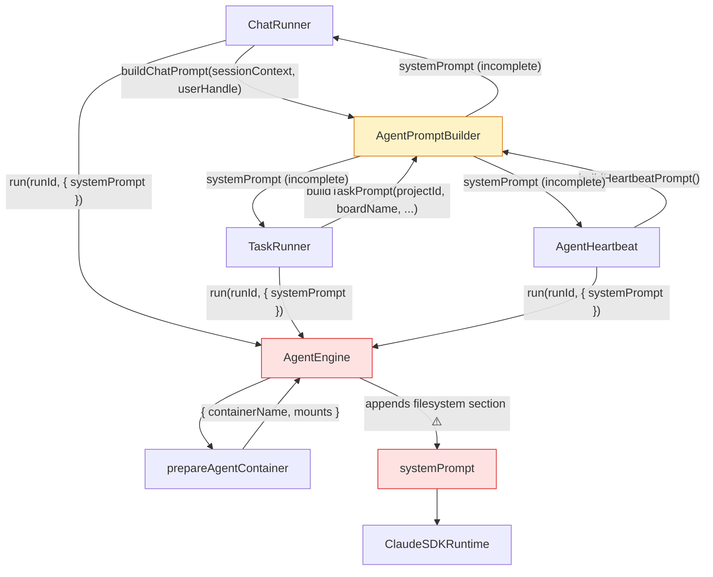
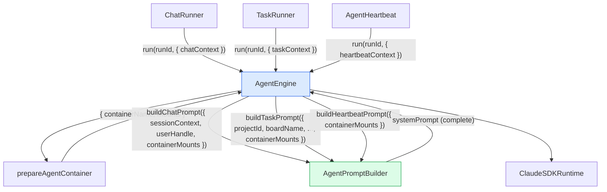

# ADR-0001: Agent Prompt Building Ownership

**Status:** Accepted

## Context

`AgentPromptBuilder` is documented as the single owner of all prompt assembly in the agent
runtime. In practice, callers (`ChatRunner`, `TaskRunner`, `AgentHeartbeat`) call it directly
and pass the resulting `systemPrompt` string to `AgentEngine.run()`.

This worked until container isolation required the prompt to include filesystem context
(which project and product directories are mounted). That information is only available inside
`AgentEngine`, after `prepareAgentContainer` runs. Because the prompt was already built by the
time the engine ran, the only way to include mount paths was to have `AgentEngine` append to
the prompt string itself — giving the engine partial ownership of prompt content.

The result: prompt content is split across two owners. The stated design principle is violated
and the split is invisible to anyone reading either file in isolation.

### Current flow



> ⚠️ Prompt content is split across two owners: `AgentPromptBuilder` builds the base,
> `AgentEngine` patches it. Neither has the full picture.

---

## Decision

Move the `AgentPromptBuilder` call inside `AgentEngine`, after `prepareAgentContainer`.

Callers pass typed context params instead of a pre-built prompt string:

```ts
// Before — caller builds the prompt
const { systemPrompt } = await new AgentPromptBuilder(agent).buildChatPrompt({ sessionContext, userHandle })
agentEngine.run(runId, { systemPrompt })

// After — caller passes context; engine builds the prompt
agentEngine.run(runId, { chatContext: { sessionContext, userHandle } })
```

`AgentEngine` calls the builder once it has the full picture:

```ts
const containerResult = await prepareAgentContainer(...)
const { systemPrompt } = await new AgentPromptBuilder(agent).buildChatPrompt({
  ...options.chatContext,
  containerMounts: containerResult?.mounts,
})
```

`AgentPromptBuilder` accepts an optional `containerMounts` param on each build method and
includes the filesystem section when mounts are present. No prompt content lives anywhere else.

### Proposed flow



> ✅ `AgentPromptBuilder` is called once with complete information. Single owner.
> Callers pass context params — they never touch the prompt string.

---

## Consequences

**Positive**
- `AgentPromptBuilder` is the sole owner of all prompt content — enforced by structure, not convention
- Prompts are always complete in one call; no post-assembly patching
- Adding new prompt content (e.g. a new context section) has one obvious place to do it
- Callers are simplified — they collect context params and hand them off; no prompt assembly logic

**Negative**
- `RunOptions` needs a typed context union (`chatContext | taskContext | heartbeatContext`) instead of a plain string — slightly more surface area
- `ChatRunner`, `TaskRunner`, and `AgentHeartbeat` each need a small change to stop calling the builder directly

**Neutral**
- The prompt preview feature (`buildChatSections`, `buildTaskSections`) is unaffected — it calls the builder directly and doesn't go through `AgentEngine`

---

## Alternatives Considered

**Append in AgentEngine (current state)**
Keep callers calling the builder; engine appends the filesystem section after. Rejected: violates
the single-owner principle and makes prompt content invisible inside `AgentPromptBuilder`.

**Static helper on AgentPromptBuilder**
Move `buildFilesystemSection` into the builder as a static function; engine calls it separately.
Rejected: the engine still decides what to append and when — two owners, just more explicit about it.

**Builder queries mounts from DB**
Give `AgentPromptBuilder` direct DB access so it can fetch memberships itself. Rejected: the
builder already has what it needs when called with `containerMounts`; having it re-query adds
a second DB round-trip and mixes IO concerns into a class that currently has none.

---

## Files Affected

- **`AgentEngine.ts`** — `RunOptions` replaces `systemPrompt?: string` with typed context params; prompt build call moves here after `prepareAgentContainer`
- **`AgentPromptBuilder.ts`** — build methods accept optional `containerMounts?: AgentMounts`; filesystem section built inside the builder
- **`ChatRunner.ts`** — stops calling `buildChatPrompt`; passes `chatContext` params instead
- **`TaskRunner.ts`** — stops calling `buildTaskPrompt`; passes `taskContext` params instead
- **`AgentHeartbeat.ts`** — stops calling `buildHeartbeatPrompt`; passes `heartbeatContext` instead
