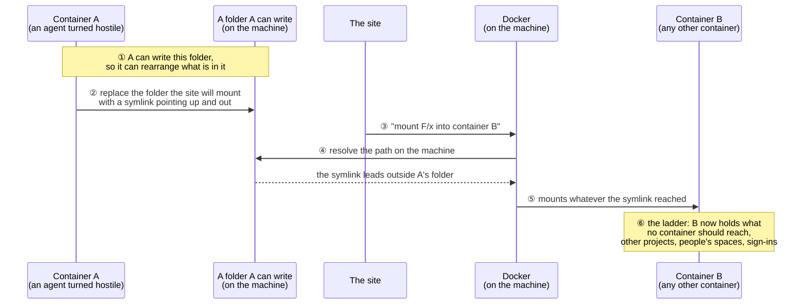
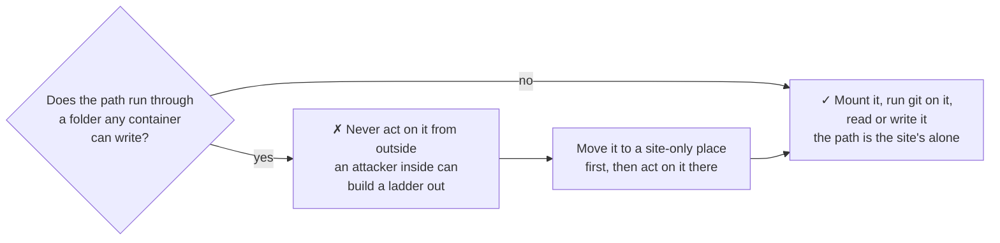

# ADR-0173: Nothing Outside a Container Acts on a Path a Container Can Change

**Date:** 2026-11-04
**Status:** Accepted

## Context

**A container is the thing we contain.** An agent works inside it, and whatever the agent runs, or is talked into
running by text it read, stays inside. The project is the security boundary (adr-0079): an agent turned hostile in a
project can reach everything in that project, and nothing outside it.

**Inside a container, a symlink can lead nowhere new.** A symbolic link (symlink) an agent makes in a mounted folder is
only ever followed inside a container, which sees only what was mounted into it.

**Outside a container, the same symlink leads anywhere.** Several things act on a project's folders from outside every
container, on the machine, where the whole site's disk is in reach:

- **Docker, mounting a folder.** The site gives Docker a *source path* on the machine. Docker resolves it there, one
  folder at a time, following any symlink on the way.
- **The site's own process**, reading and writing files, or running git on a repository.
- **Any integration** that touches a project's files from outside: today connecting a workspace to GitHub; later,
  development environments.

So if a path runs through a folder some container can write, an agent in that container can replace a folder on the
path with a symlink pointing up and out. Whatever acts on the path next, from outside, follows the symlink on the
machine: Docker mounts, git writes, or the site reads whatever it reached, such as other projects, people's personal
storage, or the harness homes that hold everyone's sign-ins. A check just before acting only narrows this: the agent can
swap the symlink in between the check and the act, and Docker and git have no option that refuses symlinks.

**The ladder, with Docker as the example:**

With git in Docker's place, step ⑤ is git writing a file into a folder outside the project, with the site's
permissions.

## Options considered

**Check the path for symlinks just before acting.** Rejected as the rule: another container can change the path
between the check and the act. It stays as a second line.

**Act only on whole boundaries, never on anything inside one.** Rejected: some things must be mounted on their own,
with other rights (a repository's `main`, read-only, adr-0168), or into other containers (the git helper, a live preview,
a workflow step), and the site must run git on repositories.

**Move anything acted on from outside to a place only the site can change, and act on it there.** Chosen.

## Decision

**Nothing outside a container acts on a path that runs through a folder any container can write.** That covers
Docker mounting, the site's own file work, git, and every integration.

- **A boundary's own folder, mounted whole** (`SITE_ROOT/projects/<id>`, `SITE_ROOT/users/<id>`, adr-0079), meets the
  rule as it is. Inside a container it is the mount point itself, which cannot be moved or replaced from inside, and
  its parent is in no container. Plain workspaces, the shared `files/`, tasks and branch copies live in it, shared and
  writable, and need nothing more.
- **A repository's main lives in the code space**, the site-only `SITE_ROOT/code/<boundary>/<workspace>/`, never in
  the boundary's folder. It is mounted read-only at the workspace's usual place in the boundary, into every container
  of that boundary; agents, people and HQ see it at the same path, with the same rights.
  - *Connecting a workspace to an existing repository* pulls it straight into the code space.
  - *Turning a workspace into a new repository* first copies its files from the boundary's folder into the code space,
    never following a symlink; that copy becomes the repository, and the push is made from it.
  - *Every git command the site runs itself* runs in the code space.
  - Becoming a repository, or ceasing to be one, changes each container's mounts in that boundary: each finishes its
    current runs and is recreated before its next run, as for any change of a container's mounts.
- **A boundary's `files/` backed up to GitHub is the one exception**: it is a backup, not a codebase, so it stays in
  the boundary's folder, shared and writable, with no branches and no read-only main. The site makes the first push
  from a copy: it copies `files/` into a site-only folder, never following a symlink, runs `git init`, commits and pushes
  there, then puts the finished `.git` into `files/` by the walk below. Afterwards the site itself never commits or
  pushes there; approved workflows do, from their own copy (adr-0147), and the site only reads the repository's state,
  never writing into `files/` by path.
- **What the site stages for a run lives in run staging**, the site-only `run-staging/`, one per runner per boundary,
  laid out like `homes/`: `run-staging/users/<person id>/<project id>/`, `run-staging/users/<person id>/personal/` and
  `run-staging/projects/<project id>/`. It holds what the site checks and hands to the runner's runs, which they may read
  but never change: the run's checked skills (`skills/`, which the harness loads) and each conversation's pinned memory
  (`pinned-memory/`). It is mounted read-only at `/run/staging/`, on the container's read-only root, never inside the
  writable harness home: otherwise a run could move the folder above it aside, and the harness would load a version of
  a skill the site never checked.
- **A container that works on part of a boundary** (the git helper, a live preview) is given the boundary's folder, or
  a folder in a site-only place, never a path below a boundary's folder. A symlink it meets inside then reaches only that
  boundary, which the project boundary already accepts.
- **When the site must read or write in a boundary's folder itself**, it walks down from the boundary's folder one
  folder at a time, opening each without following symlinks, and refuses a symlink on the way.

## What this binds

- Every new mount, every file operation the site makes in a boundary, every git command, and every integration that
  touches a boundary's files (development environments to come included) is checked against this rule when it is
  designed.
- Collaboration is unchanged: plain workspaces stay in the boundary's folder, shared and writable as adr-0079 says, and
  appear and go without restarting a container.
- Undoing it means accepting that one hostile agent in one project can reach every project and every person's sign-ins
  on its site.

## Consequences

- Two more site-only folders, `code/` and `run-staging/`, keyed like the rest by immutable ids.
- The site's disk layout, its container code and its git code are where the rule is enforced; `paths.ts` and
  `storage-and-placement.md` describe the layout.
