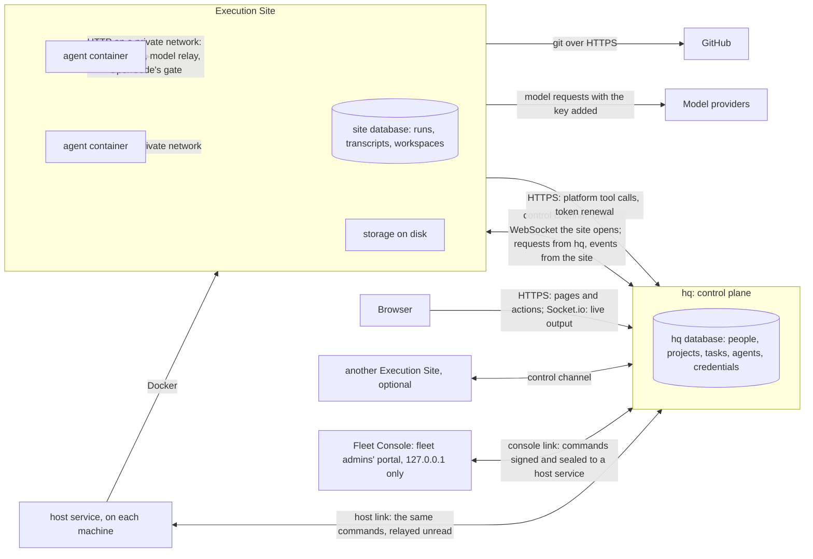
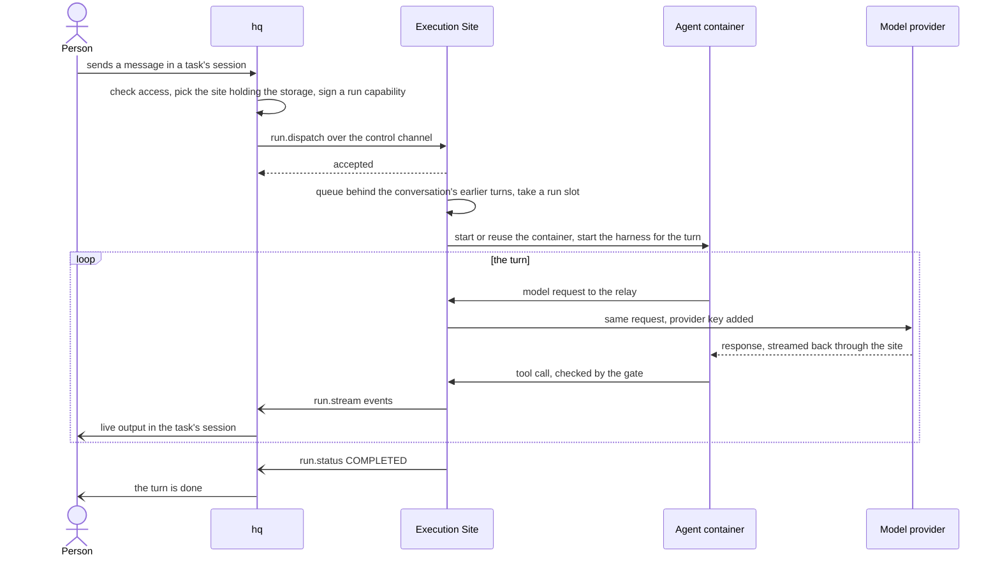

# Architecture

How Agenthix is built, as the code stands. Start here if you have just cloned the repository.

**Agenthix** is a platform for running AI agents for an organisation: people create agents, talk with them in
conversations and give them work in projects as tasks, and the agents do that work in sandboxed containers, with tools for
files, git, the web and the platform itself. The organisation runs all of it on its own machines.



**Two applications run the organisation's work, and two more look after the machines.**

- **hq** (`hq/`) is the control plane and the only thing a browser talks to. It holds the organisation's
  data (people, projects, boards and tasks, agent definitions, credentials, and the words of every conversation) and
  decides who may do what. It runs no agent harness and no container: the agent that talks in a conversation answers
  from hq by direct calls to a model provider, and everything it does as work, it sends to a site
  ([conversation-layer.md](conversation-layer.md)).
- An **Execution Site** (`site/`, often just *site*) runs agents. It holds the organisation's storage on
  its disk, starts a container for each run, and keeps each run's record: the run, its transcript, its
  tool calls. It has no users of its own and serves no web pages.
- The **host service** (`host/`) runs on every machine as the container `agenthix-host`, and is **the only authority over
  that machine**: it installs, upgrades, backs up, restores, moves and erases hq and the site there, holds the
  machine's capacity and keeps agents off the machine's own ports
  ([ADR-0107](../adr/adr-0107-the-host-service-alone-holds-a-machines-authority.md)). Its command line, `agenthix …`,
  is for whoever can use Docker on the machine.
- The **Fleet Console** (`console/`, its screens in `console-web/`) is the fleet admins' portal: a site of its own kind
  that dials out to hq, runs no agents, answers only on `127.0.0.1` of its own machine (bar the one port of remote access on
  a machine Agenthix Cloud runs), and signs every command it
  sends a host service, so hq passes it on but cannot read or make one
  ([ADR-0109](../adr/adr-0109-the-host-manager-is-a-site-that-signs-its-commands.md)). People sign in with their hq
  account, and only one holding the **fleet admin** role gets in.

Every install brings hq, one site and the Fleet Console to one machine; an organisation may add more sites, each on a
machine of its own, through the Fleet Console ([host-management.md](host-management.md)).
Each site dials out to hq; hq never connects to a site. Control messages cross that connection, bytes such
as file contents cross a second socket the site also opens, and the site calls hq's HTTPS endpoints for the
little it needs from hq ([control-channel.md](control-channel.md)). hq is the
organisation's own: one per organisation, self-hosted, and the single source of truth for its data
([ADR-0042](../adr/adr-0042-hq-is-the-orgs-own.md)).

Shared code lives in two packages: `core/` (`@agenthix/core`), the types and the protocols between every
program, and `ui/` (`@agenthix/ui`), the web components hq and the Fleet Console's screens render. No program imports
from another. hq is a [Wasp](https://wasp.sh) app (React, Node.js, Prisma, PostgreSQL) and the site a plain Node.js
server (Express, Prisma, PostgreSQL, [ADR-0086](../adr/adr-0086-the-execution-site-is-a-plain-node-server.md)); the
repository's `AGENTS.md` has the stack, the conventions and how to run them.

---

## Words used throughout

| Term | Meaning |
|---|---|
| **hq** | The control plane app. Written in lower case, as in the code |
| **Execution Site**, **site** | The app that runs agents and holds storage |
| **Control channel** | The WebSocket a site opens to hq, carrying requests from hq and events from the site |
| **Storage boundary**, **boundary** | One owner's storage: a project's, or one person's own. Nothing else owns storage |
| **Location** | A place inside a boundary a run works in: the owner's `files/`, a workspace, or a task's folder |
| **Workspace** | A named folder inside a boundary, optionally with a git repository attached |
| **Agent** | A definition held by hq: instructions, skills, model, tool permissions. It owns no storage and no authority |
| **Run** | One turn of work on a site: carrying out one brief a conversation gave a worker, one task run, or answering one message a person wrote in a task's session |
| **Session** | A harness session on a site: a task's series of runs, or a standing worker's. Its runs are ordered; nothing else is |
| **Conversation** | A person talking with an agent, held in hq: a record of messages, answered by the **lead** in direct model calls, with longer work done by **workers** and tasks. A **harness session** answers every message itself: a conversation's worker, and a task's session, which a person can also write in |
| **Lead**, **worker** | The lead is the agent as it talks in a conversation, in hq; a worker is the same agent working in one boundary, a harness session on that boundary's site, standing for the conversation |
| **Operation** | One piece of work a conversation commissioned (a brief, a task, a detached call), tracked from admission to its result |
| **Dispatch** | hq sending a run to a site |
| **Harness** | The vendor's agent program that runs the model loop and its tools: Claude Code or OpenCode |
| **Runner** | Who a container runs for: a person, or the project for work nobody is behind, such as a task in a project |
| **Harness home** | A runner's private folder on the site for the harness's own state: its session files and, for a Claude subscription, its login |
| **Package** | A versioned bundle hq holds and sends to a site by its digest: an agent's instructions and skills, the organisation's, the platform's |
| **Platform tools** | The tools Agenthix itself gives every agent (tasks, boards, memory, previews), served over MCP, the Model Context Protocol |
| **Run capability** | The token hq signs for one run, carrying what it may do |
| **Gate** | The site's check on every tool call an agent makes, against the agent's permissions |
| **Approval** | How an agent's calls that need a person's say-so are handled: `deferred` (carry on, decide after the run), `immediate` (explain and end the turn) or `bypassed` (not checked against the agent's permissions). Permissions are set at three levels, the strictest winning |
| **Model relay** | The site's endpoint that forwards a harness's model requests to the provider, adding the API key the container never holds |
| **Pulse** | hq code, not an agent run, that starts a boundary's queued tasks one at a time per agent. A boundary's automation switch, off by default, turns it and the boundary's schedules on |
| **Machine** | A computer or virtual machine running a host service. It carries at most one site, named after it |
| **Host service** | The one service on each machine that runs hq and the site there; the only authority over the machine |
| **Fleet Console** | The fleet admins' portal, which asks host services to act through commands hq relays unread |
| **Fleet admin**, **machine admin**, **organisation admin** | A fleet admin holds an hq account's fleet admin role and looks after the machines through the Fleet Console; a machine admin is whoever can use Docker on one machine; an organisation admin is hq's `ADMIN`, who looks after people, projects and agents |
| **Envelope** | A message between the Fleet Console and a host service, signed by its sender and sealed to its recipient, so hq can pass or drop it but not read or make it |
| **Scheduler** | The one in-process loop in hq that, at the top of every minute, starts every pulse and scheduled task that is due, and creates each routine's next round |

---

## A message to a harness session, end to end

Here a harness answers every message. It is how a worker's brief and a task run go on a site, and how a message a person writes in a task's session is answered; [the next section](#a-conversation-message-end-to-end) is a conversation held in hq.



1. hq checks the person may use that storage, works out which site holds it, and signs a **run
   capability**: a short-lived token saying exactly what this run may do.
2. It sends a **dispatch** to that site over the **control channel**. The site answers at once that it
   accepted the run.
3. The site queues the run behind earlier turns of the same conversation, then gets the **container** for
   that storage and person, and starts the agent's **harness** in it: the Claude Code CLI or OpenCode.
4. The harness calls the model through the site's **model relay**, which adds the provider key the
   container never sees, and calls tools, each decided by the site's **gate**.
5. Output streams to hq as events, and hq relays it to the browser. The transcript is stored on the site.

Tasks take the same path with a different start: hq's task state machine dispatches them, and they run as
the project rather than as a person (or as the person, in their personal project). What starts a task is
recorded on the dispatch as `startedBy`: a person, a boundary's pulse, a task's start time, or an agent that
called `run_task`. An agent has no schedule of its own; the **pulse** and the **scheduler** in hq
(`hq/src/automation/`) are the only things that start work automatically
([`container-runtime.md`](container-runtime.md#limits-and-slots) says what the site then limits).

---

## A conversation message, end to end

A message in a conversation is not a run. hq answers it, and starts a run only when the
agent starts work.

```mermaid
sequenceDiagram
    actor P as Person
    participant HQ as hq
    participant M as Model provider
    participant S as Execution Site
    P->>HQ: sends a message
    HQ->>HQ: store it, take the conversation's one-turn lock, find memory that matches
    HQ->>M: the conversation's context and the message, with the agent's tools
    M-->>HQ: reply streamed, tool calls
    HQ-)P: the reply as it streams
    HQ->>S: run.dispatch: a brief to the conversation's worker in a boundary
    HQ-)P: the reply ends; a work bar shows the work
    S-)HQ: run.status as the worker works
    S-)HQ: run.status COMPLETED
    HQ->>HQ: write the result as a card
    HQ->>M: one turn to present the result
    HQ-)P: the agent's report, and a notification
```

1. hq stores the message encrypted, in the conversation's record, and takes the conversation's **one-turn lock**; a
   message that arrives during a reply waits, durably, behind it.
2. It assembles the **lead's context**, adds the memory that matches by meaning, and calls the model provider itself with
   the agent's tools. Tools are hq's own operations, called in process with a capability made for this turn.
3. Quick tools answer within the turn. Work (a brief to a boundary, a task) is an **operation** and detaches at once: the
   reply says what was started and ends.
4. A brief goes to the conversation's **standing worker** on the site holding that boundary, as a dispatch exactly like a
   task run's. The worker is a harness run in a container; hq follows it through the same `run.status` events.
5. When the work ends, its result becomes a card, and the lead takes one more turn to tell the person.

[conversation-layer.md](conversation-layer.md) has the rest: the record, the lock, recovery, the model adapter, voice.

---

## The documents

**Read these four first, the fifth before changing anything about machines, and the sixth before changing a conversation.** Each answers one question a newcomer arrives with, and opens with a diagram.

| Document | Answers |
|---|---|
| [control-channel.md](control-channel.md) | How hq and a site connect, how a site takes part, how they pass work and read each other's data; how to add a method |
| [storage-and-placement.md](storage-and-placement.md) | Whose storage exists, where it is on disk, which site holds it, how a run is sent there |
| [container-runtime.md](container-runtime.md) | How a run gets a container and a harness, what it receives, what keeps it contained |
| [identity-and-trust.md](identity-and-trust.md) | Every credential: who issues it, who holds it, what it allows, how it is checked |
| [host-management.md](host-management.md) | The host service and the Fleet Console: adding a site, maintenance, backups and restoring, moves, a machine that stops answering, and Agenthix Cloud's controller on a machine Cloud runs |
| [conversation-layer.md](conversation-layer.md) | How a conversation is answered from hq: the record, the one-turn lock, the lead's context and tools, operations and workers, recovery, memory, voice |

**Then the detail behind them:**

| Document | Answers |
|---|---|
| [sites/agent-runtimes.md](sites/agent-runtimes.md) | How each harness is started, driven, kept warm and ended |
| [sites/model-relay.md](sites/model-relay.md) | How model requests reach a provider without the key entering the container |
| [sites/site_live_preview.md](sites/site_live_preview.md) | How a person views the web app an agent is building |
| [tools/tool-control.md](tools/tool-control.md) | The gate, permission states, the command sandbox, tool names |
| [tools/tool-manifest.md](tools/tool-manifest.md) | Approving tool calls that need a person's say-so |
| [tools/claude-tools.md](tools/claude-tools.md), [tools/opencode-tools.md](tools/opencode-tools.md) | Each harness's own tools, and which are shown, hidden or replaced |
| [mcp/tools.md](mcp/tools.md) | The platform tools an agent calls, and how they reach hq |
| [logs-and-diagnostics.md](logs-and-diagnostics.md) | Where each service's log is, how an admin reads a site's, recent errors, health and the support bundle |
| [cloud-connection.md](cloud-connection.md) | How hq connects to Agenthix Cloud, signing in to hq with an Agenthix account, and the email before planned downtime |
| [deployment.md](deployment.md) | What an install puts on a machine, how hq and the Fleet Console are reached, a front door, capacity, upgrading and backing up |
| [versioning.md](versioning.md) | The product version and each connection's protocol version: when two parts on different versions still talk, deprecating and removing something, the shape snapshot, stored formats. Read it before changing anything another part receives |

**Elsewhere:**

- [`docs/concepts/`](../concepts/README.md): the domain model, meaning what agents, projects, tasks,
  skills and memory are, as a person using the product meets them.
- [`docs/adr/`](../adr/README.md): the decision records. Each document here ends with the decisions that
  shaped it; read a record for *why*, and this folder for *how it is now*.
- `docs/qa/`: the QA contract and its scenarios.
- `docs/guide/`: the user guide. Its screenshots are captured from a sample organisation by the recipes in `hq/e2e/guide/` (see its `README.md`).

---

## Where things are in the code

| You want | Look in |
|---|---|
| What crosses between hq and a site | `core/src/protocol/` |
| hq's database | `hq/schema.prisma` |
| A site's database | `site/schema.prisma` |
| hq's routes, actions, queries and HTTP endpoints | each feature's `hq/src/<feature>/<feature>.wasp.ts`; the app settings and server-wide APIs in `hq/main.wasp.ts` |
| A site's HTTP endpoints (for its agents, plus a health check) | `site/src/server/app.ts` |
| Sending work to a site | `hq/src/agents/dispatchService.ts` |
| A conversation: its record, turns, workers, memory, voice | `hq/src/conversations/`, `hq/src/memory/` (see [conversation-layer.md](conversation-layer.md)) |
| The control channel, hq side | `hq/src/sites/channel/` |
| The control channel, site side | `site/src/server/hq/` |
| What starts work on its own: the pulse, the scheduler, routines | `hq/src/automation/` |
| Running a turn | `site/src/agents/runtime/` |
| The agent image and its sandbox launcher | `site/docker/` |
| Tokens and their checks | `hq/src/server/identity/`, `site/src/server/identity/` |
| Sign-in, invitations, the first-admin link and recovery | `hq/src/auth/`; first-time `/setup` in `hq/src/setup/`, `/onboarding` in `hq/src/onboarding/`; the install and the machine's commands are `host/` |
| Persistent notifications and a site's standing | `hq/src/notifications/`, `hq/src/sites/siteNotifications.ts`, `siteStanding.ts` |
| Logs, recent errors, health, the support bundle | `core/src/logging/`, `hq/src/diagnostics/`, `site/src/server/hq/diagnosticsMethods.ts` |
| Storage paths | `site/src/server/storage/paths.ts` |
| The host service and its command line | `host/src/`; its commands in `host/src/cli/commands.ts` |
| The Fleet Console's server, and its screens | `console/src/`, `console-web/src/` |
| What the host service, the Fleet Console and hq share: operations, envelopes, joins, figures | `core/src/host/` |
| hq's side of the fleet: the relay, the fleet admin role, moves, restores | `hq/src/fleet/` |
| hq's connection to Agenthix Cloud | `hq/src/cloud/`, `core/src/cloud/` (see [cloud-connection.md](cloud-connection.md)) |

## What must not break, anywhere

- **hq starts no harness and never touches a site's disk.** Agent work runs on a site, and everything crosses the control
  channel. What hq does itself is the lead's talking: direct model calls with its own operations as tools, never a
  process an agent controls.
- **hq holds no authority over machines.** A machine is acted on only by its host service, asked through its own
  command line or by the one controller it pinned — the Fleet Console, or on a machine Agenthix Cloud runs Cloud's
  own; hq relays a Fleet Console's commands and cannot read or make one.
- **Nothing dials a site, a host service or an agent.** Only hq listens on the network, and the Fleet Console on a
  machine Cloud runs listens on one more port while Cloud has remote access on, to the addresses Cloud allows.
- **A site holds no identities.** It verifies what hq signed.
- **Secrets stay out of agent containers.** A container holds only short-lived tokens the site can revoke,
  plus one exception: a Claude subscription's login, which Anthropic's terms keep with the client, in the
  runner's own harness home.
- **A run's authority is its boundary's**, never the union of everyone involved.
