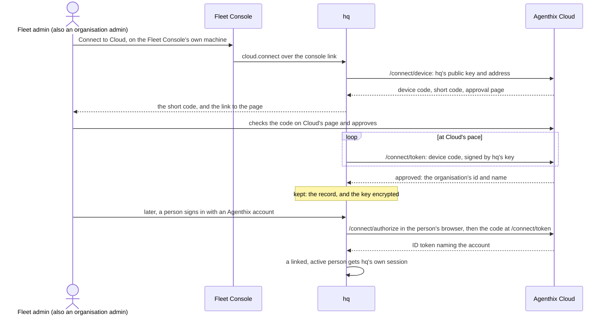

# hq's connection to Agenthix Cloud

How an organisation's hq connects to Agenthix Cloud, the hosted service from the makers of Agenthix, and what the
connection carries: signing in to hq with an Agenthix account, and an email to members before planned downtime.
The connection is **optional and outward**: hq works the same without it, hq makes every request, and Cloud never
dials hq ([ADR-0042](../adr/adr-0042-hq-is-the-orgs-own.md), [ADR-0134](../adr/adr-0134-an-hq-connects-to-cloud-by-device-approval-and-signed-tokens.md) ·
[ADR-0135](../adr/adr-0135-cloud-connects-an-hq-it-runs-without-a-code.md)).
A machine that Cloud runs has a separate, older relationship with Cloud, its controller
([host-management.md](host-management.md#agenthix-clouds-controller)); the two do not depend on each other.

Everything below is in `hq/src/cloud/`, on contracts both sides share in `core/src/cloud/` (`@agenthix/core`, with the
signing and verifying in `@agenthix/core/cloud-crypto`). The protocol is built from standards, not a scheme of its own:

| Part | Standard |
|---|---|
| Approving a connection on Cloud's page | OAuth 2.0 Device Authorization Grant (RFC 8628) |
| Authenticating hq to Cloud, every request | A JWT signed with hq's key (RFC 7523, `private_key_jwt`) |
| Disconnecting | A signed revocation request, in the manner of RFC 7009 |
| hq's client id | The thumbprint of its public key (RFC 7638) |
| Signing in with an account | OpenID Connect's authorization code flow with PKCE (`S256`), the scope `openid` alone |
| Where a sign-in comes back to | One redirect URI registered per client and matched exactly (RFC 9700 §2.1) |

Cloud's address is `CLOUD_URL` in hq's environment, and Cloud's own address when it is not set. It must be
https (plain http only to the machine itself), and hq refuses an approval page that is not on that origin.

---

## Connecting and disconnecting

- **Only from the Fleet Console's own machine, by a fleet admin who is also an organisation admin**, since the
  connection is the organisation's. A session that arrived through remote access is refused before hq is asked. The
  screen is *Connect to Cloud* on HQ's page; the console asks hq through its link (`cloud.state`, `cloud.connect`,
  `cloud.disconnect`; `console/src/http/routes/cloud.ts`, `hq/src/cloud/index.ts`). From hq's machine,
  `agenthix cloud connect|disconnect` asks the same of hq over its control socket (`cloud-connection`,
  `hq/src/cloud/machineCommands.ts`), recorded as made by the machine admin.
- **On a machine Agenthix Cloud runs, Cloud connects hq itself, with no code** (ADR-0135). The host service tells hq
  that Cloud runs its machine (`HQ_RUN_BY_CLOUD`, written into hq's services). Cloud's controller then asks, through
  the host service and hq's control socket, for hq's key and address (`organisation.key`; hq makes the key as for
  *Connect*), registers both for the organisation it runs hq for, and asks hq to connect (`organisation.connect`): hq signs for a token with
  the key and keeps the connection only once Cloud gives one. The Fleet Console shows *HQ on Agenthix Cloud* and has
  no *Disconnect* there (hq refuses it too); while not yet connected it offers *Connect* in one line, as the way back.
- **The request waits in hq's memory** for the approval, which Cloud gives at most 30 minutes; hq polls at Cloud's
  interval (5 seconds unless told, and 5 more for each `slow_down`) and the screen reads the state every 3 seconds.
  A restart of hq drops a waiting request, and the admin asks again. Refused, expired and failed requests are shown and
  can be started again.
- **What hq keeps** (`cloudStores.ts`): one row, `CloudConnection` (Cloud's id and name for the organisation, hq's
  client id, when it connected), and the private key, an Ed25519 key made at the first *Connect*, as a
  `SiteSecret` encrypted with AES-GCM under `SECRETS_MASTER_KEY`. It never leaves hq and is in no request. A new
  connection makes a new key, so a revoked key is never offered again.
- **hq's address is registered with the connection** (`core/src/cloud/hqAddress.ts`): it goes in the connection
  request, or with the key on a machine Cloud runs, in one form both sides compare (origin and path, no trailing slash,
  no query). Cloud sends a sign-in back to that address with `/login/cloud` and nowhere else. At a check-in, hq tells
  Cloud its address whenever it is not the one it last gave in that process, a signed request to `/connect/address`,
  so each start tells Cloud once and a restart with a new `HQ_URL` moves sign-ins with it. An address hq cannot
  register (not http or https, or with a query) stops *Connect* before Cloud is asked.
- **Every request to Cloud's token, revoke and address endpoints is signed**, polling included, with a 60-second assertion
  hq makes for that request alone, so someone who sees a device code cannot finish the connection with it. Cloud
  answers with access tokens of an hour at most; hq keeps each in memory until a minute before it lapses and never
  stores one.
- **While connected, hq checks in with Cloud at least hourly**: whenever 55 minutes pass without a token signed for,
  it signs for one, and at start-up a stored connection does so at once. Cloud reads each token request as hq being
  alive, so it can tell an hq that stopped from one that is quiet, and an hq that Cloud disconnected learns it within
  the hour from `invalid_client`. Cloud away at a check-in leaves the connection as it is, and hq tries again in five
  minutes.
- **Cloud answering `429`** ("too many requests") to any call means hq asks it nothing until `Retry-After` has passed
  (seconds or an HTTP date; a minute when it says neither; never more than an hour), `cloudClient.ts`. Every error
  Cloud answers, and the status it goes with, is declared in `core/src/cloud/answers.ts`. An admin
  asking to connect is told *Agenthix Cloud is busy — try again in N minutes*; a request waiting on approval polls
  again once the wait is over.
- **The protocol has a version, 1.0** (`CLOUD_PROTOCOL_VERSION`, `core/src/cloud/version.ts`), under the rule every
  connection follows ([control-channel.md](control-channel.md#protocol-versions)): the two sides work together while their
  majors are at most one apart. Every call hq makes states it in `X-Cloud-Protocol-Version`, with
  `User-Agent: hq/<release>`, and Cloud states its own on every answer. Cloud refuses a call that states no version,
  an unreadable one, or one two majors or more from its own, with `426` and its own version; hq reads an answer
  without the header as 1.0. A Cloud two majors or more ahead, or a `426`, stops hq calling it (`cloudClient.ts`):
  each call then fails at once with words naming the side that must upgrade (*… upgrade this HQ*), and hq's log says
  it once. When hq is the one behind, that lasts until hq restarts, since only upgrading it can help; otherwise hq
  asks again after the 55 minutes of a check-in. The connection itself is kept, and a request waiting on approval ends
  as failed. The browser's visit to Cloud's sign-in page carries no version: it is not a call of hq's, and the code
  exchange that finishes it is.
- **Disconnecting** tells the people who signed in with Cloud (below), revokes the key at Cloud, then forgets the record,
  the key and any token, whether or not Cloud answered. Cloud answers `revoked` also for a key it no longer holds, so
  revoking is safe to repeat. **Cloud ending it from its side** is learned from
  `invalid_client`; hq forgets the same way and records the disconnect. Connecting and disconnecting are recorded in hq
  and announced to every admin (`cloud.connected`, `cloud.disconnected`).
- The approval page shows the short code hq is waiting on. Any fleet admin can see that code while it waits, so the
  admin approving must be the one who asked: whoever approves it connects hq to *their* Cloud organisation, and the
  screen then says whose ("Connected as …"), where an organisation admin can disconnect.

## Signing in with an Agenthix account

- **Linking** is in Settings › Sign-in. A person already signed in to hq confirms their password again (held to the
  limit that changing a password has), goes to Cloud, and comes back as an account; hq keeps that account's issuer and
  subject, unique together, in `CloudAccountLink`, and nothing else. A person has one link, and one account links to
  one person.
- **Signing in** (`/login/cloud`, `cloudSignIn.ts`). hq sends the browser to Cloud's `/connect/authorize` with
  `state`, a `nonce` and a PKCE challenge; Cloud sends it back with a code, only to the redirect URI registered for
  hq (any other shows an error page on Cloud), and hq exchanges the code at the token
  endpoint with its verifier and a signed assertion. A person who is linked and still active gets hq's own session,
  as a password sign-in gives; anyone else is refused in words that say to link from Settings first. **Nothing here
  makes an account**, and a password always works, so a Cloud that is away locks no one out.
- **Login CSRF.** hq keeps no cookies, so `state` alone cannot tie a return to the browser that left. Each sign-in
  also has a **browser binding**: a secret given to the tab that started it and kept in its session storage, which the
  return must present. hq keeps only its hash, compares it in constant time, takes a flow once, and lets it lapse after
  10 minutes; at most 1000 flows wait at once (`signInFlows.ts`). The unauthenticated start and finish are limited per
  address.
- **The ID token** comes straight from the token endpoint over TLS, to an authenticated client, so hq checks its
  issuer (Cloud's origin, exactly), audience (its own client id), `azp`, nonce, expiry and age, and refuses `alg: none`,
  and does not check a signature (OpenID Connect Core §3.1.3.7, item 6). It needs only the subject; no claim naming
  another organisation is read.
- **The links stay** when hq disconnects and work again when it reconnects to the same issuer; Settings says so.
  Erasing a person deletes their link. At disconnect every active linked person is told, as a notification, that signing
  in with Cloud stops, that they stay signed in, and to use their username and password or ask an admin for a reset
  link (`tellLinkedPeopleSignInEnds`).

## The email before planned downtime

hq keeps no email service. When a scheduled change is booked or moved ([host-management.md](host-management.md#maintenance-changes-now-or-at-a-set-time)),
hq posts a notice to Cloud with an access token it signed for (`downtimeEmail.ts`); Cloud emails the named accounts the
day before, and answers that it took it. The notice names the linked accounts of the active members the change affects,
the kind of change (one of the host service's scheduled-change kinds; a change of any other kind sends nothing), its time,
its expected length and whether it affects hq or a site, and no site, project or person names. The same notice id
replaces the last, and a cancelled change withdraws it. With nobody linked, or no connection, nothing is read and
nothing is asked.

## The pledge, for a linked person

HQ asks Cloud whether a person with a linked Agenthix account has signed the Responsible AI Pledge, so the card on Home
fits them and Settings shows them their own signature (`core/src/cloud/pledge.ts`, `hq/src/cloud/pledgeStatus.ts`,
`hq/src/home/pledge.ts`). It posts the link's `sub` with a bearer access token; Cloud answers only for an account linked
to that hq. HQ keeps the answer an hour, shows it to that person alone, and asks nothing for anyone without a link.

## What the Fleet Console shows

`GET /api/cloud` is hq's `cloud.state`: the connection, a waiting request, how the last one ended, whether Cloud runs
hq, and Cloud's address for the links out (null when `CLOUD_URL` is not usable); `CloudView` in
`core/src/host/cloud.ts` declares every field. Two more facts come from hq's own records, and neither calls Cloud: how many active people asked to
sign in with Cloud, and which of Cloud's offers the signed-in fleet admin dismissed, for good, one by one
(`platformFacts.ts`; `CloudSignInAsk`, `OfferDismissal`).

## Where it is in the code

| You want | Look in |
|---|---|
| The contracts: paths, bounds, parsers for both sides | `core/src/cloud/connection.ts`, `hqAddress.ts`, `answers.ts`, `signIn.ts`, `hqState.ts`, `version.ts` |
| The fields of Cloud's operations that hq answers, checked the same by the host service and hq | `core/src/host/cloudOperations.ts` (`parseHqCloudRequest`) |
| Signing, verifying, PKCE | `core/src/cloud/crypto/` (`@agenthix/core/cloud-crypto`) |
| The protocol's version, and the check each side makes | `core/src/cloud/version.ts` |
| hq's connection, tokens and calls to Cloud | `hq/src/cloud/cloudConnection.ts`, `cloudClient.ts` |
| Sign-in, links and the downtime email | `hq/src/cloud/cloudSignIn.ts`, `cloudAccounts.ts`, `downtimeEmail.ts`; the screens in `hq/src/auth/pages/` and `hq/src/settings/pages/` |
| The Fleet Console's part | `console/src/http/routes/cloud.ts`, `cloudPlatform.ts`; `console-web/src/cloud/` |

## What must not break

- **hq makes every request.** Nothing dials hq from Cloud.
- **The connection key never leaves hq**, is never in a log or a request, and is destroyed when the connection ends.
- **Connecting and disconnecting are done on the Fleet Console's own machine**, never through remote access, or by
  Cloud on a machine it runs, through the host service; nothing dials hq for it.
- **An Agenthix account never makes an hq account**, and never replaces a password.
- **A sign-in comes back only to the address hq registered**, never to one a request names.
- **Nothing is asked of Cloud while hq is not connected.**

## Decisions behind this

[ADR-0042](../adr/adr-0042-hq-is-the-orgs-own.md) ·
[ADR-0130](../adr/adr-0130-cloud-features-are-gated-by-their-own-conditions.md) ·
[ADR-0134](../adr/adr-0134-an-hq-connects-to-cloud-by-device-approval-and-signed-tokens.md)
