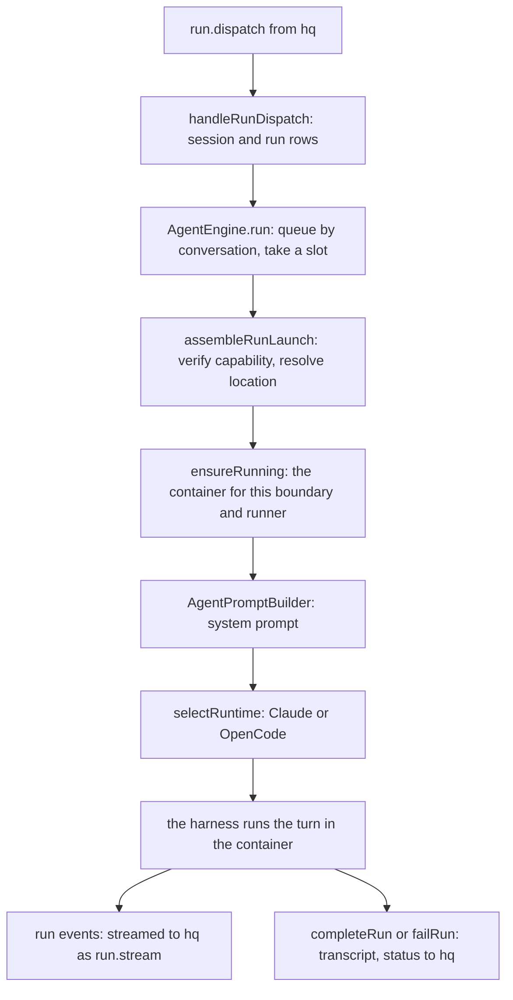
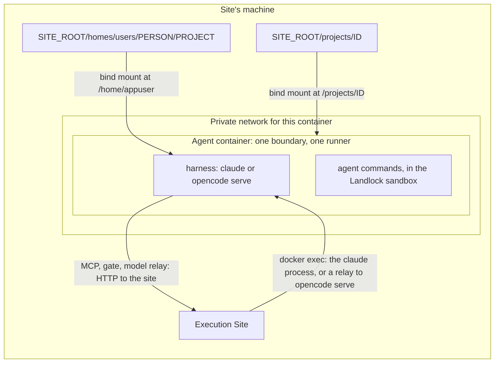

# The Container Runtime

How an Execution Site turns a dispatched run into an agent's turn: which container the run gets, which
harness runs it there, what keeps the agent's commands contained, and how its model requests reach a
provider. This is the overview; the three documents it points to hold the detail.

A **harness** is the vendor's own agent program, the thing that runs the model loop and its tools: the
Claude Code CLI or OpenCode. Agenthix does not implement an agent loop itself; it prepares a container,
starts the right harness in it, gates each tool call, and records what happened.

---

## The words used here

- A **run** is one turn of work: one chat message answered, one brief a conversation gave a worker, one task run.
  It is an `AgentRun` row in the site's database (`site/schema.prisma`). A conversation's own replies
  ([conversation-layer.md](conversation-layer.md)) are not runs: hq answers them without a container.
- A **session** is a chat's, a task's or a conversation's standing worker's `AgentSession` row; its runs are its
  turns. hq holds a copy of the session row for ownership and privacy questions; the site writes its runtime fields.
- A **runner** is who a container runs for: a person, or the project itself for work nobody is behind,
  such as a task in a project ([ADR-0074](../adr/adr-0074-a-container-is-keyed-on-its-boundary-and-its-runner.md)).
  The runner records who is running; it grants nothing
  ([identity-and-trust.md](identity-and-trust.md#the-runner-claim)).
- A **run capability** is the token hq signs for each run, saying what it may do: its agent, its storage,
  its tool permissions. The site checks it and keeps it; the container never sees it
  ([identity-and-trust.md](identity-and-trust.md#the-run-capability)).
- A **storage boundary** is one owner's storage, a project's or a person's
  ([storage-and-placement.md](storage-and-placement.md)).
- A **harness home** is the runner's private folder for the harness's own state: its session files and,
  for a Claude subscription, its login. It is outside storage, under `<SITE_ROOT>/homes/`.

---

## The path of a run

Follow one chat message, or a worker's brief, on the site. Every step names the function to open.

1. **Accepted.** `handleRunDispatch` (`site/src/server/runtime/dispatchHandler.ts`) validates the
   parameters, creates or reuses the session row from hq's seed, and hands the run to `runChat`
   or `runTask` (`chatExecution.ts`, `taskExecution.ts`). Each
   creates a `PENDING` run row and starts the engine without waiting; the dispatch is answered at once
   ([control-channel.md](control-channel.md#dispatch-how-work-reaches-a-site)).
2. **Queued.** `AgentEngine.run` (`site/src/agents/runtime/AgentEngine.ts`) puts the run in a queue keyed
   by its conversation, then waits for a slot: the site runs at most a fixed number of runs at once
   (below). A run that has to wait for one tells hq so (`run.waiting`).
3. **Launched.** `assembleRunLaunch` (`site/src/agents/runtime/runLaunch.ts`), in order: verifies the run
   capability hq signed and checks its runner fits the storage; marks the run `RUNNING`; resolves the
   agent, its packages and the primary location; refuses a Claude run with no credential, saying why;
   picks the runtime; prepares the container; checks a resumed conversation still exists in its harness;
   builds the system prompt (`site/src/agents/AgentPromptBuilder.ts`); and issues the opaque tokens the
   container will use to reach the site.
4. **Run.** The chosen runtime runs the turn in the container, while the run's limits are watched
   (`runLimitWatch.ts`, below). Its events (text, tool calls, results) are
   consumed by `consumeRunEvents` (`runEventLoop.ts`) and streamed to hq as `run.stream`
   (`SiteStreamEmitter.ts`). While the turn runs, the capability is renewed before it expires
   (`capabilityRenewal.ts`).
5. **Ended.** `completeRun` (`runCompletion.ts`) writes the transcript and tool-call rows, records the
   outcome, model and token usage on the run, adds the tokens to the session's totals, and sends the final
   `run.status`. The transcript is the conversation's whole record, kept on the site: besides messages and tool
   lines, each row names its run, and the agent's thinking, a failed or stopped run, an approval asked and the
   runtime summarising its memory are rows of their own (`runPersistence.ts`, `TRANSCRIPT_ENTRY_KINDS` in
   `core/src/protocol/transcript.ts`). A failure goes through `failRun` (`runFailure.ts`). Either way the gate stops answering
   for the run and its tokens are revoked (`runCleanup.ts`).

**After a site restart**, any run left `PENDING` or `RUNNING` is marked failed, "Server restarted — run
was orphaned", and its status is sent once the channel is back (`site/src/server/runtime/bootSweep.ts`).

---

## Containers

`AgentContainerManager` (`site/src/agents/runtime/AgentContainerManager.ts`) owns every agent container.

**One container per boundary and runner.** A container is keyed on the storage boundary it mounts and on
its runner, plus whether its mount is writable (`ContainerKey`, `containerTypes.ts`). In a project with two
members there are up to three containers: one for each member's chats, and one for the project's own runs
(and a separate one for any of them whose run may only read).
In a person's own storage there is only that person. The runner is read from hq's **signed** capability,
never from the dispatch payload, because it decides whose harness home is mounted. The name records the
key (`containerNameFor`, `containerLabels.ts`), for example `agenthix-dev-agent-project-<id>-user-<id>-rw`.

**Lifetime.**

- **Created** by the first run that needs it (`ensureRunning`), and **reused** by every later run with the
  same key. A container is never rebound to other storage; a changed mount means a new container.
- **Removed when idle**: a sweep every minute removes containers with no run, no live preview and no
  activity for `AGENT_CONTAINER_IDLE_MINUTES` (30 by default) (`containerLifecycle.ts`). This is the
  backstop for everything a conversation leaves running.
- **At site start**, containers for storage that no longer exists are removed.

**What the container is given** (`buildContainerRunCommand`, `containerRunArgs.ts`):

| | |
|---|---|
| Image | `agenthix-agent`, built from `site/docker/agent.Dockerfile`: Node, git, ripgrep, the pinned Claude Code and OpenCode versions, the git credential helper and the Landlock launcher. Its user is `appuser` (uid 1001) |
| Storage | One bind mount: the whole boundary, at `/projects/<id>` or `/users/<id>`, writable only if the run's tools can write ([storage-and-placement.md](storage-and-placement.md#how-a-run-sees-storage)) |
| Harness home | The runner's harness home, bound at `/home/appuser`; the skills staged for a turn are bound again read-only inside it |
| Commands' home | `/home/agent`, which lives only in the container; agent commands run with it as `HOME` and cannot reach `/home/appuser` |
| Network | A private Docker network of its own, whose only other member is the site ([ADR-0066](../adr/adr-0066-a-site-reaches-its-agents-over-a-private-network-per-boundary.md); `containerNetwork.ts`) |
| Limits | The host service's ceilings for the machine, read from its figures socket (`site/src/server/host/hostFigures.ts`): 8 GB, 2 processors and 4096 processes per container unless set otherwise. `AGENT_CONTAINER_MEMORY`, `AGENT_CONTAINER_PIDS_LIMIT` and `AGENT_CONTAINER_CPUS` may only narrow them, and are the limits themselves where no host service runs the site (`containerLimits.ts`) |
| The machine | Unreachable from the container: the host service's firewall rules shut the machine's own ports, ports other containers publish and the cloud metadata addresses, and a site the host service runs starts no container until they hold ([host-management.md](host-management.md#the-host-service)) |
| Process 1 | `docker run --init`, so killed processes are reaped |
| Secrets | No provider API key, no capability and no long-lived git credential. A harness gets only short-lived tokens the site can revoke (its platform token, which the git credential helper also uses, and its relay token), and for a Claude subscription, the login in its harness home |

**Without container isolation.** Containers are used only when `AGENT_CONTAINER_ISOLATION=true` (the
example environment files set it). Without it, a Claude run is a child process of the site, with the API
key in its environment and no model relay, and an OpenCode run fails. It exists for development; the compose
project the host service writes for a site sets it (`host/src/compose/projects.ts`).

---

## Order and concurrency

**Only a conversation's turns are ordered**
([ADR-0075](../adr/adr-0075-work-in-a-boundary-runs-in-parallel-only-a-conversation-is-ordered.md)).
A harness's session has one writer, so a conversation's turns queue behind each other; every other pair of
runs, including two people in one project or one person's two conversations in one container, runs at
once. `runQueueKey.ts` is the whole rule, and the queue is `KeyedAsyncQueue` (`runQueue.ts`).

The machine is protected, not ordered: at most the host service's *containers at once* runs (5 by default, see
[capacity](deployment.md#capacity); `AGENT_MAX_CONCURRENT_RUNS` may narrow it) hold a slot
at once (`GlobalSlots`, `AgentEngine.ts`), and each container has its limits. The platform takes no locks on
shared storage; conflicting edits are possible and accepted, and people and agents see what else is running
in a boundary instead (`list_active_runs`).

hq adds one rule of its own for tasks: one task per agent per project runs at a time, and the next starts
when it ends (`hq/src/agents/TaskRunner.ts`). Who starts those tasks is hq's pulse and scheduler, not the site
(`hq/src/automation/`). The three limits, in the order a run meets them:

| Limit | Where | What it holds back |
|---|---|---|
| One running task per agent per project | hq, `TaskRunner` | A task, before it is dispatched; it stays queued and says its agent is busy |
| One turn at a time per conversation | site, `runQueueKey.ts` | A run behind the conversation's earlier turn |
| At most `AGENT_MAX_CONCURRENT_RUNS` runs at once | site, `GlobalSlots` | Any run, after its conversation's queue |

A run that finds the site at its limit sends hq a one-way `run.waiting` event (`waiting: true`), and sends
`waiting: false` when a slot frees. hq shows the task as running and says it is waiting for a slot; it could not
otherwise tell, because the wait happens before the run's `RUNNING` status. 
Chats are not limited by the first; tasks and chats share the other two.

### Limits and slots

Every run is also stopped by **run limits**, which hq decides and the site enforces, so they hold when hq
restarts. The dispatch carries them as `runLimits` (`core/src/protocol/runLimits.ts`):

| Limit | Applies to | Default |
|---|---|---|
| Time limit, `timeLimitMinutes` | Every run. It counts from when the run starts working, not while it waits for a slot | 60 minutes |
| Turn limit, `turnLimit` | Only a run no person started: the dispatch's `startedBy` is `pulse`, `schedule` or `agent`, not `person` | 100 turns |

The org sets the values and a project, or a person for their own space, may only make them stricter; hq sends the
stricter of the two (`effectiveRunLimits`). A turn is one round trip with the model: the Claude runtime counts
each distinct model response, OpenCode each step it finishes (`runLimitWatch.ts`). A run stopped by a limit ends
with an error that begins "Run limit reached" and names the limit, and hq blocks the task with that reason
instead of retrying it.

---

## What a run receives

All of it arrives in the dispatch, built by hq (`buildContext`, `hq/src/agents/runContext.ts`); the site
adds what only it can know.

| Item | From | Notes |
|---|---|---|
| Agent configuration and packages | hq | Its instructions, skills and settings, as packages delivered by digest ([ADR-0072](../adr/adr-0072-an-agent-is-defined-once-in-hq-and-overridden-per-boundary.md)) |
| System prompt | built on the site | `AgentPromptBuilder` (`site/src/agents/AgentPromptBuilder.ts`), from the packages, the boundary's overrides, the mounted folders, the person's agenda and a memory section that says how to recall. See [the prompt builder concept](../concepts/agents/prompt_builder.md) |
| Skills | staged on the site per turn | From five sources, under namespaced names ([ADR-0084](../adr/adr-0084-an-agents-skills-are-staged-by-agenthix-per-turn.md); [the skills concept](../concepts/skills/skills.md)) |
| What it may do | the signed capability | Tool permissions, already narrowed by the boundary's override and the workspace's guardrail |
| The run's provider | hq, per run | A provider descriptor for the provider of the model hq's resolver chose: the organisation's key for it, or in a person's own place their own Claude subscription ([model-resolution.md](model-resolution.md), [identity-and-trust.md](identity-and-trust.md#model-credentials)). Kept on the site for the run; see the model relay below |
| The person's timezone | hq | The IANA zone of the person the run is on behalf of (`context.person.timezone`). The site adds the current local time in it to the prompt, so an agent reads "tomorrow at 9" on the person's clock. Absent when the person has set none |
| Pinned memory | hq | The pinned items the run's person and agent may read, written by the site into the run's home as a read-only file at every run start; the rest is asked of hq with `recall` ([memory](../concepts/memory/memory.md)). Sent only while conversations are on |
| Platform tools | the site's `/mcp` | Reached with an opaque token; see [mcp/tools.md](mcp/tools.md) |
| Git | the site's git credential endpoint | Through the credential helper in the image; see [identity-and-trust.md](identity-and-trust.md#git) |

---

## Harness, sandbox and model relay

Each has its own document; this is what each one is for.

- **The harness** ([sites/agent-runtimes.md](sites/agent-runtimes.md)). Two runtimes implement one
  interface, `AgentRuntime` (`site/src/agents/runtime/types.ts`): `ClaudeSDKRuntime` keeps one `claude`
  process per conversation, started with `docker exec`; `OpenCodeRuntime` keeps one `opencode serve` per
  container, shared by its conversations. A conversation keeps the runtime it started with
  ([ADR-0078](../adr/adr-0078-a-conversation-keeps-the-runtime-it-started-with.md)). Both stay running
  between a conversation's turns and are released when it goes idle
  (`AGENT_SESSION_IDLE_MINUTES`, 30 by default) or ends, taking every process the conversation started
  with them ([ADR-0083](../adr/adr-0083-a-process-belongs-to-the-conversation-that-started-it.md)).
- **The gate and the sandbox** ([tools/tool-control.md](tools/tool-control.md)). Every tool call, on
  either harness, is decided by one function on the site, `decideToolCall` (`toolGate.ts`), against the
  agent's permissions. Every command the agent runs goes through `agenthix-contain`, a launcher in the
  image that strips the harness's secrets and sandboxes the command with Landlock, a Linux feature by
  which a process restricts itself and everything it starts. Agenthix needs version 6 of Landlock's kernel
  interface, which first shipped in Linux 6.12, because that version also confines signals; on an older
  kernel no harness starts.
- **The model relay** ([sites/model-relay.md](sites/model-relay.md)). Provider API keys never enter a
  container. A harness sends its model requests to the site's relay, `/api/v1/model-relay/<provider>`, with
  a relay token valid only from its container and only during its turn, and the site adds the real key.
  A Claude subscription is the exception: Anthropic's terms keep its login with the client, so it is
  written into the runner's harness home.

---

## Conversations that cannot continue

A conversation is **closed** when it can never take another turn: its harness's own session state is gone
([ADR-0076](../adr/adr-0076-a-conversation-whose-harness-state-is-gone-is-closed.md)), its person left
the project or the organisation, or its project was deleted (`SessionClosedReason`). Before resuming a
conversation the site asks the harness whether it still holds it (`sessionExistenceCheck.ts`); if not, the
conversation is closed and the person is told, rather than silently starting a fresh one under the same
id. The history stays readable.

---

## Key files

| File | Role |
|---|---|
| `site/src/server/runtime/dispatchHandler.ts`, `chatExecution.ts`, `taskExecution.ts` | Receiving a dispatch, creating the run |
| `site/src/agents/runtime/AgentEngine.ts`, `runQueue.ts`, `runQueueKey.ts` | Queueing, slots, the run's lifecycle |
| `site/src/agents/runtime/runLimitWatch.ts` | The time and turn limits |
| `site/src/agents/runtime/runLaunch.ts` | Everything a run needs before its turn |
| `site/src/agents/runtime/AgentContainerManager.ts`, `containerLifecycle.ts`, `containerRunArgs.ts`, `containerNetwork.ts`, `containerLimits.ts` | Containers |
| `site/src/agents/runtime/harnessHomes.ts` | Harness homes |
| `site/src/agents/runtime/runCompletion.ts`, `runFailure.ts`, `runCleanup.ts` | Ending a run |
| `site/src/server/runtime/bootSweep.ts` | Runs orphaned by a restart |
| `site/docker/agent.Dockerfile` | The agent image |

## What must not break

- **A container mounts one boundary, and its runner comes from the signed capability.**
- **No provider key, capability or long-lived git credential in a container.** The container holds only
  opaque tokens the site can revoke.
- **No harness starts where commands cannot be contained**: without Landlock version 6, no run.
- **Only a conversation is ordered.** Adding a lock between runs in a boundary undoes ADR-0075.
- **A resumed conversation that its harness has lost is closed, never restarted silently.**

## Decisions behind this

[ADR-0066](../adr/adr-0066-a-site-reaches-its-agents-over-a-private-network-per-boundary.md) ·
[ADR-0073](../adr/adr-0073-claude-keeps-its-own-runtime-opencode-replaces-nativeruntime.md) ·
[ADR-0074](../adr/adr-0074-a-container-is-keyed-on-its-boundary-and-its-runner.md) ·
[ADR-0075](../adr/adr-0075-work-in-a-boundary-runs-in-parallel-only-a-conversation-is-ordered.md) ·
[ADR-0076](../adr/adr-0076-a-conversation-whose-harness-state-is-gone-is-closed.md) ·
[ADR-0078](../adr/adr-0078-a-conversation-keeps-the-runtime-it-started-with.md) ·
[ADR-0081](../adr/adr-0081-a-harness-runs-the-way-its-vendor-intends.md) ·
[ADR-0083](../adr/adr-0083-a-process-belongs-to-the-conversation-that-started-it.md) ·
[ADR-0084](../adr/adr-0084-an-agents-skills-are-staged-by-agenthix-per-turn.md) ·
[ADR-0085](../adr/adr-0085-agenthix-owns-a-harness-file-tools-where-it-can-be-a-confused-deputy.md)
