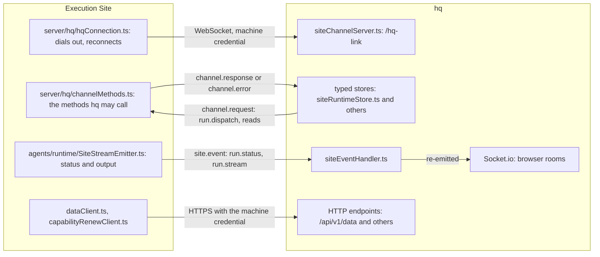
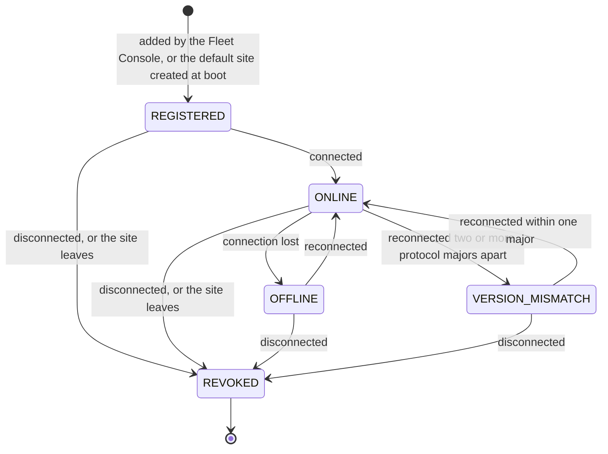
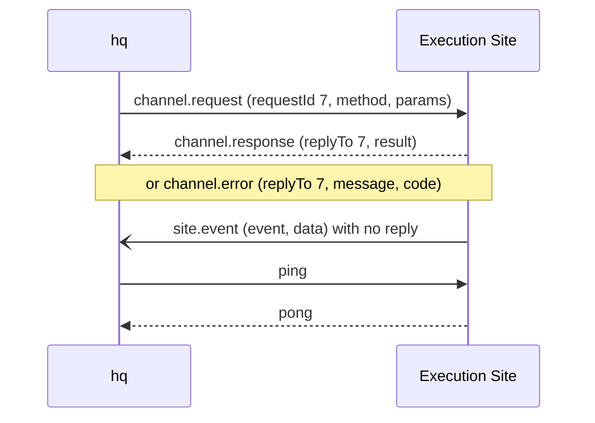
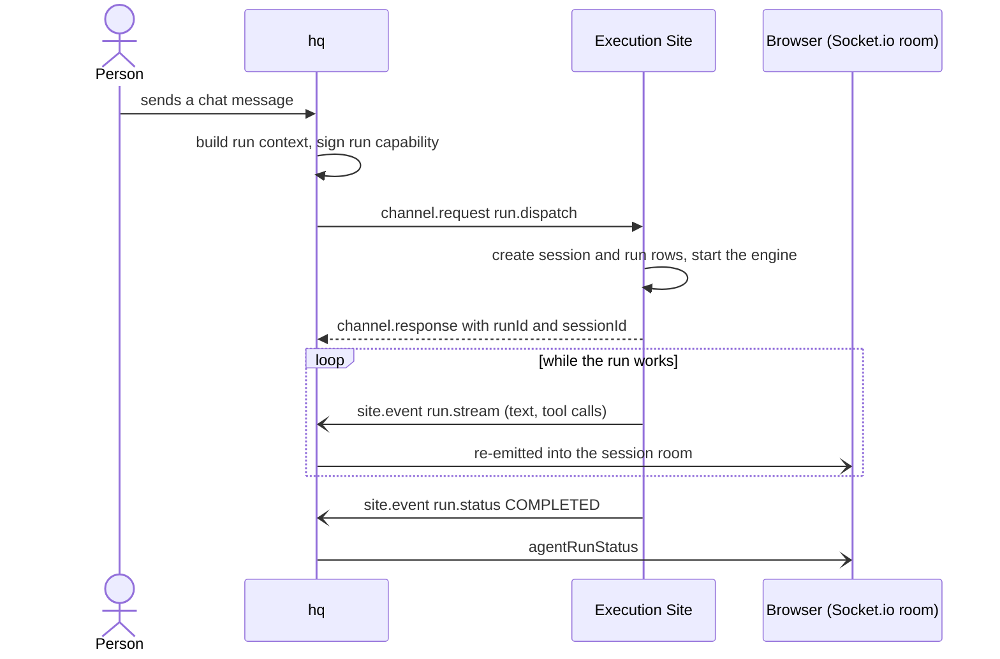

# The Control Channel

How hq and an Execution Site find each other, stay connected, and pass work and answers between them.
Read [the architecture overview](README.md) first if the words *hq*, *site* or *run* are new.



**The site always dials hq; hq never dials a site.** A site may sit behind a home router or a company
firewall with no address anyone can reach, so the one connection that exists is the one the site opened.
Over that single WebSocket, hq sends requests and the site answers them, and the site sends one-way events
that need no answer. When the site needs something from hq (a platform tool call, a renewed token), it
makes an ordinary HTTPS request instead, because hq does not serve requests on the channel.

A second WebSocket, the **content transport** (`/hq-content`), runs beside the control channel with the
same credential. It carries the bytes hq itself needs (a place's instruction file, a knowledge page, agent packages,
live preview traffic) so a large transfer never delays a control message
([ADR-0063](../adr/adr-0063-preview-traffic-crosses-on-its-own-transport.md)). **The bytes of a file a person opens do
not cross it**: the site serves them to its relay, on a third WebSocket it dials to the relay, which reuses the same
frames and stream multiplexer ([files-and-relays.md](files-and-relays.md#the-sites-line)).

---

## The connection

| | Where |
|---|---|
| Path on hq | `/hq-link` (`HQ_SITE_CHANNEL_PATH`, `core/src/protocol/connection.ts`) |
| Library | The `ws` package on both sides, not Socket.io. Socket.io is only between browsers and hq |
| Site side | `site/src/server/hq/hqConnection.ts` (`hqConnectionManager`) |
| hq side | `hq/src/sites/channel/siteChannelServer.ts`, attached in `hq/src/server/setup.ts` |
| One live connection per site | `hq/src/sites/channel/siteChannelRegistry.ts`: a newer connection closes the older one, and any request still waiting on the old one fails as `disconnected` |

**The handshake.** The site opens the WebSocket with three headers: `Authorization: Bearer <machine
credential>`, `X-Site-Id` (its own id, `SiteConfig.siteId`) and `X-Site-Protocol-Version`. hq checks them in
`hq/src/sites/siteUpgrade.ts` before accepting the upgrade:

1. The credential must match the site's stored hash and the site must not be revoked
   (`authenticateSite`, `hq/src/sites/registrationService.ts`). Otherwise `401`.
2. The protocol versions must be at most one major apart (`checkProtocolCompatibility`,
   `core/src/protocol/compatibility.ts`). Otherwise, or when the site states no version or one that is not
   `major.minor`, hq records the site as `VERSION_MISMATCH` and answers `426`, stating its own version in the same
   header so the site can say which of the two must upgrade; the site keeps retrying once a minute, and work for it
   waits (below).

The machine credential and where it comes from are in [identity-and-trust.md](identity-and-trust.md).

**Staying connected.** hq pings each site every 30 seconds and drops a connection that sent nothing for a
whole interval. The site drops its side if hq has been silent for 75 seconds (`SITE_SILENCE_TIMEOUT_MS`).
After any drop the site reconnects, waiting 5 seconds and doubling up to a minute.



That is `ExecutionSite.status` in hq's database (`hq/schema.prisma`; written by
`hq/src/sites/channel/siteStatusStore.ts`). The site keeps its own view in its `HqConnection` row:
`LINKING`, `PENDING`, `ACTIVE`, `DEGRADED`, `VERSION_MISMATCH` or `REVOKED` (`site/src/server/hq/connectionStatus.ts`); `agenthix-site status` prints it.

**What happens when a site reconnects** (`onSiteConnected`, `hq/src/sites/channel/index.ts`):

1. Instructions the site must not miss are replayed in order: today, the ones that end a person's
   membership. hq writes each to a `HeldSiteInstruction` row before sending it, and marks it done only when
   the site acknowledges it (`hq/src/sites/heldInstructions.ts`).
2. Task state is reconciled (`hq/src/agents/reconcileService.ts`): for each task hq thinks is running on
   that site, hq asks the site for the task's latest run (`run.list`) and applies its outcome as if the
   status frame had arrived live.
3. Tasks held while the site was away are started again (`drainHeldTasks`, `hq/src/agents/TaskRunner.ts`).

---

## Three kinds of message

Every frame is an `HQConnectionMessage` (`core/src/protocol/connection.ts`): a `type`, the sender's
`siteId`, a `payload`, and correlation fields for requests.



- **Requests and responses** ([ADR-0045](../adr/adr-0045-request-response-on-the-control-channel.md)).
  Only hq sends requests. Request ids are counted per socket, so a late answer from a dropped connection
  can never settle a request made on the new one (`hq/src/sites/channel/pendingRequests.ts`). A
  request times out after 15 seconds by default. An error carries a code: `unknown_method`,
  `handler_failed`, or, raised on hq's side, `offline`, `timeout` and `disconnected`.
- **Site events** ([ADR-0050](../adr/adr-0050-dispatch-and-status-cross-the-control-channel.md),
  [ADR-0051](../adr/adr-0051-live-site-data-crosses-as-typed-events-not-a-generic-relay.md)). One way,
  site to hq, never answered. The list is closed: `run.status`, `run.stream`, `session.patch`,
  `run.waiting`, `site.health`, `site.credentialRefreshed`, `site.credentialHealth`, `site.subscriptionRefreshed`, `workflow.step` and `workflow.result`. Each has its own handler in
  `hq/src/sites/channel/siteEventHandler.ts` that validates every field before touching a row or a
  browser, and hq drops anything else. There is deliberately no general-purpose relay.
- **Control frames**: `ping` and `pong`, `revoke` (hq tells the site it is revoked), `site.detach` (the
  site tells hq it has left).

**The methods hq can call** are string constants in `core/src/protocol/`, grouped by file:

| Group | File | Examples |
|---|---|---|
| Runs, sessions, transcripts | `runtimeData.ts` (`RUNTIME_METHODS`) | `run.dispatch`, `run.cancel`, `run.approve`, `transcript.list` |
| Workspace and attachment rows | `siteData.ts` (`SITE_DATA_METHODS`) | creating and listing workspaces |
| Files | `locationFiles.ts`, `fileAbout.ts` | `location.listFiles`, `location.findFiles` (a place's files by name, bounded and never following a link; since 1.8), `location.readFile`, and an owner's `artefacts/`: `location.listArtefacts`, `location.readArtefact` (deprecated since 1.8: no caller in hq); `file.about` (a file's facts before hq opens it, no content; since 1.8) |
| Relays | `relayFiles.ts` | `relay.assign`: which relay the site holds its file line to, with the pass that admits it, renewed before the pass ends (since 1.8). Its partner `files.serve` is a content method a relay opens on that line, never hq. See [files-and-relays.md](files-and-relays.md) |
| Knowledge | `locationFiles.ts`, `locationKnowledge.ts` | An owner's pages, addressed by owner (a project, a person, or the organisation) and not by location: `location.listKnowledge` (sections and pages with their properties and problems), `location.readKnowledge` (content transport; a page or one of its versions), `location.searchKnowledge` (Grep's parameters, run by ripgrep), and the gate's `location.writeKnowledge`, `location.editKnowledge`, `location.deleteKnowledge`, `location.restoreKnowledge` and `location.knowledgeVersions`. Since site protocol 1.7; a site that does not know a method answers `unknown_method`, which hq reports as the site being out of date. See [storage and placement](storage-and-placement.md#where-knowledge-lives) |
| Git | `repoWork.ts`, `gitStatus.ts` | `repo.connect`, `repo.state`; `git.status`, a folder's branch, changed count and last commit, read without running anything the repository holds (since 1.8) |
| Workflow runs | `workflowRuns.ts` (`WORKFLOW_RUN_METHODS`) | `workflow.run`, the one message that carries secret values, answered at once and followed by `workflow.step` and `workflow.result` events; `workflow.stop`, `workflow.get`; `workflow.readFiles`, a proposal's files, refusing any link. See [workflows.md](workflows.md) |
| Agent packages | `packages.ts` | `packages.missing`, `packages.put` |
| Previews | `preview.ts` | `preview.start`, `preview.stop` |
| A person leaving | `membership.ts` | `membership.memberLeftProject`, `membership.personLeftOrganisation` |
| What is running in one boundary | `activeRuns.ts` | `run.listActive`: each `PENDING` or `RUNNING` run's ids, status and times, never its content; hq resolves the names. The platform tool `list_active_runs` is built on it |
| What runs add up to | `runUsage.ts` | `run.usage`: run counts and tokens summed on the site, grouped by session, agent or storage owner, for a period; hq resolves each session's person and project |
| Claude sign-in | `claudeLogin.ts` | start, finish, cancel |
| The site itself | `connection.ts` (the result type), `siteDeviceApproval.ts` | `site.describe` (a string literal, not a constant) |
| The site's logs and health now | `siteDiagnostics.ts` (`SITE_DIAGNOSTICS_METHODS`) | `site.readLogs`: one page of the site's own log, newest first; `site.healthNow`: its health report taken at once. See [logs-and-diagnostics.md](logs-and-diagnostics.md) |

The site's side of every one is the closed map in `site/src/server/hq/channelMethods.ts`.

---

## Dispatch: how work reaches a site

hq executes nothing on a site. A chat message, a worker's brief or a task run becomes a `run.dispatch` request
to the site that holds the run's storage ([storage-and-placement.md](storage-and-placement.md) says how
that site is chosen).



- **hq side**: `dispatchChatRun` and `dispatchTaskRun` in
  `hq/src/agents/dispatchService.ts`. Each builds the run's context (`hq/src/agents/runContext.ts`), signs
  a run capability (see [identity-and-trust.md](identity-and-trust.md)), and calls
  `siteRuntimeStore.dispatchRun` (`hq/src/sessions/siteRuntimeStore.ts`). Agent packages the site lacks are
  sent first, over the content transport (`hq/src/packages/packageDelivery.ts`).
- **What crosses** (`RunDispatchPayload`, `core/src/protocol/runtimeData.ts`): the kind of run, the signed
  capability, a seed for the site's session row, the input text and model, and a context holding the
  agent's configuration, the chat or task details, the run's providers (`modelAccess`, below), the run's pinned memory
  items (`pinnedMemory`, only while conversations are on), the package digests and the person's timezone. The site stores none of the secrets: the run row keeps
  only the kind. Two fields say how the run is to be held:
  - `startedBy` is what started it: `person`, `pulse` (a boundary's pulse), `schedule` (a task's start time) or
    `agent` (an agent called `run_task`). It is required, and the capability carries it too, signed, so hq can
    read it inside a tool call. Anything that is not `person` is treated as nobody watching.
  - `runLimits` is the time limit, and for a run not started by a person the turn limit, which the site
    enforces ([container-runtime.md](container-runtime.md#limits-and-slots)).
- **The run's providers** (`modelAccess`, `RunModelAccess`, `core/src/protocol/runProvider.ts`): hq's resolver chose the
  run's model via a provider ([model-resolution.md](model-resolution.md)), and the dispatch carries a **provider
  descriptor** for it and for any other provider a helper of the run may be sent to, each once, with the billing profile
  the run's calls are costed to. A descriptor is one of `api_key` (the provider's id, vendor and key, held for this run
  only, and the address for a custom endpoint), `subscription` (a person's own Claude login, with a grant id, only for a
  run that runs as its owner in their own place) or `cloud` (the vendor API Agenthix Cloud's gateway is spoken to in, and
  its address, with no secret). The site keeps no provider table and learns of a provider only here. `modelAccess` supersedes
  `credential` and `fallbackCredentials`, which are marked deprecated since 1.1 and kept for an hq that still sends them; a site reads
  `modelAccess` first when both are there.
- **Site side**: `handleRunDispatch` in `site/src/server/runtime/dispatchHandler.ts` validates the
  parameters, creates or reuses the session row, creates the run row and starts the engine without waiting
  for it ([container-runtime.md](container-runtime.md) follows the run from there).
- **The answer is acceptance, never completion.** The response says the run was created. How it ends
  arrives later as `run.status` events, however long the run takes.
- **Back in hq**: `siteEventHandler.ts` checks the session belongs to the sending site, then re-emits
  stream frames into the browser's Socket.io room (`session:<id>` or `task:<id>`). For a status frame it
  emits `agentRunStatus` itself, applies the allowed session fields, and hands the status to listeners such
  as the task state machine (`hq/src/agents/taskStatusListener.ts`).
- **Waiting for a slot.** A site at its limit on runs at once sends a one-way `run.waiting` event
  (`RUN_WAITING_EVENT`) when a run starts to wait for a slot and again when it gets one, so hq can say why a
  task has not started.
- **Other run controls** on the same path: `run.cancel`, `run.approve`, `run.reject` (`RUNTIME_METHODS`).
  `run.reject` with `replaced: true` marks a request nobody answered `SUPERSEDED`. There is no `run.resume`: an
  approval starts the next run
  ([tool-manifest.md](tools/tool-manifest.md#lifecycle)).

- **A site's health.** While its channel is open, a site sends a one-way `site.health` event
  (`core/src/protocol/siteHealth.ts`) at once and then every minute: runs now and the most it takes at once,
  disk free and total under `SITE_ROOT`, whether Docker answers, and whether the agent image is present, with
  the version the site was given (`APP_VERSION`) when it is (`site/src/server/hq/siteHealthReport.ts`). hq checks it field by field
  and keeps the latest on `ExecutionSite.health` and `healthReportedAt` (`hq/src/sites/siteHealth.ts`). An
  admin's **Check again** asks for a report at once with `site.healthNow` instead of waiting for the next one.

**When the site is down.** A chat or a read fails at once with an explicit error naming the site, such as
"Execution Site "Home server" is unreachable". The error is `SiteUnreachableError`
(`hq/src/storage/workspaceStore.ts`), which carries the site's label, its id, the reason (offline, revoked
or a protocol version mismatch) and its version, and becomes HTTP 503 in `hq/src/storage/httpErrors.ts`.
When hq last heard from a site is `ExecutionSite.lastSeenAt`. A
task does not fail: `TaskRunner` puts it back in the queue with the reason "site unreachable
— held for reconnect", and the reconnect steps above start it again. Stream frames sent while the channel
is down are lost; the transcript on the site is the durable record.

---

## Reading across the channel

hq never reads a site's disk or database. When it needs a transcript, a run, a workspace list or a file, it
asks the site that holds it with a `channel.request`, through a typed store that turns channel failures
into `SiteUnreachableError` rather than returning empty results:

| Store (hq) | Reads |
|---|---|
| `hq/src/sessions/siteRuntimeStore.ts` | Sessions, runs, transcripts, tool-call logs, run statistics |
| `hq/src/storage/workspaceStore.ts` | Workspace and repository-attachment rows |
| `hq/src/storage/locationFileStore.ts` | File listings and contents |
| `hq/src/storage/repoWorkStore.ts` | Git state of a location |

Some views have no single owning site: the Organisation page's Today figures, the activity feed, what is running now. Those
ask every site at once with a 4-second deadline and show what came back, naming the sites that stayed
silent (`hq/src/sites/combinedRead.ts`, `siteSilence.ts`).

---

## The site calling hq

The site never sends a `channel.request` (hq answers one with `unknown_method`). Its calls to hq are HTTPS,
authenticated with the same machine credential:

| Call | Site side | hq side |
|---|---|---|
| A platform tool's data operation | `callHqData`, `site/src/server/hq/dataClient.ts` | `POST /api/v1/data`, `hq/src/server/controlplane/dataApi.ts` |
| Renew a run capability | `site/src/server/hq/capabilityRenewClient.ts` | `POST /api/v1/capabilities/renew`, `hq/src/server/identity/identityApi.ts` |
| Report the usage of the model calls its relay made | `sendUsageReports`, `site/src/server/modelRelay/usageReportClient.ts` | `POST /api/v1/usage/report` (`HQ_USAGE_REPORT_PATH`), `hq/src/sites/usageReports.ts` |
| Ask for hq's Agenthix Cloud token, for a container's calls through Cloud's gateway | `requestCloudAiToken`, the same file | `POST /api/v1/cloud/ai-token` (`HQ_CLOUD_AI_TOKEN_PATH`), `hq/src/sites/cloudAiTokenApi.ts` |
| Register, and leave | `site/src/server/control/commands.ts` | `hq/src/sites/deviceApprovalApi.ts`, `leaveApi.ts` |

The usage report is an HTTPS call and not a channel method because a site sends no request on the channel (hq would answer `unknown_method`), and because the
site must send a report again until hq acknowledges its call ids: it keeps each as a file, sends batches of at most 100,
and hq counts a call id once ([model-resolution.md](model-resolution.md#the-relay-and-its-usage-reports)).

---

## How a site takes part

A site connects to an hq in one of two ways, and in both the site holds its credential in its environment from the
start: nothing is registered or approved on the site's side.

**hq's own site is connected by configuration**
([ADR-0070](../adr/adr-0070-hq-and-its-own-site-are-connected-by-configuration.md)). One secret,
`HQ_PAIRING_SECRET`, is set in both apps' environments by the host service at install. At every boot hq makes sure one
default `ExecutionSite` row exists holding the secret's hash (`ensureDefaultSite`, `hq/src/sites/defaultSite.ts`), and
the site uses the secret as its credential (`site/src/server/registration/pairing.ts`). It reaches hq-web by its
container name over hq's private link network, never through `localhost`. It is named after hq's machine, which the
host service passes as `HQ_MACHINE_NAME`, and shown tagged, *hq-box · HQ's site* (`hq/src/shared/siteName.ts`). It
cannot be removed or made to leave; it goes only with hq. When hq refuses it, the host service on hq's machine passes
the cause through hq's control socket, so hq can say why (`hq/src/sites/defaultSiteCause.ts`).

**Every other site takes part when a fleet admin adds it in the Fleet Console**
([ADR-0115](../adr/adr-0115-a-site-takes-part-when-a-fleet-admin-or-cloud-adds-it.md)), on a machine whose host
service has just joined the Fleet Console with a one-time code
([host-management.md](host-management.md#adding-a-site-and-leaving)):

```mermaid
sequenceDiagram
    participant HM as Fleet Console
    participant HQ as hq
    participant HS as Host service
    participant S as Site
    HM-)HS: install the site (signed, sealed, relayed by hq)
    HS->>HS: make the site's credential; write its compose project with it
    HS-->>HM: the credential's hash only
    HM->>HQ: site.register over the console link: the hash, for this machine
    HQ->>HQ: an ExecutionSite row holding the hash, named after the machine
    HS->>S: start
    S->>HQ: /hq-link with the credential
    HQ->>HQ: the row takes the site's own id
```

- hq accepts and removes a non-default site's credential **only from the Fleet Console** over its link (`site.register`,
  `site.remove`; `hq/src/fleet/siteCredentials.ts`), or from Agenthix Cloud for the sites it runs. Cloud asks the host
  service on hq's machine over its own link, and that host service passes the request over hq's control socket
  (`site.register`, `site.unregister`; `hq/src/fleet/cloudSites.ts`; [host-management.md](host-management.md#agenthix-clouds-controller)).
  Such a site's row holds `cloudMachineId`, the machine Cloud knows it by, and only a row that has it can be removed
  by Cloud. Nothing an organisation admin reaches in hq adds or removes a site, and hq has no route for Cloud to call: it
  never takes a request from Cloud directly.
- The row holds a placeholder id until the site's first connection with the credential replaces it
  (`registrationService.ts`), as the default site's does.
- A site's name is its machine's, from hq's own record of the machine; two sites of one name are refused.
- There is no registration route and no registration token: a site cannot ask to join from a machine the Fleet Console
  does not know.

**The site's own command.** `agenthix-site` talks to the running site over a Unix socket only the machine's user can
open (`site/src/server/control/controlSocket.ts`; `<SITE_ROOT>/run/control.sock`, or `SITE_CONTROL_SOCKET` in the
image). It accepts `status` and `unregister`.

**Leaving.** A site is taken out when a fleet admin disconnects its machine in the Fleet Console (`site.remove`), or
when its machine disconnects itself, which tells hq with the site's own credential (`POST /api/v1/sites/leave`,
`hq/src/sites/leaveApi.ts`) and its machine's (`POST /api/v1/hosts/leave`, `machineLeaveApi.ts`). Either way
`revokeSite` (`hq/src/sites/revokeSite.ts`) marks the row `REVOKED`, closes its sockets and fails its running and held
tasks, and records who took it out: the Fleet Console, or the machine itself (`leftByItself`). A site restored on a new
machine renews its credential first, and from then on the old machine's copy is refused, and told why
([identity-and-trust.md](identity-and-trust.md#machines-and-the-fleet); `hq/src/fleet/replacedSite.ts`).

**Notifications to admins.** Execution Sites raises persistent notifications
(`hq/src/notifications/persistent.ts`) to organisation admins, each clearing itself when its problem is
fixed (`hq/src/sites/siteNotifications.ts`): a site that needs upgrading, one not connected while a held task or
instruction waits on it, hq's own site not running, and Docker not running or a disk nearly full. A site counts as not
connected once hq has not heard from it for 90 seconds, counted from hq's own start at the earliest, so a restart or
a network blip tells nobody. Each pass works out the whole state from the database and runs where a state changes and
every 30 seconds, so a missed event cannot leave a notification stuck. Fleet admins get their own about machines —
one not heard from for 10 minutes, one that left by itself — judged from the host link rather than the site's channel
([host-management.md](host-management.md#a-machine-that-stops-answering)).

---

## Protocol versions

`SITE_PROTOCOL_VERSION` in `core/src/protocol/connection.ts` is `major.minor`, currently `1.8`; `1.0` is the baseline every
later version counts from. A site states it in the `X-Site-Protocol-Version` header when it dials either channel
([ADR-0136](../adr/adr-0136-every-connection-restarts-at-1-0-and-peers-one-major-apart-still-talk.md); [`versioning.md`](versioning.md) has every connection's version and how to
move one).

- **Two sides talk while their majors are at most one apart.** The newer side speaks the older side's major.
  Two or more apart, hq answers `426` and a site that reads such a `426` says which side must upgrade
  (`checkProtocolCompatibility`, `protocolRefusalMessage`, `core/src/protocol/compatibility.ts`). Every
  versioned connection asks this one function, never compares majors itself.
- **A minor only adds**: a new method, event or optional field. A major is a break: something removed, renamed or
  given a new meaning, or a new required field.
- **A site ignores a field it does not know**; it never refuses a request for one. There are no per-feature
  minimum versions: what a version adds is whatever the shared contract in `core/src/protocol/` says at that
  version.
- hq records the version each site presented (`ExecutionSite.protocolVersion`).

At 1.x there is no earlier major, so a site one major behind is served as it is; the code kept for an older major
starts at the first major change.

---

## Adding a control-channel method

Find the nearest existing method and copy its shape. For something the Execution Sites page shows about a
site, the nearest is `site.describe`: the page (`hq/src/sites/pages/ExecutionSitesPage.tsx`) calls the
query `describeExecutionSite` (`hq/src/sites/queries.ts`, declared in `hq/src/sites/sites.wasp.ts`), which checks the
person is an admin and asks the one site, turning a failed request into a `409` the page can show as a
state ("offline") rather than as a server error. For a figure from every site at once, use `askEverySite` in
`hq/src/sites/combinedRead.ts`, which never fails because one site did.

The places a new method touches, using `preview.stop` as the example:

1. **The contract, in `core`.** Add the method name and its parameter and result types to the right file in `core/src/protocol/` (here `preview.ts`), export it from
   `core/src/protocol/index.ts`, and bump `SITE_PROTOCOL_VERSION`'s minor.
2. **The site's handler.** Write it beside its peers (here `site/src/server/hq/previewMethods.ts`),
   validating its parameters with zod, and add it to the closed map in
   `site/src/server/hq/channelMethods.ts`. A method missing from the map is answered `unknown_method`.
3. **hq's caller.** Call `siteChannelRegistry.request(siteId, method, params)` from a typed store, so a
   down site becomes `SiteUnreachableError` and an old site a version error.
4. **Tests** beside the existing ones: `site/src/server/hq/__tests__/`,
   `hq/src/sites/channel/__tests__/`.

Bytes hq needs go over the content transport instead (`site/src/server/hq/content/contentMethods.ts`); bytes for a
browser go through a relay on a ticket, never through hq ([files-and-relays.md](files-and-relays.md)). Something
the site must tell hq unprompted is a new `site.event`, with its own validating handler in
`siteEventHandler.ts`, never a generic one.

---

## What must not break

- **The site dials out.** Nothing may require hq to reach a site's address.
- **hq never trusts a frame's claims about ownership.** A `run.stream` or `run.status` frame is applied
  only to a session that belongs to the site that sent it (`sessionOwnerSite.ts`).
- **No empty results for a down site.** A read that cannot reach its site fails with
  `SiteUnreachableError`; it never returns nothing, which a person would read as "no data".
- **Dispatch acknowledges acceptance only.** Never make hq wait on the request for a run to finish.
- **Additive changes are minor bumps; anything else is a major.** Get it wrong and a site misreads frames
  from a side it was meant to refuse.

## Decisions behind this

[ADR-0042](../adr/adr-0042-hq-is-the-orgs-own.md) (hq is the org's own; sites execute) ·
[ADR-0045](../adr/adr-0045-request-response-on-the-control-channel.md) ·
[ADR-0136](../adr/adr-0136-every-connection-restarts-at-1-0-and-peers-one-major-apart-still-talk.md) ·
[ADR-0050](../adr/adr-0050-dispatch-and-status-cross-the-control-channel.md) ·
[ADR-0051](../adr/adr-0051-live-site-data-crosses-as-typed-events-not-a-generic-relay.md) ·
[ADR-0063](../adr/adr-0063-preview-traffic-crosses-on-its-own-transport.md) ·
[ADR-0065](../adr/adr-0065-a-site-serves-no-web-page.md) ·
[ADR-0070](../adr/adr-0070-hq-and-its-own-site-are-connected-by-configuration.md) ·
[ADR-0115](../adr/adr-0115-a-site-takes-part-when-a-fleet-admin-or-cloud-adds-it.md) ·
[ADR-0153](../adr/adr-0153-relays-carry-every-file-byte-and-hq-only-signs-tickets.md)
