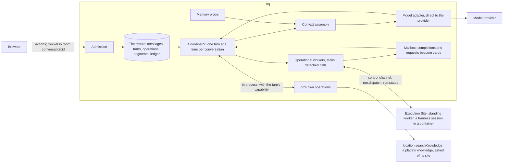

# The conversation layer

How a conversation is answered from hq while its longer work runs on sites. [The concept](../concepts/conversations/conversations.md)
says what a conversation is to a person; this page says how it is built.

**What is new here is that hq answers.** hq still starts no harness and touches no site's disk. But the reply a person
reads in a conversation is produced in hq's own process, by a direct call to a model provider, and hq holds the words of
the conversation in its database. A site is asked only for work (a harness run), for a place's knowledge, and for a
run's detail when a person opens it.

## The record

hq's database holds the conversation (`hq/schema.prisma`):

| Table | A row is |
|---|---|
| `Conversation` | One thread: its home (`PERSON`, `PROJECT` or `TASK`), who opened it, its agent (read from the task for a task's thread), status (`ACTIVE`, `ARCHIVED`, `CLOSED`) and closed reason, the talking model and the access it opened on, who holds voice, the one-turn lock and its lease, and the ledger |
| `ConversationMessage` | One thing said, numbered 1, 2, 3 with no gaps (`seq`): a role (person, agent or platform) and a kind (`TEXT`, `OPERATION_STARTED`, `ACTION`, `TASK`, `RESULT`, `APPROVAL_REQUEST`, `APPROVAL_ANSWER`, `SUMMARISED`, `VOICE_STARTED`, `VOICE_ENDED`, `FAILED`, `NOTICE`). A person's message carries the id its browser gave it, so sending twice stores it once; it is `WAITING` while a reply runs and `TAKEN` when a turn answers it |
| `InferenceTurn` | One direct-inference turn: state, what started it (a message, a report, a continuation), the person it acts as, model, usage and timings |
| `Operation` | One piece of work commissioned: kind (`WORKER`, `TASK`, `TOOL`), mode, brief, target boundary, state, result, the site and run or the task that carries it, an idempotency key and what it may continue with |
| `ConversationSegment` | One compaction, written once |
| `RunResult` | What one run said it achieved, from `set_result` |
| `ModelPolicy` | A boundary's model preferences |
| `AgentSession` (also on the site) | A standing worker, with `conversationId` and a boundary |

**Message text is encrypted at rest** with hq's data key (`hq/src/conversations/sealing.ts`), as the other sealed fields hq
keeps; a backup carries the ciphertext. A reading person gets it decrypted, after the reading rule has decided they may
read. **Nothing is held twice:** the site keeps a worker's runs, transcripts and tool calls as it always did, and a run's
detail is fetched from it only when a person opens it. A conversation stays readable, and can be written in, while a site
is offline.

## One turn at a time

Anything may ask for a conversation to be scheduled: a message admitted, a card written, a turn ending, recovery. Only one
claim wins (`coordinator/scheduler.ts`).

- **The lock** is `Conversation.activeTurnId` and a lease (30 seconds, renewed every 10 while the turn runs), claimed by
  one conditional update that succeeds where the lock is free or its lease has run out (`coordinator/lock.ts`). It holds
  across hq processes. A process that dies loses it when the lease runs out, and recovery fails the turn it held.
- **Admission** (`coordinator/admission.ts`) checks the sender may speak, stores the message under the conversation's row
  lock and, when a turn is running, stores it as waiting. By the sender's `busyConversationMode` it then waits for that
  turn (`WAIT`) or stops it (`INTERRUPT`). Messages are taken in order, and a batch is the oldest and every consecutive
  one by the same author (`coordinator/batch.ts`).
- **The turn** (`coordinator/turn.ts`) resolves the access that pays, mints its capability, assembles its context, then
  loops: a model call streams text to the room, the step's tool calls run together through the tool adapter, and the
  results go back, to at most 8 steps; the last is words only. One agent message is committed at the end, with the reply's
  steps. After 4 steps that looked something up, hq starts the rest as work itself and ends the reply with a fixed line
  (`coordinator/moveToBackground.ts`).
- **Report and continuation turns** (`coordinator/cardTurn.ts`) answer no one: the mailbox wrote a `RESULT` card, and one
  turn over all the cards waiting speaks and starts no work. A continuation replaces it when a completed operation carries
  an obligation whose three checks (member of the boundary, agent assigned, tool allowed) still pass, acting as the person
  who authorised it.
- **What the screens receive** goes to the Socket.io room `conversation:<id>`, joined only after the reading rule: `message`,
  `messageUpdated`, `delta` (text as streamed), `turn`, `steps`, `operation`, `operationLines`, `summarise`, and on joining a
  `replay` of what the running turn has streamed so far, so a dropped browser loses nothing
  (`CONVERSATION_SOCKET`, `hq/src/shared/conversations/protocol.ts`). Text being streamed is held in the process running the
  turn; the committed message is in the database.
- **Recovery** (`coordinator/recovery.ts`), at start and then every lease: a turn whose lock ran out is failed with
  "HQ restarted", a tool call hq was making is marked uncertain and then reconciled (a read is run again, a write is reported
  as unknown whether it happened), task operations stranded by a change on their board are read against their task, and
  waiting messages and unanswered cards are scheduled again in order. Workers' and tasks' operations are reconciled when
  their site connects (`work/reconcile/`).

## The lead in hq

**Context.** Four parts, ordered by how often each changes so the provider's cache of the front survives
([long conversations](../concepts/conversations/long-conversations.md)): the lead's base instructions with the agent's and
the organisation's; the compaction block; the window of messages since the last compaction; and the turn block appended to
the turn's own message. The lead sees no override or `AGENTS.md`, which are files on a site (`coordinator/context.ts`).

**The model adapter** (`hq/src/conversations/model/`) is the only code that names a provider's SDK. It uses the Vercel AI
SDK that hq already carried, for Anthropic, OpenAI, Google, OpenRouter and an OpenAI-compatible endpoint, and adds each
provider's caching hints. Which key pays is decided by the conversation's home (`access/homeAccess.ts`); the talking model
comes from the effective model policy and the person's picker.

**Tools.** Every tool is defined once, in hq's control-plane registry, behind one permission check. A harness reaches it
through its site's `/mcp` endpoint; the lead's turn reaches it in process with a **turn capability**, minted per turn for the
author of the message being answered, carrying the agent's tool permissions in the place, the strictest level winning
(`tools/mintTurnCapability.ts`, `server/controlplane/turnCaller.ts`,
[ADR-0082](../adr/adr-0082-a-conversation-acts-with-its-current-turns-authority.md)). A turn calls only quick tools, never
one that starts work or acts for a run in its container; a tool at *ask* is not called but offered (`work/toolCalls/ask.ts`).
Each call of a step runs under the **wait limit** of 4 seconds; past it the same call is detached, with the operation row
created before the call started and an idempotency key (the tool and its arguments), so an identical call while the first
is pending is the same operation. A result over 16,000 characters is cut with a line telling the lead to brief a worker.
The conversation's own tools are `start_work`, `create_task`, `run_task`, `cancel_operation`, `answer_approval`, `ledger`,
`expand`, `messages` and `offer_new_conversation`, beside `recall`, `remember`, `forget` and hq's task, board and project
tools.

## Work on a site

**A brief** becomes an `Operation` and waits in hq, `QUEUED`, in front of its boundary's **standing worker**. The queue takes
one at a time per worker, under a Postgres advisory lock, so it holds across processes (`work/workers/queue.ts`); the brief
is dispatched with `dispatchChatRun` as a run of the worker's session, as a person's message into a chat would be. Admission
checks the person, the agent and the tool for that boundary, and the run's capability is the boundary's, never the
conversation's place's. The briefs wait in hq, and not on the site, so a site restart loses none and a brief can be stopped
without reaching it.

**Events come back** through the same `run.status` listeners the task state machine uses
(`work/workers/runEvents.ts`): the run's end settles the operation, writes a `RESULT` card, and starts the worker's next
brief. A run that asks for approval ends asking; hq writes the `APPROVAL_REQUEST` card, the operation waits, and the answer
(`answerConversationApproval`, or the lead's `answer_approval`) is forwarded to the site (`run.approve` or `run.reject`) and
continues the worker in a new run of the same session. A worker's context use is read from the site and, past 70% of its window, its slot gets a fresh
session between briefs (`work/workers/freshStart.ts`).

**A task** is the project's task, started by `run_task` as it is from a person's Run; the operation is completed by the
run it started, with the run's stated result. In a task's thread, `start_work` is `run_task` on the task, and every run of
the task leaves a card there.

**Knowledge** is read with `location.searchKnowledge`, which asks the place's site for a bounded excerpt. Nothing of it is
stored in hq.

## Memory

`MemoryItem` rows hold an embedding each; the local model (`all-MiniLM-L6-v2`, 384 dimensions) runs in hq's own process
through ONNX Runtime's WebAssembly build, loaded once on first use from files hq's image carries (about 90 MB; fetched once into hq's storage if an image lacks them). Search is exact over the rows a principal may read; no
vector extension is installed, so every install keeps its pinned database image. Before each turn the probe composes a query
and the turn block carries what it finds (`conversations/memory/`); hq runs a background re-embed each minute, and, once a
day, the tidy and the tuning of each organisation's bars (`memory/maintenance.ts`). See [memory](../concepts/memory/memory.md).

## Voice

A spoken turn is an ordinary turn. Speech to text runs in the browser against the organisation's speech service, on a token
hq issues; the message arrives marked `spoken`. Text to speech runs in hq from the lead's stream, a sentence at a time with
word timings, and its audio goes only to the holder's sockets (`conversationVoice:*` events,
`CONVERSATION_VOICE_SOCKET`). The holder (`voiceHolderId`) is taken and released under the conversation's row lock; the
silence rule and the speech in progress are held in the process that has the holder's socket
(`conversations/voice/registry.ts`) and a restart ends voice with a line saying so.
See [voice](../concepts/conversations/voice.md).

A voice client calls two operations named for no vendor: `getVoiceServices` says which speech services are set up
and by which provider, for any member, and `getSpeechToken` gives a short-lived token for the speech-to-text provider
it names, with that service's settings. The providers' own settings, with their masked keys (`getVoiceProvider`), are
for admins only.

### What a voice client must do

The events say what hq and the client tell each other; they do not say when to send them. hq's web client
(`hq/src/conversations/voiceClient/`, its thresholds in `settings.ts`) does the following today, and any other client
(the mobile app) must do the same for voice to behave the same:

1. **Hear the person and turn their speech into words.** The client runs speech to text itself, against the provider
   `getSpeechToken` names, fetching a token before the person starts and a fresh one before it expires. It keeps the
   agent's own voice, heard back through the microphone, out of what it takes for the person's words (`stt/echo*.ts`,
   `acoustic/`). When speech to text stops working for good, it sends `end` with `failed: 'speech-to-text'`.
2. **Decide when the person has finished speaking.** Silence alone is not enough. When the person pauses, a turn model
   scores whether they have finished (`semantics/`); at each mark of the pause (0.5, 1 and 2 s) the score answers
   *finished*, *still speaking* or *not sure*, and at 3 s of silence the turn ends whatever the score. If the model
   gives no answer within 300 ms, silence decides. The message goes only once speech to text has heard the person's
   last words. It goes as an ordinary message with `spoken: true`, and with `trailedOff: true` when the 3 s limit ended
   a turn the model still heard as mid-thought.
3. **Add to a message just sent.** If the person speaks again after the message went but before any of the reply has
   been heard, the client sends `continue` with the reply's `turnId`; hq cancels that reply and answers the whole
   message. A reply that only asked the person to go on (a sentence marked `encouragement`) leaves the message open
   the same way. If hq has not started a reply yet, the words go as a message of their own.
4. **Keep voice alive while the person speaks.** hq ends voice after two minutes of silence on both sides
   (`silenceWarning` comes 15 s before). The client sends `activity` while the person is speaking, at most every 5 s.
5. **Play the reply, and say how much was heard.** Sentences come with their words' timings, then their audio
   (24 kHz, 16-bit PCM, in order); the client plays them in order and shows the written reply only as far as it has
   been spoken. When the person speaks over the reply, the client lowers it at once, and decides from their words
   (`orchestration/bargeIn.ts`): a stop word or enough of their own words stop it, an acknowledgement ("mm-hm") lets it
   go on. On a stop, it sends `interrupt` with `heardThrough`, the index of the last sentence heard to its end (-1 for
   none), so hq keeps only what the person heard.
6. **Fill the wait, and show it is listening.** The `phrase` events, sent as voice starts, are short clips in the
   agent's voice. While a reply is awaited the client plays filler phrases: a short sound as the message goes, more at
   3, 7 and 15 s, then every 16 s until the reply comes, never over the person and never repeating the last few. In a
   long turn's pause that the turn model hears as mid-thought, it may play an active-listening phrase ("Mm-hm."); after
   the person stops the reply with a stop word and stays silent, an encouragement phrase ("Go on."). None of these
   is written into the conversation.
7. **Let an agent's update wait its turn.** An `update` is a raised hand: the client shows it and sends `invite` at the
   next opening (the floor open for 2 s), or when the person taps it or invites it in words. A critical update is
   invited at once, after the current sentence.

## What must not break

- **Exactly one turn owns a conversation**, across processes; a turn that lost the lock writes nothing.
- **A turn never waits on a call longer than the wait limit, and a detached call is never run twice.**
- **An operation is authorised for its own boundary**, at admission and again before any continuation. Nothing is unioned
  across a conversation's places, and a worker holds its boundary's authority and none of the conversation's.
- **A knowledge excerpt is not forwarded** into a brief for another place.
- **Nothing in the first three parts of the context changes within a turn**; an expansion is appended, never substituted.
- **The record is hq's.** A site holds the work and a worker's own history; the words of a conversation are not copied there.

## Where in the code

| You want | Look in |
|---|---|
| The record's access, sealing, reading rule | `hq/src/conversations/store/`, `sealing.ts`, `readingRule.ts` |
| Admission, the lock, turns, the mailbox, recovery | `hq/src/conversations/coordinator/` |
| The model adapter and caching | `hq/src/conversations/model/` |
| The turn's tools and capability | `hq/src/conversations/tools/`, `hq/src/server/controlplane/turnCaller.ts` |
| Workers, tasks, tool calls as operations | `hq/src/conversations/work/` |
| A task's thread | `hq/src/conversations/taskThread/` |
| Compaction, the ledger, zooming | `hq/src/conversations/long/` |
| Memory | `hq/src/memory/`, `hq/src/conversations/memory/` |
| Voice, on hq and in the browser | `hq/src/conversations/voice/`, `voiceClient/` |
| What crosses to the browser | `hq/src/shared/conversations/`; a run's events, rebuilt from the site's frames, in `runEvents.ts` and `hq/src/sites/channel/clientRunEvents.ts` |
| A knowledge search on a site | `core/src/protocol/locationFiles.ts` (`location.searchKnowledge`) |

## Decisions behind this

[ADR-0042](../adr/adr-0042-hq-is-the-orgs-own.md) (hq is the organisation's own) ·
[ADR-0075](../adr/adr-0075-work-in-a-boundary-runs-in-parallel-only-a-conversation-is-ordered.md) (only a conversation is ordered) ·
[ADR-0082](../adr/adr-0082-a-conversation-acts-with-its-current-turns-authority.md) ·
[ADR-0096](../adr/adr-0096-a-conversation-belongs-to-a-place.md) ·
[ADR-0101](../adr/adr-0101-a-run-is-bounded-by-the-person-it-is-for.md)
