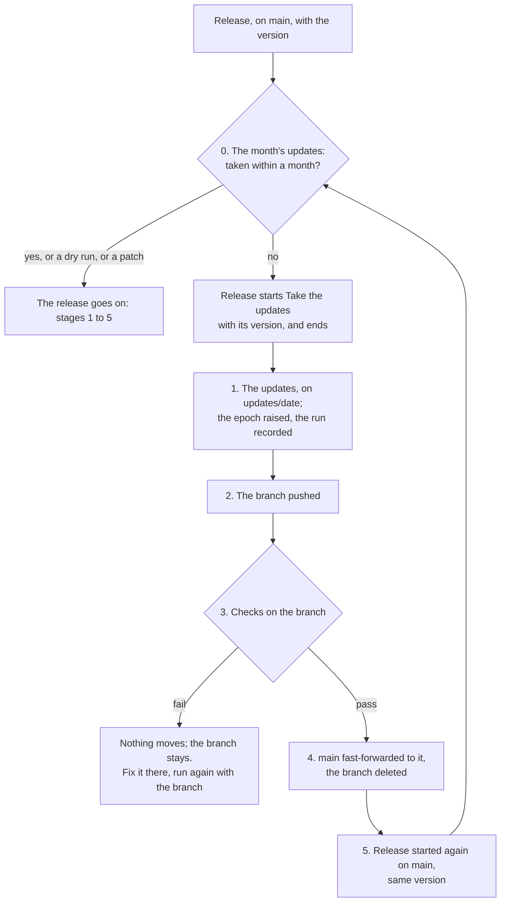

# Dependencies

Agenthix is built from outside software: npm packages, base images and workflow actions. Each is pinned to an exact
version, so a release is exactly what was tested, and each moves only when we move it: once a month at most, as the
first part of a release, by a step of our own, *Take the updates*, under rules that keep every package within what
the others require of it. The decision is [ADR-0191](../adr/adr-0191-dependencies-are-updated-by-our-own-step-as-part-of-releasing.md);
this document is how it works today.

## What we depend on, and how each is pinned

| Level | Where it is named | Pinned by | Moved by |
|---|---|---|---|
| **npm packages** | each module's `package.json` (the root, `hq`, `site`, `site/opencode-plugin`, `host`, `console`, `console-web`, `ui`, `core`, `relay`, `tests/cross-app`) | its `package-lock.json` | `scripts/deps/npm.mjs` |
| **Images from outside** | the `FROM` lines of every Dockerfile; `image:` in compose files and in workflows' service containers; image constants in code (the Postgres and Caddy images the host service runs) | a digest (`name:tag@sha256:…`) | `scripts/deps/images.mjs` |
| **Workflow actions** | the `uses:` lines of `.github/workflows/` | a commit, with the release in a comment (`@<commit> # v7.0.1`) | `scripts/deps/actions.mjs` |
| **Node** | `.nvmrc`, every Dockerfile's `FROM`, each module's `engines`, and the comments, documents and test scripts that name the version | the exact version in `.nvmrc` | `scripts/deps/images.mjs`, with the images |
| **cosign** | the host image and the workflows' `COSIGN_VERSION` | the exact version, held equal by a test | `scripts/deps/images.mjs`, both together |

Our own images (`agenthix-…`) are built here and are not outside dependencies. The development tools a person
installs on their own machine are not covered.

## The rules

Each rule exists because breaking it once cost something. **The check in Checks holds the ones marked ✓.**

| Rule | Why |
|---|---|
| **`package.json` states the range we accept; the lockfile is the pin.** Versions are ranges (`^1.2.3`), and an update moves only the lockfile, within them. ✓ | An exact version never moves, so a patch or a security fix could only be taken by editing the file by hand. |
| **A version is exact only where an outside tool needs it** (the allowed list, `ALLOWED_EXACT` in `scripts/deps/check.mjs`): hq's Wasp command line (`@wasp.sh/wasp-cli`), `prisma` and `typescript`; site's `prisma` and `@prisma/client`; `site/opencode-plugin`'s `@opencode-ai/plugin`. ✓ | Wasp builds against one Prisma and one TypeScript, and compares the text of hq's `package.json` with its own list, so the step never rewrites a range. Site's Prisma client and command line move as one. The OpenCode plugin is built against the OpenCode the agent image installs, so it equals the image's `OPENCODE_VERSION`. |
| **Below 1.0, a caret already means patch only** (`^0.28.2` allows `0.28.x`). | npm reads it that way, so the 0.x packages need no list of their own. |
| **TypeScript takes patches only** (`~6.0.3`; hq's is exact). ✓ | TypeScript does not follow semantic versioning: a minor version may break the typecheck. |
| **One version across modules** for `typescript`, `esbuild` and `prisma`, counted in each module that names the package itself. ✓ | Two compilers or two Prismas give two answers to the same code. A copy another package brings in is that package's choice, and is not counted. |
| **The Node types follow Node's major**: `@types/node` is `^24.0.0` (the text Wasp requires), on the major `.nvmrc` names. ✓ | Types from another Node describe functions the running Node may not have. |
| **Peer dependencies are checked everywhere**: no `legacy-peer-deps` in any `.npmrc`, Dockerfile, workflow or script. ✓ | Switched off, it hid a real conflict: site's Claude Agent SDK needed zod 4 while site had zod 3. A conflict now fails `npm install`, where the step sees it. |
| **Every image from outside names a digest.** ✓ | A tag can be moved by its publisher; a digest is the image we tested. |
| **Updates are minor and patch only.** A major is taken by hand ([below](#taking-a-major)). | A major is a change of behaviour, decided on purpose; bundled with routine fixes it is neither reviewed nor proved on its own. |
| **Every install installs exactly the lockfile** ([below](#exact-installs)). | Otherwise CI, the images and a new checkout each run versions nobody committed. |

Nobody changes a dependency by switching a check off: no `--force`, no `--legacy-peer-deps`. A conflict is resolved
by choosing versions that agree.

## The check

`node scripts/deps/check.mjs` (plain Node, no install needed) is the job **Dependencies follow the rules** in Checks.
It is selected whenever a change touches a file it reads: a `package.json`, a lockfile, an `.npmrc`, a `tsconfig`,
a Dockerfile, `.nvmrc`, a workflow or `scripts/deps/` (`scripts/affected.mjs`). The same job runs the tests of the
check and of the update scripts. In a checkout it reads only files Git tracks.

It prints nothing and passes when every rule holds; otherwise it prints one line per failure, `module: file: rule`,
and fails:

```text
ui: ui/package.json: zod is exact (4.3.6) and is not on the allowed list; use a range
hq: hq/.npmrc:1: legacy-peer-deps is set; the install must resolve peer dependencies properly
root: package-lock.json: typescript is on more than one version: 6.0.3 in root, hq; 6.0.2 in core
site: site/package-lock.json: @types/node is 22.19.1 but .nvmrc is Node 24; the major must match
host: host/package.json: typescript is "^6.0.3"; its range must be patch-only (~)
site: site/compose.yml:4: postgres:17-alpine is not pinned by a digest
```

What to do: write a range (`^` for most packages, `~` for TypeScript); remove the line that switches the peer check
off and resolve the conflict it was hiding; move the module that differs to the others' version, or all of them
together (a lockfile is regenerated with `npm install` in that module; hq's with `hq/scripts/install.sh`
[below](#exact-installs)); pin an image by its digest (`docker buildx imagetools inspect <name>:<tag>` prints it). An
exact version that an outside tool really requires goes on the allowed list, with the reason, in the same change.

## How updates are taken

You press **Release**. When the updates are due, Release takes them first, and starts itself again when they are on
`main`.



**Stage 0 of Release** (`.github/workflows/release.yml`, the job *0. The month's updates*) reads the date in
`scripts/deps/taken.json` (`scripts/release/updates-taken.mjs`). The release goes on until one calendar month after
that date (taken on 15 November, it goes on through 15 December; taken on 31 January, through the last day of
February). After that it starts *Take the updates* with the release's version, says so on its page, and builds nothing.
A dry run, and a release on a `release/*` branch (a patch), skip the stage.

**Take the updates** (`.github/workflows/take-updates.yml`) runs on `main` only, in the same concurrency group as a
real Release, so the two never run at once (dry runs have a group of their own):

1. **The updates** are made by `scripts/deps/update.sh --record`, from a clean checkout, in a job that holds no secret
   (the installs run packages' own scripts):
   - **npm**: `npm update --package-lock-only` in every module with a lockfile, within its ranges. Only lockfiles
     move; a `package.json` that changes, or an update npm refuses (a peer conflict), fails the run and names the
     module. hq is compiled first when it has not been, since its lockfile also pins the packages of the code Wasp
     generates.
   - **Images**: each to the newest digest of its tag, and its tag to the newest of the same shape within its major
     (Alpine `3.23` to `3.24`; Caddy's `2-alpine` keeps its tag). Node moves to the newest version of the major
     `.nvmrc` names that every image variant in use has, and is rewritten everywhere the old version is named, except
     the records of what was (`docs/work/`, `docs/adr/`). cosign moves in the host image and the workflows together.
   - **Actions**: each to the newest release of its major, its commit and its comment (read with `git ls-remote`).
   - **The rebuild epoch** (`rebuildEpoch` in `scripts/images/parts.json`) is raised by one, every run. It is an input
     of every image's content key ([versioning.md](versioning.md#an-images-content-key)), so the next release build
     rebuilds every image and takes the fixes to the system packages the images install, which are not pinned.
   - **The run is recorded** in `scripts/deps/taken.json`: the date, and what moved, by module, version to version.
     With nothing to update, the run is still recorded and the epoch still raised, so Release sees the step ran.
2. **The branch** `updates/<yyyy-mm-dd>` is pushed as one commit, with the release-pin deploy key (a workflow's own
   token may not change workflow files). It is outside `release/**`, so its push starts nothing by itself. A branch
   of that name already there stops the run.
3. **Checks** is started on the branch with every job selected, and waited for.
4. **Checks passed**: `main` is fast-forwarded to the proved commit, and the branch deleted.
5. **Started by Release**: Release is started again on `main` with the same version; stage 0 now finds the updates
   taken, and the release goes on. **That release's build is the updates' one image build**: images, the install
   test and the screenshots.

The run's summary lists what moved and ends with what to do locally ([below](#local-copies)).

**When Checks fails**, nothing moves: the branch stays, and the summary names the failed run and its jobs. Fix it on
that branch (usually a link between files that move together: a version named in two places, a type a new release
tightened), push, and run the step again with the branch as input. It skips the updates and proves the branch as it
stands:

```sh
gh workflow run take-updates.yml --ref main -f branch=updates/2026-12-01 \
  -f version=0.1.0-alpha.6 -f then_release=true
```

Without `version` and `then_release`, it lands the branch and stops: run Release afterwards.

**When `main` moved** while the updates were proved, the fast-forward is refused and nothing moves. Delete the
`updates/<date>` branch and run the step again, or run Release again, which starts it.

**When the release build fails** after the updates landed, nothing is tagged or published. It is fixed as any failed
release is (the `releasing` skill): on a branch, proved by a Release dry run there, landed on `main` as one commit,
and Release run again. Stage 0 does not take the updates a second time: they are within the month.

**By hand**, without a release: `gh workflow run take-updates.yml --ref main`. On the dev machine,
`scripts/deps/update.sh` makes the same changes in a clean checkout and prints what moved, without recording the run
or raising the epoch; committing them is yours, and they land only through Checks like any change.

## Exact installs

What runs is what was committed. Everywhere a module is installed for CI, an image or a new checkout:

- **`npm ci`**, which installs exactly the lockfile and never writes it: every Dockerfile and every workflow.
- **hq through `hq/scripts/install.sh`.** hq's lockfile also pins the packages of the code Wasp generates (the npm
  workspaces under `.wasp/out`), which a clean checkout does not have yet. `npx wasp install` runs `npm install`
  before that code exists and drops those packages; the script puts the lockfile back before `npx wasp compile`, and
  fails if the lockfile differs at the end. A plain `npm install` in hq before the first compile takes them at their
  newest. A new checkout installs as [CONTRIBUTING.md](../CONTRIBUTING.md#set-up) says.
- **The lockfile hold**: every CI job that installs runs `scripts/deps/held.sh` after its installs, which fails when an
  install changed a committed lockfile. Commit each lockfile from a clean install of its module.

## Local copies

The step moves `main` on GitHub and changes lockfiles. On a local copy:

- **The dev start checks** (`scripts/dev/fresh.sh`, run first by `hq/scripts/dev/start.sh` and by the
  `[dev:site] Start` task, so by `[dev] Start All`). It fetches `origin` and stops when the branch is behind its
  upstream ("This branch is behind GitHub: pull first"); it never pulls, so local work is never moved behind your
  back. Then, in each module already installed, it runs `npm install` when the lockfile is newer than the last install
  (hq's install script when Wasp's code is not generated). It says so when `.nvmrc` names another Node than the one
  running.
- **After a Node move**, install that Node on the dev machine (`nvm install`); the step's summary says when it moved.
- **Git refuses a push** of a branch behind GitHub, so the updates are never pushed over.

## Security alerts

Dependabot's **security alerts** are on in the repository's settings; its version updates are not used. An alert
tells the maintainers, between releases, of a known hole in something we use, and changes nothing. One marked
critical is fixed at once, as its own change: the fixed version taken in the module's lockfile (within its range,
or as a major, [below](#taking-a-major)), proved by Checks and, when it reaches an image, a Release dry run. The rest
wait for the next month's updates.

## Taking a major

A major version is never taken by the step. It is taken on purpose, usually only when something forces it (a package
we depend on requires it, or the version we are on stops receiving fixes):

1. **Everywhere at once**: every module that uses the package moves in the same change, so the one-version rule holds.
2. **Its own change**, holding nothing else, with what it breaks fixed in it.
3. **Proved** by every touched module's typecheck and tests, the full regression (the `testing-a-change` skill), and
   a Release dry run on its branch.
4. **Recorded** in the list below: the month, the package, where, and why.

A Node major also moves `.nvmrc`, `@types/node`'s range (the text Wasp requires) and every image together. A Wasp
release moves hq's pinned Wasp command line, Prisma and TypeScript to the versions it names, and the other modules'
TypeScript and Prisma with them.

### Majors taken

| When | What | Where | Why |
|---|---|---|---|
| November 2026 | zod 3 to 4 | `site` | Site's Claude Agent SDK requires zod 4; hq was already on it |
| November 2026 | TypeScript 5.8 and 5.9 to 6.0 | every module | The version hq's Wasp uses; three versions became one |
