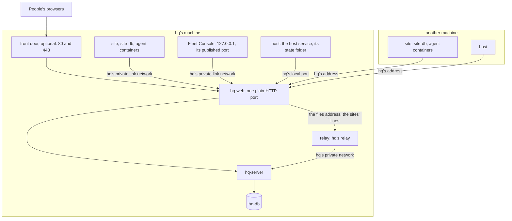

# Deploying Agenthix

What an install puts on a machine, how it is reached, and what a machine admin does around it. It is written for
someone who knows Docker and has not worked on this codebase. Every machine that runs Agenthix runs one **host
service**, and everything else on the machine is run by it
([ADR-0107](../adr/adr-0107-the-host-service-alone-holds-a-machines-authority.md));
[host-management.md](host-management.md) is how the host service, the Fleet Console and hq work together. The user
guide's *Running Agenthix* pages (`docs/guide/running-agenthix/`) are the step-by-step version for a person
installing it.

## What runs where



| Machine | Runs | Reachable from outside |
|---|---|---|
| hq's | the host service; hq (`hq-web`, `hq-server`, `relay`, `hq-db`); hq's site (`site-server`, `site-db`, agent containers); the Fleet Console; optionally a front door | `hq-web`'s one published port (7800 unless chosen otherwise), or the front door's 80 and 443 in front of it |
| Any other | the host service; its site | Nothing |

**Only hq listens on the network.** hq publishes one plain-HTTP port, served by `hq-web`, which serves the browser
app and forwards every server path to `hq-server`
([ADR-0067](../adr/adr-0067-hq-ends-at-one-plain-http-port.md)), and the files address and the lines sites dial to hq's
relay ([below](#hqs-relay)). Sites, host services and the Fleet Console dial out to
it; agents dial their site over a private network ([ADR-0066](../adr/adr-0066-a-site-reaches-its-agents-over-a-private-network-per-boundary.md));
nothing dials a site, a host service or the Fleet Console. HTTPS is the job of a **front door**: the one web server on a
machine that holds ports 80 and 443 and the certificates — the machine's own, or one the host service runs.

**The supported setup is one hq and one site on a machine** ([ADR-0108](../adr/adr-0108-a-machine-carries-at-most-one-hq-and-one-site.md)); the install does not refuse a further installation, which runs for testing ([below](#several-installations-on-one-machine)).
hq's machine always carries hq and its site, connected by a shared secret
([ADR-0070](../adr/adr-0070-hq-and-its-own-site-are-connected-by-configuration.md)); every further site is on a machine
of its own, added by a fleet admin in the Fleet Console
([ADR-0115](../adr/adr-0115-a-site-takes-part-when-a-fleet-admin-or-cloud-adds-it.md)). Outside hq's machine, a
machine carries a site or a relay, never both
([ADR-0154](../adr/adr-0154-a-machine-carries-a-site-or-a-relay-never-both-outside-hqs.md)); hq's relay is the only
relay today.

## What a machine needs

**Docker**, and nothing else: no clone of this repository and no build. A host service runs only published images it
has checked are signed by this repository's publishing workflow, for amd64 and arm64
([ADR-0117](../adr/adr-0117-a-host-service-runs-only-signed-published-images.md); `host/src/images/`). A development
build of the host service — version `dev`, built from a clone with `docker build -f host/docker/Dockerfile -t
agenthix-host .` — runs images built on the machine instead, and says their signatures were not checked. Building hq's
image on an Apple-silicon Mac needs Docker Desktop's Rosetta setting on, since its Wasp stage is fixed to Intel
(`hq/docker/Dockerfile`).

## Releases and the images they publish

A version tag publishes the images: `v<major>.<minor>.<patch>` for a release, and `v<major>.<minor>.<patch>-alpha.<n>`
or `-rc.<n>` for a pre-release, while features still land or once the scope is frozen (`-beta.<n>` is accepted too,
ordered between them). **A release is a tag on a commit of `main` that has been proved**
([ADR-0146](../adr/adr-0146-a-release-is-a-proven-build-given-a-name.md)); a release branch exists only for a patch
([versioning.md](versioning.md#the-product-version), the `releasing` skill). Nothing is built at the tag, and no image
carries a version: the tag gives a name to images already built and proved.

**The release build** (`.github/workflows/release-build.yml`) builds and proves everything a release ships except
publishing it. It is started by hand for a commit of `main`, and by every push to a `release/**` branch (a patch),
never by a pull request. The same steps run on a dev machine as the **release rehearsal**,
`scripts/release/prove.sh`, for the dev machine's own architecture. The rehearsal first refuses to go on if the
Sigstore trust root that hq's image carries (`hq/assets/sigstore/`, which lets hq check package signatures offline) was
fetched more than 300 days ago; `npm run sigstore:refresh` in `hq/` fetches a new one, and the refreshed files are
committed before the release. The rehearsal itself changes no file.

1. Each image part's content key is computed (`scripts/images/keys.mjs`, over `scripts/images/parts.json`;
   [versioning.md](versioning.md#an-images-content-key)). For each part and architecture the registry is asked for
   `build-<key>-<arch>` with a build attestation on it, and an image that is there is reused. The rest is built on a
   runner of its own architecture, started and made to answer (`scripts/images/start-test.sh`), pushed by digest,
   tagged `build-<key>-<arch>` and attested (`cosign attest`, keyless, naming the part, architecture, key and commit).
   The run's page lists each part as reused or built.
2. The **candidate record** (the artifact `candidate`) holds the commit, its tree, and per part its key and two
   platform digests.
3. *Install test* (`install-test.yml`) installs the candidate's amd64 images by digest and walks through the product in
   a browser, so it proves the images the release ships; *Guide screenshots* captures the guide's screenshots and
   keeps them as the set the tag takes the release's screenshots from.
4. `@agenthix/core` is type-checked, built, checked and packed. `npm run check:package` installs the packed package
   into an empty project and loads every entry point with plain Node and TypeScript's Node module rules, as a project
   outside this repository will. Core is written with full `.js` import paths (`NodeNext`), since Node does not fill
   them in as a bundler does; Checks runs the same check on every change.

**The tag** runs *Publish release*, `.github/workflows/publish-images.yml`, which builds nothing and only publishes, in
one order:

1. the tagged commit's *All checks passed* must have passed, and so must the latest release build for it, started by
   hand from `main` or by a push to a release branch (it waits while either runs);
2. **promotion, after a check of origin:** each part's content key is recomputed at the tagged commit and must equal the
   candidate's, and each platform digest must carry the release build's attestation for that part, architecture and
   key (`scripts/release/verify-candidate.mjs`). A digest built from other content is never promoted, whoever pushed
   it;
3. per part, one multi-platform index over the two digests, annotated with the version and the commit, tagged
   `:<version>`, signed (keyless) and its signature checked as a host service will check it. Each release signs its own
   index, so a reused image is signed again for the new version;
4. then the core package is given the version and published;
5. then the release page, with the **release record** attached (`release.json`, `scripts/release/record.mjs`): the
   version, commit and tree, per part its key, index digest and platform digests, core's name, version and integrity,
   and the Postgres image the host service pins. It is a record for people and for rebuilding a release; a host service
   finds a version by its tag and its signature, and does not read it. Beside it are **the guide's screenshots this
   release carries**: exactly those whose links in the guide's pages and the README, at the tagged commit, name the tag,
   taken from the release build's set for the commit; a screenshot the set lacks fails the run in its first step,
   before anything is published. Which links name the upcoming tag is decided before the release is proved, by the pin
   step ([the guide's README](../guide/README.md#releasing-the-screenshots)).

**Cleanup.** The weekly *Registry cleanup* workflow deletes untagged images and `build-…` tags older than 90 days, only
when no release record names them (`scripts/release/cleanup.mjs`); a release's version tag is never deleted. The
repository's tag ruleset stops `v*` tags being moved or deleted, with the repository admin's bypass kept for a publish
that failed part-way.

**If anything fails after the tag is pushed**, the tag and whatever that attempt published (images, the core
package, the release page with its screenshots) are deleted, the fix is made, and the same version is tagged again on the fixed commit;
with nothing built at the tag, a retry promotes the same digests. A version that published is never published again:
a fix takes a new version number.

A host service takes a pre-release as published, and expects the signer to be that workflow run for that version's
own tag. Every check of a version — the workflow, core's `PUBLISHED_VERSION` and the host service's own forms — takes
the same forms, and a host test holds them together.

**While the image packages are private,** a machine needs a credential to pull them, and only a staging machine
has one. Put `REGISTRY_USERNAME` and `REGISTRY_TOKEN` in the host service's start-up settings
(`--env-file /etc/agenthix/host.env` on its `docker run`); the token needs read access to the packages and nothing
else. When both are set the host service writes a Docker client configuration of its own in its state folder,
readable by its owner only (never the machine's `~/.docker`), and uses it for the image pull and for the signature
check. The credential is never logged, never sent to hq, a site or an agent, and is dropped from the environment of
every command the host service starts. Without both, the host service pulls anonymously, as it always has.

**A machine Agenthix Cloud runs** has three more start-up settings, written by Cloud when it creates the machine:
`CLOUD_URL` (the controller's address, https), `CLOUD_MACHINE_ID`, and
`CLOUD_ENROLMENT_CODE_FILE`, the path, as the host service's container sees it, of a file holding a one-time
code: owned by root, mode 0600, at most an hour old. The folder holding it is mounted writable, because the host
service deletes the file once the code is spent. With these the host service enrols with Cloud's controller over a
link of its own, and refuses a Fleet Console: a machine has one controller. Without `CLOUD_URL` nothing of
this runs. A code that is spent is recorded and never reused even if the file cannot be deleted, and `agenthix status`
says why a machine set up for Cloud is not enrolled yet.

**hq's connection to Cloud** is separate and needs no setting: hq reads `CLOUD_URL` from its own environment
and uses Cloud's address when it is not set ([cloud-connection.md](cloud-connection.md)).

**At the first release** the image packages are made public and the credential is revoked; no machine then needs
either setting, and they can be taken out of the start-up settings.

## Installing

Start the host service, then ask it to install:

```sh
docker run -d --name agenthix-host --restart unless-stopped \
  -v /var/run/docker.sock:/var/run/docker.sock -v ~/.agenthix:/state \
  -v agenthix-host-figures:/run/host-figures -e TZ=Europe/London \
  --network host --cap-add NET_ADMIN \
  --label com.docker.compose.project=agenthix-host <host service image>
docker exec -it agenthix-host agenthix install
```

- **`~/.agenthix`** is the state folder: every setting and secret of what the host service runs, the machine's
  capacity, nightly backups and their key, scheduled changes, and the host service's own keys. It is readable by
  its owner only, and the host service never moves it. A site's data — its workspaces — is in `site/data` inside it.
- **`TZ`** is the machine's own time zone, since nightly backups, the maintenance window and scheduled changes run
  in the container's time.
- **The figures volume** holds the socket the site reads the machine's ceilings and protections from.
- **`--network host --cap-add NET_ADMIN`** is what the agent protections need: the firewall the host service
  changes is the machine's own. No `--privileged`.

`agenthix install` (`host/src/install/install.ts`) asks one question — the address people will open hq at — then:

1. checks every image's signature, and pulls them by digest;
2. makes every secret in the state folder — hq's database password, `JWT_SECRET`, hq's and the site's own
   `SECRETS_MASTER_KEY`, the site's database password, `HQ_PAIRING_SECRET` and `HQ_CONSOLE_PAIRING_SECRET`
   (`host/src/state/secrets.ts`) — and writes hq's and the site's compose projects (`host/src/compose/projects.ts`).
   A value already set is never replaced, so running it again starts what is stopped and changes nothing;
3. starts hq and waits for it, then the site, named after the machine, which dials hq-web over hq's private link
   network;
4. starts the Fleet Console and connects this machine to it;
5. prints one link for the first account, which holds the organisation admin and fleet admin roles. The link opens
   setup, which happens in hq ([below](#setup-happens-in-hq)).

It then prints a one-line command that saves a two-line shortcut, `/usr/local/bin/agenthix` (or `~/.local/bin`), which
runs `docker exec -it agenthix-host agenthix "$@"`; without it, the `docker exec` form works the same.

**An installation** is everything one host service runs on a machine, and it is identified by its **namespace**. The
host service records it once, at its first start, in `installation.json` in its state folder, from `INSTALL_NAMESPACE` on
the `docker run` that started it, else the default, `agenthix`. The host service's own container must be named
`<namespace>-host`; a start where it is not is refused, with nothing recorded, and so is a state folder that records
another namespace than `INSTALL_NAMESPACE` says. Besides the namespace, `installation.json` holds the two ports the
installation publishes and its agents' address range ([below](#the-ports-an-installation-publishes)); every container
the installation runs carries them as labels, which another installation's host service reads before it publishes
anything (`host/src/state/installation.ts`).

Every name on the machine is `<namespace>-<part>[-<what>]`, from that namespace (`host/src/state/namespace.ts`): the containers `agenthix-host`,
`agenthix-hq-server`, `agenthix-hq-web`, `agenthix-relay`, `agenthix-hq-db`, `agenthix-site-server`, `agenthix-site-db`,
`agenthix-console` and `agenthix-agent-<id>`; the volumes `agenthix-hq-db-data`, `agenthix-hq-storage`,
`agenthix-site-db-data`, `agenthix-console-state` and `agenthix-host-figures`; the networks `agenthix-hq-internal`,
`agenthix-site-internal`, `agenthix-hq-link`, `agenthix-edge` and `agenthix-console`; and the databases `agenthix_hq`
and `agenthix_site`. Volumes and networks are named explicitly, so compose adds no prefix of its own. Labels are
`agenthix.<key>`.

**The address ranges an install uses.** Its own networks each take one /24 (256 addresses) from `10.214.0.0/16`,
and its agents' networks one /29 each from the **agent slice** it was given ([below](#the-agent-slice)); nothing is left to Docker's default pool, which on a
machine with many networks reaches 192.168.0.0/16, where a home or office network usually is, and would cut HQ off
from a model on another computer there. A network that already exists keeps its subnet whenever its compose file is
written again; a new one takes the first /24 that no Docker network and none of the machine's own addresses
overlaps, so two installs on one machine never share one (`host/src/compose/subnets.ts`). When the range has none
left, install refuses and says to remove the Docker networks no longer needed. A local network inside `10.213.0.0/16`
cannot be reached from the agents; on Docker Desktop the host service sees only
the virtual machine's addresses, not the computer's, so the same holds there for `10.214.0.0/16`.

**One group per part.** Docker Desktop groups containers by their compose project, which is also what the host service
starts, upgrades and removes with `--remove-orphans`, so each part that lives a life of its own is its own group:
`agenthix-hq`, `agenthix-site`, `agenthix-console` and `agenthix-front-door`, by compose; `agenthix-host`, the host
service and its launcher, by the label `com.docker.compose.project` on the `docker run` above, which the launcher
carries to each new version; and `agenthix-agents`, the agent containers and their networks, and a workflow run's step and
proxy containers ([workflows.md](workflows.md)), by the same label, which the site sets. The agents never share the site's group, whose next upgrade would remove them as orphans mid-run. Their
group is deleted as one in Docker Desktop, or with `docker compose -p agenthix-agents down`; erasing the site, or HQ
with it, takes it down too. An agent container holds nothing kept nowhere else, and is made again when needed.

### The ports an installation publishes

An installation publishes two ports on the machine, and no more: **HQ's** and **the Fleet Console's**. Both are the
machine admin's to choose, because they are the only ports of Agenthix that can clash with other software; everything
inside the containers, and in development, keeps Agenthix's own numbers. [ports.md](ports.md) is the one table of every
port and address block.

| Port | Default | Chosen with | Changed with |
|---|---|---|---|
| HQ's | 7800 | `install --hq-port <port>`, or the port of a plain `http://` address | `agenthix hq address <address>` |
| The Fleet Console's | 7801, on `127.0.0.1` only | `install --console-port <port>`, `console install --console-port <port>` | `agenthix console port <port>` |

- **Chosen once, then kept.** The port is recorded in `installation.json` at the install and read back by every operation
  after it; a re-run of `install` changes nothing that is set, and refuses a flag that names another port rather than
  ignoring it (`host/src/install/ports.ts`). For a machine HQ moves to, or a restore, `console connect` and
  `restore` take the same two flags.
- **HQ's address and its port agree.** A plain `http://` address names the port browsers open it on (80 when it names
  none), and that is HQ's published port; `--hq-port` must agree with it or is refused. An `https://` address says
  nothing of the port, because a front door or the machine's own web server answers on 443: HQ's port is then
  `--hq-port`, else what was recorded, else 7800, on `127.0.0.1` for that proxy to reach.
- **What may be chosen:** a port from 1024 to 32767, below the range operating systems give to outgoing connections,
  where a listener can lose its port at random; HQ may also take 80 or 443. The two cannot be the same port.
  (`CHOSEN_PORT_RANGE` and the defaults are in `core/src/ports/ports.ts`.)

**The check.** Before anything is published, and before anything is fetched or written, one check
(`host/src/install/portCheck.ts`) is asked by every operation that publishes a port: `install`, `restore`,
`console install`, a move received, `hq address`, `console port`, the front door on 80 and 443, and a remote access
port. It refuses with every problem at once: a port outside the range; a port this installation already uses for
another of its parts; a port another installation on the machine holds (read from the `ports` label on its
containers, running or stopped); and a port held now, found by trying to listen on the address it would be published on
and, when Docker publishes it for a container, named by that container, else reported as a program outside Docker. A
port this installation's own containers already hold is not a problem; it is what a re-run finds. A refusal says what
is wrong, who holds the port, and how to choose another, and ends "Nothing was changed."

**A part kept from starting.** A port can be free at install and taken by the time the machine starts again after a
reboot, when Docker starts the containers in no particular order. Docker then leaves that part stopped. `agenthix
status` says so for each part (HQ, the Fleet Console, the front door): which port, who holds it, and what to do; the
Fleet Console shows the same from the figures the host service sends HQ, and the host service writes it to its log shortly
after it starts (`host/src/status/portsBlocked.ts`). Free the port, or move the part to another.

### Several installations on one machine

The supported configuration is **one installation on a machine**
([ADR-0108](../adr/adr-0108-a-machine-carries-at-most-one-hq-and-one-site.md)). More than one runs only for **testing**, where a
test installation runs beside an installed copy: each starts under a namespace of its own (`INSTALL_NAMESPACE`, and a
host container named `<namespace>-host`), on ports it chooses, so nothing is shared by name or by port. The check
above is what keeps them apart: a port another installation's labels list is refused as theirs. The
`running-locally` skill (`.agents/skills/running-locally/`) shows how to start one.

### The agent slice

An installation with a site gives its agent containers a **slice** of `10.213.0.0/16`: a /20 (4,096 addresses),
picked once when the site is first installed, as the first slice that overlaps no Docker network, none of the machine's
own addresses and no slice another installation labels its containers with. It is recorded in `installation.json` and
read back by every operation after, so an upgrade or a rewritten compose file never picks again. The agents'
networks are a /29 each inside it, and the firewall rules that stop agents reaching the machine and its network cover
only that slice, so one installation's rules never reach another's agents (`host/src/compose/agentSlice.ts`). When
none is left, install refuses and says what to remove. Tests create their networks in `10.211.0.0/16`.

## Setup happens in hq

A new install is **not set up**: hq has no accounts, its sign-in page says so and where the link is. The first admin opens the link `agenthix install` printed (valid 24 hours; `agenthix hq invite-admin` makes
a new one, which withdraws the last, and hq also prints one in its log at every start without accounts). That makes their
account and opens **setup in hq**: their name and password, how the organisation reaches AI (Agenthix Cloud, or its own
model and voice providers with their keys), the organisation's name and time zone, and a last look. It cannot finish
without a working model provider, speech-to-text provider and text-to-speech provider. hq's state (**not set up**,
**setting up**, **set up**) is worked out from its data and never stored, and a mobile app reads it before sign-in
(`claimState`, `core/src/client/protocol.ts`).

The Fleet Console has no first run of its own and is not where setup happens: it is installed with hq, is reached once the
account exists, and signs in with that account's fleet admin role. Setup asks nothing of the machine's admin beyond the
link. For a machine with no browser, `agenthix provider add|list|remove` puts the organisation's providers in place from the
terminal (the key is asked for there, never typed on a command line); setup then finds them, and opens at the first step
whose need is unmet. Providers are the organisation admin's after that, in the admin area, and not the fleet admin's:
hq reads no provider key from its own environment at start. What setup asks and writes is
[setup](../concepts/setup/setup-flow.md).

## hq's address

**The address decides where hq-web listens** (`listenerFor`, `host/src/install/address.ts`):

| Address | hq-web listens on | Proxies trusted |
|---|---|---|
| `http://localhost:…`, or another loopback name | `127.0.0.1`, on the address's port | 1 |
| `http://` a network address or name | `0.0.0.0`, on the address's port | 1 |
| `https://…` | `127.0.0.1`, on HQ's published port, behind a front door | 2 |

**`HQ_URL` is set when hq-web starts.** The browser app is built once with a placeholder address, and hq-web's start
script puts `HQ_URL` in its place ([ADR-0111](../adr/adr-0111-hqs-browser-app-takes-its-address-when-it-starts.md)), so
changing hq's address is a restart — done as a move, `agenthix hq address <address>`, so that sites and machines follow
([host-management.md](host-management.md#moves)).

**`HQ_TRUSTED_PROXIES`** is how many proxies hq trusts to report a caller's real address: `hq-web` itself, and the
front door when there is one. hq uses the caller's address in its per-address limits, so with a front door hq-web must
stay on `127.0.0.1`, or a caller reaching hq-web around it could claim any address.

**Files have their own origin**, `FILES_ORIGIN` ([ADR-0114](../adr/adr-0114-uploaded-files-are-served-from-their-own-origin.md);
`filesOriginFor`, `host/src/install/address.ts`): `files.localhost` on hq's own port for a local address,
`files.<hq's host>` for a domain, and none for a bare network address. hq's relay answers there, never hq-server
([below](#hqs-relay)). On a bare address tickets are opened on hq's own address under `/relay/`, where every answer is a
download (a picture keeps its type, so an image tag still draws it, and text is read and drawn by the page), so PDF
preview needs a files address.

### hq's relay

The `relay` container in hq's compose set carries the bytes of every file a browser opens: a site's, and the uploads
hq keeps (task attachments, pictures)
([ADR-0153](../adr/adr-0153-relays-carry-every-file-byte-and-hq-only-signs-tickets.md);
[files-and-relays.md](files-and-relays.md)). hq-server serves no file. It publishes nothing and is reached by hq-web
alone (`hq/docker/Caddyfile`):

| On hq-web | Goes to |
|---|---|
| `/t/*` and `/viewer/pdf` on the files host | the relay: a ticket, and the PDF viewer page. Nothing else is answered on the files host |
| `/relay-line` on hq's host | the relay: the WebSocket a site dials to hold its file line |
| `/relay/*` on hq's host | the relay, unchanged: a ticket on a bare address |

hq-web compresses nothing under `/t/` or `/relay/`: a PDF is read by byte range, and a range of a compressed answer is
not a range of the file. The relay dials hq-server for its own link on hq's private network, so `/relay-link` has no
route through hq-web. Its environment (`host/src/compose/projects.ts`; the full list is in `relay/AGENTS.md`):

| Variable | Set to |
|---|---|
| `HQ_RELAY_SECRET` | A secret made at install, the same in hq-server's environment; at least 32 characters |
| `RELAY_HQ_ADDRESS` | hq-server on hq's private network |
| `HQ_URL`, `FILES_ORIGIN` | hq's address, the one origin given CORS, and the files address |
| `RELAY_PORT` | The relay's server port ([ports.md](ports.md)) |
| `HQ_UPLOADS_ROOT` | hq's storage volume, mounted read-only at `/hq-storage` |

When the relay is stopped, files cannot be opened or downloaded and screens say so; the rest of hq carries on.

## In front of hq

**The host service's front door.** `agenthix front-door on` runs Caddy on ports 80 and 443, holding the certificates for
hq's host and its files host and passing both to hq-web over the machine's edge network (`host/src/frontDoor/`). It warns
first that it takes both ports for the whole machine, is refused while either is in use, checks its configuration
before anything changes and puts everything back if a certificate cannot be had. It needs a domain whose DNS points at
the machine, and both ports reachable from the internet. `front-door off` stops it.

**On a machine Agenthix Cloud runs,** Cloud gives the front door a certificate and its key instead
(`frontDoor.set`, accepted from Cloud's controller alone; [host-management.md](host-management.md#agenthix-clouds-controller)):
Caddy then asks no certificate authority for any name, the pair is written at 0600 under the front door's folder and
mounted read-only into its container, one certificate serves both hosts and must cover each, and a new certificate
starts the front door again. A files host Cloud gives is kept through an address change; with a certificate and none
given, only hq's host is routed and files are opened on hq's own address, under the bare `/relay/t/…` path, where a PDF can only be downloaded.

**The machine's own front door.** With an `https://` address and no front door of the host service's, point the
machine's own web server at hq-web for both hq's host and the files host, passing the `Host` header and WebSocket
upgrades through. A front door in a container joins the `agenthix-edge` network and reaches `http://agenthix-hq-web:4100` (hq-web's own port inside its container, which never changes);
one on the machine reaches `http://127.0.0.1:<HQ's published port>`, 7800 unless chosen otherwise. For nginx:

```nginx
map $http_upgrade $connection_upgrade {
    default upgrade;
    ''      close;
}

server {
    listen 443 ssl;
    server_name hq.example.com files.hq.example.com;
    # ssl_certificate and ssl_certificate_key: your own

    client_max_body_size 50m;   # nginx's default is 1 MB; set it to the largest upload you expect

    location / {
        proxy_pass http://127.0.0.1:7800;   # HQ's published port
        proxy_http_version 1.1;
        proxy_set_header Host $host;
        proxy_set_header X-Forwarded-For $proxy_add_x_forwarded_for;
        proxy_set_header X-Forwarded-Proto $scheme;
        proxy_set_header Upgrade $http_upgrade;
        proxy_set_header Connection $connection_upgrade;
        proxy_read_timeout 1h;
    }
}
```

For Caddy on `agenthix-edge`, `hq.example.com, files.hq.example.com { reverse_proxy agenthix-hq-web:4100 }`; Traefik,
Nginx Proxy Manager or a Cloudflare Tunnel route the same two hosts the same way.

**Live previews** need a wildcard host name of their own and a certificate for each app
([ADR-0169](../adr/adr-0169-live-apps-travel-through-relays.md),
[sites/site_live_preview.md](sites/site_live_preview.md)). A live app is reached at `p-<id>.<preview domain>`, built from
the pattern `PREVIEW_PATTERN`, which the host service sets for hq-server, hq's relay and hq-web from the preview domain:

- **A server with a domain.** One wildcard DNS record, then `agenthix front-door on --previews <preview domain>`. The front
  door asks for one certificate per app on its first open, after asking hq (`/preview-certificate-ask`), which says yes
  only for an app id it has recorded and for the check name. The command runs three checks (DNS, port 443 with a
  certificate a browser accepts, the relay answering behind it) and puts everything back if one fails.
- **hq-web** sends the preview names to the relay, not to hq-server.
- **A laptop with hq at `http://localhost:<port>`** needs nothing: the pattern is `p-<id>.preview.localhost:<port>`.
- **A bare network address** has no pattern, so no live previews; the rest of hq is unaffected.
- **Your own web server** sends the wildcard name to hq's address and holds a certificate covering it.

Live previews are also per site: a fleet admin switches them on in the Fleet Console, and the machine's firewall rules for
the live-preview part of the agent address range must hold ([ports.md](ports.md)).

## The Fleet Console

The fleet admins' screens, started by `agenthix install` on hq's machine
([host-management.md](host-management.md#the-fleet-console-and-how-hq-relays-it)). It runs on a Docker network of its
own, `agenthix-console`, which nothing else joins, and **Docker publishes its port to `127.0.0.1` of the
machine only**, 7801 unless the machine admin chose another (`agenthix console port <port>` changes it) (`host/src/compose/console.ts`) — except on a machine Agenthix Cloud runs, where, while Cloud has remote
access on, the host service publishes one more port (1024 to 65535) for the length of that access, and the Fleet Console
ends TLS there and answers only the addresses Cloud allows ([host-management.md](host-management.md#remote-access-on-a-machine-cloud-runs)).
Inside, it accepts a connection from the loopback side only from that network's gateway. On
Docker Desktop the published port reaches the computer, so a browser there opens it. From anywhere else, use an SSH
tunnel:

```sh
ssh -L 7801:127.0.0.1:7801 <hq's machine>
```

then open `http://127.0.0.1:7801` (or the port chosen) and sign in with an hq account that holds the fleet admin role. It may run on another
machine instead, even a fleet admin's own computer: `agenthix hq console-code` on hq's machine, then
`agenthix console install <hq address> <code>` there.

## A further site

On a new machine, start the host service as above — but do not run `install`, which is for hq's machine. A fleet admin
chooses **Add a site** in the Fleet Console and gets a one-time code; the machine admin runs
`agenthix console connect <hq address> <code>`, compares the fingerprint it prints with the fleet admin, who confirms;
the host service then starts the site, named after the machine, and it takes part at once
([host-management.md](host-management.md#adding-a-site-and-leaving)). `agenthix console disconnect` takes it out
again, at once.

**hq's address must be reachable from the site's machine.** Each site and host service dials the address hq gave, and
refuses a plain `http://` address that is neither on the machine nor on a private network
(`site/src/server/control/hqUrlPolicy.ts`): use hq's `https://` address across the internet.

## Capacity

A site starts at most a set number of agent containers at once, each with a memory, processor and process ceiling:
**5 containers of 8 GB, 2 processors and 4096 processes** until set otherwise (`DEFAULT_CEILINGS`,
`host/src/figures/figures.ts`). A run beyond that waits for a slot, and hq says it is waiting. `agenthix capacity set`
on the machine, or *Change capacity* in the Fleet Console, changes them, and refuses ceilings whose containers could not
all fit the machine's memory at once. Size them from a measurement of your own heaviest work:

```
containers at once  =  (machine memory − OS − hq and the databases − the site)  ÷  peak memory per run
```

Watch an agent container while a representative task runs (`docker stats --no-stream`) and take the highest memory
use. The defaults have not been measured on a deployment machine.

## Status, logs and getting back in

| On the machine | Does |
|---|---|
| `agenthix status` | Every hq and site on the machine, each in a sentence that ends in what to do next |
| `agenthix hq logs [<part>]`, `agenthix site logs [<part>]` | Recent log lines of hq-server, the relay, hq-web, hq-db, or the site and site-db |
| `agenthix hq invite-admin` | On a fresh install, a link for the first account; once hq has people, an organisation admin invitation for when none can sign in |
| `agenthix provider add <vendor>`, `list`, `remove <vendor>` | The organisation's model and voice providers, from hq's machine: the key is asked for at the terminal and sent over hq's control socket, checked with the vendor before it is stored, and recorded as the machine admin's |
| `agenthix hq reset-password <user>` | A one-time link, valid an hour, to set that person's password |
| `agenthix hq fleet-admin [--remove] <user>` | Gives that account the fleet admin role, or takes it away; how the role comes back when no fleet admin is left |
| `agenthix help [<command>]` | Every command, or one in detail (`host/src/cli/commands.ts`) |

hq keeps no email address and sends no email, so every way back in is an admin in the app or a command on hq's machine.
The `hq …` commands reach hq through a Unix socket inside the `hq-server` container that only `docker exec` reaches
(`host/src/hq/control.ts`, `hq/src/auth/machine/`); each is recorded as made on hq's machine and announced.

Each service keeps its own log, as files that roll each day and at 10 MB, kept for 7 days or 100 MB: hq's in `logs/`
inside its storage volume, a site's in `logs/` inside its data folder
([ADR-0106](../adr/adr-0106-each-service-keeps-its-own-logs.md); [logs-and-diagnostics.md](logs-and-diagnostics.md)).
Fleet admins also read them in hq, under **Manage organisation › Infrastructure › Logs and diagnostics**.

## Upgrading and backing up

Both are the host service's ([host-management.md](host-management.md#maintenance-changes-now-or-at-a-set-time)):

- **Upgrades:** `agenthix hq upgrade` or `agenthix site upgrade`, now or `--at` a time, or from the Fleet Console's
  *Maintenance*. Members are told, runs pause, a sealed backup is taken first, and a version that does not come up
  healthy within 10 minutes is rolled back. Fixes apply by themselves in the maintenance window
  (`agenthix upgrades`). `agenthix upgrades host` moves the host service itself, through its launcher.
- **Backups:** every machine backs itself up, sealed, each night at 02:00 machine time. `agenthix backup location
  <path>` adds a copy in a folder of your choosing — set only on the machine — and `agenthix backup export` writes one
  sealed to a key shown once. (A machine Agenthix Cloud runs has its location set by Cloud, to an S3-compatible store,
  and no folder can then be set.) **Keep the key**: a backup cannot be read without it, and hq's backup holds the
  `SECRETS_MASTER_KEY` without which the keys and logins hq saves, and the words of every conversation, cannot be read.
- **Restoring on a new machine:** `agenthix restore --from <folder or file>`, on a machine where nothing runs yet.

## What an install leaves on a machine, and what removes it

Everything the host service makes is named from the install's recorded namespace (`agenthix` by default;
`host/src/state/namespace.ts`), and `agenthix uninstall` removes all of it by those names
(`host/src/lifecycle/uninstall.ts`, `uninstallSteps.ts`). It is refused while hq or a site is on the machine, running
or suspended — `agenthix hq erase` or `site erase` first, which keeps a final backup for 30 days — and an erased one
still in the bin is purged only when its address or name is typed. A step that fails is reported and the rest run;
running it again removes what is left.

| What the install leaves | Name | Removed by |
|---|---|---|
| hq, its site and the front door: containers, networks and volumes | compose projects `<ns>-hq`, `<ns>-site`, `<ns>-front-door` | `hq erase`, `site erase` (`compose down --volumes`); the uninstall sweeps any left by label |
| The agents a site started, and their networks | group `<ns>-agents`, by the `com.docker.compose.project` label | `site erase`, `hq erase`, the uninstall |
| The Fleet Console and its keys | compose project `<ns>-console`, volume `<ns>-console-state` | the uninstall (on hq's machine; one installed elsewhere is refused until it is moved or removed with `console remove`) |
| The agent protections | nftables table `inet <ns>_agents` | the uninstall, which first stops the host service putting it back |
| The install's networks | `<ns>-console`, `<ns>-hq-internal`, `<ns>-site-internal`, `<ns>-edge`, `<ns>-hq-link` | erase, with their projects; the uninstall, by name |
| The images it fetched | the published images, and the database's and front door's by their digests | the uninstall, never forced, so one another container uses stays; a development build fetched none and removes none |
| The host service: its container, launcher and the one kept during a switch | `<ns>-host`, `<ns>-host-launcher`, `<ns>-host-previous` | the uninstall; its own container last, by a helper `<ns>-host-uninstall` started from its image (`host/src/launcher/uninstall.ts`), which then removes itself |
| The figures volume | `<ns>-host-figures` | the uninstall's helper, once the host service's container is gone |
| The state folder: settings, secrets, keys, backups, exports and the bin | `~/.agenthix`, or wherever `/state` is mounted from | the uninstall's helper, given the folder alone, empties it (the person removes the empty folder), only when it records this namespace and holds nothing but the entries the host service writes (`STATE_FILES`, `STATE_FOLDERS` in `host/src/launcher/uninstall.ts`, checked against the code by `stateEntries.test.ts`); a folder holding anything else is left whole, and what else it holds is reported |

Not removed: the backup location, which is the person's own, and the host service's image, which the helper runs from;
the uninstall prints the `docker image rm` that removes it.

## What a site can reach, and who can act as it

Accepted limits of the current design. Each says what happens, why it is accepted and what would change it.

### Agents keep internet access

The host service's agent protections block agents from the machine's own ports, ports other containers publish, and the
cloud providers' metadata addresses, and a site starts no agent until they hold
([host-management.md](host-management.md#the-host-service)). They leave ordinary internet access, so an agent that
follows an instruction planted in what it reads can send what its project holds to an internet address. An egress
proxy with a per-project allow-list is queued as later work.

A site run without the host service — from `site/compose.yml`, or in development — has no protections and keeps its
own ceilings (`site/src/server/host/hostFigures.ts`).

### A site's machine credential has no lifetime

A site's machine credential has no expiry, by design: anyone who holds it is that site as far as hq can tell. The site
keeps it encrypted in its own database, the host service keeps it in its state folder, and a site's backup carries it
([ADR-0119](../adr/adr-0119-a-sites-backup-carries-its-authority.md)), so the machine and the backup's key are the
protection. Recovery is disconnecting the machine in the Fleet Console, which removes the credential at hq.

### A site can report a person's refreshed subscription credential

A person's subscription credential is refreshed while a run uses it, and the site running it reports the refreshed
credential to hq. hq checks that the placement names that site and that the expiry only increases
(`hq/src/sites/credentialRefresh.ts`); it does not check that a run acted as that person. A compromised site could
therefore replace such a person's stored subscription with another account's, and the replacement persists after the
site is removed. The exposure is limited to the people whose storage that site holds, and such a site already sees their
token whenever it runs for them.

### hq keeps only a hash of an invite

An invite's link is shown once, when it is created, and hq stores only a hash of its token. A lost link cannot be shown
again: revoke the invite and issue a new one.

## Without the host service

`hq/compose.yml`, `site/compose.yml` and `front-door/` build the images from a clone and run them with `docker compose`.
They serve development of the images; nothing above — signed images, protections, backups, the Fleet Console — applies
to them, and a further site cannot join an hq that way, since only the Fleet Console adds one.
