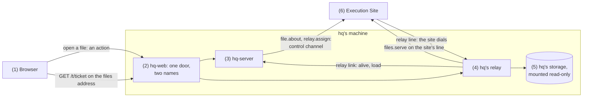
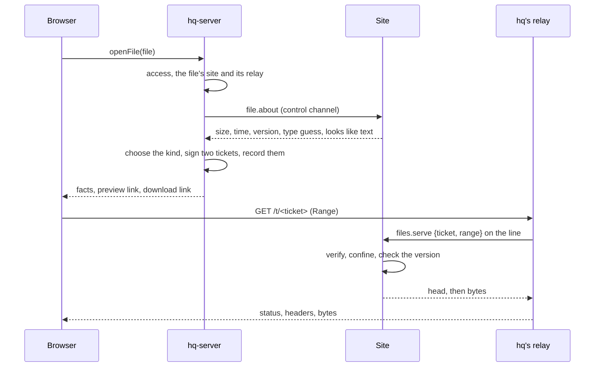

# Files and Relays

How the bytes of a file reach a person's browser without passing through hq: hq checks access and signs a ticket, a
**relay** carries the bytes, and the site that holds the file checks the ticket and serves only what it names. What
the browser then draws, and where files are referred to, is [files-in-the-browser.md](files-in-the-browser.md).

1. **The browser** asks hq to open a file, gets back the file's facts and a link carrying a ticket, and fetches the
   link.
2. **hq-web** is hq's one published port ([ADR-0067](../adr/adr-0067-hq-ends-at-one-plain-http-port.md)). It sends the
   app's name to the app and hq-server, and the files name to hq's relay.
3. **hq-server** decides: it checks the person's access, asks the site about the file, chooses the file's kind, signs
   the ticket and records it. It never carries a byte of a file.
4. **hq's relay** carries the bytes: a ticket's request goes down the line the file's site holds to it.
5. **hq's storage**: the files hq keeps itself (task attachments, pictures), which hq's relay serves from its own
   read-only mount.
6. **The site** verifies the ticket, confines the path to the place's storage, checks the file has not changed, and
   streams the bytes.

The rule is [ADR-0153](../adr/adr-0153-relays-carry-every-file-byte-and-hq-only-signs-tickets.md): **hq decides,
relays carry, sites hold.** There is no fallback through hq: when a relay is not answering, opening a file says so.
Nothing listens on a site; a site dials its relay as it dials hq.

## Words used here

| Term | Meaning |
|---|---|
| **Relay** | A fleet member that carries bytes between browsers and the sites assigned to it, and decides nothing (`relay/`). Not the site's *model relay*, nor hq's relaying of the Fleet Console's commands |
| **hq's relay** | The relay on hq's machine, in hq's compose set, connected to hq by configuration. Today it is the only relay |
| **Files address** | The origin a relay answers browsers on (`files.example.com`, `files.localhost`): another origin from hq's, with no session ([ADR-0114](../adr/adr-0114-uploaded-files-are-served-from-their-own-origin.md)) |
| **Bare address** | An installation whose address can have no name for files (a network address): tickets are opened on hq's own address under `/relay/`, and nothing is answered inline |
| **Ticket** | hq's signed permission for one stream: one purpose, one file at one version, one person, one relay, five minutes |
| **Relay pass** | hq's signed permission for one site to hold a line to one relay, an hour long |
| **Line** | The WebSocket a site dials to its relay, on which the relay asks for files |
| **Space** | Where a file is named: a place's storage (`place`, optionally at a `commit` of a workspace's repository), an owner's `artefacts/` (`artefact`), a knowledge page (`knowledge`), or a file hq keeps (`upload`) (`core/src/files/refs.ts`) |

## Opening a file, end to end

1. **Access first.** `openFile` (`hq/src/files/openFile.ts`) checks the person may read the file's owner
   (`assertLocationAccess`) before anything is asked of a site; a file they may not read answers `not-found`, the same
   as a file that is not there. It finds the site holding the place and that site's relay. A relay that is not
   connected to hq answers `relay-unavailable` at once, before the site is asked or anything is signed.
2. **About the file.** `file.about` (`core/src/protocol/fileAbout.ts`) answers the facts and
   whether the first bytes look like text; no content crosses hq. A file with more than one hard link is refused as
   `linked`, which `openFile` answers as its own state so the frame can say why. A place's file may
   name a `commit`: see *A workspace's file at a commit* below.
3. **The kind** is chosen by core's `chooseFileKind` (`core/src/files/kind.ts`), so hq and the page agree.
4. **Two tickets**, preview and download, are signed and recorded by `issueFileTicket` (`hq/src/relays/fileTickets.ts`):
   a `FileOpened` row is written for each before it is returned, so no browser holds a ticket hq has no record of.
   A kind whose viewer needs the files address (PDF) on a bare address answers `no-files-address`, with the download
   link only.
5. **The relay** reads the ticket's site and person without verifying it, to choose the line and count streams, and
   opens `files.serve` with the ticket and the browser's `Range`, untouched.
6. **The site** (`site/src/server/relay/filesServe.ts`) verifies the ticket with core's `verifyRelayToken`, opens the
   file once through `openSiteFile`, takes the version from the open file's own stat, and answers a head
   (`core/src/relay/streamHead.ts`) followed by the whole file or one range.
7. **The relay** turns the head into a status and headers and passes the bytes on.

**Embeds on a screen** are opened together: `openFiles` takes up to 50 files, each through the same open, six at a
time, and one file that cannot be opened answers its own state without failing the others. **Chips** ask
`getFileFacts`, which checks access and asks the site about the file but signs nothing.

**What the answer can be** (`FileOpenAnswer`, `core/src/files/open.ts`): `ready`, `no-files-address`, `no-relay`
(the site has no relay yet), `relay-unavailable` (naming the site and its relay), `site-unavailable`, `linked` (the file has
more than one hard link) or `not-found`. `getFileFacts` for a chip answers `linked` the same way. The frame words each one ([files-in-the-browser.md](files-in-the-browser.md#the-frame-and-its-states)).

### A workspace's file at a commit

The workspace view reads a workspace with Git at one commit (a branch's latest, `main`'s, or one of `main`'s versions),
and opens its files through the same `openFile`, with the `commit` named in the file's ref. The site does not read the
folder for it (`site/src/server/files/gitFiles.ts`): the commit helper, the container that already runs every git
command on the repository, reads the one plain file named by its exact path in that commit's tree (never a symlink, a
submodule or a folder) and answers its blob id, size, commit time and first bytes for `file.about`. For `files.serve`
the helper writes the file whole into `git-file-reads/`, a folder of the site's own that no container mounts, and the
site serves it from there for the ranges a PDF viewer reads and for the download. The file's version in the ticket is its
blob id, so a commit's file never reads as changed. The copy is kept a little longer than a ticket lives, the folder is
emptied when the site starts, and every open checks again that the site holds the workspace as a code workspace. A
`commit` on any other kind of file names nothing and is not found.

**Who may read a commit.** Anyone who may read the workspace may read any commit of its own repository, not only the
branches and versions its screen lists: an intermediate commit, or one of a deleted branch while git keeps it. The
helper checks only that the name is a commit of that repository, so nothing outside the workspace is reachable, and a
person who can't read the workspace gets no ticket. This is the boundary git itself has for anyone who can clone a
repository: a file removed from a branch stays in its history, and a secret once committed is rotated, not deleted.

**A site's refusal**, and the status the relay answers with: `ticket-invalid` and `ticket-expired` 403, `changed` 409
(the file's version is no longer the ticket's), `not-found` 404, `range-not-satisfiable` 416, `busy` 503 (the site's
reads and its queue are full), `failed` 500. The relay itself answers 503 when the site holds no line to it, 429 past
16 streams for one person, and 404 for a path that is not a ticket's.

## Tickets and passes

hq signs both with its one RS256 key (`hq/src/relays/relayTokens.ts`); sites and relays fetch the public half from
`/.well-known/jwks.json`, again for a key id they do not hold. Neither a site nor a relay can make one. Both are
verified in one place, `verifyRelayToken` (`core/src/relay/verifyToken.ts`): signature first, then every claim.

| Claim | File ticket | Relay pass |
|---|---|---|
| `aud` | The site that serves the file; for an upload, the relay itself | The relay |
| `sub` | — | The site |
| `purpose` | `preview` or `download`; `diff` and `ide-session` are reserved and refused today | — |
| The file | Its space and its name in that space (`readFileRef`) | — |
| `version` | Size and modified time when signed (`fileVersion`) | — |
| `person` | Who it was made for; null only for a picture the sign-in page shows | — |
| `relay`, `site` | The relay it goes through; the site that serves it | — |
| Life | 5 minutes (`FILE_TICKET_TTL_SECONDS`) | 1 hour, renewed at 80% |

A ticket travels in the link's path, so a frame, an image and a download can all use it, reusable until it expires
so a PDF viewer can read by range. It is never a cookie and never a header. Neither the relay nor the site logs a
ticket, a path or a query string. There is no revocation list: a ticket dies with its five minutes, or as soon as
the file changes.

## The site's line

hq tells a connected site which relay to hold a line to with `relay.assign` (`core/src/protocol/relayFiles.ts`; `hq/src/relays/relayAssignment.ts`): the relay, the line's address and a pass. It
sends the same assignment again before the pass ends.

- **The site dials** (`site/src/server/relay/relayLines.ts`, `relayLine.ts`) with the pass as its bearer credential,
  `X-Site-Id`, and both its site protocol and the relay protocol. It dials only the address hq gave, resolved against
  the address it already dials hq on when hq gives a path (`lineUrl.ts`); hq's relay's line is the path `/relay-line`,
  reached through hq-web like hq itself.
- **One line per site.** A renewed pass is kept for the next dial and the open line carries on. A new relay or address
  opens a new line beside the old one, and the old one closes only once the new one is up and its own streams have
  ended, so open files carry on.
- **The relay accepts a line** only for a pass naming it as audience and the dialling site as subject.
- **On the line** the content channel's frames and stream multiplexer are reused (`core/src/protocol/contentMux.ts`):
  the relay opens streams, the site serves them. Each stream has **flow control**: the opener grants a window (2 MB)
  and further credit as its reader takes bytes, and the site waits for credit, so a browser reading slowly holds back
  only its own stream, never the line.
- **A site serves 32 ticket reads at once** (`SITE_CONCURRENT_FILE_READS`), queues up to 256 more, and answers `busy`
  beyond (`readSlots.ts`): its disk is shared with its agents.
- **Confinement.** `openSiteFile` resolves the real path inside the space's storage and refuses anything outside it,
  confirms the open descriptor is the entry it checked, and refuses any file with more than one hard link (`linked` to
  hq, which words it; to the relay, a ticket for such a file is not found). A ticket
  for an upload is never served by a site, and `files.serve` asked on hq's own content channel is refused.

## The relay

A plain Node server (`relay/`, [`relay/AGENTS.md`](../../relay/AGENTS.md)) that holds no database and writes nothing.

- **Two doors** (`core/src/relay/door.ts`). On the files address, `GET`/`HEAD /t/<ticket>`, with a preview answered
  inline in the type the site guessed (a value that is not a plain media type becomes an octet stream). On a bare
  address, `/relay/t/<ticket>` on hq's own address: every answer is an attachment, a picture keeps its type so an
  image tag draws it, every other preview is plain text for the page to read, and a PDF's preview is refused.
  A download is always an attachment and an octet stream.
- **Every answer**, refusals included, carries `Content-Security-Policy: sandbox`, `X-Content-Type-Options: nosniff`,
  `Referrer-Policy: no-referrer`, `Cache-Control: private, no-store`, and CORS for hq's origin only, never with
  credentials. Cookies and authorisation headers are dropped. Ranges are passed to the site as the browser sent them.
- **hq's uploads.** An `upload` ticket names the relay as its audience, so the relay verifies it itself, as a site
  would, and opens the file from `HQ_UPLOADS_ROOT` with no link anywhere on the way and no second hard link.
- **The PDF viewer page**, `/viewer/pdf`, on the files address only (see
  [files-in-the-browser.md](files-in-the-browser.md#the-renderers)).
- **The hq link.** The relay dials hq at `/relay-link` with the secret it shares with hq; hq answers `relay.welcome`
  with the relay's id, the audience its passes carry, and the relay reports its sites, open streams and bytes carried
  every 15 seconds (`relay.report`). hq records when it was last seen; one silent for a minute is shown as not
  answering.

## hq's relay

Configuration, not enrolment, as hq's site is ([ADR-0070](../adr/adr-0070-hq-and-its-own-site-are-connected-by-configuration.md)):

- **One secret**, `HQ_RELAY_SECRET` (at least 32 characters), in hq-server's and the relay's environment; the host
  service makes it at install. hq keeps a single `Relay` row with `isHq` and the secret's hash
  (`hq/src/relays/hqRelay.ts`), rebuilt from the secret at each start. Without the secret, hq logs that files cannot
  be opened and places nothing on a relay.
- **Its link** dials hq-server directly on hq's internal network (`RELAY_HQ_ADDRESS`); `/relay-link` is not routed by
  hq-web. In development, where the site dials hq-server and not hq-web, `HQ_RELAY_LINE_URL` gives sites an absolute
  address for its line (`hqRelayLine.ts`, `scripts/dev/relay.sh`).
- **Placement.** Every site with no relay is placed on hq's relay, at boot and when it connects
  (`hq/src/relays/placement.ts`). The relay protocol, the `Relay` record and the line's move are shaped for further
  relays on machines of their own ([ADR-0154](../adr/adr-0154-a-machine-carries-a-site-or-a-relay-never-both-outside-hqs.md));
  adding one is not built yet.
- **It is named after hq's machine**, and shown as its site is: *hq-box · HQ's relay* (`displayRelayName`).
- **The Fleet Console** shows it on HQ's page, from `relay.facts` on the console link (`hq/src/fleet/relayFacts.ts`): its files address, whether it is answering, the sites holding a line, open streams and
  traffic. A relay not answering is on the Dashboard's *Needs you*.

How it is installed and routed is [deployment.md](deployment.md#hqs-address); its port is in [ports.md](ports.md).

## What still crosses hq

hq reads a file's content through the content transport only for its own work, never to hand it to a browser:
`location.readFile` for a place's instruction file the lead reads, `location.readKnowledge` for knowledge pages (the
Knowledge tool's reader and editor and the lead's knowledge tools), and `packages.put`. A live app's bytes and a branch carried to another site cross a relay, never hq
([ADR-0169](../adr/adr-0169-live-apps-travel-through-relays.md)). The site has no method that streams an owner's
artefact to hq; `location.listArtefacts` only lists them.

## Where things are in the code

| You want | Look in |
|---|---|
| Tickets, passes, the doors, the stream head, the relay protocol | `core/src/relay/` |
| How a file is named, its kind, the open answer, the renderer contract's core half | `core/src/files/` |
| Opening a file, embeds, chips' facts, a task's attachment | `hq/src/files/` |
| Signing, recording, placement, assignment, hq's relay, the relay link | `hq/src/relays/` |
| Links to hq's uploads and pictures | `hq/src/server/files/` |
| `file.about`, the ticket-checked reader, a workspace's file at a commit, the site's lines | `site/src/server/files/` (`gitFiles.ts`), `site/src/server/relay/` |
| The relay | `relay/src/`; its image `relay/docker/Dockerfile` |
| hq-web's routes | `hq/docker/Caddyfile` |

## What must not break

- **No file byte for a browser passes through hq-server.** A new way of showing or downloading a file signs a ticket
  through `issueFileTicket` and is carried by a relay.
- **Access before a site is asked**, and a disconnected relay answered before anything is signed.
- **The site verifies every ticket itself.** A relay passes a site's ticket on unverified and decides nothing.
- **Nothing dials a site.** A site dials its relay only at an address hq gave it.
- **Nothing is served inline on hq's own origin.** The bare door's rule holds whatever path a request came by.

## Decisions behind this

[ADR-0153](../adr/adr-0153-relays-carry-every-file-byte-and-hq-only-signs-tickets.md) ·
[ADR-0154](../adr/adr-0154-a-machine-carries-a-site-or-a-relay-never-both-outside-hqs.md) ·
[ADR-0155](../adr/adr-0155-a-file-is-drawn-only-by-a-renderer-behind-one-boundary.md) ·
[ADR-0114](../adr/adr-0114-uploaded-files-are-served-from-their-own-origin.md) ·
[ADR-0063](../adr/adr-0063-preview-traffic-crosses-on-its-own-transport.md) ·
[ADR-0067](../adr/adr-0067-hq-ends-at-one-plain-http-port.md) ·
[ADR-0070](../adr/adr-0070-hq-and-its-own-site-are-connected-by-configuration.md)
