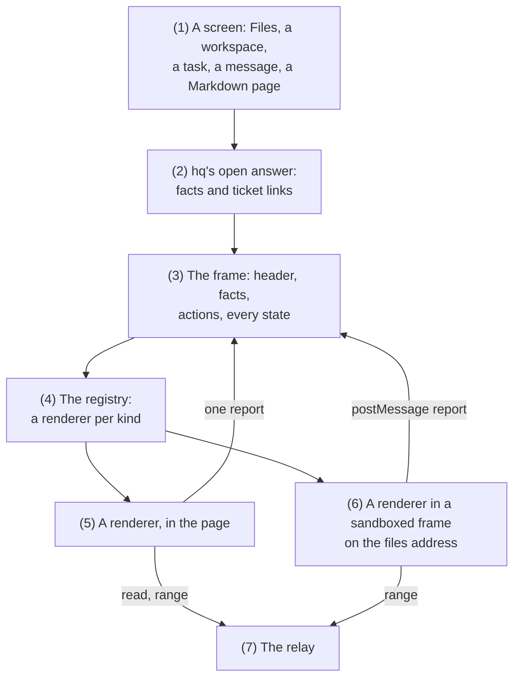

# Files in the Browser

How hq's pages draw a file once its bytes can be fetched, and where a file is referred to: the renderer boundary and
its frame, the Markdown embed, chips and references in conversations, the `@` picker, and git status. How the bytes
arrive is [files-and-relays.md](files-and-relays.md).

1. **A screen** names a file (`SiteFileRef`, [files-and-relays.md](files-and-relays.md#words-used-here)) and asks hq
   to open it.
2. **hq's open answer** carries the file's facts and its preview and download links, or a state.
3. **The frame** (`FileFrame`, `ui/src/files/`) draws everything around the file, one header (`FrameHeader`) and every
   state in words.
4. **The registry** finds the renderer for the file's kind.
5. **A page renderer** draws a text-like kind in hq's page, by trusted code, as text and never as HTML.
6. **A framed renderer** draws an active kind (PDF) in a sandboxed frame loaded from a viewer page on the files
   address, where there is no hq session, and reports by `postMessage`, checked against that origin.
7. **The relay** serves the bytes on the ticket, by range where the renderer asks.

The rule is [ADR-0155](../adr/adr-0155-a-file-is-drawn-only-by-a-renderer-behind-one-boundary.md): **a file is drawn
only by a renderer behind one boundary.** Adding a format is adding a registry entry; the frame does not change.

## The kind

One function in core, `chooseFileKind` (`core/src/files/kind.ts`), so hq and the page agree. The name gives a content
type; the site's look at the first bytes (`looksLikeText`) says whether it is text. It returns `markdown`, `text`,
`code` (with a language), `json`, `csv`, `image`, `pdf` or `none`. Images and PDFs are chosen by name alone, and an SVG
is always drawn as an image, never as markup; any other binary file is `none`.

## The contract

The core half (`core/src/files/contract.ts`) is what a renderer is given and what it reports; the ui half
(`ui/src/files/renderer.ts`) is the registry entry.

- **Given:** `FileFacts` (name, size, version, content type, kind, language) and `FileBytes`: the ticket link,
  `read(limit)` for the first bytes and `range(start, end)`. No hq API, no person, no store.
- **Reports once:** `ready`, `partial` with how much was shown (and, optionally, its own first sentence for the line
  above it, such as "the first 10,000 of 60,000 rows"), or `failed` with a reason (`unreadable`, `too-large`,
  `changed`, `unavailable`). A renderer never draws its own error. It may also give the kind's own fact for the facts
  line (pages, rows, pixel size).
- **Its views and options** are the frame's two shared controls (`ui/src/files/renderers/ViewControls.tsx`): `ViewTabs`
  for the one switch between views (Read · Source, Tree · Text, Fit · 100%) and `ToggleButton` for an option such as
  Wrap, both at control height.
- **Two modes:** *opened*, filling the area inside the frame; *embedded*, inside a page or a message, bounded and with
  no controls. A renderer that does not embed (`embeds: false`) is shown embedded as a card.
- **Reads** go to the relay with no credentials and are aborted when the renderer unmounts (`createFileBytes`,
  `fileBytes.ts`).

## The renderers

| Renderer | Kinds | Runs | Reads at most |
|---|---|---|---|
| Markdown | markdown | page; hq gives it `MarkdownMessage` (`withMarkdown`) | 1 MB |
| Text | text | page | 1 MB |
| Code | code | page | 1 MB, highlighted to 512 KB, plain beyond |
| JSON | json | page | 5 MB, as a tree; a larger file's first 1 MB, as the whole records in it |
| Table | csv | page | 10,000 rows, 5 MB; a table shown in part is not sortable |
| Image | image | page; the only one that embeds | 20 MB |
| PDF | pdf | frame, on the files address | 50 MB, by range |

Each lives in `ui/src/files/renderers/<name>/`, listed in `RENDERERS` (`registry.ts`). Code, Markdown's Source view and
a JSON file that does not parse share one text surface (`CodeSurface`): every line is its number in a column of its own
and the code as one run of text, so a wrapped line hangs two characters in, and Wrap is on from the start in a narrow
view. Every other text (a text file, JSON's Text view) is split into lines before drawing (`TextLines`, no piece longer
than 1,000 characters), so no single run is too long for the browser. A JSON file past 5 MB is cut at a comma between records
(`jsonPartial.ts`) and drawn as a tree with each record folded to one line; one that does not parse is shown as code
with its problem line marked (`jsonProblem.ts`). A table's columns keep the width of their content and scroll sideways
with an edge fade; a column of long text wraps at about 40 characters.

**The PDF viewer page** is the relay's own, `/viewer/pdf` on the files address (`relay/viewer/pdf/`): pdf.js's
display API draws pages onto canvases, reading by range from the ticket path given in the page's address fragment,
and reports to hq's origin only. It uses no pdf.js viewer component, scripting or forms, so a PDF's own script has
nothing to run it; its policy allows scripts, styles and connections from its own origin only, and framing by hq's
origin only. The browser's built-in viewer is not used, since browsers refuse it inside a sandboxed frame. On a bare
address there is no viewer page, and a PDF offers Download.

## The frame and its states

`FileFrame` draws one header (`FrameHeader`) wherever a file opens: ‹ back, named for where the person came from; ▤ to
show the folder beside the file (the Files tool and a workspace); the folder line over the title; **Download** (a link
through the relay, for every kind and size); Full screen (not on a phone, where the viewer already fills the screen); and
⋯ with Copy link, Copy path, Show in Files and Mention, each only where hq gives it an action. Under it is the facts line
(when it changed, the kind, the size, the kind's own fact), then the line for a file shown in part. Full screen is hq's
(`FullScreenFile`): the same frame in a dialog over everything, with its own header, ✕ and "‹ Back to the viewer". Its
states (`frameStates.ts`):

| State | It says | Offers |
|---|---|---|
| No renderer for the kind | "No preview for .zip files." | Download |
| Part shown | The renderer, under "Showing the first 1 MB of 3.4 MB. Download to see all of it." (a renderer may give its own first sentence) | Download |
| Too large | "Too large to preview (68 MB)." | Download |
| Empty | "This file is empty.", in the preview's place, with no views | Download |
| Hard-linked | "This file can't be opened. It's linked to another file elsewhere on the machine…" | Ask the agent |
| Named as text, but binary | "This doesn't look like text, so it isn't shown." | Download |
| PDF with no files address | "PDF preview needs a files address. An admin can set one up." | Download |
| Changed while open | "This file changed since you opened it." | Show the new version |
| The relay isn't answering | "Files on hq-box · HQ's site can't be opened right now: hq-box · HQ's relay isn't answering." | Try again |
| The site isn't answering | "The site holding these files isn't answering." | Try again |
| The site is too old to read a file at a commit | "… can't show a past version of a file until it is upgraded." | Try again |

Download is greyed when no byte can be fetched: in the last three, and for a hard-linked file. **Ask the agent** is hq's
(`askToSaveAgain`): it puts the request in the conversation's message box, and copies it when no box is open.

**Where the frame is used:** one component, `OpenedFile` (`hq/src/storage/pages/OpenedFile.tsx`), draws a file in the
Files, Workspaces and Artefacts tools, in the workspace view (a file at a commit, through its own `source`), and in the
file viewer below.

## The file viewer

A file clicked where it is mentioned (a chip, a task's attachment, working file or description, a link in a page) opens
in the file viewer, not in a place of its own (`hq/src/storage/pages/viewer/`):

- **The address holds it.** `?open=` on whatever page is under the viewer carries the file and where the person came from,
  as base64url JSON read like any outside value (`viewerAddress.ts`): each field checked, the file's name through core's
  `readFileRef`, anything else dropped. Opening adds a history entry, so the browser's Back closes it; opening another file
  from inside replaces it. hq still checks access when the file is opened.
- **One host.** `FileViewerHost`, mounted once by the shell (`ShellFrame.tsx`), draws it over the main area between the
  menu and the chat; the page underneath stays as it was. Below the dock's medium width it is the whole screen.
- **ViewerFile** opens the target through `OpenedFile` (a task's attachment through hq's own relay, as `source`). Its
  words are pure functions of the target (`viewerFileParts.ts`, `fileWords.ts`): the folder line, ‹ back's name, Copy link,
  Show in Files and what a path that names nothing says.
- **The chat stays beside it.** `useFileBeside` (`hq/src/dock/useOpenConversation.ts`) drops a chat that was over the page
  to its docked place when a file opens, and puts back the position it had when the file closes. At a medium width
  (768–1,279 px) the docked chat sits beside the file instead of sliding over the page (`dockClasses`, `slidesOver` in
  `dockLayout.ts`); the bar's open and minimise button and ⌘J work as always and hold from file to file, and Over the page, in the conversation's ⋯ menu, is greyed
  while a file is open. At 1,280 px and wider nothing changes.

The Files tool and a workspace's files do not use the viewer: they are the file's home for browsing. `FolderBrowser`
folds the tree away when a file opens, shows "‹ <folder>" back and ▤ to bring the tree back beside the file.

## The Markdown embed

Markdown files, knowledge pages, a task's description and comments, and agents' replies all render through
`MarkdownMessage`, so the embed is added there once (`hq/src/shared/components/markdownEmbed/`):

- **Where a path points** is read against the place the text belongs to (`embedTarget.ts`): a relative path against
  the page's folder, `/…` against the place's top. A path that leaves the place shows as a broken image with its name.
- **A place's folders are siblings.** In a knowledge page or a task's text, a path starting `files/…`, `artefacts/…`
  or `workspaces/<id>/…` names that file of the owner's storage; in a task's text, `attachments/<task key>/<file>`
  names one of the task's attachments. `..` never steps from one of these roots into another. The organisation's own
  knowledge has no Files, so only its own paths resolve.
- **An image** is drawn inline, up to 480 px tall; **another file** is a card, or a chip inline. The embeds on a screen
  are opened together, as they scroll into view (`embedBatch.ts`).
- **An image tag**, ``, is the only HTML Markdown accepts (`imgTag.ts`): only
  those four attributes are kept, and any other tag, or a tag it cannot read strictly, stays text.
- **An image on another website** is not loaded on its own: "Image from example.org · Load".
- **The knowledge editor's Preview** draws with the same place and folder as the saved page.

## Chips and references

A **reference** is a path from a place's root that a person can click: `files/…`, `artefacts/…`,
`workspaces/<id>/…`, and for tasks `tasks/<key>`, `tasks/<key>/<path>` (a task's working file) and
`attachments/<key>/<file>`. Agents learn them from their tools: reading a task lists its attachments, each with its
reference, and attaching a file answers with one (`hq/src/server/controlplane/taskOps.ts`). An agent's instructions
say to write references, never an address, which it does not know.

- **In a reply** a reference becomes a chip, whether written as a link, in a sentence or in backticks
  (`remarkReferences.ts`); old messages gain chips too. A folder is a folder chip that opens the Files tool there. A
  chip for a file that is gone ("Not here any more") or that the person may not read ("Can't be found") is struck
  through; one for a hard-linked file is as usual and opens to say why it is not shown; one for a task the person cannot
  see stays plain text.
- **A chip's facts** come from `getFileFacts` or `getTaskReferenceFacts` (`hq/src/files/`): access and the site's facts,
  with nothing signed or recorded.
- **A chip opens the file in the file viewer**, in the frame, with the chat still beside it; **Copy link** gives the file's stable link, an address in
  hq naming the place, the tool and the path (a task's file: `?task=…&file=…`), never a site, relay or ticket.
- **Mention** puts a chip inside the message box, at the caret, deleted with one Backspace; the box sends the same
  path text as before.
- **The `@` picker** opens under the caret and lists files whose names hold what is typed after `@`, each with its
  folder (`hq/src/conversations/components/atPicker/`). hq checks the person's access, then asks the place's site with
  `location.findFiles` (site protocol 1.8, `core/src/protocol/locationFind.ts`): one location only, links never
  followed, `.git` and `node_modules` skipped, at most 20 results, 20,000 entries, depth 12 and 1.5 seconds, answering
  what it found by then. Only the conversation's own place is searched (`hq/src/conversations/findConversationFiles.ts`),
  since a reference is read in that place's folder.

## Git status at a glance

One line above a workspace's files, and in the Files tool when `files/` is a repository (`GitLine.tsx`): the branch
(or a detached commit), the count of changed files or no changes, the last commit, and a merge or rebase in progress.
hq asks with `git.status` (site protocol 1.8, `core/src/protocol/gitStatus.ts`; `hq/src/storage/gitStatus.ts`) when the
folder opens and again on focus, after checking access.

The site's read (`site/src/storage/gitStatusRead.ts`) runs git with fixed arguments and a time limit, never a shell,
and changes nothing. Because the folder is one an agent writes, git is pointed at a git directory of the site's own,
linking the repository's refs and objects, so the repository's own configuration (hooks, filters, `fsmonitor`) is
never read; `GIT_OPTIONAL_LOCKS=0` keeps a read from taking the index lock an agent's commit needs. A `.git` that is a
link or a file is answered as not a repository.

## What must not break

- **Every place that shows a file's content goes through the registry and the frame**, never a renderer of its own.
- **No active code in hq's page.** Text-like kinds are drawn as text; an active kind runs only in a frame on the files
  address.
- **Markdown accepts no HTML but the image tag**, with its four attributes.
- **An outside image waits for a click**, so opening a page never tells another site who is reading.
- **A git read runs nothing the repository holds.**

## Decisions behind this

[ADR-0155](../adr/adr-0155-a-file-is-drawn-only-by-a-renderer-behind-one-boundary.md) ·
[ADR-0153](../adr/adr-0153-relays-carry-every-file-byte-and-hq-only-signs-tickets.md) ·
[ADR-0114](../adr/adr-0114-uploaded-files-are-served-from-their-own-origin.md) ·
[ADR-0039](../adr/adr-0039-files-and-workspaces.md)
