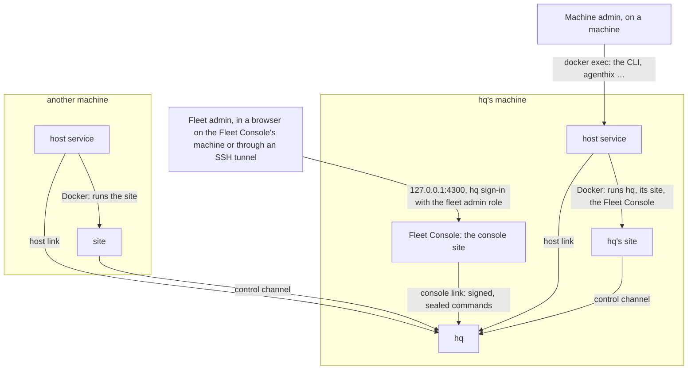

# Host Management

How the machines that run Agenthix are looked after: the **host service** on every machine, the **Fleet Console**
that fleet admins use, the signed commands hq passes between them, and what they do together — adding a site,
maintenance, backups and restoring, moves, and noticing a machine that stops answering. Read
[the architecture overview](README.md) first; [deployment.md](deployment.md) says what an install puts on a machine,
and [identity-and-trust.md](identity-and-trust.md#machines-and-the-fleet) every credential involved.



Every arrow points from the side that opens the connection. **Only hq's port listens on the network**: the host
services, the sites and the Fleet Console all dial out to it, and the Fleet Console's screens answer on `127.0.0.1` of
its own machine alone. Two exceptions belong to a machine **Agenthix Cloud runs**, which has Cloud's controller in
place of a Fleet Console ([below](#agenthix-clouds-controller)): its host service also dials out to Cloud, and while
Cloud has remote access on, the Fleet Console there answers on one more published port, to the addresses Cloud allows.

---

## Who holds what

| Part | What it is | Authority |
|---|---|---|
| **Host service** (`host/`) | One container, `agenthix-host`, on every machine that runs Agenthix. Installs, starts, stops, upgrades, backs up, restores and erases hq and the site there, holds the machine's capacity and applies the agent protections | **The only authority over its machine** ([ADR-0107](../adr/adr-0107-the-host-service-alone-holds-a-machines-authority.md)). Acts only through a closed set of operations |
| **CLI** | The host service's own command, `agenthix …`, run as `docker exec -it agenthix-host agenthix …` | Whoever can use Docker on the machine — the **machine admin**. Not an account in Agenthix |
| **Fleet Console** (`console/`, screens in `console-web/`) | The fleet admins' portal: a site of its own kind, the *console site*, that dials out to hq and runs no agents | None of its own: everything it does, a host service does, asked by a command it signs ([ADR-0109](../adr/adr-0109-the-host-manager-is-a-site-that-signs-its-commands.md)) |
| **hq** | The organisation's control plane | The organisation's, **and none over machines**: it relays the Fleet Console's commands but cannot read or make one, and shows each site's state read-only |
| **Fleet admin** | A role on an hq account (`User.fleetAdmin`) | Signing in to the Fleet Console, and so asking host services to act ([ADR-0110](../adr/adr-0110-fleet-admin-is-a-role-on-hq-accounts.md)) |
| **Agenthix Cloud's controller** | The hosted service's own identity, pinned by a host service when the machine enrolls with Cloud. Only on a machine Cloud runs | The machine admin's, **for that machine alone**, over a link of its own that never passes through hq ([ADR-0130](../adr/adr-0130-cloud-features-are-gated-by-their-own-conditions.md), [below](#agenthix-clouds-controller)). A machine has one controller: a Fleet Console's or Cloud's |

**A machine carries at most one hq and at most one site**; hq's machine carries hq and its site
([ADR-0108](../adr/adr-0108-a-machine-carries-at-most-one-hq-and-one-site.md)). A second organisation is a second
machine.

---

## The host service

It runs as the container `agenthix-host`, with the machine's Docker socket, a state folder mounted at `/state`, a figures
volume, the machine's network and `NET_ADMIN` — the command is in [deployment.md](deployment.md#installing). Its
program is `host/src/main.ts`; the CLI is `host/src/cli/main.ts`, with every command a row of `host/src/cli/commands.ts`.

- **Two sockets, and nothing else listens** (`host/src/sockets/`). The **owner socket**, `/run/host/owner.sock`
  inside the container, takes every operation and is reached only through `docker exec`. The **figures socket**, in
  the figures volume, which the site mounts read-only, answers `figures.read` and nothing else.
- **A closed set of operations.** Every request passes `parseOwnerRequest` (`host/src/owner/requests.ts`): core's
  `parseHostRequest` (`core/src/host/operationParse.ts`) plus the few operations that stay on the machine, such as
  setting the backup location. Nothing is passed through to Docker, a shell or a file; Docker is driven only by
  `host/src/docker/`, with argument lists the host service builds.
- **Everything it runs is a compose project** it writes from its state folder (`host/src/compose/projects.ts`,
  `console.ts`), from images whose signatures it checked first (below).
- **Every name it stores comes from the install's recorded namespace** (`host/src/state/namespace.ts`): recorded
  once, `agenthix` today, and from then on the source of every container, compose project, network, volume, label and
  database name, so a later rename of the product breaks no install. What a person reads comes from core's
  branding module (`core/src/naming/branding.ts`).
- **Its state folder is readable by its owner only** (`host/src/state/folder.ts`): settings and secrets of what it
  runs, the machine's capacity, nightly backups and their key, scheduled changes, its own keys and its credentials to
  hq and the Fleet Console.

**Capacity.** The host service holds the machine's ceilings for agent containers — memory, processors and processes
per container, and containers at once (`HostCeilings`, `core/src/host/figures.ts`; `capacity.set`,
`host/src/figures/capacity.ts`) — and refuses ceilings that cannot fit the machine. The site reads them from the
figures socket every 30 seconds (`site/src/server/host/hostFigures.ts`) and applies them to every container it starts;
hq and project policy may only narrow them.

**Agent protections** (`host/src/protections/`). Firewall rules in an nftables table of the host service's own block
traffic from the agents' address range to the machine's own ports, to ports other containers publish, and to the
cloud providers' metadata addresses (`METADATA_ADDRESSES`, `rules.ts`). They are applied at start and checked every
minute, have no setting, and allow no exception. On Docker Desktop they are applied inside its virtual machine, where
the containers run. **A site the host service runs starts no agent until they hold** (`AgentContainerManager.ts`);
ordinary internet access stays.

**Signed images.** Every image is published by one workflow (`.github/workflows/publish-images.yml`), for a version
tag, and signed with Sigstore's keyless signing. The host service checks each signature with `cosign` before it
fetches anything, then fetches by the digest the signature covers (`host/src/images/signatures.ts`,
`published.ts`; [ADR-0117](../adr/adr-0117-a-host-service-runs-only-signed-published-images.md)). A pre-release
(`-alpha.N`, `-beta.N`, `-rc.N`) is checked against its own tag's run. While the image packages are private, a staging machine
pulls them with a registry credential of its own, kept apart from the machine's Docker configuration
([ADR-0131](../adr/adr-0131-a-machine-may-pull-private-images-with-registry-credentials.md);
[deployment.md](deployment.md#releases-and-the-images-they-publish)). A development
build, with no published version, runs images built on the machine and says the check was not made.

**Replacing itself.** A container cannot replace itself, so the host service's image carries a **launcher**
(`host/src/launcher/`): the host service checks and fetches its new image, then starts the launcher, which swaps
the container and puts the old one back if the new one does not answer within 3 minutes
([ADR-0118](../adr/adr-0118-a-host-service-replaces-itself-through-a-launcher.md)).

---

## The Fleet Console, and how hq relays it

The Fleet Console is a plain Node server (`console/src/`) serving its JSON API and the built screens of `console-web/`.

**It is reached on its machine's `127.0.0.1:4300` only,** bar the one exception on a machine Agenthix Cloud runs
([below](#remote-access-on-a-machine-cloud-runs)). It runs on a Docker network of its own that nothing else
joins; Docker publishes its port to the machine's loopback only, and it accepts a connection only from that
network's gateway, read inside its container at start (`console/src/net/containerNetwork.ts`). Every request also
passes `console/src/http/guards.ts`: the Host header names the loopback, no other origin, and a session needs both its
HTTP-only cookie and its CSRF token header. On hq's machine it also joins hq's link network, to dial hq-web, and
answers nothing there. A fleet admin elsewhere reaches it through an SSH tunnel.

**Sign-in is hq's.** The Fleet Console has no accounts. It asks hq over its link whether a username and password sign
in (`signIn.check`, `hq/src/fleet/signInCheck.ts`, held to hq's sign-in limit) and lets in only an account holding the
fleet admin role. A session ends after an hour unused, after twelve hours in any case, and as soon as hq says the
person no longer holds the role, which is asked again every minute (`console/src/auth/`). While hq does not answer,
nobody can sign in.

**Two links to hq, and a relay between them.**

| Link | Path on hq | Opened by | With |
|---|---|---|---|
| Console link | `/console-link` | The Fleet Console | On hq's machine, `HQ_CONSOLE_PAIRING_SECRET`; elsewhere a lasting credential it got for a one-time code (`hq/src/fleet/consoleCredential.ts`) |
| Host link | `/host-link` | Each host service | Its machine credential, or once while it joins, the lookup derived from its one-time code (`hq/src/fleet/relay/hostLinkServer.ts`) |

Over them pass **envelopes** (`core/src/host/envelope.ts`): each signed with the sender's Ed25519 key, sealed to the
recipient's pinned X25519 key with AES-256-GCM, and fresh — an id, a send time and an expiry, with replays refused.
hq looks only at an envelope's header, to route it (`hq/src/fleet/relay/frames.ts`), and passes it only between a host
service and the Fleet Console it pinned (`relayHub.ts`); anything else is answered `relay.undeliverable`. **hq can drop
a command, but cannot read it, alter it or make one.** A host service opens an envelope only against the one Fleet
Console it pins, and takes its request through `parseHostRequest` alone, never the owner socket's machine-only
operations (`host/src/link/envelopes.ts`).

The Fleet Console also asks hq a closed set of things of its own over its link (`ConsoleLinkMethods`,
`hq/src/fleet/consoleMethods.ts`): signing in, the fleet admins, recording what fleet admins did (`activity.record`,
kept in hq's `FleetActivity`), adding and removing a site's credential, and the facts about silent machines below.

**Where it runs.** On hq's machine by default, started by `agenthix install`. It may move to another machine — even a
fleet admin's own computer — with `agenthix hq console-code` on hq's machine and `agenthix console install` on the
other. The running Fleet Console makes that code, and every machine moves to the new Fleet Console's key only on a
certificate the Fleet Console it already pins signed, so hq, which never sees the code, cannot make a machine pin a key
of its own (`console/src/handover/`, `hq/src/fleet/handover.ts`, `host/src/link/handover.ts`). If the Fleet Console is
lost, `hq console-code --no-machines` starts a new one with none, and each machine connects to it again.

**Agenthix Cloud.** Two separate things connect to Agenthix Cloud, the hosted service from the makers of Agenthix:
a machine Cloud runs enrols with Cloud's controller ([below](#agenthix-clouds-controller)), and an organisation's hq
connects to Cloud ([cloud-connection.md](cloud-connection.md)), which the Fleet Console starts from HQ's page.
No blanket flag gates either: each feature is governed by its own condition (this machine enrolled with Cloud, this
HQ connected, the person's account linked), and until that is true it says so where it runs and does nothing else
([ADR-0130](../adr/adr-0130-cloud-features-are-gated-by-their-own-conditions.md)). A feature held back at a release
ships behind a flag of its own, held in `core/src/naming/features.ts`
([ADR-0116](../adr/adr-0116-a-feature-not-ready-ships-behind-a-flag.md)). Still scaffolds, answering that the
organisation is not connected: remote access through Cloud's relay for a self-hosted Fleet Console, the authenticator
code's setup on the Fleet Console, a fleet admin's own Cloud sign-in to it, and the listing of Cloud's sites and fleet
admins there (`console/src/http/routes/cloud.ts`).

**The host protocol.** Every link between a host service or the Fleet Console and hq (and Cloud's host link) is
versioned as the host protocol, `HOST_PROTOCOL_VERSION` (`1.0`, `core/src/host/relay.ts`), stated in the
`X-Host-Protocol-Version` header when the link is dialled. It follows the same rule as the site protocol
([control-channel.md](control-channel.md#protocol-versions)): majors at most one apart work together, and a peer two or
more apart is answered `426` with the receiver's own version, so each side can say which of the two must upgrade.

---

## Agenthix Cloud's controller

On a machine Agenthix Cloud runs, Agenthix is the machine admin, so Cloud may ask what a machine's owner would: the
backup location, admin links, remote access, the front door's certificate. The machine **enrols with Cloud** and from
then on takes requests from Cloud's controller, which has its own pinned identity beside (never together with) a Fleet
Console's. Everything is in `host/src/cloud/`, driven by `core/src/host/cloudOperations.ts` and `cloud.ts`.

```mermaid
sequenceDiagram
    participant C as Cloud's controller
    participant HS as Host service
    participant HQ as hq (hq's machine only)
    Note over HS: start-up settings: Cloud's address, machine id, a one-time code in a file
    HS->>C: /host-link with the code's lookup; host.join with its identity and a binding only the code can make
    C-->>HS: host.joined: Cloud's identity, its binding, the machine id
    HS->>HS: pins Cloud's identity; spends the code
    C-)HS: sealed requests, on a link the host service opens again whenever it drops
    HS-)C: sealed results
    HS->>HQ: only for site and account operations, over hq's control socket
```

- **Enrolment** (`enrol.ts`, `start.ts`, `codeFile.ts`). Cloud writes three start-up settings when it creates the
  machine ([deployment.md](deployment.md#releases-and-the-images-they-publish)). The code is the join code of
  [Adding a site](#adding-a-site-and-leaving) (12 characters, one hour), read from a file the host service checks is a
  plain file owned by root with mode 0600, then spends — by recording its lookup and deleting the file — whatever the
  outcome once the connection opened. The join uses a label of its own (`host-join/1/cloud`), so a Fleet Console's
  join can never be mistaken for it, and the binding covers both fingerprints, the role `cloud` and the machine id
  (`core/src/host/crypto/join.ts`). The host service pins Cloud's identity only when Cloud's binding checks out
  (`link/cloudController.ts`, kept at `link/cloud.json`, 0600).
- **Its own link, never through hq** (`link.ts`). One outward connection to Cloud's `/host-link`, opened with the
  machine id and no secret, and kept open with growing waits when it drops. It takes nothing until Cloud's first frame,
  a fresh envelope from the pinned identity; anything else, or nothing within 30 seconds, closes it. An envelope from
  the Cloud identity that arrives through hq is dropped. It keeps working while hq is down.
- **One controller per machine.** A machine set up for Cloud (`CLOUD_URL`) refuses a Fleet Console's join
  and pin, and a machine with a Fleet Console pinned does not enrol. The host service on hq's machine does not ask the
  Fleet Console beside hq for a code on such a machine (`link/localConsole.ts`).
- **What Cloud may ask** (`dispatch.ts`). On a machine enrolled with Cloud only: the shared operations
  (`parseHostRequest`, recorded as `by: { kind: 'cloud' }` whatever the request claims), and the **Cloud-only
  operations** through one registry (`handlers.ts`), each parsing its own fields. Anything else is refused. The
  Fleet Console's own operations on a site, such as a move, are not Cloud's, and installing HQ is allowed only on a
  machine that runs nothing yet.

| Cloud-only operation | What it does | Where |
|---|---|---|
| `backup.location.set` | Sets the backup location to an S3-compatible store with credentials that last seven days at most; asked again, only the credentials are replaced. The folder location of [Backups](#backups-exports-and-restoring) cannot then be set on the machine | `host/src/backups/cloudLocation.ts`, `s3Folder.ts` |
| `frontDoor.set` with a certificate | Turns the front door on with a certificate and key Cloud gives, serving both hosts and asking no certificate authority | `host/src/frontDoor/given.ts`, `set.ts` |
| `upgrades.set` | Sets automatic fixes and a maintenance window in the owner's time zone (`timeZone`, DST-safe) | `host/src/upgrades/cloudSet.ts`, `zoned.ts` |
| `resize.prepare`, `resize.finish` | Suspends HQ and its site (or the site) so Cloud can change the machine's size, then starts them again, unless a person had suspended them | `host/src/lifecycle/resize.ts` |
| `remoteAccess.csr`, `.on`, `.off`, `.authenticator.add` | Remote access to the Fleet Console ([below](#remote-access-on-a-machine-cloud-runs)) | `host/src/remoteAccess/` |
| `site.register`, `site.unregister` | Admits or removes a site Cloud runs, in hq, by the hash of its credential | `host/src/cloud/hqOperations.ts`; hq's `cloudSites.ts` |
| `account.firstLink`, `.resetLink`, `.adminInvite` | Makes a first-admin link, a password-reset link or an admin invitation in hq | `host/src/cloud/hqOperations.ts`; hq's `cloudAccountLinks.ts` |

- **hq's machine passes the last two groups to hq** over hq's control socket (`cloud-site-register`,
  `cloud-first-link` … in `hq/src/auth/machine/cloudMachineCommands.ts`; [ADR-0133](../adr/adr-0133-cloud-may-ask-for-admin-links-on-a-machine-it-runs.md)).
  The host service sends them only for an envelope from the pinned Cloud identity on a machine enrolled with Cloud; hq
  cannot tell whether its machine is enrolled. A link is built from hq's configured address, must be https, is stored
  in hq only as a hash, and is never logged. A new link ends the one before, and hq announces every one it makes to its
  admins. A site is Cloud's when its `ExecutionSite.cloudMachineId` is set: only such a site can be unregistered by
  Cloud, and its figures are shown to no one.
- **The front door's given certificate** serves both of hq's hosts (it must cover each, checked with the machine's
  clock); Caddy is told `auto_https disable_certs`. A new certificate starts the front door again, and a failed
  renewal rolls back the files and hq's settings. The key is written at 0600 under the front door's folder and never
  appears in a refusal (`host/src/frontDoor/`).
- **Resize** reuses the suspension of [Maintenance](#maintenance-changes-now-or-at-a-set-time), so members get the
  same notices and runs pause the same way. Its state, `resize.json`, and the suspension are in the state folder, so
  both survive a restart.
- **`agenthix status`** says when Cloud manages the machine, and why a machine set up for Cloud is not enrolled yet
  (`link/status.ts`, `cloud-enrolment.json`). The CLI's Cloud commands (`src/cli/cloud.ts`, `src/owner/cloudCliOps.ts`)
  connect and disconnect hq through its control socket, turn remote access off, and forget a fleet admin's
  authenticator in the Fleet Console; turning remote access on is Cloud's alone. `backup location <path>` is refused
  while Cloud has set the location.

### Remote access on a machine Cloud runs

[ADR-0132](../adr/adr-0132-cloud-may-turn-remote-access-on-for-a-machine-it-runs.md). Everywhere else the Fleet
Console is reached on `127.0.0.1` alone, and a session that arrived through the tunnel can never turn remote access on
or extend it. On a machine Cloud runs, Cloud's controller turns it on directly, in four steps:

1. `remoteAccess.csr`: the Fleet Console makes an ECDSA P-256 key in its state folder and returns a certificate request
   for a name Cloud chooses; the key stays there.
2. Cloud returns the certificate with `remoteAccess.on`: a port (1024 to 65535, not 4300), the addresses allowed (at
   most 20: single IPv4 addresses, or IPv6 /64s), and an end, at most 8 hours away. The host service checks the
   certificate is for that key and name and good until the end, **publishes the port** beside `127.0.0.1:4300`
   (`remoteAccess/publish.ts`), and tells the Fleet Console to listen there.
3. The Fleet Console (`console/src/net/remoteAccess.ts`, `remoteListener.ts`) closes any connection from an address not
   on the list before TLS, ends TLS itself (1.2 or later), and answers only the name. Every session there needs the
   fleet admin's hq sign-in **and** an authenticator code (`auth/totp.ts`, `authenticators.ts`): codes are RFC 6238,
   each works once, recovery codes are kept as hashes, and a wrong password, a wrong code and an account that is not a
   fleet admin get the same answer and count against one limit. Cloud sets an authenticator with
   `remoteAccess.authenticator.add`, and the person's first correct code claims it.
4. It stops by itself at the end, after a restart too (`resumeRemoteAccess`), and `remoteAccess.off` closes the port even
   when the Fleet Console does not answer. Sessions opened this way end then and work only this way; a session from
   the machine opens nothing remotely.

A session through remote access still cannot connect the organisation to Cloud, set up an authenticator, or turn remote
access on. IPv6 clients are not admitted yet: the console's Docker network has no IPv6, so they arrive from its
gateway and are refused, which fails closed.

---

## Adding a site, and leaving

```mermaid
sequenceDiagram
    actor FA as Fleet admin
    participant HM as Fleet Console
    participant HQ as hq
    participant HS as New machine's host service
    actor MA as Machine admin
    FA->>HM: Add a site
    HM->>HQ: open a join with the code's lookup
    HM-->>FA: one-time code, 12 characters, 1 hour
    FA-->>MA: the code, by any means
    MA->>HS: agenthix console connect <hq address> <code>
    HS->>HQ: /host-link with the lookup; its identity, its name, a binding only the code can make
    HQ->>HM: the machine's half, passed on
    HM-->>FA: the machine's name and fingerprint
    FA->>HM: confirms, having compared the fingerprint with the machine admin
    HM-)HS: pinned; the host service pins the Fleet Console and gets its machine credential
    HS->>HS: starts the site with a credential it made
    HM->>HQ: registers the credential's hash; the site takes part
```

The code (Crockford base32, 60 bits; `core/src/host/join.ts`) yields two values: a lookup, which hq is given to admit
the machine, and a binding key, which hq never sees. Each side proves its key under the binding, so hq, which relays
the join, can neither join a machine of its own nor swap one in (`core/src/host/crypto/join.ts`). **hq accepts and
removes a non-default site's credential only from the Fleet Console** (`hq/src/fleet/siteCredentials.ts`), or for a
site Agenthix Cloud runs, from Cloud's controller through the host service on hq's machine (`hq/src/fleet/cloudSites.ts`,
[above](#agenthix-clouds-controller); [ADR-0115](../adr/adr-0115-a-site-takes-part-when-a-fleet-admin-or-cloud-adds-it.md));
the host service made the credential and hq keeps only its hash. hq's own site still joins by its pairing secret
([ADR-0070](../adr/adr-0070-hq-and-its-own-site-are-connected-by-configuration.md)).

**Disconnecting** works from either side. `agenthix console disconnect` on the machine forgets the Fleet Console's pin
and the machine credential first, so it takes effect even when nothing else answers, then tells hq the machine left
(`host/src/link/manage.ts`; `POST /api/v1/hosts/leave`, `hq/src/sites/machineLeaveApi.ts`); its site leaves with its
own credential. hq lists the machine as *left by itself* and asks fleet admins to remove it. **Disconnect** in the
Fleet Console does the same from the other side. hq's machine cannot be disconnected; hq moves first.

**Naming.** A site is always called by its machine's name — in the Fleet Console, in hq and on the machine
(`console/src/join/names.ts`; [ADR-0120](../adr/adr-0120-a-site-is-named-after-its-machine.md)). No name is asked when a site is added; hq names the site from its own record of the
machine (`siteCredentials.ts`), and a move or restore renames it after the new machine (`hq/src/fleet/siteMove.ts`,
`siteRestore.ts`). hq's own site is named after hq's machine, which the host service passes as `HQ_MACHINE_NAME`
(`hq/src/sites/defaultSite.ts`) and which hq shows tagged, *hq-box · HQ's site* (`hq/src/shared/siteName.ts`). A name
is a label only: machines are found and trusted by their fingerprints. Two machines of one name are refused, so people
can tell them apart.

---

## Maintenance: changes now or at a set time

Upgrading, changing capacity (*resize*), moving, suspending, resuming and erasing can each be done now or
**scheduled**, on the machine (`agenthix hq schedule …`, `agenthix site schedule …`, `agenthix scheduled`) or by a
fleet admin in the Fleet Console: upgrading, capacity, a move and suspending hq from its *Plan maintenance* panel, which
the *Maintenance* page, HQ's page and each site's page open (`console-web/src/pages/maintenance/`), and erasing hq from
HQ's page. A scheduled change is **held by
the host service of the machine it affects** (`host/src/scheduled/`), in its state folder, and run there at its time;
one whose time passed while the host service was down runs late within 30 minutes and is otherwise reported missed.

```mermaid
sequenceDiagram
    participant HS as Host service
    participant HQ as hq
    actor P as Members affected
    HS->>HQ: notice: scheduled (control socket on hq's machine, else through the site's channel)
    HQ-)P: notice on their projects, or on Home for hq itself
    Note over HS,HQ: 5 minutes before
    HS->>HQ: notice: pausing
    HQ->>HQ: start no new runs on what it affects; task runs pause after their current step
    HS->>HS: runs the change, after a backup; rolls back if it fails
    HS->>HQ: notice: done, or failed and put back
    HQ->>HQ: paused runs carry on
```

- **How hq hears** (`host/src/scheduled/notices.ts`): on hq's machine through hq's control socket; on a site's machine
  the site reads the notices with the machine's figures and passes them up its channel. The Fleet Console gets each
  notice sealed over the host link.
- **What hq does** (`hq/src/sites/scheduled/`): it tells the members whose projects run where the change is, and for a
  change to hq everyone (`memberNotices.ts`); from `SCHEDULED_CHANGE_PAUSE_LEAD_MS` (5 minutes) before, it starts no
  new runs there and pauses task runs at the end of their current step, to carry on afterwards (`runHold.ts`).
- **Upgrades** (`host/src/upgrades/`) check every new image's signature before anything stops, take a sealed backup,
  and go back to the version before, from that backup, if hq does not answer as the new version, or the site does not
  connect, within 10 minutes. **Fixes** — new patch versions — apply by themselves in a maintenance window (Sunday
  02:00–04:00 unless moved; `agenthix upgrades`); a new minor or major version only on request. A window is in the
  machine's time, or in a time zone when Agenthix Cloud set it (`MaintenanceWindow.timeZone`,
  `host/src/upgrades/settings.ts`).
- **Suspend** stops hq or a site and keeps everything; **resume** starts it again. A suspended hq is resumed on its own
  machine, since the Fleet Console reaches machines only through hq.
- **Erase** takes a final sealed backup, removes what ran, and keeps that backup in a bin for 30 days, when everything
  is purged, the backup location's copies included (`host/src/lifecycle/bin.ts`). An hq is erased at once or on a
  date with a countdown shown to its people.

---

## Backups, exports and restoring

**Every site is backed up nightly by its own machine, and every backup is sealed**
([ADR-0112](../adr/adr-0112-every-backup-is-sealed-its-key-held-by-a-machine.md)). A backup holds the site's database
and data folder, with its workspaces; hq's machine's backup also holds hq's database, its storage folder and its
secrets, `SECRETS_MASTER_KEY` among them (`host/src/backups/parts.ts`).

| Backup | Where | Sealed to |
|---|---|---|
| Nightly, at 02:00 machine time unless set otherwise, caught up once after a missed night (`nightly.ts`) | The host service's state folder | The machine's own key, 32 random bytes in the state folder (`keys.ts`) |
| A copy in the **backup location** | A folder the machine can write to — a NAS, a synced drive, a mounted bucket. **Set and changed only on the machine** (`agenthix backup location <path>`; `location.ts`), never by a Fleet Console. On a machine Agenthix Cloud runs, Cloud's controller sets an S3-compatible store instead, and no folder can then be set | A key shown once to whoever set it, or for Cloud's store the key Cloud gives; the machine keeps only its public half |
| An **export** (`agenthix backup export`, or from the Fleet Console's *Backups*) | Wherever the person takes it | A key made for that export alone, shown once (`export.ts`) |
| A **move**'s final backup | Passed to the receiving machine | Re-wrapped to the receiving host service's key |

**How a backup is sealed** (`host/src/backups/seal.ts`): a random file key per backup encrypts chunks of at most
1 MiB with AES-256-GCM in a construction that detects a chunk dropped, reordered or cut off; the file key is sealed
to the holder's X25519 public key. A copy for another holder is the same chunks under a new wrap, so the machine can
seal a copy to a person's key while holding only its public half.

**Restoring on the same machine** brings back hq and its site, or the site, as they were that night. **On a new
machine**, `agenthix restore --from <folder or file>` lists the backups there, takes the key typed on that machine and
restores hq's machine whole; its sites reconnect by themselves.

**A lost site comes back as itself** ([ADR-0119](../adr/adr-0119-a-sites-backup-carries-its-authority.md)). A site's
backup carries, sealed with the rest, the credential the site proves itself to hq with.

1. A fleet admin chooses **Add a site › Restore from a backup…** for a site whose machine is offline — never hq's —
   is warned that the machine may only be down for a while and that a restore replaces it, and gets a one-time code.
2. On a new machine, `agenthix restore --from <folder or file> <hq address> <code>`: the machine admin chooses the
   backup there and types its key there; neither leaves that machine. The machine joins with the code, naming under
   its binding the backup it restores (`host/src/backups/joinedRestore.ts`).
3. The fleet admin confirms the fingerprint, and the Fleet Console asks for the restore, signed.
4. **Before the site starts, its credential is renewed at hq** (`host/src/backups/renewal.ts`;
   `POST /api/v1/sites/restore-renew`, `hq/src/fleet/siteRestore.ts`). hq needs the backup's credential and the machine
   credential of a machine a fleet admin confirmed for restoring that site within 24 hours, and accepts only while
   neither the site nor the machine it ran on is connected. From then on the backup's credential is refused, so the
   old machine is refused if it comes back, and a stolen backup cannot push out a running site.
5. The site starts and connects as itself, named after its new machine.

**After a restore, hq and the site reconcile** (`hq/src/sites/restoreReconcile.ts`): each time a site connects hq asks
what it holds; for a restored site it tells the organisation admins what was lost, and a restored hq takes back the
workspaces it recognises on the site that holds them and reports the rest.

---

## Moves

**A site moves to a new machine** with *Move site…*: a one-time code, `agenthix console connect` on the new machine,
which must run nothing yet, and the fingerprint confirmed. At its time the site's runs pause, it is read-only from the
moment the final backup starts, and the old machine passes the sealed backup to the new one in chunks it signs, which
hq relays and cannot read (`host/src/move/`). The site keeps its id, its credential and its workspaces, and takes the
new machine's name. The old machine removes its copy only after the site answers hq from the new machine; if the new
machine does not take over — or says, signed, that it gave up — the site starts on the old machine again, and
deadlines (`host/src/move/timings.ts`) keep it from ever running on both.

**hq moves** to a new machine the same way, with its site and, if it ran beside hq, the Fleet Console; hq is read-only
from the moment the backup starts (its control socket's `read-only`, `hq/src/fleet/hqMove.ts`). **A new address** on the
same machine is a move too (`agenthix hq address`), with hq stopped for those minutes.

**Sites and machines follow hq to a new address** ([ADR-0113](../adr/adr-0113-a-moved-hqs-sites-follow-it-by-challenge-response.md)).
Before it stops, hq tells each connected site, host service and the Fleet Console its new address over the connection
each has (`hq/src/fleet/addressMove.ts`). Each keeps both addresses and switches only once the new address passes a
mutual challenge–response on the credential hash hq already holds (`core/src/host/moveCheck.ts`,
`hq/src/fleet/moveCheck.ts`): the credential never crosses the network, so a stranger's address learns nothing. One that
was offline is pointed on its own machine with `agenthix site hq-address` or `agenthix console hq-address`, after the
same check.

---

## A machine that stops answering

hq raises one **Needs you** for fleet admins about a machine whose host service it has **not heard from for 10
minutes** (`HOST_SILENT_AFTER_MS`, `core/src/host/stopping.ts`; `hq/src/sites/machineStanding.ts`,
`machineNotices.ts`), judged from the machine's host link, not its site's channel, and only once hq itself has been
up that long. It clears itself when the machine connects again. A machine that left by itself raises its own item
until it is removed. Organisation admins keep their own notice for a site that work waits on.

Two facts only the Fleet Console knows narrow that notice, and it tells hq them per machine with `host.silenceFacts`
(`console/src/hosts/silence.ts`), a notification preference that gives hq no authority:

- **Notify the fleet admins if this machine stops answering** — a setting per machine (`notifyIfSilent`, on unless
  turned off), asked with the code when a machine joins or receives a move, and changed on its page. hq's machine is
  always notified.
- **It stopped on purpose.** A host service that is stopped sends its pinned Fleet Console a sealed `stopping` word
  first, within two seconds (`host/src/link/stopping.ts`). The machine then reads *Stopped on its machine*, raises no
  notice, until it answers again on a new connection.

Nothing is ever done to a machine either way.

---

## hq's view of sites

hq shows sites read-only ([ADR-0115](../adr/adr-0115-a-site-takes-part-when-a-fleet-admin-or-cloud-adds-it.md)).
Organisation admins see **Where work runs** (`/org/settings/where-work-runs`, `hq/src/sites/pages/`): each site's
state in a word and a sentence with its cause, its runs against its capacity, what each run gets, and the next
scheduled change (`whereWorkRunsWords.ts`). A site's
figures, versions and logs are for fleet admins only, checked on the server (`assertFleetAdmin`,
`hq/src/sites/assertAdmin.ts`; `siteFigures.ts`), and never shown for a Cloud site. Members are warned on their
projects when their site's machine is nearly out of disk or memory (`hq/src/sites/resources/nearlyOutNotices.ts`), and a
run that stops for lack of memory, disk or processes says so, with the limit it hit
(`runResourceNotice.ts`). When hq's own site is not connected for a reason hq cannot see, the host service on hq's
machine passes the cause through hq's control socket (`hq/src/sites/defaultSiteCause.ts`).

---

## Where it is in the code

| You want | Look in |
|---|---|
| The contracts every party shares: operations, envelopes, joins, figures, scheduled changes, moves | `core/src/host/`; the cryptography in `core/src/host/crypto/` (`@agenthix/core/host-crypto`) |
| The host service: sockets, operations, compose projects, install | `host/src/` — `owner/`, `sockets/`, `compose/`, `install/`; `host/AGENTS.md` |
| Backups, restores, exports | `host/src/backups/` |
| Scheduled changes, upgrades, suspend and erase | `host/src/scheduled/`, `upgrades/`, `lifecycle/` |
| Moves | `host/src/move/`; `console/src/move/`; `hq/src/fleet/siteMove.ts`, `hqMove.ts`, `addressMove.ts` |
| The host link and the Fleet Console's pin | `host/src/link/` |
| Agenthix Cloud's controller on a machine: enrolment, its link, its operations | `host/src/cloud/`, `link/cloudController.ts`; `core/src/host/cloud.ts`, `cloudOperations.ts`; remote access in `host/src/remoteAccess/` and `console/src/net/` |
| hq's connection to Cloud, and Cloud's sites and links in hq | [cloud-connection.md](cloud-connection.md); `hq/src/cloud/`, `hq/src/fleet/cloudSites.ts`, `hq/src/auth/machine/cloudAccountLinks.ts` |
| The Fleet Console's server, sign-in and guards | `console/src/`; `console/AGENTS.md` |
| Its screens | `console-web/src/`; `console-web/AGENTS.md` |
| hq's relay, the fleet admin role, the record of what fleet admins did | `hq/src/fleet/` |
| hq's machine commands (`invite-admin`, `fleet-admin`, `console-code`, `read-only` …) | `hq/src/auth/machine/hqMachineCommands.ts` |
| What hq shows of sites, and its notices | `hq/src/sites/` |

## What must not break

- **Nothing dials a site, a host service or an agent.** Each dials out: to hq's port, and on a machine Agenthix Cloud
  runs the host service also to Cloud.
- **hq holds no machine authority.** It relays envelopes it cannot read; no hq operation acts on a machine.
- **A host service takes requests only from its owner socket or the one controller it pins** — a Fleet Console, or on
  a machine Agenthix Cloud runs Cloud's — and only from the closed set (Cloud's own operations besides); a controller
  never reaches the owner socket's machine-only operations.
- **The Fleet Console answers on its machine's loopback only**, except for the one published port, to the addresses
  Cloud allows, while Cloud has remote access on.
- **A one-time code never reaches hq**, only its lookup.
- **A backup location is set only on the machine** — or, on a machine Agenthix Cloud runs, by Cloud's controller.
- **Every name stored on a machine derives from the recorded namespace**, never from the product's current name.

## Decisions behind this

[ADR-0107](../adr/adr-0107-the-host-service-alone-holds-a-machines-authority.md) ·
[ADR-0108](../adr/adr-0108-a-machine-carries-at-most-one-hq-and-one-site.md) ·
[ADR-0109](../adr/adr-0109-the-host-manager-is-a-site-that-signs-its-commands.md) ·
[ADR-0110](../adr/adr-0110-fleet-admin-is-a-role-on-hq-accounts.md) ·
[ADR-0112](../adr/adr-0112-every-backup-is-sealed-its-key-held-by-a-machine.md) ·
[ADR-0113](../adr/adr-0113-a-moved-hqs-sites-follow-it-by-challenge-response.md) ·
[ADR-0115](../adr/adr-0115-a-site-takes-part-when-a-fleet-admin-or-cloud-adds-it.md) ·
[ADR-0116](../adr/adr-0116-a-feature-not-ready-ships-behind-a-flag.md) ·
[ADR-0117](../adr/adr-0117-a-host-service-runs-only-signed-published-images.md) ·
[ADR-0118](../adr/adr-0118-a-host-service-replaces-itself-through-a-launcher.md) ·
[ADR-0119](../adr/adr-0119-a-sites-backup-carries-its-authority.md) ·
[ADR-0120](../adr/adr-0120-a-site-is-named-after-its-machine.md) ·
[ADR-0130](../adr/adr-0130-cloud-features-are-gated-by-their-own-conditions.md) ·
[ADR-0131](../adr/adr-0131-a-machine-may-pull-private-images-with-registry-credentials.md) ·
[ADR-0132](../adr/adr-0132-cloud-may-turn-remote-access-on-for-a-machine-it-runs.md) ·
[ADR-0133](../adr/adr-0133-cloud-may-ask-for-admin-links-on-a-machine-it-runs.md)
