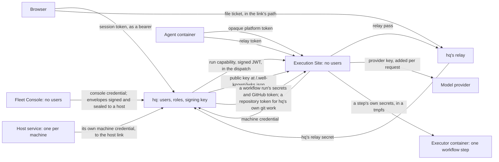
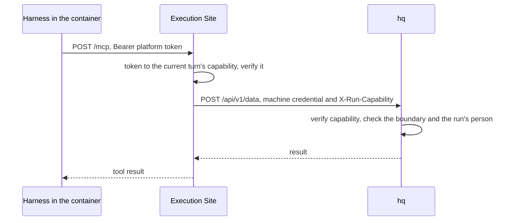

# Identity and Trust

Every credential in the system: who issues it, who holds it, what it lets the holder do, how long it lives,
and how it is checked.



**hq holds every identity; a site holds none.** People sign in to hq and nowhere else. An Execution Site
has no user, session or login tables
([ADR-0042](../adr/adr-0042-hq-is-the-orgs-own.md),
[ADR-0065](../adr/adr-0065-a-site-serves-no-web-page.md)): it trusts hq because hq signs what it sends,
and it checks those signatures itself with hq's public key, without asking hq each time. An agent container
holds even less: only opaque tokens the site issued and can revoke, and, when a run uses a person's Claude
subscription, that subscription's login. **No secret of a place and no GitHub token ever enters it**: those are used
only by approved workflows, in executor containers of their own ([workflows.md](workflows.md)).

**Machines have an authority of their own, which hq does not hold.** The host service on each machine acts only on
commands from its owner socket or from the one Fleet Console it pinned, each signed and sealed so that hq relays them
unread ([below](#machines-and-the-fleet); [host-management.md](host-management.md)).

---

## The credentials at a glance

| Credential | Issued by | Held by | Lets the holder | Lives |
|---|---|---|---|---|
| hq session token | hq (Wasp auth) | A browser, in its local storage; sent as `Authorization: Bearer`, never a cookie | Use hq as that person, within their role | Until sign-out or Wasp's session expires |
| Machine credential, site | The host service that runs the site, its hash registered with hq by the Fleet Console (or the pairing secret, for hq's site) | The site, encrypted; the host service's state folder; the site's backups | Connect to hq's control channel; call hq's site endpoints | Until the site is removed, or renewed by a restore |
| Run capability | hq, signed per run | The site, never the container | Act for one run: its agent, its boundary, its permissions | 15 minutes, renewed while the run lasts |
| File ticket | hq, signed per file opened, and recorded | A browser, in the link it fetches from a relay | Read one file at one version, for one purpose, through one relay; refused once the file changes | 5 minutes ([files-and-relays.md](files-and-relays.md#tickets-and-passes)) |
| Relay pass | hq, signed per site and relay | The site | Hold a line to that one relay | 1 hour, renewed at 80% of that |
| hq's relay secret | The host service at install (`HQ_RELAY_SECRET`) | hq-server and hq's relay, in their environment; hq keeps its hash | Hold hq's relay's link to hq | Until changed |
| Turn capability | hq, in process, per turn of a conversation | hq's memory for the turn, never stored or sent | Let the lead call hq's own operations as the author of the message it answers | One turn, 15 minutes at most ([the conversation layer](conversation-layer.md#the-lead-in-hq)) |
| Platform token | The site | The agent's harness | Reach the site's platform tools as the current turn | One run, or a whole conversation for a harness kept across turns; it means something only while a turn runs |
| Relay token | The site | The agent's harness | Send model requests through the site's relay, only from its own container | A turn on OpenCode; a Claude process's life, meaning something only during a turn |
| Provider API key | An organisation admin on Providers, the machine admin, or Agenthix Cloud's controller for Cloud itself | hq, encrypted; the site in memory for a run, and hq's own process for a conversation's turn | Call a model provider | Until changed |
| Claude subscription login | A person signing in through hq | hq, encrypted; the runner's harness home on the site | Use that Claude subscription | Refreshed by Claude Code |
| Place secret | A project's administrators, or a person for their own storage, typed or uploaded once | hq, encrypted; for one run of an approved workflow, the site's memory and the tmpfs of each step that names it | Whatever the secret itself allows, only from approved steps | Until replaced or deleted |
| GitHub installation token | hq's GitHub App, through the mint gate | A workflow step that names `GITHUB_TOKEN`, for one run; the site's memory, for one call of hq's own git work | One repository, with only the permissions named | About an hour; a workflow run's is revoked when the run ends |
| Host service keys | The host service, once | Its state folder | Sign what it sends its Fleet Console; open what is sealed to it | For good; never replaced |
| Fleet Console keys | The Fleet Console, once | Its state volume | Sign and seal commands to host services | Until the Fleet Console is replaced |
| Machine credential, host service | hq, when a fleet admin accepts the machine's join | The host service's state folder | Hold a host link to hq's relay | Until the machine is disconnected |
| Console credential | hq: the pairing secret on hq's machine, or a credential for a one-time code | The Fleet Console | Hold the console link | Until another Fleet Console takes over |
| Fleet Console session | The Fleet Console, at sign-in through hq | A browser: an HTTP-only cookie and a CSRF token | Use the Fleet Console as a fleet admin | An hour unused, twelve at most, or until the role is gone |
| One-time code | The Fleet Console, or hq for `console-code --no-machines` | Read out by a fleet admin to a machine admin | Join a machine, restore a site, or move the Fleet Console | One hour, once |
| Backup key | The host service, or one shown once to a person | The machine; the person who set a backup location or made an export | Open a sealed backup | For as long as the backup is kept |
| Cloud enrolment code | Agenthix Cloud, when it creates a machine | A file on that machine, 0600, owned by root | Enrol the machine with Cloud's controller | One hour, once; the file is deleted when it is spent |
| Cloud controller identity | Agenthix Cloud, its own keys | A host service on a machine Cloud runs, as a pin (`link/cloud.json`, 0600) | Let Cloud ask that machine its operations, over a link of Cloud's own | Until the pin is deleted |
| hq's Cloud connection key | hq, at the first *Connect* of a connection | hq's database, encrypted; never leaves hq | Sign hq's requests to Cloud | Until hq disconnects (the key is destroyed even when Cloud cannot be reached) |
| Cloud access token | Agenthix Cloud, for a signed request | hq's memory only | Post a downtime notice, ask for an ID token | At most an hour; never stored |
| Cloud account link | A person signing in to hq, then to Cloud | hq's database: Cloud's issuer and the account's subject, nothing else | Sign in to hq as that person with an Agenthix account | Until the person unlinks it, or is erased |
| Authenticator code, for remote access | Agenthix Cloud sets it up; a person's first correct code claims it | The Fleet Console, on a machine Cloud runs (0600); recovery codes as hashes | Sign in to the Fleet Console through remote access, with the person's hq sign-in | An unclaimed code lapses at the time Cloud set; sessions it opens end when remote access does |
| Registry credential | An administrator of a staging machine | The host service's state folder, 0600, apart from the machine's Docker configuration | Pull private images and check their signatures | Until the first release makes the packages public |

---

## People, in hq

- **Sign-in** is Wasp's username and password, with a session token the browser keeps in its storage and sends as a bearer header, not a cookie (`auth:` in `hq/main.wasp.ts`). Ten wrong
  passwords in 15 minutes from one address make that address wait 15 minutes (`hq/src/auth/signInLimit.ts`,
  middleware in front of Wasp's login route).
- **There is no public sign-up.** hq refuses Wasp's own sign-up route (`hq/src/auth/refuseSignup.ts`) and
  creates every account itself, from an invitation (`hq/src/auth/inviteAccept.ts`; a single-use code, stored
  only as a hash, valid for 7 days). The very first admin comes in by a one-time first-admin link hq makes
  while it has no users: stored only as a hash, valid 24 hours, printed in hq's log from its configured
  address, replaced at every start, and accepted only while no user exists (`hq/src/auth/firstAdmin.ts`).
  There is no standing key in the configuration.
- **Every way back in is an admin, or HQ's machine.** hq keeps no email address. An admin makes a one-time
  password reset link (1 hour, single use, stored as a hash) for someone else; setting the password ends
  every sign-in that person had (`hq/src/auth/passwordReset.ts`). Someone who can run commands on hq's
  machine can do what no admin is left to do: `agenthix hq reset-password <username>` and
  `agenthix hq invite-admin` reach the running hq through a Unix socket in a folder only hq's own user can
  open (`hq/src/auth/machine/controlSocket.ts`), which inside a container is reached only by
  `docker exec`: the host service runs each command there (`host/src/hq/control.ts`). Each is recorded as
  made on hq's machine and announced to the organisation's admins.
- **Getting in, in the browser.** Both the first-admin link and an invitation open `/invite/<code>`, where the
  account is made. The first admin then goes through `/setup` (You, Your organisation, how agents reach AI, a last look), once per
  hq: it is done when that admin finishes the last look, with or without models and voice, recorded on the organisation
  (`Org.setupCompletedAt`, `hq/src/setup/setupState.ts`), and an admin invited later is never sent through it.
  Every invited person goes through `/onboarding` (Join, You, then a last
  look; `hq/src/onboarding/onboardingFlow.ts`). `agenthix install` makes every secret, pairs hq with its
  site and prints the first-admin link (`host/src/install/`).
- **Links people send are built from hq's configured address** (`HQ_URL`), never from the sender's browser
  (`hq/src/auth/hqLinks.ts`).
- **Fleet admin** is a role apart from the organisation's (`User.fleetAdmin`, `hq/schema.prisma`;
  [ADR-0110](../adr/adr-0110-fleet-admin-is-a-role-on-hq-accounts.md)): it lets an account sign in to the Fleet
  Console, and in hq it shows a site's figures, versions and logs. The first account, made at install, holds it
  (`hq/src/auth/inviteAccept.ts`). After that only a fleet admin, in the Fleet Console, or a machine admin of hq's
  machine (`agenthix hq fleet-admin <user>`) grants or removes it — never an organisation admin — and every change is
  announced to every fleet admin and organisation admin (`hq/src/fleet/fleetAdminRole.ts`).
- **Organisation roles** are `ADMIN` and `MEMBER` (`UserSettings.role`, `hq/schema.prisma`). Whether someone
  may work is decided per project: a project's `VIEWER` reads it and starts or changes nothing in it
  (`requireMayWorkInProject`, `hq/src/projects/membership.ts`; ADR-0102); the platform tools that change the organisation itself, such as creating a project or an agent, need
  `ADMIN` (`ORG_ESCAPING_TOOLS`, `hq/src/server/identity/rolePolicy.ts`).
- **Project membership** is separate, and it is the only gate to a project: only its members act in it or
  read its work. An open project is listed to everyone in the organisation, who may join it; a private one is
  shown only to its members. A project admin administers the project, not more run authority
  ([ADR-0062](../adr/adr-0062-people-are-members-agents-are-assigned.md),
  [ADR-0099](../adr/adr-0099-an-open-project-is-open-to-join.md); `ProjectMember`).
- **Leaving** deactivates and deletes nothing: sign-in is refused, every session, pairing token and
  connection ends, and the person leaves every project; erasing their own data is a separate act
  ([ADR-0100](../adr/adr-0100-leaving-deactivates-erasing-is-separate.md);
  [invite-auth.md](../concepts/auth/invite-auth.md)).
- **Conversation privacy**: a conversation held in hq is read by the rule of its home, decided in hq before anything is
  read: a personal or project conversation only by the person who opened it, admins included; a task's thread by
  anyone who can see the task. Its messages are encrypted at rest with hq's data key
  ([the conversation layer](conversation-layer.md#the-record)).
- **Chat privacy**: a chat's content is readable only by the person who started it, admins included.
  Within a boundary, members can see that a chat is running, with which agent, by whom and since when, but
  not what it says ([ADR-0041](../adr/adr-0041-chat-session-privacy.md),
  [ADR-0077](../adr/adr-0077-within-a-boundary-a-running-chat-is-visible-its-content-is-not.md);
  `hq/src/sessions/sessionEntitlement.ts`). This is enforced only in hq, since only hq knows people.

---

## hq's signing key and tokens

hq signs tokens with one RSA key (RS256), generated at first boot and stored with its private half
encrypted (`hq/src/server/identity/signingKeyService.ts`). The public half is served at
`GET /.well-known/jwks.json` (`identityApi.ts`). Tokens are minted in `tokenService.ts`, with issuer
`agenthix-hq`, and their lifetimes are in `core/src/protocol/capability.ts`
([ADR-0040](../adr/adr-0040-hq-issued-token-ttls.md)):

| Token | `aud` (audience) | Lifetime |
|---|---|---|
| Run capability | The one site the run is placed on | 15 minutes, renewed after 80% of that (12 minutes) |
| Identity token, for a signed-in person | A site | 1 hour; only a check endpoint on the site uses it today |
| File ticket | The site that serves the file; for a file hq keeps, hq's relay | 5 minutes, signed in `hq/src/relays/relayTokens.ts` |
| Relay pass | The relay; its subject the site | 1 hour |

**How a site checks one** (`site/src/server/identity/verifyHqToken.ts`, `tokenVerify.ts`): it fetches hq's
public key once and caches it, refetching only for a key id it has not seen; then it checks the signature,
algorithm, issuer, expiry and token type, and that the audience is **its own** site id. A capability minted
for a sibling site is refused here, so a token copied from one site cannot be replayed on another. File tickets and
relay passes are checked the same way, by core's `verifyRelayToken`, on the site before it reads a byte and on the
relay before it keeps a site's line.

---

## The run capability

**What a run may do is decided by hq and carried in the capability.** hq signs one for every dispatch
(`resolveCapabilityClaims`, `hq/src/server/identity/capabilityService.ts`). Its claims
(`CapabilityClaims`, `core/src/protocol/capability.ts`):

- **who and where**: the agent, the session, the task if any, the project if the run is in one, the
  workspace if any, the site;
- **`startedBy`**: what started the run (`person`, `schedule` or `agent`; `pulse`, which hq no longer sends, is read as not a person). It is signed so hq can read
  it inside a tool call, where it decides what the run may do: only a run a person started may set a
  start time or a routine, or call `run_task`, and a missing or unknown value is never read as a person
  (`parseRunStartedBy`);
- **`onBehalfOfUserId`**: the person a person-started run in a task is for (the sender of a message into the
  task's conversation, or whoever pressed Run); absent for a chat, whose person is its own, and for a task run
  nobody started, whose person is the task's;
- **`role`**: set only for a chat in the person's own storage, as a marker of that kind of run (personal git access
  reads it). It authorises nothing: hq reads the person's current role at each call;
- **`permissions`**: the tools allowed, the bash command patterns allowed, the tools never allowed, and
  whether approval is bypassed (`bypassed`: the gate does not check the run's calls against its permissions,
  and the tools never allowed are only those the workspace's guardrail leaves out, platform tools included;
  see [tools/tool-control.md](tools/tool-control.md)). They are the agent's own, narrowed by the boundary's
  override for that agent, the strictest level winning, and then by the workspace's `allowedTools` guardrail.
  Permissions are what the run may attempt, not authority: what a platform tool may do is decided by the
  person the run is for (below);
- **`runner`**, below.

**A run may do in hq only what both its boundary and the person it is for may do**
([ADR-0060](../adr/adr-0060-authority-comes-from-the-boundary.md), [ADR-0101](../adr/adr-0101-a-run-is-bounded-by-the-person-it-is-for.md)): an
intersection, never a union.

- **The boundary confines it.** A run in a project reaches that project and no other, and uses the
  project's credentials; a run in a person's own storage uses that person's. A task in a person's personal
  project is a run in their own storage, confined to that personal project.
- **The person bounds it.** Every run is on behalf of one person
  ([ADR-0095](../adr/adr-0095-a-run-is-on-behalf-of-whoever-started-it.md)): whoever started it,
  signed into the capability as `onBehalfOfUserId`; for a task run nobody started, the task's person; for a
  chat, its own person (`personOfRun`, `hq/src/server/controlplane/runOnBehalfOf.ts`). Each control-plane
  operation checks that person as its browser twin checks the signed-in person: still in the organisation,
  their organisation role as it is at that call, their membership of the project the entity is in, and the
  same role floors (`actingPerson`, `runPerson.ts`; `requireProjectEntitlement`, `requireRoleFloor`,
  `authorize.ts`). A changed role, a person removed from the project, or a person who has left applies from
  the run's next call. Where the browser asks that a person works in the project — a Member or Admin of it, not
  a Viewer — for an act that starts or changes work (archiving, deleting or running a task, finishing a sprint,
  a task or a board that will start work, a schedule or a routine), the run's person needs it too, and nothing
  stricter.
- **The tools that act on the whole organisation** (`ORG_ESCAPING_TOOLS`) reach beyond any project, so only
  a chat in a person's own storage may use them, with that person's role; a run in a project is refused them
  whatever its person may do.
- **A run on behalf of no one** — a task run whose task is gone, a session that is neither a task's nor a
  chat — is refused every operation but its boundary's own runtime support (its repository's credential).
- **The agent's permissions never enter into it.** Bypassed widens nothing here.

**Renewed while the run lasts.** The site renews a capability before it expires, through
`POST /api/v1/capabilities/renew` with its machine credential (`site/src/server/hq/capabilityRenewClient.ts`).
hq recomputes the claims from current data, so a permission change reaches a running run within one
lifetime, and refuses if the runner or site would change.

### The runner claim

The runner says **who the run is for**, which decides whose harness home is mounted into its container
([ADR-0074](../adr/adr-0074-a-container-is-keyed-on-its-boundary-and-its-runner.md)). It is one of
`person` or `project`, derived by hq (`resolveRunner`, `hq/src/server/identity/capabilityRunner.ts`):
a chat runs as the person who sent it, a task as its project, and anything in a person's own storage, a
task in their personal project included, as that person. It grants nothing.

It sits in the signed capability, never in the dispatch payload, because a payload is not signed. The site
checks it against the run's storage before anything else happens (`requireRunnerForBoundary`,
`site/src/server/identity/runnerClaim.ts`), with the same rule hq used (`runnerBoundaryMismatch` in
`core`): a person's own storage can only run as that person, and a person may run inside a project only
for a chat.

### Who a task is done on behalf of

The runner says whose container it is; it does not say whom the work is for. Every task also records the person it
is **done on behalf of**, followed up the chain of agents that created it so it is always a person
([ADR-0089](../adr/adr-0089-every-task-runs-on-behalf-of-a-person.md)). Approvals for a tool the run was not allowed,
and notifications, go to that person. If they lose access to the project, their tasks in it are blocked until a
project admin reassigns them; hq never routes the work to someone else by itself.

### A person's own connection to hq

A tool outside the product, such as a person's own Claude Code, reaches hq's `/mcp` endpoint with a **connection**
that person created (`PersonConnection`, `hq/src/connections/`;
[ADR-0090](../adr/adr-0090-a-connection-to-hq-is-a-persons-own.md)). The organisation-wide key that used to open
that endpoint is gone, so no caller is nobody.

| | |
|---|---|
| Token | `ahx_conn_…`, shown once when created; hq keeps only its SHA-256 hash and compares it in constant time |
| Authority | Its person's, read fresh on every call (their current org role), never more. It reaches only the projects that person can, and only those on its own list if it has one |
| Permissions | Four groups that only narrow the person's own: read (on by default), change tasks, start work, manage (off by default). Every control-plane tool belongs to one group (`hq/src/server/controlplane/connectionGroups.ts`); a tool with no group is refused to every connection |
| Expiry | 7, 30, 90, 180 or 365 days, 90 by default; revoking takes effect on the next call |
| Record | What it creates or changes is recorded as done by the person, through that connection |

Control-plane code takes a `CallerContext` (`hq/src/server/controlplane/types.ts`): either `{ kind: 'run' }`,
carrying an agent run's verified capability claims, or `{ kind: 'connection' }`, carrying the connection's grant.
The authorisation checks (`authorize.ts`) treat a connection as its person held to the same rules as a run of
that person's, further limited to its project list. A run started through a connection counts as started by a person,
which is why *start work* is off until the person turns it on.

---

## What the container holds

The capability never enters the container. The site keeps it, and gives the harness **opaque tokens**:
random strings that mean something only to this site, which looks them up in memory and can revoke them
at once.



- **The platform token** (`site/src/server/runtime/runTokens.ts`, `conversationTokens.ts`). A harness that
  stays running across a conversation's turns holds one token for the conversation. During a turn it points
  at that turn's capability; between turns it points at nothing, so a process left running can still use
  its files and network but cannot act through the platform
  ([ADR-0082](../adr/adr-0082-a-conversation-acts-with-its-current-turns-authority.md) ·
[ADR-0089](../adr/adr-0089-every-task-runs-on-behalf-of-a-person.md) ·
[ADR-0090](../adr/adr-0090-a-connection-to-hq-is-a-persons-own.md)). It is revoked when
  the conversation is released. The harness receives it as `SITE_MCP_KEY`.
- **Platform tools** (`/mcp`, `site/src/server/mcp/handler.ts`): the site resolves the token, verifies the
  capability, hides the tools it never allows, and forwards each data tool to hq's `POST /api/v1/data`
  (`site/src/server/hq/dataClient.ts`). hq authenticates the site, verifies the capability against that
  site, validates the arguments and checks the run's boundary and its person before running the operation
  (`hq/src/server/controlplane/dataApi.ts`, `authorize.ts`). The site holds no authorization policy for
  platform data. The tools themselves are in [mcp/tools.md](mcp/tools.md).
- **The relay token** is for model requests only; see [the model relay](sites/model-relay.md).
- Every tool call, whether platform or built in, also passes the site's gate
  ([tools/tool-control.md](tools/tool-control.md)).

---

## The site's machine credential

A site proves it is itself with a **machine credential**. For hq's own site it is the shared `HQ_PAIRING_SECRET`
([ADR-0070](../adr/adr-0070-hq-and-its-own-site-are-connected-by-configuration.md)). For any other site, **the host
service that runs it makes the credential** and answers only its hash, which the Fleet Console registers with hq over
its link (`host/src/install/managedSite.ts`, `hq/src/fleet/siteCredentials.ts`;
[ADR-0115](../adr/adr-0115-a-site-takes-part-when-a-fleet-admin-or-cloud-adds-it.md)): the credential never crosses
the network, and nothing else in hq creates or removes one.

- **hq keeps only its SHA-256 hash** (`ExecutionSite.credentialHash`) and compares in constant time
  (`hq/src/sites/credentials.ts`).
- **The site is given it in its environment**, as hq's own site is given the pairing secret, and keeps it encrypted
  with its own `SECRETS_MASTER_KEY` (`HqConnection.connectionToken`, `site/src/server/hq/connectionToken.ts`,
  `site/src/server/registration/pairing.ts`). A value it cannot decrypt counts as none, and the site pairs again from
  its environment. The host service keeps it in its state folder, and the site's backups carry it, sealed.
- It is sent as the bearer on the control channel, the content transport, and every HTTPS call the site
  makes to hq. hq checks it with `authenticateSite`.
- **It ends** when a fleet admin disconnects the machine in the Fleet Console, or the machine disconnects itself and
  tells hq (`hq/src/sites/revokeSite.ts`). **A restore renews it** before the restored site starts, and from then on
  the backup's credential is refused ([ADR-0119](../adr/adr-0119-a-sites-backup-carries-its-authority.md); below).
  There is no other way to replace it: a site gets a new credential by being disconnected and connected again.
  How a site connects and leaves is in [control-channel.md](control-channel.md#how-a-site-takes-part).

---

## Machines and the fleet

hq holds the organisation's authority and none over machines
([ADR-0107](../adr/adr-0107-the-host-service-alone-holds-a-machines-authority.md)). Each machine's authority is its
host service's, and the Fleet Console asks it to act; hq carries their messages and checks who may sign in.
[host-management.md](host-management.md) describes the parts; this is what each holds and how it is checked.

```mermaid
sequenceDiagram
    participant B as Browser on 127.0.0.1
    participant HM as Fleet Console
    participant HQ as hq
    participant HS as Host service
    B->>HM: username and password
    HM->>HQ: signIn.check over the console link
    HQ-->>HM: the account, and whether it is a fleet admin
    HM-->>B: session cookie, and a CSRF token once
    B->>HM: an action, with both
    HM->>HM: sign with its key; seal to the host's pinned key
    HM->>HQ: envelope
    HQ->>HS: the same envelope, unread, over the host link
    HS->>HS: open only against the pinned Fleet Console; parse against the closed set
    HS-->>HQ: answer, signed and sealed to the Fleet Console
    HQ-->>HM: the same answer
```

- **Identities, pinned at join.** The host service and the Fleet Console each hold an Ed25519 key to sign and an
  X25519 key to be sealed to, made once and named by one fingerprint (`host/src/identity/identity.ts`,
  `core/src/host/crypto/keys.ts`). When a machine joins, a fleet admin compares the machine's fingerprint with its
  machine admin, and each side pins the other's.
- **Envelopes hq cannot read or make** (`core/src/host/envelope.ts`, `crypto/envelope.ts`). Every message between the
  Fleet Console and a host service is signed by its sender, sealed to its recipient with a fresh X25519 key through
  HKDF-SHA-256 to an AES-256-GCM key, and carries an id, a send time and an expiry of at most 5 minutes; an id already
  accepted is refused. hq reads only the header, to route it, and passes it only between a host service and the Fleet
  Console it pinned (`hq/src/fleet/relay/relayHub.ts`).
- **One-time codes never reach hq.** A join code, 12 characters of Crockford base32 (60 bits) living one hour, yields
  a lookup, which hq is given to admit the machine, and a binding key, which hq never sees; each side proves its key
  under the binding, so hq can neither join a machine of its own nor swap a key in (`core/src/host/join.ts`,
  `crypto/join.ts`). Moving the Fleet Console works the same way, and a machine moves its pin only on a certificate the
  Fleet Console it already pins signed (`host/src/link/handover.ts`).
- **The links to hq.** A host service holds its host link with a machine credential of its own, which hq issues when
  a fleet admin accepts the join and keeps as a hash (`RelayHost.credentialHash`, `hq/src/fleet/joins.ts`). The Fleet
  Console holds its link with `HQ_CONSOLE_PAIRING_SECRET` on hq's machine, or with a credential it gets once for a
  one-time code from `agenthix hq console-code` (`ConsoleCredential`, `hq/src/fleet/consoleCredential.ts`); one Fleet
  Console at a time, so a new credential retires the one before.
- **Signing in to the Fleet Console is hq's check.** The Fleet Console has no accounts: it asks hq whether a username
  and password sign in (`hq/src/fleet/signInCheck.ts`, held to hq's sign-in limit, keeping nothing) and lets in only a
  fleet admin. Its session is an HTTP-only, same-site strict cookie and a CSRF token returned once, both needed on
  every request: cookies are not kept apart by port, so a cookie alone opens nothing. Sessions are kept as hashes and
  end after an hour unused, twelve hours at most, or when hq says the role is gone (`console/src/auth/`). It answers
  only on its machine's loopback (`console/src/http/guards.ts`), except for the published port of remote access on a
  machine Agenthix Cloud runs, where a session also needs an authenticator code, works only there, and is secure-cookie
  only (`console/src/net/`, `http/routes/remoteSignIn.ts`; [host-management.md](host-management.md#remote-access-on-a-machine-cloud-runs)).
- **Agenthix Cloud's controller has an identity of its own.** On a machine Cloud runs, the host service enrols with
  Cloud using a one-time code Cloud wrote, in the same join as a Fleet Console's but under a label of its own
  (`host-join/1/cloud`) and a binding that names the role `cloud` and the machine id, so a join of one kind can never
  be taken for the other (`core/src/host/crypto/join.ts`). A
  machine pins one controller, never both. From then on the host service opens an envelope only against the pinned
  Cloud identity, on Cloud's own link (the envelopes of a Fleet Console and of Cloud are never accepted on each
  other's path, and a Cloud envelope that arrives through hq is dropped), and records every request as Cloud's
  whatever it claims (`host/src/cloud/`).
- **What a controller may ask is closed.** A host service takes a controller's request through core's
  `parseHostRequest` alone (`host/src/link/envelopes.ts`); the operations that stay on the machine — setting the
  backup location among them — are reached only through its owner socket, by `docker exec`.
- **hq proves itself to Cloud with a signed request, not a shared secret**
  ([ADR-0134](../adr/adr-0134-an-hq-connects-to-cloud-by-device-approval-and-signed-tokens.md);
  [cloud-connection.md](cloud-connection.md)). hq makes an Ed25519 key at the first *Connect* of a connection, keeps it
  encrypted under `SECRETS_MASTER_KEY` and signs a short-lived client assertion (EdDSA, 60 seconds) for every request to
  Cloud's token and revoke endpoints, polling included; its client id is the key's RFC 7638 thumbprint. Cloud gives
  hq access tokens of at most an hour, which hq keeps in memory. hq accepts an approval page only on Cloud's configured
  address.
- **Signing in to hq with an Agenthix account** is OpenID Connect's authorization code flow with PKCE (`S256`), asking
  for the scope `openid` alone. hq keeps no cookies, so `state` cannot tie a return to the browser that left: each
  sign-in also has a **browser binding**, a secret handed to the tab that started it and kept in that tab's session
  storage, which the return must present. hq keeps only its hash, compares it in constant time, takes a flow once, and
  lets it lapse after 10 minutes (`hq/src/cloud/signInFlows.ts`). hq checks the ID token's issuer (Cloud's origin),
  audience, `azp`, nonce and times, and refuses `alg: none`; it does not check a signature, relying on TLS and its own
  signed request to the token endpoint, as OpenID Connect allows. Linking needs the person's password again, held to
  the limit changing a password has, because otherwise a session left open could link someone else's account and stay
  in after a password change. A sign-in with a linked account makes hq's own session, as a password does; an account
  not linked is refused, nothing here makes an account, and a password always works. The link holds the issuer and the
  subject, unique together, so a different Cloud address can never sign someone in through another issuer's subject.
- **Backups and their keys** ([ADR-0112](../adr/adr-0112-every-backup-is-sealed-its-key-held-by-a-machine.md);
  `host/src/backups/keys.ts`, `seal.ts`). A nightly backup is sealed to the machine's own key, 32 random bytes in the
  state folder. A copy in the backup location and an export are sealed to a key of 120 random bits shown once to a
  person, of which the machine keeps only the public half.
- **A site's backup carries its authority** ([ADR-0119](../adr/adr-0119-a-sites-backup-carries-its-authority.md)).
  The backup holds, sealed, the site's machine credential, so whoever holds a backup and its key holds no more than
  the backup already gives. A restored site renews its credential before it starts
  (`POST /api/v1/sites/restore-renew`, `hq/src/fleet/siteRestore.ts`): hq needs the backup's credential **and** the
  machine credential of a machine a fleet admin confirmed for restoring that site within 24 hours, and accepts only
  while neither the site nor the machine it ran on is connected. From then on the backup's credential is refused.
- **A moved hq proves itself without the credentials crossing the network**
  ([ADR-0113](../adr/adr-0113-a-moved-hqs-sites-follow-it-by-challenge-response.md)): at a new address hq proves it
  holds a site's or host service's credential hash, and the site or host service proves it knows the credential
  (`core/src/host/moveCheck.ts`, `hq/src/fleet/moveCheck.ts`).
- **Every grant of the fleet admin role, export and erase is announced** to every fleet admin and organisation admin
  (`hq/src/fleet/announce.ts`), and what fleet admins did is recorded in hq (`FleetActivity`, `hq/src/fleet/activity.ts`).

---

## Model credentials

- **Providers hold the keys, in hq**, encrypted under `SECRETS_MASTER_KEY`: at most one per vendor for the organisation
  (`AiProvider` rows), and a person's own Claude subscription as a provider owned by that person. A key is checked with its
  vendor before it is stored, **written only through one module** (`hq/src/providers/write.ts`) by an organisation admin, the
  machine admin or Agenthix Cloud's controller, and **never returned by any read**: only its last four characters. The only
  way to a key is the store's `credentialOf`, for hq's own calls and for building a run's provider descriptor. Neither a
  project nor an agent holds a key, and hq reads none from its environment. A Claude subscription is a login rather than a
  key, and needs the person to have accepted Anthropic's terms.
- **Chosen per call** by the resolver ([model-resolution.md](model-resolution.md)), not by whoever holds a credential: it
  picks the model via a provider, and the provider is what is presented. A person's login is offered only for work in
  their own place and goes only to a run whose runner is that person, into their own harness home
  ([ADR-0105](../adr/adr-0105-a-run-uses-the-login-of-the-person-it-is-for.md)); a task's run in a shared project runs as
  the project in a shared home, so it can never be given one.
- **Automated runs use the same rule.** A run a schedule starts is resolved exactly like any other run in its
  place; there is no separate key for automated work.
- **A conversation's own turns use a key and no login.** hq calls the provider itself with the organisation's key for the
  model the resolver chose. A Claude login is never used for a turn. The key is read for the turn and not stored with the
  conversation, which records only which provider it talked through.
- **Carried in the dispatch** to the site as a provider descriptor ([control-channel.md](control-channel.md#dispatch-how-work-reaches-a-site)),
  which keeps it in memory for the run and stores none of it.
- **Never in the container**, except a subscription's login: see [the model relay](sites/model-relay.md).
- **A refreshed login comes back.** Claude Code refreshes a subscription's login in the harness home, and
  the site reports the new one with the `site.credentialRefreshed` event. hq accepts it only against a grant it made when it
  handed that login to that site for that run, only if it is newer than what is stored, and only to update an existing
  login (`hq/src/sites/subscriptionGrants.ts`). This is the one piece of credential data a site writes back
  to hq; separately, `site.credentialHealth` reports, with no secret in it, that a login has stopped
  working.
- **No person's outside accounts.** A run never loads accounts a person connected to a vendor outside
  Agenthix; Claude Code's claude.ai connectors are switched off for every run
  ([ADR-0080](../adr/adr-0080-a-run-never-carries-a-persons-own-connected-accounts.md)).

---

## Git and workflow secrets

Repositories are reached through the organisation's **GitHub App**, whose private key only hq holds,
encrypted (`hq/src/github/githubApp.ts`). Every installation token passes **the mint gate**
(`hq/src/github/mintGate.ts`): the repository comes from the location's own connection, found by its place and
workspace, the place must still be allowed to connect to that GitHub account, accounts and repositories are matched
by GitHub's ids, and the token is minted fresh for one repository with exactly the permissions named.

**An agent's container holds no git credential at all.** It commits locally; to share, it runs the approved `push`
workflow, and a plain `git push` there fails with a message naming it. A step of that workflow gets the run's token
as a file, and hq revokes it when the run ends. A place's own secrets reach a site only in a run instruction, for an
approved version that names them. Both are in [workflows.md](workflows.md).

---

## Secrets at rest

| Where | What | How |
|---|---|---|
| hq database | The signing key's private half, provider keys and subscription logins, the GitHub App's keys | Encrypted with AES-256-GCM under `SECRETS_MASTER_KEY` (`hq/src/server/crypto/secretCrypto.ts`) |
| hq database | Places' secrets (`PlaceSecret`); tokens minted for workflow runs, until they expire, so masking can find them (`WorkflowMintedToken`) | The same, each value bound to its row and its place as associated data, so a value copied elsewhere fails to decrypt (`hq/src/secrets/store.ts`) |
| hq database | Sites' and host services' machine credentials, the pairing secret, the console credential, one-time codes' lookups, invite and mobile tokens | SHA-256 hash only; never read back |
| site database | The machine credential | Encrypted under the site's own `SECRETS_MASTER_KEY` |
| site memory | A workflow run's instruction, with its secrets, for the run's length ([workflows.md](workflows.md)); run capabilities; platform and relay tokens; the one-use tickets a Claude process trades for its relay token ([model relay](sites/model-relay.md#relay-tokens)); the turn's provider API keys | Never written to disk; lost on restart |
| The host service's state folder | The secrets of what it runs (database passwords, `JWT_SECRET`, both `SECRETS_MASTER_KEY`s, the pairing secrets, a site's machine credential), its own keys, its machine credential, the machine's backup key, nightly backups | Plain files readable by the folder's owner only (`host/src/state/folder.ts`); backups sealed |
| The Fleet Console's state volume | Its keys, its credential to hq, sessions | Readable by its owner only; sessions as hashes |
| A runner's harness home on the site | A Claude subscription's login, `.credentials.json` | Plain file, written for a run granted that subscription; removed when the last run using it ends, or when a run without one arrives and no other run is using it (`site/src/agents/runtime/boundaryClaudeHome.ts`) |

A database copied without its environment cannot be decrypted.

---

## What must not break

- **A site never gets user records**, and never decides who a person is. Entitlement is checked in hq.
- **The audience pin.** Every capability is checked against the verifying site's own id.
- **The runner comes from the signed capability**, never from the dispatch.
- **The container never holds the capability, a provider API key, a GitHub token or a place's secret.** A
  Claude subscription's login is the one exception, and only in its own runner's harness home.
- **Every GitHub installation token passes the mint gate**, names its permissions and reaches one repository.
- **A conversation's token resolves to nothing between turns.**
- **hq stores machine credentials and connection tokens only as hashes.**
- **hq can relay a command to a machine but cannot read, alter or make one**, and never sees a one-time code, only
  its lookup.
- **The fleet admin role is granted only by a fleet admin or a machine admin of hq's machine**, never by an
  organisation admin. Agenthix Cloud grants no role: a link it asks for on a machine it runs (a first-admin
  link, a reset, an admin invitation) is an ordinary one, announced to hq's admins, and the account a first-admin link
  makes is the first account, which holds the role as any first account does ([ADR-0133](../adr/adr-0133-cloud-may-ask-for-admin-links-on-a-machine-it-runs.md)).
- **A machine has one controller**, a Fleet Console's or Agenthix Cloud's, and Cloud's link never passes through hq.
- **hq's Cloud connection key never leaves hq**, and a sign-in with an Agenthix account only ever signs in a person
  already linked, who always keeps a password.
- **Nothing acts for nobody.** An agent's run is held to its boundary and its person
  ([ADR-0101](../adr/adr-0101-a-run-is-bounded-by-the-person-it-is-for.md)); an outside tool reaches hq only through a person's own connection.

## Decisions behind this

[ADR-0040](../adr/adr-0040-hq-issued-token-ttls.md) ·
[ADR-0041](../adr/adr-0041-chat-session-privacy.md) ·
[ADR-0042](../adr/adr-0042-hq-is-the-orgs-own.md) ·
[ADR-0060](../adr/adr-0060-authority-comes-from-the-boundary.md) ·
[ADR-0101](../adr/adr-0101-a-run-is-bounded-by-the-person-it-is-for.md) ·
[ADR-0062](../adr/adr-0062-people-are-members-agents-are-assigned.md) ·
[ADR-0070](../adr/adr-0070-hq-and-its-own-site-are-connected-by-configuration.md) ·
[ADR-0074](../adr/adr-0074-a-container-is-keyed-on-its-boundary-and-its-runner.md) ·
[ADR-0077](../adr/adr-0077-within-a-boundary-a-running-chat-is-visible-its-content-is-not.md) ·
[ADR-0080](../adr/adr-0080-a-run-never-carries-a-persons-own-connected-accounts.md) ·
[ADR-0082](../adr/adr-0082-a-conversation-acts-with-its-current-turns-authority.md) ·
[ADR-0089](../adr/adr-0089-every-task-runs-on-behalf-of-a-person.md) ·
[ADR-0090](../adr/adr-0090-a-connection-to-hq-is-a-persons-own.md) ·
[ADR-0107](../adr/adr-0107-the-host-service-alone-holds-a-machines-authority.md) ·
[ADR-0109](../adr/adr-0109-the-host-manager-is-a-site-that-signs-its-commands.md) ·
[ADR-0110](../adr/adr-0110-fleet-admin-is-a-role-on-hq-accounts.md) ·
[ADR-0112](../adr/adr-0112-every-backup-is-sealed-its-key-held-by-a-machine.md) ·
[ADR-0113](../adr/adr-0113-a-moved-hqs-sites-follow-it-by-challenge-response.md) ·
[ADR-0115](../adr/adr-0115-a-site-takes-part-when-a-fleet-admin-or-cloud-adds-it.md) ·
[ADR-0119](../adr/adr-0119-a-sites-backup-carries-its-authority.md) ·
[ADR-0130](../adr/adr-0130-cloud-features-are-gated-by-their-own-conditions.md) ·
[ADR-0131](../adr/adr-0131-a-machine-may-pull-private-images-with-registry-credentials.md) ·
[ADR-0132](../adr/adr-0132-cloud-may-turn-remote-access-on-for-a-machine-it-runs.md) ·
[ADR-0133](../adr/adr-0133-cloud-may-ask-for-admin-links-on-a-machine-it-runs.md) ·
[ADR-0134](../adr/adr-0134-an-hq-connects-to-cloud-by-device-approval-and-signed-tokens.md) ·
[ADR-0147](../adr/adr-0147-a-secret-is-used-only-by-a-workflow-a-person-approved-run-by-the-platform.md)
