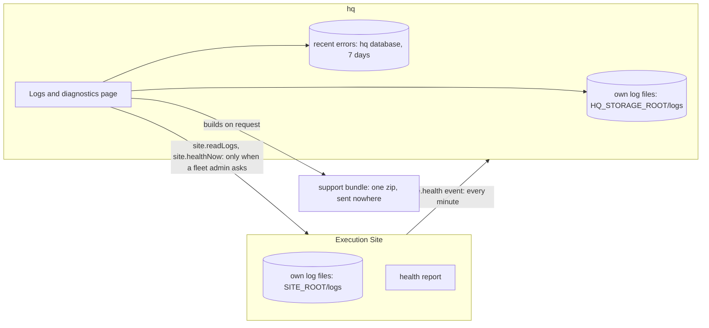

# Logs and diagnostics

How an admin finds out why something failed without a terminal on the machine: each service keeps its own log,
hq reads a site's over the channel it already has, and the Logs and diagnostics page under **Infrastructure**
shows health, recent errors, logs and a support bundle.

**Who sees what.** Recent errors are for organisation admins. Health, versions, logs and the support bundle are for
fleet admins — the accounts holding the fleet admin role
([ADR-0110](../adr/adr-0110-fleet-admin-is-a-role-on-hq-accounts.md)) — checked on the server by `assertFleetAdmin`
(`hq/src/sites/assertAdmin.ts`; `operations.ts`, `logOperations.ts`), since they show a machine's condition and
software, which looking after the machines is about. On a machine, `agenthix hq logs` and `agenthix site logs` read
the same files ([host-management.md](host-management.md)).

## The log

Each service writes its own file on its own disk; nothing is forwarded to hq's database
([ADR-0106](../adr/adr-0106-each-service-keeps-its-own-logs.md)).

- **Shape and retention** (`core/src/logging/`): JSON lines in `YYYY-MM-DD.NNN.jsonl` files, a segment closing at
  10 MB, kept for 7 days or 100 MB, whichever comes first, oldest dropped first. It is not a setting.
  `RollingLog` takes the file system as a parameter, so both apps share it; each passes `node:fs`
  (`hq/src/server/utils/logFile.ts`, `site/src/server/utils/logFile.ts`). A write that fails is reported once and
  never stops the service.
- **Where**: hq writes to `<HQ_STORAGE_ROOT>/logs` (`hq/src/diagnostics/startDiagnostics.ts`), a site to
  `<SITE_ROOT>/logs` (`site/src/server/main.ts`). The file is only started at boot, so tests that import a logger
  touch no disk.
- **Secrets are removed before a line is written** (`core/src/logging/redact.ts`): by shape (model provider keys
  and logins, GitHub tokens, a site's machine credential, connection tokens,
  JWTs, private keys, the userinfo of a URL) and by field name (`password`, `token`, `authorization` and the
  like). Over-removal is the accepted failure. hq removes them again from what it reads back from a site.
- **Reading** is one query type, `LogQuery` (`core/src/logging/logQuery.ts`): problems or all levels, a time
  range, a search, a cursor, newest first, up to 1000 lines a page.

## Reading a site's log

hq asks the site that holds it, only when a fleet admin opens the page or builds a bundle, and keeps nothing it reads
(`hq/src/diagnostics/logSources.ts`). Two channel methods
(`core/src/protocol/siteDiagnostics.ts`; handlers in
`site/src/server/hq/diagnosticsMethods.ts`):

| Method | Answers |
|---|---|
| `site.readLogs` | One page of the site's own log for a `LogQuery` |
| `site.healthNow` | The site's health report taken now, for **Check again** |

A site that is not connected, or too old to answer, is named with the reason and no lines. Its log stays on its
own machine and hq holds no copy.

## Health

- **A site's health** is the `site.health` event it sends when its channel opens and every minute
  ([control-channel.md](control-channel.md#dispatch-how-work-reaches-a-site)): runs now against the most at once,
  disk free, whether Docker answers, the agent image. hq keeps the latest on `ExecutionSite.health`.
- **hq's own health** (`hq/src/diagnostics/hqHealth.ts`): when it started, version and commit, whether its
  database answers, when its scheduler last ran, and how many sites it knows.
- **`GET /health`**, on hq and on the site, answers `{ "status": "ok" }` and nothing else. Versions are shown to
  fleet admins on the page and on hq's own machine by `agenthix status`.

## Recent errors

hq keeps the errors worth an admin's attention in `RecordedError` for 7 days (`hq/src/diagnostics/recordedErrors.ts`,
pruned hourly). Two kinds: one occurrence (a run that failed, a request GitHub refused), and a condition that
lasts (Docker not running on a site), kept as one row per stretch with its first and last time. Occurrences are
grouped into one problem with a count, and each group says in plain words what failed and what fixes it
(`errorAdvice.ts`, `recentErrors.ts`).

## The support bundle

A fleet admin builds one zip to attach when asking someone for help (`hq/src/diagnostics/supportBundle.ts`). It holds
versions, the name of each setting and whether it is set, health, recent errors and the logs of hq and each
connected site for 24 hours or 7 days. It never holds what people wrote or agents replied, files or secrets, and
people, projects and agents appear as `person-1`, `project-2`, `agent-3` in every file (`bundleNames.ts`). hq sends
it nowhere ([ADR-0042](../adr/adr-0042-hq-is-the-orgs-own.md)); the page lists exactly what is in it before
**Download**.

## Where it is in the code

| You want | Look in |
|---|---|
| The log format, redaction, rolling and query | `core/src/logging/` |
| The page's routes and operations | `hq/src/diagnostics/diagnostics.wasp.ts`, `operations.ts`, `logOperations.ts` (`/org/infrastructure/diagnostics`, `…/logs`, `…/bundle`) |
| The channel contract | `core/src/protocol/siteDiagnostics.ts`, `siteHealth.ts` |
| The site's side | `site/src/server/hq/diagnosticsMethods.ts`, `siteHealthReport.ts` |

## Decisions behind this

[ADR-0106](../adr/adr-0106-each-service-keeps-its-own-logs.md) (each service keeps its own logs) ·
[ADR-0042](../adr/adr-0042-hq-is-the-orgs-own.md) (hq is the org's own)
