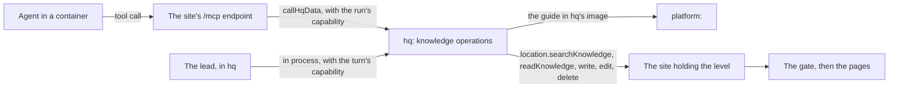

# MCP Tools

How an agent reaches the platform's data, and which tools it may call.

**The registry is `hq/src/shared/mcpTools.ts`**, with a copy at `site/src/shared/mcpTools.ts` (below), and it is the source of truth for tool names and access tiers. This document describes the model; it deliberately does not repeat each tool's input and output schema. Duplicating schemas here is what made the previous version of this file wrong — it listed thirteen tools under names that no longer existed, against a datastore the platform had already left.

---

## The endpoint, and who may call it

The **Execution Site** serves the agent's MCP endpoint at `POST /mcp` (`site/src/server/mcp/handler.ts`). Its only clients are the harnesses in that site's own agent containers: `runLaunch.ts` gives the Claude Agent SDK an `mcpServers` entry named `platform` pointing at the site's agent-facing URL, and the OpenCode runtime adds the same endpoint to its server as one connection per conversation (see [agent-runtimes.md](../sites/agent-runtimes.md)).

The agent never passes `orgId` or `siteId`. Scope comes from a **verified capability**, not from a shared connection context:

1. The harness presents an opaque **platform token** as its bearer. It is issued by the site (`site/src/server/runtime/runTokens.ts`, `conversationTokens.ts`), and for a harness that stays running across a conversation it is the conversation's token, pointed at the current turn's capability and at nothing between turns ([ADR-0082](../../adr/adr-0082-a-conversation-acts-with-its-current-turns-authority.md)).
2. The site resolves that token to the turn's capability, verifies the JWT, and **pins the audience to its own `siteId`** — a capability minted for a sibling site is refused.
3. `claims.permissions.neverTools` becomes the request's disabled-tool set.

The container never holds the site's machine credential or the capability JWT, and a renewal loop refreshes the capability behind the same opaque token, so a long run never carries a stale bearer. The whole token model is in [identity-and-trust.md](../identity-and-trust.md).

`adr-0040` sets the token lifetimes.

## Forwarding — hq does the work

**Every tool that touches data is forwarded to hq** through `callHqData`, which presents `X-Site-Id` and `X-Run-Capability`. hq's own registry performs the authorization and the operation.

A few tools are answered by the site itself (`site/src/server/mcp/mcpServer.ts`, `siteTools.ts`):

- **`ping`** and **`get_site_info`**, which touch no data;
- **`stop_processes`**, which stops processes the calling conversation's earlier commands left running in its container — only that conversation's own;
- **`web_search`**, offered to OpenCode only (Claude keeps its own search), which searches with the organisation's key so the key never reaches the container.

The site therefore holds no authorization policy for platform data. Its MCP endpoint is a transport with a capability check on the front — which is what keeps hq the single source of truth for who may do what, and why an hq outage makes data tools fail rather than degrade.

## Why the surface is shaped this way

Three alternatives were available, and each fails on something concrete.

**The runtime could call the platform directly, with no MCP.** The Claude Agent SDK's tool
interface *is* MCP, so avoiding it means inventing a bespoke tool protocol and teaching the
model to use it — a cost paid forever, against a protocol the SDK already speaks.

**The agent could address hq's MCP endpoint directly.** hq may be on a different machine from
the container, so the network path is not guaranteed; and it would mean handing the container
a credential hq trusts, which is exactly the durable-credential exposure the opaque run token
exists to avoid.

**The site could serve MCP under its own authority, reading its own database.** That puts a
second authorization policy on the site, and two policies diverge. hq is the org's source of
truth for its data, and a site deciding for itself who may archive a task has taken part of
that role.

**This does not contradict `adr-0022`**, which removed MCP as an *inbound* interface for
third-party agents — a developer's IDE connecting to a site to execute tasks. What runs here
is an *outbound* surface for the platform's own agent, in a role that record did not consider.
Same protocol, different question. `adr-0022`'s §1 is worded as though the first ruled out the
second, and it is annotated to that effect.

## Access tiers

A tool's tier decides whether an agent gets it without anyone choosing:

| Tier | Meaning |
|---|---|
| **Always injected** | Every agent has it. Not user-configurable |
| **Default on** | Included when `allowedTools` is null; can be turned off |
| **Administrative** | Off unless explicitly granted |

**Tiers decide the defaults; states decide each call.** An agent whose permissions were never edited
(`Agent.allowedTools` null) gets every always-injected and default-on tool as `always` and every
administrative tool as `never` (`DEFAULT_TOOL_PERMISSIONS`, `site/src/agents/runtime/toolPermissions.ts`).
Once someone edits the agent, each tool has the state they chose, `always`, `ask` or `never`, and the gate
decides each call by it ([tool-control.md](../tools/tool-control.md)); always-injected tools stay `always`
whatever is set. An agent whose approval is bypassed has every tool, administrative ones included, whatever
its list says; only a workspace's allowed list removes one. A tier is not authority: each operation checks
the person the run is for as the browser checks them — their current role, their membership of the project,
and the same role floors — and a run in a project is refused the tools that act on the whole organisation
([ADR-0101](../../adr/adr-0101-a-run-is-bounded-by-the-person-it-is-for.md)), whatever the agent's permissions.

## The registry

| Domain | Tool | Tier |
|---|---|---|
| **Platform** | `ping` · `get_site_info` · `stop_processes` | always |
| **Org** | `get_org` · `list_teams` | default |
| | `update_org` · `create_team` | administrative |
| **Product** | `list_products` · `get_product` | default |
| | `create_product` · `update_product` · `delete_product` | administrative |
| **Project** | `list_projects` | default |
| | `create_project` | administrative |
| **Board** | `list_boards` · `get_board` · `rename_sprint` | default |
| | `create_board` · `finish_sprint` | administrative |
| **Milestone** | `list_milestones` · `create_milestone` · `update_milestone` | default |
| | `delete_milestone` | administrative |
| **Run** | `list_active_runs` | default |
| | `set_result` | always |
| **Task** | `fetch_my_queued_tasks` · `get_task_details` · `add_comment` · `run_task` | always |
| | `list_tasks` · `create_task` · `update_task` · `change_tasks` · `attach_file` · `set_task_schedule` · `create_routine` · `update_routine` | default |
| | `archive_task` · `delete_task` | administrative |
| **Agent** | `list_agents` | default |
| | `create_agent` · `list_presets` · `apply_agent_preset` | administrative |
| **Library** | `list_workforce_templates` · `propose_workforce_template` | administrative |
| **Git** | `get_github_config` | administrative |
| **Workflow** | `list_workflows` · `propose_workflow` · `run_workflow` · `workflow_run` | always |
| **Live preview** | `start_app` · `stop_app` · `list_apps` · `reload_view` · `set_auto_reload` | always, to every code-work run; answered while its branch has a live preview on its site |
| | `install_packages` · `ask_to_use_package` | always, to a code-work run |
| | `offer_live_preview` | the lead only |
| **Board, in a conversation** | `open_board` | the lead only |
| **Memory** | `remember` · `forget` · `recall` | always |
| **Knowledge** | `search_knowledge` · `read_knowledge` · `write_knowledge` · `edit_knowledge` · `delete_knowledge` | always (the last three only to a run that may change files) |

**`run_task` is the task-delegation tool** — `adr-0020` chose delegation through a tool over sub-agent spawning, and this is the surface that decision rests on.

## What the live preview tools do

The app tools act on the live preview of the branch the run works on, on the run's own site; hq reads it from its rows at
each call, and the workspace and branch are never arguments, so a run cannot reach another branch's. `start_app` on a branch
with none opens it first, as the run's person and on the run's site, through the same checks as a person's *Live preview*
(their role, the site's limits), and only for a run a person started; a refusal starts nothing. The other app tools are
refused then. A code-work run's prompt says whether its branch's live preview was open when it was dispatched, and which
apps ran in it (`RunCodeWork.openLivePreview`): with one open, it calls `list_apps` first and, after changing what the
app shows, commits and calls `reload_view`; with none open, it calls `start_app` only when the person asked for the app
in its request. *Auto* reloads the view on every commit to the branch, the run-end commit included. Starting the live preview is the permission, so they are
not asked for. `install_packages` installs npm packages with scripts off and runs the scripts of those that pass the rule;
`ask_to_use_package` asks a person about one that failed it. `offer_live_preview` puts a card with a button in the lead's
reply; the person's press starts the live preview. See [site_live_preview.md](../sites/site_live_preview.md).

## What the board and milestone tools do

A board is a saved view of a project's tasks and holds none ([adr-0176](../../adr/adr-0176-a-board-is-a-saved-view.md)).
`list_boards` lists a project's boards (the built-in *Task state* and *Execution*, and its saved ones, each with
its counts per column) and the ids an agent arranges tasks by: the project's task types with their columns, its
custom fields with their options, and its current and upcoming sprints. `get_board` reads one board's columns and
their tasks in the project's order; a card is moved by changing the task with `update_task`. `create_board` saves
a view for the whole project. `open_board` is the lead's own: it shows the person a board as a card in the
conversation, which opens it, and changes nothing. `finish_sprint` finishes the project's current sprint; while any
of its tasks is not done it must say where those go (`next` or `none`), and their task state stays.
`rename_sprint` names a sprint (its number stays). `list_milestones`, `create_milestone` and `update_milestone`
read and change a project's dated milestones, which its epics belong to; `delete_milestone` removes one and leaves
its epics. See [board.md](../../concepts/tasks/board.md) and
[task.md](../../concepts/tasks/task.md#plan-epics-and-milestones).

## What the task tools do and refuse

A task has a type and sits in one of its type's columns, so in a task state
([adr-0174](../../adr/adr-0174-a-tasks-type-and-column-set-its-state.md)). An agent moves it with `update_task`, by
its `columnId` or its `state` (which lands on its type's default column for that state), changes its type, sprint,
epic, agent and custom field values, and puts it in the project's order with `afterTaskId` or `beforeTaskId`.
`change_tasks` makes one change to up to 100 tasks of one project and says which it did not reach and why. The
tools never set what an agent is doing with a task: that is its **execution state**, which only the system changes.
The task, board and sprint tools are declared once in core (`core/src/tasks/agentTools.ts`), and hq and the site
build their schemas from those declarations. The rules the task tools enforce in hq
(`hq/src/server/controlplane/taskWriteOps.ts`, `changeTasksOp.ts`, `boardOps.ts`, `scheduleOps.ts`, `routineOps.ts`):

- **Creating, moving or assigning a task starts nothing**
  ([adr-0175](../../adr/adr-0175-work-starts-only-by-an-explicit-act.md)). `create_task` puts a task in Backlog, last
  in the project's order, unless it names a column or a state. Each change goes through the service the screens
  use, on behalf of the person the run is for, and refuses what the screens refuse: an agent not in the project,
  a column of another type, a sprint of another project, an epic planned into a sprint. A refusal met after part
  of an `update_task` was made says which parts were.
- **`run_task` starts one task, only from a run a person started.** The task joins its agent's line and runs when the
  agent is free (`hq/src/server/controlplane/startGate.ts`). It is refused in a run a schedule or another agent started,
  through a connection without *Start work*, and for an epic, an archived task, a task with no agent, one already running,
  failed or needing a person, and one with a Run at… time still to come. `create_task` asked to start goes through the same
  gate and, when refused, still makes the task. The run it starts is `startedBy: 'agent'`: it carries the turn limit and
  cannot call `run_task` itself. A start deeper in a chain than the organisation's maximum depth is not made.
- **`set_task_schedule`, `create_routine` and `update_routine`** set when a task starts once (Run at…), or make and change a
  routine, a repeatable run of an agent on a cron schedule. An agent may use them only in a run a person started (never in
  a routine's own scheduled run), only where that person could do it themselves, and only when the project's setting
  *agents may set start times when asked* is on. They act on that person's behalf; a routine runs on behalf of the last
  person who changed it. An agent working unattended can never schedule work.
- **Times are read in the person's timezone.** `at` and a routine's times are the wall-clock time in the
  timezone of the person the agent is working for, unless the call names a `timezone`; the result says which was
  used. The run's prompt also states the person's current local time (see
  [container-runtime.md](../container-runtime.md#what-a-run-receives)).

## What the memory and result tools do

`remember`, `forget` and `recall` reach memory by meaning ([memory](../../concepts/memory/memory.md)): which scopes a call
may touch is decided in hq from the person the run is for, never from an argument (`hq/src/memory/principal.ts`). `recall`
searches memory only; knowledge has its own tools, below. `set_result` is how a run states what it achieved; hq keeps it with the run (`RunResult`) and a task's
latest on the task, and it refuses a call that names a run other than the caller's own, or one that has ended
(`hq/src/server/controlplane/resultOps.ts`). The lead of a conversation has these and hq's other quick tools, plus its own
(`start_work`, `answer_approval`, `ledger` and others) that only a conversation defines
([conversation-layer.md](../conversation-layer.md#the-lead-in-hq)).

## What the knowledge tools do

`search_knowledge`, `read_knowledge`, `write_knowledge`, `edit_knowledge` and `delete_knowledge` are shaped like the
native Grep, Read, Write and Edit, under their parameter names, and reach every level of
[knowledge](../../concepts/knowledge/knowledge.md): the platform guide, the organisation's, the run's place's, and for a
conversation's lead each place its person added. The tools are defined once, in `hq/src/server/controlplane/knowledgeToolSchemas.ts`
(`knowledgeOps.ts` runs them), and reach a worker the way every data tool does:

- **The levels a call may name are those its capability holds**: a worker's one place, or a conversation's places
  (`hq/src/knowledge/reach.ts`), with `org:` and `platform:`. There is no parameter that names another place.
- **hq decides who may change**: an `org:` change is refused unless the run or turn acts for an organisation admin,
  `platform:` is read-only, and the change tools are not offered to a run that has no write tools or to a turn that does
  not answer a person (the site withholds them from the run's tool list, and hq refuses them for it as well).
- **A search fans out.** hq asks the sites holding the places' and the organisation's knowledge, and its own copy of the
  guide, at once, and merges the answers within one time limit, the conversation's own place first. Each hit is marked
  with its page's name. A site that cannot be reached, or a missing guide, is said in the result and never fails a
  turn. The result is at most 8,000 characters and says where to continue.
- **The site runs the search.** `location.searchKnowledge` takes Grep's parameters and runs ripgrep over the owner's pages
  with the guards of `@agenthix/core/file-tools` (below); a change goes to the one site that holds the page, which applies
  it through the gate ([storage and placement](../storage-and-placement.md#where-knowledge-lives)).
- **A tool call is a normal result, whatever happens.** Refusals use a fixed set of messages, details go to the log,
  and the log never holds a search pattern.
- **`suggest_place`** is not one of these and not a run's: it is the lead's own conversation tool, which leaves a card
  asking the person to add a place ([conversation layer](../conversation-layer.md#a-conversations-places)).

### The file tools underneath

`@agenthix/core/file-tools` (`core/src/fileTools/`) holds grep, read, write and edit over any folder they are given,
knowing nothing of knowledge or places: ripgrep search with Grep's parameters, numbered reading that gives a version,
exact-match editing, and a write that goes beside and is renamed in. The OpenCode plugin's file tools are built on the
same module ([opencode-tools.md](../tools/opencode-tools.md)). The guards live here, so every user gets them:

| Risk | What stops it |
|---|---|
| A pattern that never finishes | ripgrep's engine never backtracks; a pattern it cannot run (backreferences, look-around) is refused with ripgrep's own message |
| Heavy or many searches | Pattern at most 500 characters; `rg` as its own process, killed after 2 seconds; a file size, line width and one-thread limit; at most 30 calls a minute per run or conversation |
| A pattern or option taking over the command | `rg` is started directly, never through a shell; arguments are built only from the allowed parameters; the pattern follows `-e`; links are not followed |
| Reading outside the folder | Every name is resolved inside its root only, opened without following links and checked to be the file allowed |
| An error giving the system away | A fixed set of messages; the detail goes to the log |

ripgrep is installed in the site's server image and hq's, as well as the agent and executor images.

## What the workflow tools do

`list_workflows`, `propose_workflow`, `run_workflow` and `workflow_run` are forwarded to hq like the others
(`hq/src/workflows/agentTools.ts`; their shapes in `core/src/workflows/agentTools.ts`). They act in the run's own place,
which the agent cannot name, and answer secret names, never values. `propose_workflow` and `run_workflow` name a
workspace, which must be one of the place's own. An agent can propose but never approve or switch a workflow, and its
runs of one workflow are limited per hour. How a run goes is [workflows.md](../workflows.md).

## A person's own client

hq's own `POST /mcp` (`hq/src/server/mcp/handler.ts`) serves the same registry to a tool outside the product, such
as a person's own Claude Code, which agents never call. It authenticates with a **connection** the person created,
not with an org-wide key (there is none): the call is that person, narrowed by the connection's permission groups
and project list. Each tool belongs to one group (read, change tasks, start work, manage), in
`hq/src/server/controlplane/connectionGroups.ts`; a tool with no group, such as the agent-only
`remember` and `set_result`, is refused to a connection. See
[identity-and-trust.md](../identity-and-trust.md#a-persons-own-connection-to-hq).

## A tool is declared in two places

hq's registry defines a tool; `site/src/server/mcp/forwardedToolSchemas.ts` decides what the site forwards. `site/src/server/mcp/__tests__/registryServed.test.ts` checks that the two agree: it fails whenever the registry advertises a tool the site does not serve, whether locally or by forwarding.

When adding a tool, add it to both, and check the tier lists in *both* modules' copies of `mcpTools.ts` — the file is duplicated rather than shared through `@agenthix/core`, and kept in step by hand.

## Adding a platform tool

1. **Name and tier**: add it to `SYSTEM_MCP_TOOLS` and one tier list in `hq/src/shared/mcpTools.ts`, and the
   same in `site/src/shared/mcpTools.ts`.
2. **If it touches the organisation's data**, it runs in hq: its argument schema goes in
   `hq/src/server/controlplane/toolSchemas.ts`, its operation in the matching `*Ops.ts` file there,
   registered in `operations.ts`, using the checks in `authorize.ts`. The site forwards it once it is in
   `site/src/server/mcp/forwardedToolSchemas.ts`.
3. **If it acts on the site's own machine** (the container's processes, its files), the site answers it
   itself, like `stop_processes`, in `site/src/server/mcp/siteTools.ts`. It acts only for the turn the
   caller's token names, and only in that turn's container.
4. **Either way it passes the gate** under its own name like every other call, and `registryServed.test.ts`
   fails until the site serves everything the registry lists.
