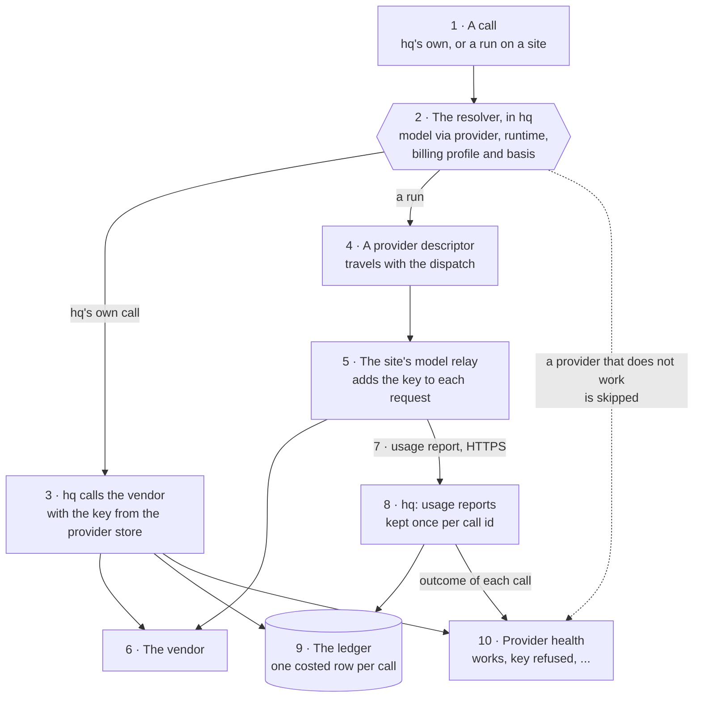

# Model resolution: the resolver, the relay and the ledger

How every model, speech-to-text and text-to-speech call in an organisation gets its provider, its key and its cost
record. Providers, their keys and every choice about models are held by hq; a site holds no key of its own and learns of
a provider only through the run it is given. What a person sees of this is in
[providers](../concepts/providers/providers.md), [models](../concepts/models/models.md) and
[billing](../concepts/billing/billing.md).

## The resolver

One module in hq (`hq/src/routing/`) answers for every call, so there is one rule instead of one per kind of call. Its
request (`ResolveRequest`, `core/src/providers/resolver.ts`) says what the call is for (`conversation`, `worker`,
`helper`, `title`, `summary`, `stt`, `tts`, or `voice_sample`), the place (a shared project, a person's own place, or none),
the agent, the person, and a pick when one was made. Its answer is a `Resolution`, or one problem.

- **`snapshot.ts`** reads what the rule needs, once per call: the organisation's providers, oldest first, with their
  states, plus the asking person's own Claude subscription; the organisation's three defaults (its one default model, listening and speaking); the agent's own choices; every
  [list](../concepts/models/lists.md) that applies (the organisation's, the agent's, the project's when the place is a shared project,
  and the person's); the model a conversation is fixed to; and the billing profile.
- **`decide.ts`** is the rule, with no database, so tests give it a snapshot and read the answer. A model may run when a
  provider of the call's type that works reaches it and every list lets it. A choice made for the call is used as it is or not
  at all and its problem says why; the defaults fall through to the same model via another provider, the next layer, then any
  model that may run. For work a conversation hands off the first default is the model the conversation talks on, so the
  lead and its workers run on one model; then the agent's default, then the organisation's. `fellBack` carries what was
  not used, and a brief keeps it as the line its run's page shows (`conversations/work/workers/workModel.ts`).
- **The answer** carries the model via its provider, the provider's name as it is now, the runtime (for work), the voice,
  where the choice came from, the **basis** the cost will be written on, and the billing profile. The basis is `INCLUDED` on
  a person's subscription, `AWAITING_ACTUAL` through Agenthix Cloud, `ESTIMATED` when an own key's model has a known price,
  `UNPRICED` otherwise. Pricing then fixes the amount when the row is written.
- **A problem** is one of eight codes, each with the words a person reads and who can fix it
  (`problems.ts`). `cap_reached`, Cloud's spending limit, is a refusal for money and not a provider failing.

Memory search never asks: it uses hq's built-in embedding model. Callers: conversation replies, titles and summaries
(`hq/src/conversations/access/talkingModel.ts`), the model picker (`models-settings/offered.ts`), work and helpers
(`hq/src/agents/runModel.ts`), a task's saved model (`models-settings/taskModelChoice.ts`), speech (`voice/speechAccess.ts`)
and the voice sample phrase (`voice/phraseModel.ts`).

## Reaching the provider

**In a demo, nothing is reached.** With `DEMO_MODE` set, the conversation lead's model is scripted, `languageModelFor` refuses, and no vendor is called, including speech and voice ([ADR-0186](../adr/adr-0186-a-demo-is-a-setting-of-the-install.md)).

A resolution only says where to send and what to present (`hq/src/routing/reaching.ts`).

- **hq's own calls** take the provider's key from the store (`credentialOf`, the only way to a key) and call the vendor
  directly. The result, success or the kind of failure, is reported to the provider's health. Agenthix Cloud is not a
  provider hq calls until the hosted side offers models and voice; it is never chosen for a call today.
- **A run on a site** is given a **provider descriptor** for the provider of its model and for any other provider a helper
  may be sent to, in the dispatch's run context as `modelAccess` (`RunModelAccess`, `core/src/protocol/runProvider.ts`):

| Descriptor | Carries | Used by |
|---|---|---|
| `api_key` | The provider's id, vendor and key (and the address for a custom endpoint), for this run only | The site's relay, which adds the key to each request |
| `subscription` | The Claude Code login of a person, a grant id and the login's id | Written into the run's own harness home, only for a run that runs as its owner in their own place; not relayed |
| `cloud` | The vendor API the gateway speaks (Anthropic's for Claude Code) and its address, with no secret | The relay, which asks hq for hq's Cloud access token and holds it until a minute before it lapses |

It supersedes `credential` and `fallbackCredentials`, which are marked deprecated and kept for an hq that still sends them: a
site reads `modelAccess` first when both are there. A run also carries the billing profile its calls are costed to.

## The relay and its usage reports

The site's model relay ([sites/model-relay.md](sites/model-relay.md)) forwards each request, adds the key the descriptor
names, and **reads the vendor's own usage out of the answer as it passes**, without holding or changing it: Anthropic's
`message_start` and `message_delta`, the final usage chunk of OpenAI, OpenRouter and compatible endpoints, Gemini's
`usageMetadata`. Each upstream call gets a call id made by the relay (reused by a retry), and one report: the call id, the
run, the provider, the model, the usage or none, the upstream HTTP status and the kind of failure.

Reports travel as **HTTPS calls from the site to hq**, with the site's machine credential, as a capability renewal does;
hq serves no requests on the control channel ([control-channel.md](control-channel.md#the-site-calling-hq)). The site keeps
each report as a file until hq acknowledges its call id, sends batches of at most 100 soon after calls end, and sends again
what was not acknowledged after a pause that grows while hq cannot be reached; past 50,000 waiting, a new report is dropped
and logged. hq (`hq/src/sites/usageReports.ts`) keeps each report once per call id, answers every call id it now holds
(including ones it already had), and leaves a report it cannot read out of the answer and logs it. A report seen for the
first time also feeds the provider's health, so an agent's failing calls move a provider's state as hq's own do.

A container on a person's own Claude subscription is not relayed. Its usage is the run's own report, and when the run ends
hq writes one `INCLUDED` row from the tokens the session added.

## The ledger

hq writes one `CALL` row per call (`hq/src/billing/writer.ts`), kept once per call id by a partial unique index, so the same
report arriving twice counts once. It prices the row when it is written from hq's own price lists (`hq:<version>`), or from
Cloud's catalogue (`cloud-catalogue:<version>`), and a later figure from Cloud, or a fix, is a new row that points at its
call (`refersTo`): nothing is changed or deleted. Where each row's place and profile come from:

| Source | Counted by | Place and profile from |
|---|---|---|
| hq's own calls | hq, in `sources/hqCalls.ts` | The resolution |
| An agent's run through the relay | The relay's report, written to the run's place in `sources/relay.ts` | `RunCosting`, which hq keeps when it dispatches a run |
| A run on a subscription | The run's own report, in `sources/runs.ts` | `RunCosting` |
| Text to speech | hq counts the characters it sends, in `sources/voice.ts` | The conversation's place |
| Speech to text | The browser streams to the speech service itself; hq issues the token with a sealed ticket and, when the session ends, counts the audio handed back, capped at the time since issue | The ticket |

Each call's cost is one view (`UsageCallCost`, `hq/src/billing/callCostView.sql`): its latest row with an amount, or the
call alone while none has one. Every report and the CSV export read it. Rows keep their ids as plain values with no
cascading foreign key, so removing a provider, project, agent or person never removes cost.

## Provider health and the Cloud token

`hq/src/providers/health.ts` moves a provider's state from every outcome, whoever saw it, under one rule
(`healthRules.ts`): any success is *works*; `auth` or `quota` from a real call asks for a check at once and the check
confirms it; three `unavailable` in a row, at least a minute apart, make it *unreachable*; a rate limit, a bad request, a
cancel and Cloud's spending cap are not states. Notices to organisation admins follow from state
(`providers/notices.ts`).

A site asks hq for hq's Cloud access token with `POST /api/v1/cloud/ai-token` (`HQ_CLOUD_AI_TOKEN_PATH`), with its machine
credential. hq's private key never leaves hq. Until hq's calls to Cloud's AI exist the answer is a refusal: `not_connected`
while hq has no Cloud connection, otherwise `not_available`. The relay remembers a refusal for 30 seconds, so a burst of
calls asks once. [cloud-connection.md](cloud-connection.md#the-ai-contract) has the contract with Cloud.

## Where it is in the code

| You want | Look in |
|---|---|
| The resolver | `hq/src/routing/` (`resolver.ts`, `decide.ts`, `snapshot.ts`, `reaching.ts`, `problems.ts`); the contract `core/src/providers/resolver.ts` |
| A provider descriptor, the Cloud token, a usage report | `core/src/protocol/runProvider.ts`, `usageReport.ts` |
| The relay, its reader, its outbox | `site/src/server/modelRelay/` |
| hq's side of usage reports and the Cloud token | `hq/src/sites/usageReports.ts`, `cloudAiTokenApi.ts` |
| The ledger | `hq/src/billing/`; the contract `core/src/billing/ledger.ts` |
| The provider store and health | `hq/src/providers/` |

## What must not break

- **Only the provider store writes a key, and only `credentialOf` reads one.** No read, log or answer carries a key.
- **A site keeps no provider table and no key at rest.** What it needs arrives with the run and is held for the run.
- **A choice made for a call is never switched silently.** A default falls through, and says so once.
- **A call is counted once.** The call id is made on the organisation's side and a retry reuses it.
- **Nothing is deleted from the ledger.**
