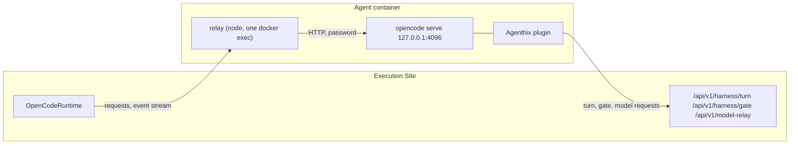

# Agent Runtimes

How an Execution Site runs an agent's turn: which harness runs it, how each harness is started, driven,
kept warm between turns and ended, and what ends a conversation's processes. A **harness** is the
vendor's agent program — the Claude Code CLI or OpenCode — that runs the model loop and its tools.

The gate every tool call passes is [tool-control.md](../tools/tool-control.md); how model requests reach
a provider without the key entering the container is [model-relay.md](./model-relay.md).

---

## Two runtimes behind one interface

Every run goes through `AgentRuntime` (`site/src/agents/runtime/types.ts`, adr-0019):

| Method | What it does |
|---|---|
| `run(context)` | Runs one turn and yields its events (text, tool calls and results, thinking, status) |
| `sessionExists(query)` | Whether the harness still holds a conversation, asked before it is resumed (adr-0076) |
| `conversationIdle(ref)` | The conversation went idle: let go of what the harness keeps warm for it |
| `endConversation(ref)` | The conversation ended: the same, for good |

Two implementations
([adr-0073](../../adr/adr-0073-claude-keeps-its-own-runtime-opencode-replaces-nativeruntime.md)):

| Runtime name | Class | Harness | Models |
|---|---|---|---|
| `claude-sdk` | `ClaudeSDKRuntime` | The `claude` CLI, through the Claude Agent SDK | Anthropic's on an API key, a person's own Claude subscription, or a Claude model through Agenthix Cloud |
| `opencode` | `OpenCodeRuntime` | `opencode serve`, through its HTTP API | Any other model of a provider Agenthix offers (OpenRouter, OpenAI, Google, Inworld, an OpenAI-compatible endpoint, Agenthix Cloud), including a Claude model reached through Inworld, on an API key |

**Selection** (`selectRuntime.ts`, called from `runLaunch.ts`) is by name. A conversation uses the
runtime recorded on its session when it was created, whatever the models chosen later would give
([adr-0078](../../adr/adr-0078-a-conversation-keeps-the-runtime-it-started-with.md)); a session with none
recorded takes the runtime hq sends with the run, which follows the model hq's resolver chose for it
([model-resolution.md](../model-resolution.md)). An agent has no runtime of its own. An unknown name fails the run — it
never falls back to Claude, which would silently change the conversation's harness and billing.

**Each harness runs the way its vendor intends, and stays warm across a conversation's turns**
([adr-0081](../../adr/adr-0081-a-harness-runs-the-way-its-vendor-intends.md)): Claude as one process per
conversation, OpenCode as one server per container.

---

## Claude: one process per conversation

`ClaudeSDKRuntime` keeps one `claude` process for each live conversation (`claude/claudeProcess.ts`,
`claude/claudeProcesses.ts`). The process is the SDK's ordinary `query()` given a stream of user messages
— the SDK's streaming input, which its documentation calls the preferred mode — and each turn is one more
message on that stream (`claude/turnInput.ts`). In a container it is started with `docker exec -i` as the
image's user, with its own environment on the exec (`DockerSpawner.ts`); without container isolation it
is a child of the site's process.

**What is per turn stays per turn:**

- the gate: the `PreToolUse` hook runs in the site's process and decides each call against the current
  turn's context; between turns every call is refused;
- the model, set with `setModel()` before the turn; the run records the model the CLI reports for the
  turn (its `system/init` message), not the id requested, since the CLI renames retired ids;
- the platform token: the process is started with the conversation's token, not the run's, and the site
  points it at each turn's capability and at nothing between turns
  ([adr-0082](../../adr/adr-0082-a-conversation-acts-with-its-current-turns-authority.md));
- a cancel: `interrupt()`, which ends the running turn and keeps the process. Every control call is
  awaited and its rejection handled.

**What is fixed at start is checked at every turn.** `buildClaudeStart` (`claude/claudeStart.ts`) builds
the process's options afresh for each turn and hashes what the CLI reads only when it starts: working
folder, container, harness home, tool list, blocked tools, system prompt, staged skills (by content),
platform-tool connection, the exec's environment, and how it authenticates — an API key or a
subscription. **The running process is replaced**, and the new one resumes the conversation from its
session file, when:

- that hash differs from the running process's — so editing the agent's agenda file, which
  is in a chat's system prompt, replaces it at the next turn;
- the process has ended, or its last turn failed;
- it held more than `AGENT_HARNESS_MEMORY_MB` of resident memory (1,024 by default) when last measured —
  the vendor's guidance is to recycle processes as memory grows. The site measures a process's memory in
  the background after each turn that reached its result, so no turn waits on the measurement; a process
  that passes the ceiling is replaced at the first turn to start after a measurement shows it;
- it refuses the turn's model.

A changed API key does **not** replace it: the key is not in the process at all. With an API key in a
container, the process's model requests go to the site's model relay, and the key Claude Code sends is a
relay token its `apiKeyHelper` fetched once, at start, with a one-use ticket
([model-relay.md](./model-relay.md)). A subscription's login is written into the runner's harness home,
which the CLI reads again on its next request; a subscription is never relayed.

**Other environment on the process's `docker exec`**: the conversation's process tag
(`SITE_SESSION`), so the process and everything it starts end with the conversation;
`CLAUDE_CODE_SHELL_PREFIX` and `USE_BUILTIN_RIPGREP=0`, so its commands and searches run in the command
sandbox ([claude-tools.md](../tools/claude-tools.md)); the platform token and the agent's handle (`SITE_MCP_KEY`, `AGENT_HANDLE`); and
`ENABLE_CLAUDEAI_MCP_SERVERS=false`. Nothing git-related: the container holds no git credential
([workflows.md](../workflows.md)).

**A turn that could not start** is retried once in a new process that resumes the conversation, in two
cases only: Claude Code refused a new session under an id whose session file already exists, or a process
that had served earlier turns ended between turns and answered nothing. A failed resume is never answered
with a fresh session under the same id.

**Ending a process** closes its input, which the CLI answers by exiting and saving its session file; if
it has not gone within a few seconds the SDK closes it, and in a container the process is found by its
tag and killed, so a replacement never shares its session file (`claude/claudeProcessProbe.ts`). A site
restart ends the `docker exec` holding each process; the next turn starts a new one, which resumes.

No `claude` process starts in a container until the Landlock check has passed (below).

---

## OpenCode: one server per container

`OpenCodeRuntime` runs only in an agent container: its commands can be contained only where the image's
launcher is, so without container isolation an OpenCode run fails and Claude still runs. Each container —
one storage boundary and one runner (adr-0074) — has at most one `opencode serve` process, hosting every
OpenCode conversation in that container as its own OpenCode session (`opencode/openCodeServers.ts`).

**Driven through one relay.** The site starts one long-running `docker exec -i` into the container as the
image's user, running a small Node program (`opencode/relayScript.ts`, `openCodeRelay.ts`). Every request
to the server and its event stream pass through it as lines of JSON — about 1 ms a request, against about
31 ms for a new `docker exec` — and the server listens on the container's loopback address alone, never
reachable over the network. The relay also starts and stops the server, so the server's secrets arrive on
the relay's standard input and are never on a command line. When the relay's input closes — the site
stopped it or went away — it stops the server and exits, so a server never outlives the relay that holds
its password.

**Started** by the first turn dispatched to a container without a running server, and by the existence
check. A server the check started is kept when it finds the session, for the turn that follows, and
stopped when it finds none or fails, unless another conversation holds it; likewise when a run is refused
before its turn begins (its model, credential or capability). Before starting it, the relay stops any server left on the port, removes OpenCode's `auth.json`,
and refuses a home whose `opencode.db` holds an OpenCode account. The server starts with no
conversation's tag, with a password and a key of its own generated for it, and with its configuration in
its environment (`opencode/openCodeConfig.ts`): every provider addressed at the site's model relay, no
provider key, every tool allowed except those hidden (see
[opencode-tools.md](../tools/opencode-tools.md)), Agenthix's plugin, the launcher as its shell, and the
settings that keep OpenCode from reading project configuration, fetching its catalogue, sharing sessions,
updating itself or installing plugins. From the container's own environment it takes only `PATH`, locale,
time zone and proxy settings. The site polls `GET /global/health` until it answers — each probe abandoned
after 250 ms, since a starting server may accept a connection it does not yet answer, and the whole wait
bounded at 60 s — and then waits for the event stream's first event before any turn is sent.

**The event stream.** The site follows `GET /global/event`, which carries every project folder's events
on one stream, and routes each event to the turn that owns its OpenCode session. If the stream ends while
the server runs, the turns running on it fail — the events they missed cannot be recovered — and the
stream is followed again for later turns.

**A turn:**

1. The site points the conversation's platform token at the run's capability, registers the run with the
   gate, and issues the turn a relay token pointed at the turn's credentials.
2. It adds the conversation's own platform-tool connection with `POST /mcp` if the server lacks it — first
   turn, after a restart, or a new token. The connection is named `agx` and the first 12 hexadecimal
   characters of a SHA-256 hash of the conversation id (`opencode/openCodeConnection.ts`).
3. It stages the turn's skills and finds the conversation's OpenCode session: the one recorded on the
   conversation (`AgentSession.harnessSessionId`), or a new one created with `POST /session` in the
   conversation's working folder (the `directory` query parameter), with Agenthix's title for it — so
   OpenCode never asks a model for one. The session's rules begin with Agenthix's whole set, deny every
   `agx*` connection, then allow the conversation's own, and for a restricted agent deny its `never`
   built-ins — and, in a run with no approved manifest, its `ask` built-ins and `ask`
   platform tools too. The last matching rule wins, so a conversation sees only its own platform tools, whoever
   joins the server later. Permissions are read at every turn, so a resumed session's rules are brought up
   to the turn's before the message is sent (`GET` then, if they differ, `PATCH /session/:id`).
4. It records the session's turn for the plugin: the conversation id, the platform token, and the header
   carrying the relay token.
5. It sends the message with `POST /session/:id/prompt_async` — the model, the agent `build`, the system
   prompt with the staged skills' list, and the text (after the one-line instruction for the skill the person picked, when the site kept the pick; [skills-and-assets.md](../skills-and-assets.md#the-picked-skill)) — which answers at once, and ends the turn on the
   stream's `session.idle`. No request is held open for a whole turn.
6. When the turn ends, the turn record, relay token and platform token resolve to nothing again.

**The plugin fetches its turn.** Before every model request and tool call, Agenthix's plugin asks
`POST /api/v1/harness/turn` for its session's current turn, authenticated by the key the site gave its
server (`SITE_HARNESS_KEY`), which the launcher strips from commands. A key opens only its own
server's sessions; between turns the answer is no turn, so a model request carries no relay token and a
tool call is refused. The plugin sets the relay token on each model request (`chat.headers`), asks the
gate before each call (`tool.execute.before`), and tags each command with the conversation and blanks
the server's secrets in its environment (`shell.env`).

**A cancel** tells the gate first, which refuses everything still pending for the run, and then aborts
the OpenCode session (`POST /session/:id/abort`). The server keeps running.

**Stopped** when the last conversation it serves is released and no turn is running — the site first
disconnects that conversation's connection — and with the container. **Restarted** by the next turn after
it crashed; conversations resume from the home, and each conversation's connection is added again before
its next turn. **An OpenAI-compatible endpoint's model names** are the one setting read from the server's
configuration: a turn needing one the running server lacks restarts it when no other turn runs on it,
and otherwise fails with a message asking to run it again.

**The existence check** is `GET /session/:id`: `200` exists, `404` gone. A starting server may refuse a
connection or accept it and never answer, so the check retries for up to 60 s and then fails the run; it
never reads silence as absence.

---

## How a turn ends

The same for both runtimes; each harness's messages are translated into the site's run events
(`claude/claudeMessages.ts`, `opencode/openCodeTranslate.ts`) and the engine records the outcome
(`AgentEngine.ts`, `runCompletion.ts`).

- **Completed.** The reply is the turn's text. Text parts separated by tool calls are joined with a
  paragraph break, the same in the streamed text and the stored reply. When Claude Code answers a turn
  itself without calling the model — the one command the site sends, Summarise now, is such a command — that answer is the reply. A person's message is never sent as a command: text that begins with `/` is given after a line saying it is plain text.
  A turn that ends with no text says "The agent ended its turn without a reply."
- **Retrying.** Each harness retries a failed model request itself: OpenCode up to five times over about
  70 s, Claude Code up to its own limit. Each retry is shown in the chat as a transient notice (the
  `notice` run event, streamed as `agentRunNotice`), naming a rate limit or the provider's reason. After
  three retries, or at once when the provider asks to wait more than 60 s, the site ends the turn: on
  OpenCode it stops the run's gate decisions and aborts the session, on Claude it interrupts the turn, and
  the turn fails with the provider's reason (`providerRetry.ts`). The same bound applies to task runs.
- **Failed.** The run is FAILED with the provider's or harness's own reason — an OpenCode `session.error`,
  or a Claude result marked as an error. The hint to check the provider's credential is added only when
  the provider refused it (401, 403, or OpenCode's `ProviderAuthError`). A context overflow OpenCode
  recovers from by compacting does not fail the turn.
- **Stopped by a limit.** A run past its time limit, or, when no person started it, its turn limit, is stopped
  the same way and recorded `CANCELLED` with a reason beginning "Run limit reached" that names the limit
  (`runLimitWatch.ts`; [container-runtime.md](../container-runtime.md#limits-and-slots)). Claude counts a turn
  for each distinct model response and OpenCode for each step it finishes.
- **Stopped.** A person's Stop, or hq stopping a busy conversation for a new message, tells the gate
  first, then the harness (`interrupt()` on Claude, `POST /session/:id/abort` on OpenCode); the harness
  keeps running. The run is CANCELLED with `Cancelled by user` or `Interrupted by a new message`; text
  already produced is kept as the reply, and a turn with none records "Stopped." or "Stopped for a new
  message." (`turnStop.ts`). What the turn produced is saved and its tokens counted.

---

## The conversation lifecycle

Nothing is reset when a turn ends. A process belongs to the conversation that started it and ends with
it ([adr-0083](../../adr/adr-0083-a-process-belongs-to-the-conversation-that-started-it.md);
`conversationLifecycle.ts`).

- **Tagged.** Every process a conversation starts carries `SITE_SESSION=<conversation id>` in its
  environment, and everything it starts inherits it. A Claude process gets it on its `docker exec`; an
  OpenCode command gets it from the plugin's `shell.env` hook. The OpenCode server carries none.
- **Idle.** When a turn ends, the conversation's idle timer starts: `AGENT_SESSION_IDLE_MINUTES`, a
  machine setting in the site's environment, 30 by default. The next turn stops it, and a running turn is
  never idle.
- **Ended.** Closed because its harness state is gone (adr-0076), deleted, or its person leaving
  (`server/runtime/conversationEnding.ts`, `membershipEnding.ts`): released at once.

**Releasing a conversation, in this order:**

1. Its platform token is revoked, so nothing still running can act through the platform.
2. Its runtime is told (`conversationIdle` or `endConversation`): a Claude process is closed and saves its
   session file; an OpenCode server drops the conversation, and stops if it was the last.
3. Every process still carrying its tag is ended by the finder (`conversationProcesses.ts`): as the image's
   user, which alone can read the other processes' environments, one pass matches the exact entry, stops
   the matches with `SIGSTOP` so they cannot fork, kills them, and repeats until a pass finds none, up to
   50 passes.
4. Its staged skills in the runner's run staging are removed, once nothing can be reading them.

A turn starting while a release is under way waits for it, so no harness starts into the finder's kill.
The conversation stays resumable after an idle release; its next turn starts without what it left
running.

**PID 1 reaps.** Containers start with `docker run --init` (`containerRunArgs.ts`); without it, killed
processes would stay as zombies against the container's process limit.

**Kept in memory.** After a site restart nothing is known of earlier turns. A container reached again is
recreated, which takes its processes with it; one never reached again is removed when idle
(`AGENT_CONTAINER_IDLE_MINUTES`, adr-0049), which remains the backstop for everything. A process started
with its environment cleared loses its tag and lives until then.

---

## The Landlock check

Every agent command runs in a Landlock sandbox, and signals and tracing are confined only on Landlock
ABI 6 (Linux 6.12) or later ([tool-control.md](../tools/tool-control.md)). The site asks the kernel's ABI
once at startup, from a throwaway container of the agent image, in the background so boot does not wait
(`landlockCheck.ts`, `server/setup.ts`). If startup could not ask — no image yet, Docker not up — the first
container that needs it asks. Before a `claude` process or an OpenCode server starts in a container the
answer must be known and 6 or later, or the run fails with a message saying the kernel cannot contain an
agent's commands. The ABI is the host kernel's, so one answer holds for every container.

---

## Start-up time against memory

Measured on the runtimes as built, in the agent container with a stand-in model, through the site's own
classes and the model relay (turn to its end, median): a new Claude process costs a turn about 0.3 s, and a
running process holds about 220–240 MB; a new OpenCode server and its first turn take about 1.3 s, a turn on
a running server about 37 ms, and a server holds about 320 MB idle and about 530–550 MB once it has served
turns, however many sessions it holds, plus about 60 MB for the relay. A turn in a running Claude process
measured 37 ms, of which about 33 ms was the memory measurement that now runs after the turn instead. The
[harness-lifetime analysis](../../work/2026-09-27-model-vendor-independence/harness-lifetime-analysis.md)
weighed the same trade-off before the build. Keeping both warm makes a turn in a live conversation start
without a process start; it costs memory that grows with live conversations on Claude and with active
containers on OpenCode, bounded by the idle timer and, for Claude, the memory ceiling.

---

## Key files

| File | Role |
|---|---|
| `site/src/agents/runtime/selectRuntime.ts`, `runLaunch.ts` | Which runtime a run uses, and the run's context |
| `site/src/agents/runtime/ClaudeSDKRuntime.ts`, `claude/` | The Claude runtime and its per-conversation processes |
| `site/src/agents/runtime/OpenCodeRuntime.ts`, `opencode/` | The OpenCode runtime, its servers, relay, sessions and turns |
| `site/opencode-plugin/src/` | Agenthix's OpenCode plugin |
| `site/src/server/harness/turnApi.ts` | The plugin's turn endpoint |
| `site/src/agents/runtime/conversationLifecycle.ts`, `conversationProcesses.ts` | Idle timer, release order, the process finder |
| `site/src/agents/runtime/landlockCheck.ts` | The kernel check |
| `site/src/server/runtime/conversationTokens.ts` | Each conversation's platform token, pointed at each turn |
