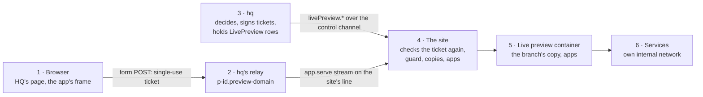

# Live Previews

How a person sees the web app an agent is building **before it is deployed**: a container of its own on an Execution Site
runs the app from a branch's working copy, and the browser reaches it through a relay on an address of its own. hq decides
and signs; the relay carries every byte; the site holds the container and checks again
([ADR-0169](../../adr/adr-0169-live-apps-travel-through-relays.md)). This replaces the earlier preview path, in which hq
proxied a dev server running in the agent's own container (`start_preview`, `PreviewSession`), which is gone.

The people's view is in the user guide, [Live previews](../../guide/projects/live-previews.md); the trust boundary is
[ADR-0167](../../adr/adr-0167-agenthix-acts-only-on-machines-the-organisation-runs.md).

**It is behind the `livePreview` flag, at experimental** ([feature flags](../feature-flags.md)): everything below is
built, and refuses or is hidden unless the flag is on. Code work on branches does not depend on it.

1. **The browser** loads the app in a sandboxed frame (or a new tab) by posting a form from HQ's page; the ticket is never in a link.
2. **The relay** (`relay/src/apps/`) answers `p-<id>.<preview domain>`. It admits an entry only as a `POST` from HQ's origin with fetch metadata, exchanges the ticket for a host-only `__Host-` cookie of at most 15 minutes, refuses requests made from any other page (sibling apps included) and WebSockets opened by any page but the app's own, and strips `Domain=` from the cookies an app sets.
3. **hq** (`hq/src/livePreviews/`) holds the `LivePreview` and `LiveApp` rows, picks the site, signs tickets, answers the relay's `relay.ask` before every new stream, and sends the site its orders. It never carries an app's bytes.
4. **The site** (`site/src/server/livePreviews/`) makes and inspects the container, runs the guard, serves the app stream (`app.serve`) and checks the site's own single-use ticket for each new stream.
5. **The live preview's container** binds the branch's copy and nothing else; apps run inside it through the sandbox launcher.
6. **Services** (`.agents/services.yaml`) run beside it on an internal network of their own.

## Opening one

`startLivePreview` (hq) checks the person is a Member or Admin of the project, that HQ has a preview address
(`livePreviewsHaveAnAddress`: none on an install reached by a bare network address), picks a site, and takes an
advisory lock so two opens make one live preview per branch. It asks the site `livePreview.open`.

- **A copy of the branch.** On the workspace's own site the container binds the branch's own working copy, which the site
  checks against its `BranchCopy` record. `main` gets a copy of its own, made by the commit helper and refreshed by
  `livePreview.refresh` when `main` moves.
- **Another site.** hq asks the workspace's site for a Git bundle of the branch (`bundle.make`, which also carries `main`),
  and the bundle crosses a relay on a bundle ticket (`bundle.read` on the source, `bundle.write` on the destination, a
  single take of the ticket's `jti`, the size and SHA-256 checked before anything is kept). The destination makes a copy of
  its own; the branch's runs then go to that site, and each commit comes back (`livePreview.commit`, `bundle.make`,
  `branch.bringBackBundle`), which writes only that branch's name and refuses with `moved_meanwhile` if the branch moved.
- **Choosing the site.** The workspace's own, if it allows live previews, its guard has reported within a minute and it
  has room; else the allowed site with the most room. A site with live previews off is never listed. A full site answers
  with the list of open ones, so a person can stop one of theirs.

## Entering an app

`openLiveApp` (`hq/src/relays/appEntry.ts`) signs a ticket naming one person, one live preview, one app and one relay, records
it in the ticket book (`appTickets`), and answers the form HQ's page posts into a named frame or a new tab
(`hq/src/workspaceView/appFrame.ts`). The relay takes the ticket once and sets the cookie. Before each new stream the relay
asks hq (`relay.ask`; a yes is reused for 2 seconds); hq says yes only while the ticket is in its book, nothing revoked it,
the live preview is `RUNNING`, and the person is still a member of its project. A pause, a stop or a person leaving a
project revokes tickets (`relay.revoke`), which ends open streams.

An app's address comes from the pattern `PREVIEW_PATTERN` (`hq/src/relays/appAddress.ts`) and an id of at least 128 bits
given once per app and branch. On a laptop with hq at `http://localhost:<port>` the pattern is `p-<id>.preview.localhost:<port>`.
The host service sets the pattern from the preview domain (`agenthix front-door on --previews`), and its front door asks hq
(`/preview-certificate-ask`) before getting a certificate, which hq grants only for an app id it has recorded. See
[deployment.md](../deployment.md#in-front-of-hq).

## States

`LivePreview.state` is `STARTING`, `RUNNING`, `PAUSED` or `STOPPED`, and hq owns every move: a site's events
(`livePreview.state`, `livePreview.appState`, `livePreview.services`, `livePreview.guard`) count only for a live preview hq
opened on the site they came from. hq's sweep, every minute, stops one unused for the site's idle time (default 2 hours;
"in use" is `lastUsedAt`, touched by the screen once a minute while shown, an open, an app tool, and a run starting or
ending on the branch); at every connect hq reconciles both ways, stopping what the site runs and hq does not hold live, and
marking stopped what hq holds and the site no longer runs. A site restart removes every live preview container and pauses
the open ones as `lineLost`, and they return with fresh containers when the line does; apps do not survive it.

## The agent's tools

`start_app`, `stop_app`, `list_apps`, `reload_view` and `set_auto_reload` (`core/src/livePreview/appTools.ts`) are offered to
every code-work run, and to a run whose signed capability carries a live preview claim (`CapabilityLivePreview`). A
harness lists a conversation's platform tools once, when it connects, and keeps that list for the conversation's later
runs, so the offer cannot follow a live preview that opens or stops between them. hq answers a call only while the branch
the run's session works on has a live preview on the run's site, read from its rows at the call; the site then checks that
the run is going on that branch. `start_app` on a branch with none first opens it, as the run's person, on the run's site,
through `startLivePreview` (hq's `livePreviews/runOpening.ts`), so the person's role, the site's limits and the copy rules
apply and the person is its starter; a refusal reaches the agent in hq's words and nothing is started. The other app tools
are refused while the branch has none. The
workspace and branch are never arguments. Starting a live preview is
the permission; they are not asked for. `install_packages` and `ask_to_use_package` are offered to every code-work run and
install in the live preview's container, or in the run's own container in the branch's copy (`RunContext.codeWork`, from the
site's checked record). `offer_live_preview` is the lead's: a card with a button, which calls `startLivePreview` as the
person who pressed it ([mcp/tools.md](../mcp/tools.md)).

## Install scripts

[ADR-0170](../../adr/adr-0170-install-scripts-are-blocked-by-default.md). Every agent command runs with scripts off
(`npm_config_ignore_scripts`, `YARN_IGNORE_SCRIPTS`, `YARN_ENABLE_SCRIPTS`), set in the agent's exec environment, and the
environment outranks the `.npmrc` and `.yarnrc` files a repository carries. `install_packages` then runs the scripts of
packages that pass the rule in `core/src/livePreview/installScripts.ts`: published at least 30 days ago, more than 1,000
downloads a week, no advisory in the OSV database, the same publisher as the version before; a built-in list and the
organisation's trusted scopes (`Org.trustedPackageScopes`, at most 20, carried in every run's capability) skip it. Facts are
looked up once per version. A blocked package is asked about as a question on the live preview's strip, or, when no live
preview is open, as a card in the branch's thread (`branch.packageBlocked` from the site, `branch.packageUse` back, checked
by hq against its records and again by the site). The press is the person's own: a yes through the lead is refused.

## Secrets

[ADR-0171](../../adr/adr-0171-secrets-reach-a-live-preview-only-through-an-approved-workflow.md). See
[workflows.md](../workflows.md#a-run-aimed-at-a-live-preview).

## The container and the guard

The container runs with no capability, `no-new-privileges`, a read-only root, IPv6 off, no published port and no Docker socket, as
uid 1001, and is created and inspected before it starts and re-inspected on every look; any difference from its template stops
it. It binds the branch's copy and nothing else: never the workspace's folder, another copy, any storage or the site's data.
Its network is made only in the live-preview part of the agent address range ([ports.md](../ports.md)), where the host
service's firewall rules (`private-addresses` always, `public-address` once the machine's public address is known from
`hq.seenFrom`) close private addresses, the machine's own and public addresses and cloud metadata. A site starts no live
preview until both rules hold.

The guard (`site/src/server/livePreviews/guard/`) looks at least every 5 seconds and on every Docker event: template
differences, containers or processes the site did not make, ports no app opened, privilege changes, blocked-address rates,
unusual use, protections that stop holding, and any Docker exec, attach or copy-in the site did not make. It stops or pauses
within 2 seconds, and fails closed.

A site reaches an app through one long-lived forwarder per live preview: a `docker exec` of a small program inside the
container's network namespace, which carries every stream of that live preview over its standard input and output, each
stream under its own credit, so an app that listens only on `localhost` works, no port is published, and a page of hundreds
of modules costs one exec. While the forwarder cannot answer, a stream gets an exec of its own, at most 4 at once across the
site.

Commit helpers run at most 4 at once across the site; one beyond that waits up to half its budget, then is refused having
started nothing. Identical reads of a workspace asked together (`branch.list`, say) share one helper, and their answer for
2 seconds, unless a helper wrote the workspace meanwhile.

## Capacity and the Fleet Console

Per site, set in the Fleet Console (`sites.livePreviews`, `sites.livePreviews.set`, `sites.livePreviews.stop`): live previews
on or off (on for hq's own site, off for others), *Live previews at once* (none by default) and *Stop when unused for*. The
site reports capacity in `site.health`; hq raises a notice to fleet admins when memory passes 80% and when it is back under
70%, and when a live preview is stopped for resources.

## Versions

Site protocol 1.12 added `livePreview.*`, `site.livePreviews`, `app.serve`, duplex streams, `bundle.*` and
`branch.bringBackBundle`, and deprecated `preview.start`, `preview.stop` and `preview.connect`, which answer as gone. See
[versioning.md](../versioning.md).

## Related

- [The container runtime](../container-runtime.md): the agent's container.
- [The control channel](../control-channel.md): how the `livePreview.*` methods cross.
- [Files and relays](../files-and-relays.md): the relay, tickets and lines.
- [Deployment](../deployment.md#in-front-of-hq): the preview domain and the front door.
- [Platform tools](../mcp/tools.md): the agent's tools.
