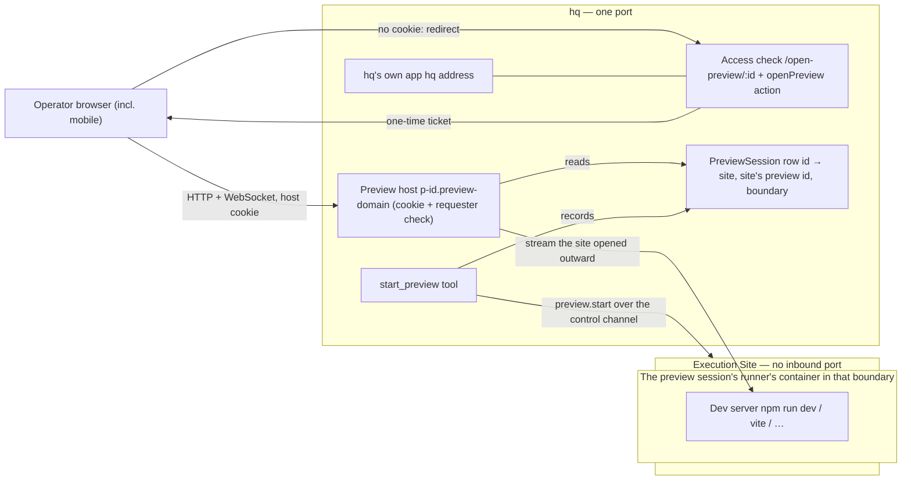
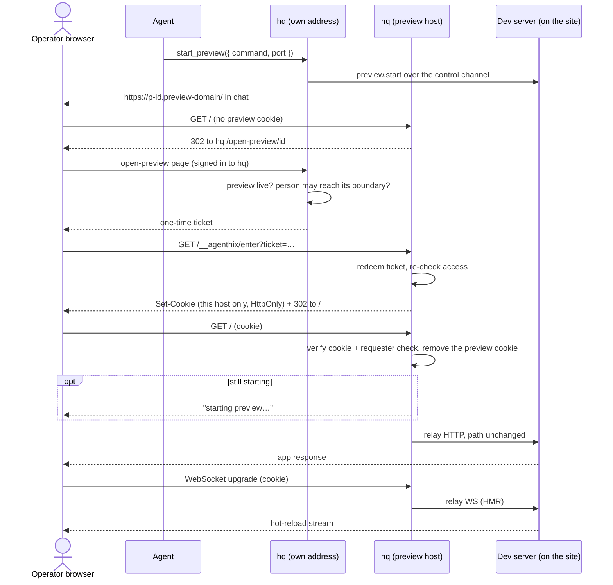
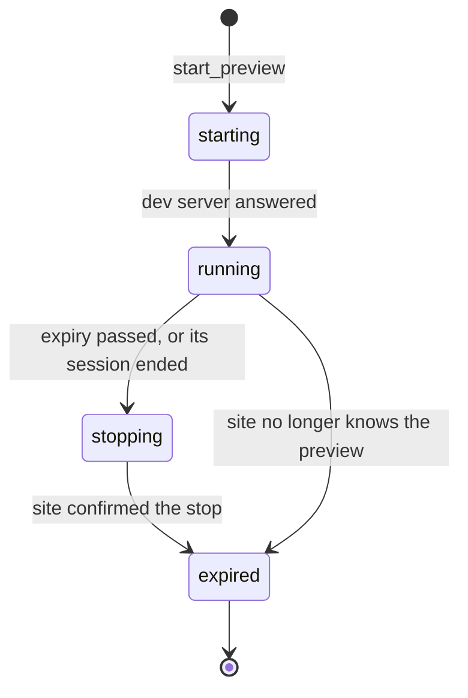

# Site Live Preview

How an operator sees the web app an agent is building **before it deploys** — a generic, preview-before-deploy capability reachable from any browser, including a phone. The agent's working tree is served live and never copied. A preview is always reached through hq, but never from hq's own address: each preview has a host name of its own, `p-<id>.<preview domain>`, on hq's own port.

---

## What it is

When an agent builds or changes a web application, the operator needs to *see and verify the running result* before anything goes live — the way a client reviews a developer's work. Live Preview gives that: the agent serves its working tree, and hq relays a host name of the preview's own to the running dev server through the site, with hot-reload intact.

It is **generic** — it works for any app that serves over HTTP, with no base path to configure, because the dev server runs at its host's root — and it is **safe**: the preview's script cannot read or use the viewer's hq sign-in, every request is checked against the person viewing, and the preview is throwaway (it ends at a fixed expiry, or with its session). It is the operator-facing half of "operate remotely"; the agent pushes code to GitHub but **never deploys production** (promotion stays human-gated).

---

## Architecture

hq is a **reverse proxy** in front of the dev server, reaching it over a stream the site opens outward (ADR-0063). Nothing about the app is copied or rebuilt for preview — the dev server runs as a process inside the container of the preview's session's own runner, in that boundary (ADR-0074), so it serves exactly what the run sees.

---

## Components

- **Preview process** — the dev server, started with `docker exec` inside the existing container of the boundary and the runner the preview's session runs for (ADR-0074), and in a session of its own so it can be stopped. The site never creates a second container or a second mount for it — it refuses if that container is not up rather than starting one. It is stopped when the preview ends or its container is destroyed.
- **`start_preview` tool** — the agent's only role: request a preview by declaring `{ command, port }`. hq asks the site holding the boundary to start the dev server, records the preview, and returns its address. The agent never controls lifecycle or networking. With previews off, it refuses before anything is started.
- **Preview host** — every request whose host name is `p-<id>.<preview domain>`, HTTP **and** WebSocket upgrade (for hot-reload), is routed to the preview by host on hq's own http server, before any of hq's own routes or sockets, and relayed with its path unchanged. Nothing of hq is served on a preview host, and no preview is served on hq's own address.
- **Access check** — a signed-in page on hq's own address, `/open-preview/<id>`, whose action checks the person and mints a one-time ticket for the preview host.
- **Preview registry** — hq's `PreviewSession` row, keyed by its id, records the site, the site's own preview id, the storage boundary being served, its expiry and last access. The site keeps a separate in-memory registry of running previews, which is empty after a restart.

---

## How the preview is reached

A preview's address is `p-<id>.<preview domain>` with hq's own scheme and port. The `<id>` is the preview row's id, which is not a credential: nothing is served on it without the access check, so it may appear in logs and DNS queries.

- **On a developer's machine** the preview domain is `preview.localhost` with no setting, so a preview is at `http://p-<id>.preview.localhost:4101`; browsers resolve every `*.localhost` name to the machine itself.
- **On a deployed hq** the operator sets `PREVIEW_DOMAIN`, and the front door sends `*.<preview domain>` to hq's one port, where its web container forwards it to hq's server. This needs a wildcard DNS entry and a wildcard certificate. A deployed hq with no preview domain has previews off — which is every hq the host service installs today, since it sets no `PREVIEW_DOMAIN` and its front door holds no wildcard certificate ([the deployment guide](../deployment.md#in-front-of-hq)).

---

## Request lifecycle

1. **Create** — agent calls `start_preview`; the site starts the dev server and hq records a `PreviewSession` with its expiry (the earlier of the preview's lifetime and its session's end). The address appears in chat as a plain link.
2. **Enter** — the operator opens the link. The preview host sees no cookie of its own and redirects to hq's access check. hq's sign-in applies there: someone already signed in passes straight through; someone who is not signs in first and is brought back to the check afterwards. The check confirms the preview is live and that this person may reach its storage boundary, and mints a ticket — single use, valid for about a minute, bound to that person and that preview. The browser goes to `/__agenthix/enter?ticket=…` on the preview host, which redeems it, sets a cookie for that host alone, and redirects to the root.
3. **Serve** — every request to the preview host carries that cookie. The host checks its signature, that it names this preview and has not expired, and then re-runs the requester check, so revoking access or ending the preview refuses the next request. It removes its own cookie from the request, leaving the app's own cookies and any authorization header, and relays. While the dev server is still starting, the host answers with a "starting preview…" page.
4. **Hot-reload** — WebSocket upgrades on the preview host pass the same checks and are relayed, so HMR works as if local.
5. **End** — at its expiry, or when its session is archived, deleted or cleared, the preview stops resolving, and hq's sweep asks the site to stop the dev server. Each request records last access; it does not extend the expiry.

The `PreviewSession` is a small state machine, and hq owns every transition:

---

## Security model

- **Its own origin** — a preview's script runs on the preview's host, never on hq's origin, so it cannot read the sign-in hq keeps in the browser's storage for its own origin, nor act as the viewer (ADR-0071).
- **Checked per person, per request** — the cookie says who is viewing; every request, live reload included, re-runs the requester check: the person must be able to reach the storage boundary whose files the preview serves. A row with no boundary is refused (`hq/src/preview/previewAuth.ts`, `assertLocationAccess`).
- **The cookie** — issued only in exchange for a one-time ticket from hq's access check; signed with a key derived from `SECRETS_MASTER_KEY`; bound to the one preview host (no `Domain` attribute), `HttpOnly`, `SameSite=Lax`, `Secure` over HTTPS; never valid past the preview's expiry.
- **Nothing of hq's reaches the dev server** — the preview cookie is removed from the `Cookie` header before relaying, and the ticket exchange is answered by hq, never relayed. The app's own cookies and any `Authorization` header pass through: hq's own bearer is sent only to hq's address, never to a preview host.
- **Single gateway** — the dev server is never exposed directly; only hq's preview host reaches it, through the site's outward stream.
- **Same container as the run** — the dev server runs inside the same container a run of that session would use: the one keyed to the boundary and the runner (ADR-0063, ADR-0074); there is no separate credential-free container for it. The container is the *execution-isolation* boundary; the run/session context is the *permission* boundary (ADR-0036).

A preview domain under hq's own domain still receives that domain's cookies from the browser; that is harmless while hq keeps its sign-in out of cookies, and a second domain avoids it entirely.

---

## Constraints & trade-offs

- **Wildcard DNS and certificate** — a deployment that offers previews needs both for the preview domain, which usually means a DNS-provider challenge at the front door.
- **Cold start** — the first request pays install/build/boot; mitigated by a "starting" state and by keeping the server warm thereafter.
- **Bandwidth** — every byte of a preview passes through hq (ADR-0063).

---

## Boundaries — what this is *not*

- **Not a deployment.** A preview serves the live working tree; it never promotes anything to production. Production deploy stays human-gated.
- **Not mobile/native preview.** This is web/HTTP only. Mobile preview (Expo/EAS) and store distribution are deferred.
- **Not a built-artifact preview deploy** — serving built artifacts on real infrastructure is not built and has no plan in this repository; this serves the live in-container working tree.

---

## Evolution

- **A separate relay** — because previews are told apart by host name, their traffic can move to something other than hq's own process — a relay service, or a direct path to a reachable site — with the same addresses and the same access check (ADR-0071).
- **Mobile live preview** — the same relay fronting a Metro dev server, with a QR/`exp://` handoff.
- **Built-artifact preview environments** — per-PR deployed previews on real infrastructure, complementary to this live working-tree preview. Not built; no plan in this repository.

---

## Related

- [The container runtime](../container-runtime.md) — the container a preview's dev server runs in
- [The control channel](../control-channel.md) — how `preview.start` reaches the site, and the content transport preview traffic crosses
- [Deployment](../deployment.md#in-front-of-hq) — previews on a deployed hq
- [Platform tools](../mcp/tools.md) — the platform tool catalogue; `start_preview` is one of the tools every agent has
