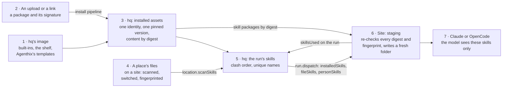
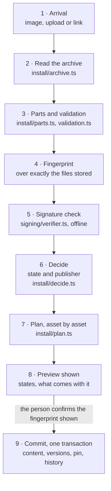
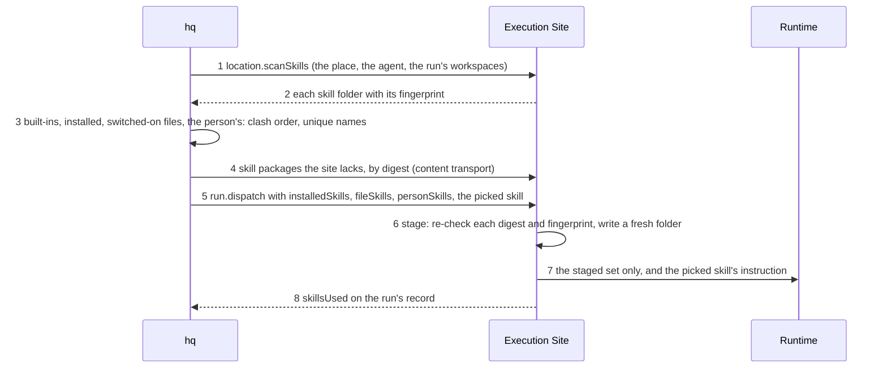

# Skills and the Asset Layer

How a skill gets from where it lives into a run, and how a Library asset gets into hq in the first place. Two
halves: [the asset layer](#the-asset-layer) holds what an organisation has installed and is the only place a version
is pinned; [delivery](#delivery-to-a-run) names, for each turn, the skills an agent will see, and the site stages them.
Both keep one rule: **content nobody approved never reaches a run**. The words are defined in the concepts
([skills](../concepts/skills/skills.md), [the Library](../concepts/library/library.md)); this document is the how.

1. **hq's image** is signed and verified before it runs ([ADR-0117](../adr/adr-0117-a-host-service-runs-only-signed-published-images.md)),
   so what it carries is Agenthix's by where it is. It holds the built-in skills, the shelf of offered skills and
   Agenthix's agent, board and team templates.
2. **An upload or a link** is hostile input until the pipeline has checked it.
3. **Installed assets** are rows in hq's database: each names a version, and each version names its files by digest.
4. **A place's files** belong to whoever can write them, so hq lists and switches skills there and never pins them.
5. **The run's skills** are decided in hq, per turn.
6. **The site** trusts nothing it is told: it reads the bytes and compares them with the digest or fingerprint hq named.
7. **The runtime** is shown the staged set only ([ADR-0084](../adr/adr-0084-an-agents-skills-are-staged-by-agenthix-per-turn.md)).

---

## The asset layer

An **asset** is a Library item of one of four kinds: a skill, an agent template, a task template or a team template
([ADR-0157](../adr/adr-0157-every-library-item-is-a-versioned-asset-pinned-once-per-organisation.md)). The records are
in `hq/schema.prisma` (*Module: Assets*) and the code is `hq/src/assets/`.

| Record | Holds |
|---|---|
| `Asset` | One identity per kind: `publisher/name`. The pin (`currentVersionId`), whether every agent has it (`givenToAll`), whether it is built in and switched off, the organisation's own copy that replaced it (`setAsideById`), when it was last used |
| `AssetVersion` | One installed or published version: SemVer version, the content's `digest`, where it came from (`BUILT_IN`, `UPLOAD`, `URL`, `MADE_HERE`), what the signature proved (`signerKind`, `signerIdentity`), the trusted publisher it was installed as, `basedOn`, the licence, the note, who and which agent asked |
| `AssetPinChange` | Every move of the pin: an install, an update, a roll back, a publish, an older version on purpose. Who, when and why |
| `AssetGrant` | An agent that has an asset not given to every agent |
| `Draft`, `DraftRevision` | The one shared draft of an asset or of a place's skill, and each change to it with its author |
| `Proposal` | A skill an agent proposed, or a member's *New skill* they may not publish, aimed at a level |
| `PlaceSkill` and its versions | A skill found in a place's files, keyed by place and path: its switch, its published versions |
| `TrustedPublisher`, `LibraryMaintainer` | Whom the organisation trusts to sign, and who looks after the Library beside administrators |

**Content is never stored on these rows.** Every version, draft revision, proposal and place-skill version names an
immutable `PackageContent` by digest, the same store agent packages use
([ADR-0072](../adr/adr-0072-an-agent-is-defined-once-in-hq-and-overridden-per-boundary.md); `hq/src/assets/content.ts`).
A sweep removes a digest only when nothing names it (`packages/packageContentSweep.ts`), so a run that already named
one keeps it for the grace period.

**Identity.** `publisher/name` (`core/src/assets/identity.ts`): each part is 1 to 64 lowercase letters, digits and
single hyphens. A template's role skill is `publisher/template/skill`. The publisher is **the verified signer's name as
this organisation recorded it, never a manifest's claim**; an unsigned package installs under `unsigned/`, and
`agenthix/` is only ever taken from hq's own image or Agenthix's exact signature. A different signer is a different asset.

**The fingerprint** of a version is the sha256 of `assetFingerprintInput` (`core/src/assets/fingerprint.ts`): the
canonical path-and-hash list of every file, `package.json` included, over exactly the files stored. It is the version's
`digest`, and what a signature covers is the canonical JSON `{format, kind, publisher, name, version, fingerprint}`
(`signedStatement`).

**The manifest** (`package.json`, format 2, `core/src/assets/manifest.ts`) carries `kind`, `publisher`, `name`,
`description`, `version`, `basedOn`, `licence` and `suitedTo`. Each field is checked and bounded on the way in. A
plain skill folder with only a `SKILL.md` is accepted and counts as unsigned.

### Boot

At start hq installs, from its own image and without a person (`assets/builtins/boot.ts`, `assets/templates/imageTemplates.ts`):

- each folder of `assets/platform/skills/` as a built-in `agenthix/<name>`, on for every agent; changed content is a new
  version, and an administrator's switch is never touched;
- each agent, board and team template as `agenthix/<name>`. A template is built from one source: every shared skill
  it needs is copied into its package from the shelf (`templates/imageBuild.ts`), so a package carries every skill it
  needs and nothing refers to another package;
- **not** the shelf's skills, nor the skills a template carries. Those are installed when someone chooses them or when
  the first agent is made from the template (`templates/carried.ts`).

An agent, board or team **made** from a template reads the pinned version once and keeps only a read-only link to it
(`madeFromVersionId`). It never follows the template's later versions.

### The install pipeline

One path for the shelf, an upload and a link ([ADR-0158](../adr/adr-0158-an-asset-is-installed-from-anywhere-through-one-signed-protocol.md)).
Preview (`install/preview.ts`) changes nothing; commit (`install/commit.ts`) runs it again and acts only on what the
person confirmed.

1. **Arrival.** The shelf and hq's templates arrive as `image`: trusted by where they are, with no bundle. An upload
   (`sources/upload.ts`) is a package ZIP or a folder sent file by file, with `package.sigstore.json` when it has one.
   A link (`sources/link.ts`) is fetched as below, with its signature from `<link>.sigstore.json`. The Wasp
   operation checks the person's right first: `install` for the image, `installFromOutside` for the rest, which
   administrators hold, and Library maintainers too when the organisation lets them.
2. **The archive is read** with the Library ZIP reader's bounds (`library/packages/packageZip.ts`: entry count, a
   streamed byte cap, links refused, paths checked), and anything a disk or a reader could take two ways is refused,
   never skipped: duplicate entries, names that differ only by case or Unicode normalisation, `.DS_Store` and
   `__MACOSX`, unsafe paths, a path that is both a file and a folder.
3. **Parts and validation.** The manifest is read (format 2) and a template's embedded skills are listed. Every skill is
   checked against the Agent Skills rules (`validation.ts`): a name of 1 to 64 lowercase letters, digits and hyphens,
   a description of 1 to 1,024 characters, a warning for a body over 500 lines, header keys staging drops flagged.
4. **Fingerprint** as above.
5. **Signature check.** See [below](#the-signature-check). An image arrival has none.
6. **Decide** the state and the publisher. The organisation's setting for unsigned assets applies here.
7. **Plan.** Each asset is matched on kind, publisher and name. The same version is reused; a newer one is stored and
   offered as an update; an older one leaves the installed one alone; a version already held with other content, an
   asset another signer published, and a built-in's identity are refused.
8. **Preview.** The person is told the state, the signer or that it is unsigned, and what comes with it.
9. **Commit.** The confirmation names the fingerprint that was shown. An unsigned package needs "I've read it"; a new
   signer needs a choice, to trust it or to install once. Content, versions and the pin are written in one transaction,
   and every move of the pin is recorded.

| State | Meaning | Allowed |
|---|---|---|
| `built-in` | From hq's image | Install |
| `trusted` | Signed by a publisher the organisation trusts | Install |
| `new-publisher` | A valid keyless signature by someone not yet trusted | Trust and install, or install once, by a person who may trust |
| `unsigned` | No signature | After "I've read it", unless the organisation never allows unsigned assets |
| `tampered` | The signature does not match | Refused |
| `unverifiable` | The signature could not be checked: an unreadable bundle, no transparency-log proof, a key nobody added, an expired trust root | Refused |

Every asset inside a package takes the package's verified publisher, and a package or an embedded skill that claims
another is refused. A newer version is an update only when the **same verified signer** signed it.

### The signature check

`signing/verifier.ts` verifies a detached Sigstore bundle over the signed statement with sigstore-js, **without the
network**. The trust root is Sigstore's `trusted_root.json` in hq's image (`assets/sigstore/`), refreshed in the
release by `hq/scripts/sigstore/`, with `issued.json` beside it. A root older than 365 days makes a check refuse
rather than trust keys Sigstore may have retired; the age is shown.

- **Keyless.** The certificate must chain to Sigstore's authority and carry a certificate-transparency proof, and the
  signature must be in the transparency log with an inclusion proof checked against the log's signed checkpoint. The
  signer is then matched against the trusted publishers **exactly** (`signing/publishers.ts`): the issuer, the exact
  certificate identity less the ref, and the source repository, with the ref one of the tags or the one named branch.
  No pattern, prefix or case folding.
- **Key pair.** Only the organisation's trusted keys are tried. A key nobody added cannot be checked, so the
  bundle is unverifiable, not a new publisher.
- A message-signature bundle is the form read; a DSSE envelope is refused.

### Fetching from a link

A link is aimed at hq's own network, so `sources/urlFetch.ts` allows only `https` on the standard port, with no user
name or password. The host is resolved once and the connection is pinned to that address (`pinnedHttps.ts`). Only a
public unicast address is allowed (`publicAddress.ts`): loopback, private, carrier, link-local (where cloud metadata
answers), multicast, reserved and documentation ranges are refused in IPv4 and IPv6, and again on each redirect, of
which there are at most 3. The body is streamed under the package size cap (8 MB, `PACKAGE_MAX_BYTES`) within 60 seconds,
and nothing is sent but `accept` headers. Every failure on the way says the same thing, so the answer cannot be used
to map what hq can reach. The signature is fetched the same way; only a plain "not found" means unsigned, and one
that is there but cannot be read refuses.

---

## Delivery to a run

`resolveRunSkills` (`hq/src/assets/delivery/runSkills.ts`) runs for every dispatch (`hq/src/agents/runContext.ts`).

1. **The scan** is a control-channel method of the site protocol. The site lists the skill folders under the
   place's `.agents/skills/`, the agent's `.agents/agents/<agent id>/skills/`, and each of the run's workspaces'
   `.agents/skills/`, `.claude/skills/` and `.github/skills/`, under staging's bounds (1,000 entries, 16 MB, 8 levels
   deep), at most 200 skills for a place and 99 workspaces, never following a link. hq checks the person's access
   first; the parameters carry no person. Under the setting *Never* hq does not scan.
2. **The answer** is hostile input: hq keeps only a folder under a root it asked for, by a plain relative path, with a
   well-formed fingerprint. It is kept as `PlaceSkill` rows; a new skill follows the default, so under *Off by default*
   it is off.
3. **The set** is built from four sources and settled in two steps.
   - Built-ins not switched off (`builtins/delivery.ts`), at the version in hq's image. `working-with-git` is given
     only when the run's location is a git repository, which only the site holding it can say (`repo.state`).
   - Installed skills (`delivery/installed.ts`): every skill with `givenToAll`, and every skill the agent was granted,
     at its pinned version, not removed and not set aside for the organisation's own copy.
   - The place's switched-on skills in files (`delivery/fileSkills.ts`): a switch holds only for the fingerprint it was
     set on, so a changed skill falls back to the place's default.
   - The person's published skills (`delivery/personSkills.ts`), only on a turn of their own conversation, or a worker
     it handed work to for them, and not in Your space (where they are the place's skills already); never a task, a
     scheduled or automated run, or a run someone else started. The organisation can turn this off.
   - **The clash order** (`delivery/clashOrder.ts`): installed, then the project, then the person. Only the same skill
     clashes, by identity, else by name, else by folder; the one set aside is recorded with its reason. Then
     **staged names are made unique** (`delivery/stagedNames.ts`): of two skills that would stage under one name, the
     one higher in the order is kept, or at one level the one installed first.
4. **The packages.** Installed and personal skills are `skill` packages, keyed by the version row and addressed by
   digest, so a site fetches each version once for every agent and turn (`packages/packageDelivery.ts`). File skills
   are not sent: they are on the site already.
5. **The dispatch** carries three lists in the run's context (`core/src/protocol/runtimeData.ts`):
   `installedSkills` (`identity`, `version`, `digest`, `level`: `builtin`, `org` or `agent`, and the package `ref`),
   `fileSkills` (`placeId`, `path`, `fingerprint`, `group`) and `personSkills`, and `skill`, the picked skill's staged
   name when the message has one.
6. **Staging** (`site/src/agents/runtime/skillSources.ts`, `skillStaging.ts`) reads each entry into memory and keeps
   it only if it still matches what hq named: an installed or personal skill's files in the package cache must still
   fingerprint to the entry's digest; a file skill is read from its place, path and fingerprint, and what is read now
   must equal the fingerprint hq named, so a file changed since it was switched on is not staged. A tree is read with
   links refused and its real path inside the place. The entries themselves are checked for shape and capped at 500
   of each list (`runSkillInputs.ts`). Anything named and not staged is **refused with a reason**, and recorded.

   A skill is staged under `<source>-<slug>`:

   | From | Source | Example |
   |---|---|---|
   | A built-in | `platform` | `platform-skill-creator` |
   | Installed for every agent | `org` | `org-code-review` |
   | Installed for chosen agents | `agent` | `agent-code-review` |
   | The place's own folder | `shared` | `shared-deploy` |
   | One agent's folder in the place | `boundary` | `boundary-deploy` |
   | A workspace's repository | `workspace-<n>-` | `workspace-1-lint` |
   | The person's own | `person` | `person-code-review` |

   The slug of an installed or personal skill is the last part of its identity's name, so a role skill
   `agenthix/project-manager/read-context` stages as `agent-read-context`. `<n>` numbers the workspace and folder
   pairs a run names, in a fixed order, 1 to 99. A name is at most 64 characters. **Two skills that would share a name
   stage neither**, and both are refused. The staged `SKILL.md` keeps its body byte for byte under a header rebuilt from
   an allowlist (`name`, `description`, `when_to_use`, `argument-hint`, `disable-model-invocation`, `user-invocable`),
   so `hooks`, `allowed-tools` and the rest never reach a harness (`skillFrontmatter.ts`).
7. **The runtime.** How each harness is given the folder is in [sites/agent-runtimes.md](sites/agent-runtimes.md). The
   platform's own `skills/` folder is still read by the site, but hq's platform package carries none, since built-ins
   arrive as `installedSkills` at the `builtin` level.
8. **The record.**

### The picked skill

A person types `/` at the start of the message box and picks a skill of the conversation's agent. The pick is a
**structured field** beside the message (`PickedSkill`), kept on the person's message
(`TextBody.skill`) and sent with the dispatch; it is never parsed from the text. The site (`pickedSkill.ts`) keeps
it only if it equals a name staged for this turn and the skill does not set `user-invocable: false`; otherwise it is
dropped, logged, and the text goes on. Kept, it becomes one instruction before the message, naming the skill's `/` word
and telling the runtime to load it first; a skill that only a person may invoke (`disable-model-invocation: true`) is
read from its staged file instead. **Message text that begins with `/` is given after a line saying it is plain
text**, so a typed `/word` is never a runtime command on either harness, a staged skill's name included.

### What a run records as used

The site writes one entry per staged skill to the run's `skillsUsed` (`skillUseRecord.ts`, best effort): the staged
name and source, the fingerprint of exactly what was staged, and what it was (identity and version, or place and
path, and the person for their own skill). A skill hq named and the site did not stage is recorded too, with
`refused` saying why. hq reads it back with `run.get` as the site's word, so **hostile input**:
an entry counts only when every field has its shape, and a refused one is never counted as used
(`assets/conversation/usedSkillRecord.ts`). It stamps *last used* on a Library skill and a place skill, which decides
nothing.

The work step reads *Used the skill* with the person-facing name and opens the skill beside the conversation, at the
version used, from hq's own records by fingerprint, never from the site. **Access is checked every time it is named
or opened**: an installed skill is for anyone in the organisation, a skill in a place's files for whoever sees that
place, a person's own for that person alone. When a person is erased, the kept content of their own skills goes and
the runs keep only identity and fingerprint.

---

## Writing a place's skill

Publishing, rolling back, putting back, adding from the Library and removing a skill in a place go through two
site-protocol methods that write or remove **a whole skill folder at once**: `location.writeSkill`, a content
method whose stream carries the files, and `location.removeSkill`. They accept only `.agents/skills/<slug>` and
`.agents/agents/<agent id>/skills/<slug>`, never a workspace's repository. The site checks each file against the
contents list and the whole against the fingerprint hq gave, keeps to staging's bounds, refuses a link anywhere on
the way, writes the folder beside the old one and swaps it in, so a run never reads a half-written skill.

hq keeps a place skill's draft and its published versions in its own records and never in the place's live folder, so
no agent sees a draft. `hq/src/assets/places/` holds it.

## Agents drafting and proposing

`propose_skill` is the one tool an agent has for writing a skill, declared once in `core/src/assets/skillTools.ts` so
hq's validator and the site's forwarded copy cannot drift. The site fills in the run id and forwards the call to hq's
data path (as the workflow tools are, [workflows.md](workflows.md)); **who asked is never an argument**. hq takes the
person from the run's on-behalf-of record (`proposals/caller.ts`) and routes the call (`proposals/route.ts`):

- from the person's own interactive conversation, where they may edit at the aimed level, and for a skill edited in
  place: it updates their draft;
- from any other run, a task or scheduled run or a run someone else started, **Bypassed or not**: a proposal, which
  reaches no agent until a reviewer accepts it.

Each call passes the plain checks (`proposals/checks.ts`: size, the Agent Skills rules, files `SKILL.md` names are
present) and at most five are accepted per run. An open proposal is unique by level, place and name. Accepting
publishes through the level's own publish path, naming the content the reviewer looked at, so a proposal that moved is
refused. Rejected proposals are removed 90 days after review.

hq also has the mechanism for an agent's request to publish, roll back, switch a skill on or install, as a card
(`approvals/request.ts`): it is written by hq, never run as the agent's own call, so no approval mode skips it, and it
runs only when the person it acts for approves it and holds the right at that moment. No tool offered to agents makes
such a request: `propose_skill` is the only skill tool. A card to switch a skill on is refused when approved, and
points to the skill's page (`approvals/handlers.ts`).

All of this is decided by one policy (`assets/policy.ts`); no operation checks a role of its own.
[ADR-0159](../adr/adr-0159-agents-draft-skills-people-publish-them.md) is the rule.

---

## The protocols this is part of

Versions and their rules are in [versioning.md](versioning.md#the-protocols). Skills are part of the 1.0 baseline of both:

| Protocol | What carries skills |
|---|---|
| Site | `installedSkills`, `fileSkills` and `personSkills` on the dispatch; the picked skill on the run's context; a `skill` target among a work step's targets; `skillsUsed` on the run's record, with `refused` on an entry; the `skill` package kind, so installed and personal skills are delivered as packages with a `ref`; `location.scanSkills`, `location.writeSkill` and `location.removeSkill` |
| Client | `PickedSkill`, the skill a person picked with `/` for a message, and `TextBody.skill`, the pick kept on the message it was made for |

A skill's source, `org` or `agent`, names the level an installed skill was installed at.

## Where things are in the code

| You want | Look in |
|---|---|
| The asset records | `hq/schema.prisma` (*Module: Assets*) |
| Identity, fingerprint, manifest, SemVer, the `propose_skill` declaration | `core/src/assets/` |
| What a run is told about skills; the shapes on the wire | `hq/src/assets/delivery/`; `core/src/protocol/packages.ts`, `runtimeData.ts`, `locationSkills.ts` |
| Installing | `hq/src/assets/install/`, `sources/`, `signing/` |
| Versions, drafts, publishing, the organisation's own copy | `hq/src/assets/lifecycle/` |
| A place's skills | `hq/src/assets/places/`, `site/src/packages/placeSkillHomes.ts` |
| Proposals and agents' requests | `hq/src/assets/proposals/`, `approvals/` |
| Who may do what | `hq/src/assets/policy.ts` |
| Staging, the picked skill, the record of use | `site/src/agents/runtime/skillSources.ts`, `skillStaging.ts`, `pickedSkill.ts`, `skillUseRecord.ts` |

## What must not break

- **A skill's publisher is the verified signer**, never a package's claim, and a different signer is a different asset.
- **A signature is checked against the exact bytes stored**, offline, and a keyless signer is matched exactly.
- **Nothing reaches a run that a person did not approve:** an agent's draft is invisible, a proposal waits for a
  reviewer, and a skill in a place's files runs only as the place's switches allow.
- **Staging re-checks what hq named.** A digest or fingerprint that does not match is refused, never staged.
- **Every staged name is unique within a run.**
- **A message's text is never a command.** The picked skill is a field the site validates.
- **Access to a used skill is checked when it is viewed.**

## Decisions behind this

[ADR-0042](../adr/adr-0042-hq-is-the-orgs-own.md) ·
[ADR-0072](../adr/adr-0072-an-agent-is-defined-once-in-hq-and-overridden-per-boundary.md) ·
[ADR-0084](../adr/adr-0084-an-agents-skills-are-staged-by-agenthix-per-turn.md) ·
[ADR-0172](../adr/adr-0172-a-flag-has-a-stage.md) ·
[ADR-0117](../adr/adr-0117-a-host-service-runs-only-signed-published-images.md) ·
[ADR-0149](../adr/adr-0149-platform-knowledge-is-the-user-guide.md) ·
[ADR-0152](../adr/adr-0152-a-conversation-reaches-only-its-own-place-and-the-places-its-person-added.md) ·
[ADR-0156](../adr/adr-0156-built-in-skills-sit-beside-platform-knowledge.md) ·
[ADR-0157](../adr/adr-0157-every-library-item-is-a-versioned-asset-pinned-once-per-organisation.md) ·
[ADR-0158](../adr/adr-0158-an-asset-is-installed-from-anywhere-through-one-signed-protocol.md) ·
[ADR-0159](../adr/adr-0159-agents-draft-skills-people-publish-them.md)
