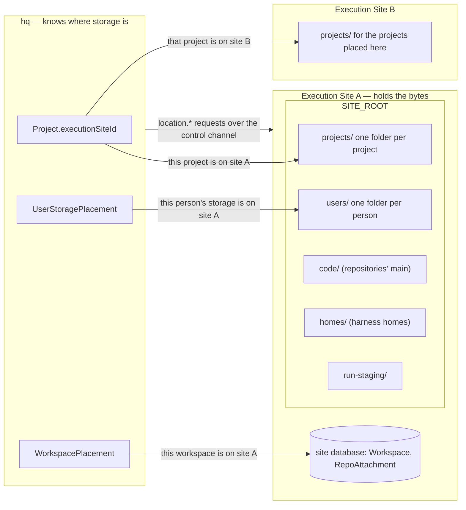
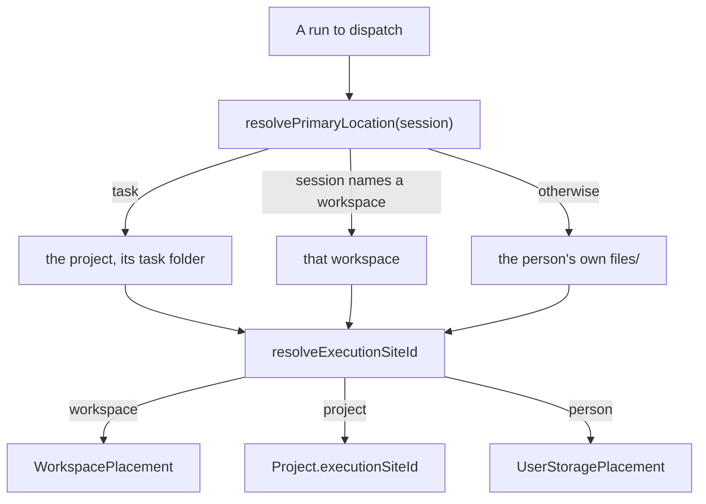

# Storage and Placement

Whose storage exists, where it lives on disk, which Execution Site holds it, and how a run is sent to the
site that holds the storage it works in.



**Storage belongs to a project or to a person, and to nothing else.** hq never touches it: the files, and
the rows that describe workspaces in them, live on the Execution Site that holds them. hq keeps only an
index of *which* site holds each owner's storage, and asks that site for everything else.

---

## The words used here

- A **storage boundary** (often just *boundary*) is one owner's storage: a project's, or one person's own.
  Products, programmes, teams and agents own no storage
  ([ADR-0061](../adr/adr-0061-a-product-and-a-programme-group-work-and-own-nothing.md),
  [ADR-0072](../adr/adr-0072-an-agent-is-defined-once-in-hq-and-overridden-per-boundary.md)). Its two kinds
  are `WorkspaceOwnerType` `project` and `user` (`core/src/protocol/siteData.ts`).
- A **location** is one place inside a boundary that a run works in: the owner's `files/` folder, one of
  its workspaces, or a task's folder. It is a `LocationRef`, `{ ownerType, ownerId, workspaceId?, taskId? }`
  (`core/src/storage/locationRef.ts`). The path is always derived from those ids and never stored
  ([ADR-0039](../adr/adr-0039-files-and-workspaces.md)).
- A **workspace** is a named folder inside a boundary, with a `Workspace` row in the site's database. It is
  not necessarily a git repository; one can be attached (below).

---

## On the site's disk

Everything is keyed by immutable ids, so renaming anything never moves a file. The only code that knows
this layout is `site/src/server/storage/paths.ts`; hq names a location by its ids and lets the site turn it
into a path.

```
<SITE_ROOT>/
├── projects/<project id>/
│   ├── files/                 the project's own documents; a run with no workspace works here
│   │   ├── AGENTS.md          the place's instructions, put into every run's prompt
│   │   └── .agents/           skills for every agent, and one agent's own instructions and skills
│   ├── workspaces/<id>/       one folder per workspace; a repository workspace's main is mounted here, not kept here
│   ├── clones/<copy id>/      a branch's copy of a repository workspace, where its runs work
│   ├── artefacts/             throwaway things agents made in conversations, one file each
│   ├── tasks/<task id>/       a task's working folder
│   └── members/<person id>/   one member's area in the project, holding their agenda.md
├── users/<person id>/
│   ├── files/                 the person's own files, and their agenda.md
│   ├── workspaces/<id>/
│   ├── artefacts/
│   └── tasks/<task id>/       a task's folder in the person's personal project
├── knowledge/                 pages and versions, beside storage and never inside it
│   ├── projects/<project id>/ pages/ and versions/
│   ├── users/<person id>/     the same
│   └── org/                   the organisation's, on its default site only
├── code/                      the code space: each repository workspace's main, outside every boundary
│   ├── projects/<project id>/<workspace id>/
│   ├── users/<person id>/<workspace id>/
│   └── .work/                 where the site builds a repository, or backs up files/, before putting it in place
├── homes/                     harness homes, beside storage and never inside it
│   ├── users/<person id>/personal/
│   ├── users/<person id>/<project id>/
│   └── projects/<project id>/
├── git-file-reads/            copies of workspace files read at a commit, kept a few minutes for files.serve
├── run-staging/               what the site stages for a runner's runs, laid out like homes/
│   └── …/skills/, …/pinned-memory/
└── executor/runs/<run id>/    a workflow run's own folders while it runs: workflow/, out/, snapshot/
```

`SITE_ROOT` defaults to `./site` under the site's working directory (`site/src/agents/agentDiskPaths.ts`).

**Knowledge is not storage either.** A place's pages sit under `knowledge/`, beside the storage folders, because a run
mounts a whole storage folder and Docker cannot leave one folder of a mount out: kept apart, no run reaches a page and
the only way to change one is the gate. `pages/` holds the place's sections and pages; `versions/` holds each page's
earlier versions and its deleted pages (`site/src/server/storage/paths.ts`, `getKnowledgeDir`; the code that knows the
layout is `site/src/server/knowledge/`). A `knowledge/` folder inside an owner's folder is ignored. The
[concept](../concepts/knowledge/knowledge.md) says what a page is and how versions are kept.

**Nothing outside a container acts on a path a container can change**
([ADR-0173](../adr/adr-0173-nothing-outside-a-container-acts-on-a-path-a-container-can-change.md)). A run writes its
whole boundary, so it can replace any folder in it with a symbolic link (symlink), and Docker, git and the site's own
file work would follow that symlink on the machine. So what is mounted on its own, or worked on with git from outside a
container, lives where no container writes: a repository's main in the code space, what is staged for a run in run
staging. The boundary's own folder is mounted whole, as it is. Where the site must read or write in a boundary itself,
it goes down from the boundary's folder one folder at a time, opening each without following a symlink, and refuses
one on the way (`site/src/agents/runtime/safeTree.ts`, `site/src/server/storage/boundaryTreeCopy.ts`).

**Harness homes are not storage.** A harness home holds one runner's private runtime state in one boundary:
the harness's session files and login. A project's storage is mounted by every container in the project,
so a home inside it would be readable by all of them; homes therefore sit in `homes/`, grouped by person, so
removing a person removes one folder (`site/src/agents/runtime/harnessHomes.ts`). Runners and containers
are in [container-runtime.md](container-runtime.md).

**Run staging is not in the home.** What the site checks and hands to a runner's runs — the turn's skills and each
conversation's pinned memory — sits in `run-staging/`, laid out like `homes/` and mounted read-only at `/run/staging`
in the runner's containers (`site/src/agents/runtime/runStaging.ts`). Inside the writable home, a run could move the
folder above it aside and have the harness load a skill the site never checked.

**A workflow run's folders are not storage either.** The approved files, the run's scratch folder and its
snapshot of the workspace sit outside every owner's folder, so no agent's container can see them, and on the same
disk, so the snapshot can be a copy-on-write clone; they are removed when the run ends
(`site/src/executor/runFolders.ts`; [workflows.md](workflows.md)).

**What lives in hq instead.** An agent's definition and its packages, what an agent remembers (memory items, in
three scopes: [ADR-0058](../adr/adr-0058-memory-of-a-person-is-held-by-hq-in-two-layers.md)), the words of a
conversation ([conversation-layer.md](conversation-layer.md#the-record)), task attachments
uploaded by people and agent images are hq's own (`HQ_STORAGE_ROOT`, `hq/src/server/hqStoragePaths.ts`),
served to browsers by hq's relay from that folder mounted read-only. None of them is on a site.

---

## Which site holds what

hq's database holds four placement records, each written once. **Nothing moves storage between sites**:
there is no code that changes a placement and carries the files with it, so a different site for an
existing owner would be new work.

| Owner | Record in hq | Set when |
|---|---|---|
| A project | `Project.executionSiteId` | The project is created; whoever creates it picks the site (the `createProject` action, `hq/src/projects/actions.ts`) |
| A person | `UserStoragePlacement` | The first time that person's storage is needed. Today always the default site |
| A workspace | `WorkspacePlacement` | The workspace is created, on its owner's site (`hq/src/storage/workspaceService.ts`) |
| The organisation's knowledge | `OrgKnowledgePlacement` | The first time it is used, on the default site, and never moved (`ensureOrgKnowledgePlacement`, `hq/src/storage/storageSite.ts`) |

The site's own database holds the `Workspace` and `RepoAttachment` rows (`site/schema.prisma`), served to
hq through `site/src/server/storage/workspaceRows.ts`. `WorkspacePlacement` is hq's index into those rows,
written only by hq, so there is one writer and nothing to keep in step.

The **default site** is the one that comes with hq ([control-channel.md](control-channel.md#how-a-site-takes-part)).
It is where a person's own storage goes and where the organisation's knowledge is placed (`hq/src/sites/localSite.ts`). With no default site connected, anything that needs one fails with
"No Execution Site is connected" (`hq/src/sites/noExecutionSite.ts`).

---

## Placing a run

**A run executes on the site that holds its primary location**
([ADR-0056](../adr/adr-0056-a-run-is-placed-on-the-site-holding-its-storage.md)). An agent has no site of
its own: its package travels to wherever the run is placed, and the storage never travels.



- **A personal project** (a person's own "My tasks") has no storage of its own: its tasks resolve to
  `tasks/<task id>` inside the person's own storage, so their runs go to the site holding that storage and
  run as the person ([identity-and-trust.md](identity-and-trust.md#the-runner-claim)).
- **The primary location** comes from `resolvePrimaryLocation` (`hq/src/storage/primaryLocationService.ts`;
  the site has an identical copy, `site/src/server/storage/primaryLocationService.ts`, held equal by a test).
- **The site** comes from `resolveExecutionSiteId` (`hq/src/server/identity/capabilityService.ts`), which
  calls `resolveStorageSite` (`hq/src/storage/storageSite.ts`). Dispatch and the signed run capability use
  the same call, so the site a run is sent to and the site its capability names cannot disagree.
- **When that site is down**, a task waits for it and starts when it reconnects
  ([control-channel.md](control-channel.md#dispatch-how-work-reaches-a-site)); a chat, or a brief to a worker there, fails with an
  explicit error naming the site, and the conversation itself stays readable and can be written in. Work is never moved to another site.

---

## Where knowledge lives

A place's [knowledge](../concepts/knowledge/knowledge.md) is held on the site that holds the place, outside the storage
a run mounts (see *On the site's disk*): a project's on the project's site, a person's with their storage, and the
organisation's on the default site. hq reaches it by owner (a project, a person or the organisation), not by location,
through the knowledge methods of the control channel and content transport; the platform guide is the exception, held in
hq's image and never on a site.

- **Nothing is mounted.** No container mount contains knowledge, so an agent cannot read or change a page except through
  the knowledge tools, whose reach is decided in hq ([MCP tools](mcp/tools.md#what-the-knowledge-tools-do)).
- **The site holds the gate.** Every change, an agent's or a person's, goes to the site that holds the page and is applied
  there in one step: the change applied to the current page, the result checked against the page rules in
  `@agenthix/core`, the current page moved into `versions/`, and the new one renamed into place. One change at a time
  per page (`site/src/server/knowledge/gate.ts`, `pageLock.ts`). hq then records who made it (`KnowledgeChange` in
  `hq/schema.prisma`: the place, the page, the kind of change, and the person, or the agent with the person and the
  conversation or run).
- **The site lists and searches.** The listing (`itemiser.ts`) walks `pages/` and returns sections and pages with their
  index entries and problems; the search runs ripgrep over `pages/` with the guards of `@agenthix/core/file-tools`.
  Every name is resolved inside the owner's pages only, and every link is refused, including one that stays inside.
- **Versions are pruned daily** by the site (`pruning.ts`): a page's versions for 30 days and its last 20 always, a deleted
  page for 30 days, and each owner's versions together capped at 200 MB, oldest first. Permanent deletion removes a page
  or a version at once.
- **The site does not know who is asking.** hq checks the person (`assertLocationAccess` for a place; an organisation
  admin for changes to the organisation's) before it asks, and the site only keeps the record it is handed.
- **Deleting a project or a person's storage removes its knowledge** with it (`location.remove`).

## hq reading and writing files

hq has no path to a site's disk. Everything it reads or writes itself goes through `location.*` methods
(`core/src/protocol/locationFiles.ts`). **A file a person opens or downloads is not read by hq**: hq asks the site
about it (`file.about`), signs a ticket, and the site serves the bytes to its relay, confined to the place's storage
as these reads are ([files-and-relays.md](files-and-relays.md)).

| Method | Transport | Used for |
|---|---|---|
| `location.listFiles`, `location.statFile` | control channel | The storage pages, file browsers |
| `location.findFiles` | control channel | The message box's `@` picker: a place's files by name, bounded, never following a link |
| `file.about` | control channel | A file's facts before hq opens it or a chip shows it; no content |
| `git.status` | control channel | The git line above a workspace or `files/` ([files-in-the-browser.md](files-in-the-browser.md#git-status-at-a-glance)) |
| `location.readFile` | content transport | A place's instruction file, which the lead reads |
| `location.listArtefacts` | control channel | The Artefacts tool |
| `location.readArtefact` | content transport | Nothing in hq; deprecated since site protocol 1.8 |
| `location.listKnowledge`, `location.searchKnowledge`, `location.write`/`edit`/`delete`/`restoreKnowledge`, `location.knowledgeVersions` | control channel | The Knowledge tool, and the knowledge tools of agents ([below](#where-knowledge-lives)) |
| `location.readKnowledge` | content transport | Opening a page, or one of its versions |
| `location.seedFiles`, `location.ensureDir` | control channel | hq creating a project's starting files and folders |
| `location.remove` | control channel | Deleting a project's storage after the project is deleted |

- **hq checks the person; the site checks the path.** Before any of these, hq checks that the person may
  reach that boundary (`assertLocationAccess`, `hq/src/storage/locationAccess.ts`): a person's own storage
  is theirs alone, and a project's is open to its members. The site checks only that the path stays inside
  the location, with links resolved on both sides (`site/src/server/storage/locationContainment.ts`). In
  `artefacts/`, which hq addresses by the owner rather than by a location, it refuses every
  link, and a folder that has itself been replaced by one. The same holds for knowledge, below. It has no notion of who is asking: it has no
  users.
- hq's callers are `hq/src/storage/locationFileStore.ts` and `ownerFolderStore.ts`, and the queries in
  `hq/src/storage/queries.ts` and `ownerFolderQueries.ts`.
- **People do not write into a site's storage through hq.** A person's upload to a task is stored by hq
  (`uploadTaskAttachment`). Agents write their own files in their container. How files are shared and
  served is [the file-sharing concept](../concepts/file-sharing/file-sharing.md).

---

## How a run sees storage

A run's container mounts **one whole boundary**, at a path that mirrors the site's disk without the site
root: `/projects/<project id>` or `/users/<person id>`
([ADR-0079](../adr/adr-0079-access-to-a-boundary-is-access-to-all-of-it.md) ·
[ADR-0173](../adr/adr-0173-nothing-outside-a-container-acts-on-a-path-a-container-can-change.md);
`resolveBoundaryMount`, `site/src/agents/runtime/locationResolver.ts`). Everything inside it comes with that
one mount: files, artefacts, every workspace, and a project's tasks and members folders. A
workspace created while the container runs appears in it at once.

**What keeps a run out of other storage** is that nothing else is mounted. The site builds the container's
one storage mount from the run's primary location alone, and the container is keyed on that boundary, so a
run in project A gets a container that has project A's folder and nothing else from `SITE_ROOT`. A person
chatting in a project gets the project's folder, not their own `/users/` folder; their own storage is
reached only by a chat that works in it. The runner decides only which harness home comes with it
([container-runtime.md](container-runtime.md#containers)).

- **The working folder** is a path inside that mount: `tasks/<id>` for a task, `workspaces/<id>` for a
  workspace, otherwise `files/` (`resolvePrimaryContainerDir`). A run on a branch of a repository workspace works
  in the branch's copy, `clones/<copy id>`.
- **A repository workspace's main** is mounted read-only from the code space over `workspaces/<id>`, into every
  container of the boundary (`codeWorkspaceMounts.ts`). A workspace becoming a repository changes the mounts, so
  each container in the boundary finishes its current runs and is made again before its next one.
- **Read-only or writable**: the mount is writable when the run's permissions allow `write_file`,
  `edit_file` or `bash` (`runHasWriteTools`, `site/src/agents/runtime/toolPermissions.ts`), and read-only
  otherwise (`containerPrep.ts`).
- **The working folder is a starting point, not a limit.** Nothing confines a run's writes to it: within
  its mount a run can write anywhere its tools allow. The gate's path rule protects only the harness home
  and `/proc` ([tools/tool-control.md](tools/tool-control.md#the-harness-path-rule)).
- **Access to a boundary is access to all of it.** There is no way to keep agents out of one workspace of a
  project. A workspace's `allowedTools` is a guardrail on which tools a run there may use, not an access
  rule. To keep something from agents, put it in a project they are not added to, or in personal storage.

---

## Git repositories

A repository is **attached** to a location: to a workspace, or to an owner's `files/` folder. The
attachment is a `RepoAttachment` row on the site holding the repository's GitHub address.

- **A repository workspace's main lives in the code space**, `code/<projects|users>/<owner id>/<workspace id>/`,
  never in the boundary: a workspace is one when its folder there holds a `.git` (`site/src/server/storage/codeSpace.ts`).
  Turning Git on, or connecting a workspace to GitHub, builds the repository in `code/.work/` — the workspace's files
  copied out of the boundary without following a symlink, or nothing for a pull — and renames it into the code space
  only when it is finished. New runs in the workspace wait meanwhile; then the workspace's old folder in the boundary
  is removed, and `main` is mounted in its place. Every git command the site runs on the repository runs there, and
  the commit helper is given `main` and, for a branch's copy, the boundary's whole folder, never a path below it.
  A file a person opens at one commit (a branch's tip, or one of `main`'s versions) is written by the commit helper
  into `git-file-reads/`, a folder of the site's own that no container mounts, and served from there on its ticket; it
  is kept a little longer than a ticket lives, and the folder is emptied before its first use each time the site starts
  (`site/src/server/files/gitFiles.ts`).
- **`files/` backed up to GitHub is the one exception**: a backup, not a codebase, so it stays in the boundary, shared
  and writable, with no branches. The first push is made from a copy in `code/.work/`; the finished `.git` is then
  written into `files/` through open folders. Afterwards the site never commits or pushes there; the git line above it
  (`git.status`) only reads, over a git directory of the site's own with optional locks off, so it writes nothing.

- **All git runs on the site**, never in hq: connecting a repository (push an existing folder up, or pull a
  repository into an empty one) is `repo.connect`, and its state is `repo.state` (`core/src/protocol/repoWork.ts`;
  `site/src/server/storage/repoWorkMethods.ts`, `site/src/storage/repoOps.ts`). The credential arrives with
  the call and is passed to git through `GIT_ASKPASS`, never written to `.git/config`.
- **hq holds the GitHub App** and mints a short-lived token for one repository for each use, through the mint
  gate (`hq/src/github/mintGate.ts`; [workflows.md](workflows.md#the-mint-gate)). The attachment records GitHub's
  installation, account and repository ids, which the gate matches. Only a project admin may attach or detach a
  project's repository.
- **An agent pushes and pulls by running workflows**, `push` and `pull`, which the executor runs on a snapshot of
  the workspace and writes back once scanned ([workflows.md](workflows.md)). Its container holds no git credential.
  A token is minted only for a location's own attachment in the run's place
  ([ADR-0060](../adr/adr-0060-authority-comes-from-the-boundary.md)).

---

## When owners go away

- **A project is deleted**: hq sends `location.remove` for the whole project folder, its knowledge and its code space, after the deletion
  commits (`hq/src/projects/projectStorageRemoval.ts`). If the site is down the folder stays and the failure
  is logged.
- **A person leaves a project or the organisation**: hq sends a membership-ending instruction, held until
  acknowledged (`core/src/protocol/membership.ts`). Leaving a project goes to the site holding the project's
  storage and every site that ran one of the person's conversations in it; leaving the organisation goes to
  every site that is not revoked, since that is the only set that cannot miss one
  (`hq/src/sites/membershipEnding.ts`). The site closes that person's
  conversations, removes their containers and deletes their harness homes and run staging, through open folders
  (`site/src/server/runtime/membershipEnding.ts`). Their member folder and stored transcripts stay.
- **A person is erased** ([ADR-0100](../adr/adr-0100-leaving-deactivates-erasing-is-separate.md)): hq asks
  each site to delete their own conversations by id (`session.deleteMany` with `ids`), never by person, so a
  project's task sessions filed under them stay; and sends `location.remove` for their own storage
  (`hq/src/settings/erasePerson.ts`). If the site holding their files is down the folder stays and the
  failure is logged.
- **A workspace is deleted**: its row and placement go; its folder stays on disk.

---

## What must not break

- **hq never reads or writes a site's disk**, and never assumes it shares a filesystem with one.
- **Paths are derived from ids, on the site.** Never store a path, and never key a folder by a name.
- **A container mounts exactly one boundary.** Mounting two would let a run in one owner's storage reach
  another's.
- **Knowledge stays outside storage.** A run mounts a whole storage folder, so a page inside it could be changed without
  the gate.
- **Harness homes stay outside storage.** Moving one inside a project would expose one person's sessions
  to every container in the project.
- **Nothing outside a container acts on a path a container can change.** A mount's source is a boundary's own
  folder or a folder only the site writes; the site's file work in a boundary goes through open folders.
- **Placement is decided once, by the same function for dispatch and capability.**

## Decisions behind this

[ADR-0039](../adr/adr-0039-files-and-workspaces.md) (ids, derived paths) ·
[ADR-0056](../adr/adr-0056-a-run-is-placed-on-the-site-holding-its-storage.md) (placement; supersedes
ADR-0047) · [ADR-0058](../adr/adr-0058-memory-of-a-person-is-held-by-hq-in-two-layers.md) ·
[ADR-0060](../adr/adr-0060-authority-comes-from-the-boundary.md) ·
[ADR-0061](../adr/adr-0061-a-product-and-a-programme-group-work-and-own-nothing.md) ·
[ADR-0074](../adr/adr-0074-a-container-is-keyed-on-its-boundary-and-its-runner.md) ·
[ADR-0079](../adr/adr-0079-access-to-a-boundary-is-access-to-all-of-it.md)
