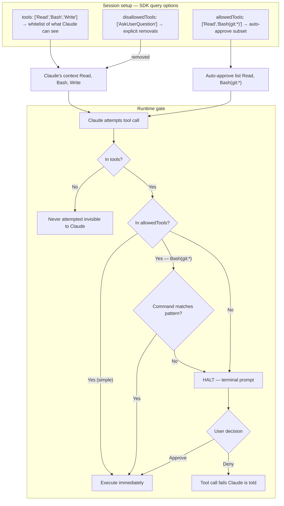
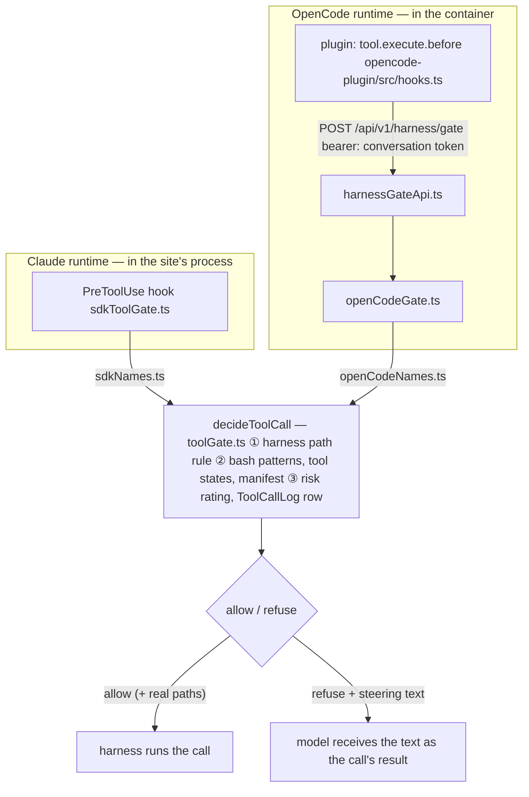

# Tool Control

How tool calls are gated on both runtimes — Claude Code and OpenCode — and how an agent's commands are
kept apart from the harness that runs them. One gate decides every call on either runtime; each harness
reaches it through a thin adapter.

Each runtime's own tools are listed in [claude-tools.md](./claude-tools.md) and
[opencode-tools.md](./opencode-tools.md); the approval surface for `ask` calls is
[tool-manifest.md](./tool-manifest.md).

---

## Why neither harness's own permission system is used

**Claude Code** has a built-in permission gate (`permissionMode: 'default'`): a tool not in
`allowedTools` halts and prompts at a terminal before it runs. Agenthix runs with
`permissionMode: 'bypassPermissions'` instead, because approvals must surface in a browser, not a
terminal, and may be collected for a batch review after the run rather than answered one at a time.

**OpenCode**'s permission system is, by its own security policy, an aid for the person at the terminal
and not a security boundary, and its permission replies are an API call anyone holding the server's
password can make. So OpenCode is configured to allow everything, and never asks.

On both, the gate is Agenthix's own: Claude's `PreToolUse` hook and OpenCode's plugin hook ask it before
every call.

### Claude's own permission model, which Agenthix does not use

Shown only for contrast: this is how the Claude Agent SDK gates tools on its own. Agenthix turns it off
(`bypassPermissions`) and gates every call itself, as the next section shows.



---

## One gate, two adapters



**The shared decision** is `decideToolCall` in `site/src/agents/runtime/toolGate.ts`. It takes a
`GateCall` — the canonical tool name, the arguments as the harness sent them, the harness's call id, and
for a file tool the paths it will open — and, in order:

1. **Refuses a call whose run has been stopped** (below).
2. **Applies the harness path rule** to a file tool's paths (below).
3. **Checks the agent's permissions**, skipped entirely for an agent whose approval is `bypassed` and for the few calls
   that need no permission: the harness's own to-do list, and loading a skill staged for the turn (`skill`
   on both runtimes; Claude's `Skill` is logged under the canonical name `skill`). Otherwise, in order:
   - **`never` always refuses.** A tool in state `never` is refused in every run, whatever the run's
     manifest approves, `*` included; so is `bash` in state `never`, and a command whose bash pattern is
     `never`. For a patch that adds or deletes a file, `write_file`'s state counts too. Logged as
     `tool-never` or `bash-pattern-never`.
   - **An attended run asks through its manifest.** Chat and task runs carry an **approved manifest**: the
     calls already approved for this run ([tool-manifest.md](./tool-manifest.md)). An `ask` call it does
     not cover is refused and added to the run's deferred manifest, for a person to decide after the run.
   - **A run with no approved manifest refuses what needs asking.** Such a run has nobody to approve
     anything: an `ask` tool is refused (`tool-ask-unattended`), and so is a command that needs approval (an
     `ask` pattern, or a command matching no pattern while bash is `ask`) (`bash-ask-unattended`). No run is like this today, because every chat and task run carries a manifest,
     including a task a pulse or a schedule started, whose requests wait for the person it is done on behalf
     of; the rule stays so a run without one fails safe.
   - **A tool missing from the agent's permissions counts as `ask`.**
4. **Rates the call's risk** (`riskRating.ts`, on the canonical name) and **writes its `ToolCallLog` row**,
   with the harness's call id as `toolUseId`.
5. Answers **allow** — with each checked path's real path where one led through a link — or **refuse**
   with steering text the model receives as the call's result.

It **fails closed**: an error while deciding is a refusal (`gate-error`), recorded like any other. Its log
lines are written as `ToolGate` whichever runtime asked; Claude's adapter logs its own refusals as
`ClaudeSDKRuntime`.

**Claude's adapter** (`sdkToolGate.ts`) runs in the site's own process: the `claude` CLI runs in the
container, but the Agent SDK that drives it runs in the site and calls its `PreToolUse` hook there. It translates Claude's names (`Read`, `mcp__platform__create_task`), refuses what only
Claude could ask for — another MCP server's tools, `ToolSearch`, `TaskOutput`, `TaskStop`, and a `Skill`
call naming a skill that was not staged for the process (`skill-not-staged`; `name`, `/name` and
`agenthix:name` are accepted) — and
answers in the SDK hook's shape: `{}` to allow, `{ decision: 'block', reason }` to refuse, and for an allow
with real paths, `updatedInput` carrying them. Between turns the running process has no gate and every
call is refused.

**OpenCode's adapter** is split. The plugin's `tool.execute.before` hook, which OpenCode runs before every
built-in, plugin and platform tool call with its full arguments, sends the call to
`POST /api/v1/harness/gate` (`site/src/server/harness/harnessGateApi.ts`) with the conversation's
platform token as its bearer. The site resolves the token to the turn running now — none between turns —
and `openCodeGate.ts` translates the call and runs the shared decision. The plugin then lets the call
run, replacing its arguments with the site's checked ones when the answer carries them, or throws the
steering text; OpenCode ends only that call and hands the model the text verbatim. The plugin fails
closed too: no turn, no answer within its 30-second deadline, an error or a malformed answer is a
refusal, and OpenCode sets no deadline of its own on the hook.

### Stopping a turn

OpenCode does not cancel a hook that is still waiting, so a call the site allowed after its turn was
stopped would still run. So stopping a run tells the gate first (`stopGateRun`, `toolGateRuns.ts`): every
decision still pending for the run is answered with a refusal at once, every later one is refused and
recorded as `run-stopped`, and only then is the harness told to stop. `AgentEngine.cancelRun` does this,
and so does the end of every turn.

---

## What each runtime shows the model

The gate decides calls; each harness also decides which tools the model sees at all.

| | Claude | OpenCode |
|---|---|---|
| Built-in tools | Only the agent's `always` and `ask` built-ins — in an unattended run, `always` only — plus `TodoWrite` and `Skill`, are in the SDK's `tools` list; a bypassed agent gets the full useful set (`buildSdkBuiltinTools`, `sdkNames.ts`) | Each session's rules deny with pattern `*`, which hides them, a restricted agent's `never` built-ins and, in an unattended run, its `ask` ones; `edit`, `write` and `apply_patch` share one permission key, so they are hidden only when both `edit_file` and `write_file` are withheld. The rules are brought up to date at every turn ([opencode-tools.md](./opencode-tools.md)) |
| Always removed | `disallowedTools`: `AskUserQuestion`, `EnterPlanMode`, `ExitPlanMode`, `CronCreate`/`Delete`/`List`, `TeamCreate`/`Delete` | Denied with pattern `*`: `task`, `question`, and every other conversation's tool connection |
| Platform tools | The site's MCP server leaves the run's `never` tools out of its tool list; they are also in `disallowedTools`, and in an unattended run so is every `ask` platform tool (`buildSdkDisallowedTools`) | The same MCP server, on the conversation's own connection; in an unattended run the session's rules also deny each `ask` platform tool by its id, `<connection>_<tool>` |

In an unattended run `bash` stays listed while it is `always` or any `always` pattern exists, since some
command can still run, and is hidden otherwise. Whatever a harness lists, the gate refuses a `never` tool or command in
every run, and an `ask` one in an unattended run, when called.

---

## Tool and bash pattern states

Every tool and every bash pattern has one of three states, used in both the UI and the code.

| State | What it means |
|---|---|
| `always` | The call runs without approval. |
| `ask` | The model can see and plan around it; calling it needs approval. |
| `never` | Refused in every run; hidden from the model wherever the harness allows (table above). |

How an `ask` call is handled depends on the agent's approval. With `deferred` the call is
refused with text telling the agent to carry on, and collected for a batch review after the run. With
`immediate` it is refused with text telling the agent to explain why it needs the tool and end its
turn. With `bypassed` no call is checked against the agent's permissions, and the run's capability names no
tool `never` but those a workspace's allowed list leaves out, platform tools included. See
[tool-manifest.md](./tool-manifest.md).

**Permissions are set at three levels, and the strictest wins.** The organisation's level is the agent's own
tool states, bash patterns and approval. A project can narrow them for a run in that project, and a person can
narrow them for a run in their own Chat; a run meets only one of the two. For each tool and each pattern the
order is `always` < `ask` < `never`, and for the approval `bypassed` < `deferred` < `immediate`; a narrowing only
ever takes away. hq resolves this once, when it signs the capability and builds the dispatch, so the site never
combines levels (`resolveEffectivePermissions`, `hq/src/agents/permissions/effectivePermissions.ts`).

**The gate decides what an agent may attempt; hq decides what a platform tool may do.** Whatever the gate lets
through, hq checks each platform tool call against the run's boundary and the person the run is for, as the
browser checks that person: their current organisation role, their membership of the project, and the same
role floors ([ADR-0101](../../adr/adr-0101-a-run-is-bounded-by-the-person-it-is-for.md); [identity-and-trust.md](../identity-and-trust.md)). So no
state, `always` or Bypassed, lets a run do in hq what its person may not.

```
# example agent config
create_task   → always      git log *    → always
create_agent  → ask         git push *   → ask
update_org    → never       rm -rf *     → never
```

**Bash is judged on the whole command**, the `command` argument, against the agent's bash patterns by
prefix. A compound command is judged by its start: `cd x && git push` matches `cd`, not `git`. The first
pattern that matches decides: `always` runs it without approval, `ask` needs the manifest's approval, and
`never` refuses it in every run, whatever bash's own state and whatever the manifest approves. **A command
matching no pattern follows "Any other command"**, bash's own state: `always` runs it, `ask` needs the
manifest's approval, and with bash `never` no command runs at all. A tool missing from the agent's
permissions counts as `ask`, bash included.

---

## The harness path rule

The harness's own file tools run inside the harness, as its user, and can open anything it can — its
credentials and session database in its home, and through `/proc/self/environ` its secrets. So the gate
refuses those tools any path under a protected root: the harness home (`/home/appuser` in a container)
and `/proc` (`harnessPathRule.ts`). A path is judged both as written and by where it really leads,
resolved in the container by one `docker exec` (`harnessRealPath.ts`), so a link already planted cannot
lead there. A glob is judged by the folder before its first wildcard and refused if it climbs (`..`)
after one; a search is also refused a folder that holds a protected root, such as `/`.

Read-only tools may still read a few folders inside the home that the harness itself hands the model:
the skills staged for the turn, and the folder where the harness saves a long tool result (Claude's
session `tool-results`, OpenCode's `.local/share/opencode/tool-output`).

The rule cannot see a link swapped in between the check and the open. How far each runtime closes that:

- **Both** hand the harness the checked real path in place of the model's — Claude through
  `updatedInput`, OpenCode by replacing the call's arguments — so only a folder swapped after the check is
  left.
- **OpenCode**: Agenthix's own `read`, `write`, `edit` and `apply_patch` open the file first and check
  what was opened, which leaves no gap ([opencode-tools.md](./opencode-tools.md)).
- **Both**: `grep`/`glob` (`Grep`/`Glob` on Claude, with `USE_BUILTIN_RIPGREP=0`) run `rg` through the
  command launcher, which cannot reach the home.
- **Claude**: `Read`, `Edit` and `Write` run inside the CLI and cannot be replaced; they stay narrowed but
  not closed — an open risk.

---

## The command sandbox

The harness — the `claude` CLI, or OpenCode's server and plugin — runs in the container as the same user
as the commands the agent runs, so file ownership cannot separate them. **Every command the agent runs is
sandboxed with Landlock**, a Linux feature by which a process restricts itself and everything it starts,
irreversibly and without privilege.

The launcher is `agenthix-contain` (`site/docker/launcher/agenthix-contain.c`), built into the agent
image. Both harnesses use it as their shell:

- **OpenCode** through its `shell` setting, `/usr/local/lib/agenthix/shell/bash`;
- **Claude Code** through `CLAUDE_CODE_SHELL_PREFIX`, `/usr/local/lib/agenthix/bin/claude-shell-prefix`,
  which keeps Claude's own `cd` handling and time limits.

Before the command runs, the launcher:

- removes the harness's secrets from its environment — the list is `site/docker/launcher/secret-env.list`,
  which a unit test holds equal to the site's `HARNESS_SECRET_ENV`;
- sets `HOME` to the commands' own home, `/home/agent`, which lives in the container and goes with it;
- restricts itself: no access beneath the harness home, except read-only access to folders named in
  `SITE_COMMAND_READABLE` (the staged skills, so a skill's scripts run; a name outside the home, or
  the home itself, makes it refuse); and, with Landlock ABI 6, signals and abstract Unix sockets only
  within the sandbox. Landlock also refuses tracing any process outside the sandbox, and with it that
  process's `/proc/<pid>/environ`.

It never runs a command uncontained: below ABI 6, or when any step fails, it exits 126. It can be started
from inside its own sandbox — a command that runs `rg` — and then keeps that sandbox rather than building
another.

Each command is its own sandbox, and signals between sandboxes are refused, so a command cannot stop a
process an earlier command started. The site's `stop_processes` platform tool does it instead, for the
calling conversation's own processes only.

**Landlock ABI 6 needs Linux 6.12.** The site asks the kernel's ABI once at startup from a throwaway
container, and again from the first container that needs it if startup could not ask
(`landlockCheck.ts`). Before any harness starts in a container, the check must have found ABI 6 or later,
or the run fails; nothing is started on an assumption. Landlock does not hide file names in the harness
home, only their contents.

---

## Tool-name mapping

Agenthix's canonical names (`read_file`, `write_file`, `edit_file`, `glob_files`, `grep_files`, `bash`,
`web_fetch`, `web_search`, and each platform tool's own name) are what `agent.json`, the permission
states, the manifest, the risk rules and `ToolCallLog` use. Each runtime translates in one file:

| Canonical | Claude (`sdkNames.ts`) | OpenCode (`opencode/openCodeNames.ts`) |
|---|---|---|
| `read_file` | `Read` | `read` |
| `write_file` | `Write` | `write` |
| `edit_file` | `Edit` | `edit`; `apply_patch` (plus `write_file` when the patch adds, deletes or moves a file) |
| `glob_files` / `grep_files` | `Glob` / `Grep` | `glob` / `grep` |
| `bash` | `Bash` | `bash` |
| `web_fetch` | `WebFetch` | `webfetch` |
| `web_search` | `WebSearch` (Anthropic's own search) | the site's `web_search` platform tool |
| a platform tool | `mcp__platform__<tool>` | `<connection>_<tool>`, prefix removed by the known connection name |
| `skill` (every agent has it) | `Skill` | `skill` (Agenthix's own) |
| — (every agent has it) | `TodoWrite`, `TodoRead` | `todowrite`, `invalid` |

A name neither table knows is refused on OpenCode; on Claude it passes to the decision under its own
name. Call ids are opaque strings in each provider's own format.

---

## Key files

| File | Role |
|---|---|
| `site/src/agents/runtime/toolGate.ts` | The shared decision, `ToolCallLog` writes, steering text |
| `site/src/agents/runtime/sdkToolGate.ts` | Claude's `PreToolUse` adapter |
| `site/src/agents/runtime/opencode/openCodeGate.ts` | OpenCode's adapter, and its path policy |
| `site/src/server/harness/harnessGateApi.ts` | The endpoint OpenCode's plugin asks |
| `site/opencode-plugin/src/hooks.ts` | The plugin's gate, `shell.env` and `chat.headers` hooks |
| `site/src/agents/runtime/toolGateRuns.ts` | Stopped runs, pending decisions, running turns by run id |
| `site/src/agents/runtime/harnessPathRule.ts`, `harnessRealPath.ts` | The harness path rule |
| `site/src/agents/runtime/sdkNames.ts`, `opencode/openCodeNames.ts` | Each runtime's tool names |
| `site/src/agents/runtime/riskRating.ts` | Risk level per call, on canonical names |
| `site/src/agents/runtime/landlockCheck.ts` | The kernel check before any harness starts |
| `site/docker/launcher/` | The Landlock launcher, both harnesses' shells, the `rg` wrapper, the secret list |
| `site/src/server/mcp/handler.ts` | Verifies the run's capability and leaves its `never` tools out of the MCP tool list |
| `hq/src/server/controlplane/authorize.ts`, `runPerson.ts` | Checks each platform tool call against the run's boundary and its person |
| `core/src/protocol/capability.ts` | `ToolPermission`, `BashPatternPermission`, `ToolPermissionState` |
| `site/src/agents/runtime/toolPermissions.ts` | `getToolState`, `getBashPatternState`, defaults |
| `site/src/agents/runtime/manifestParser.ts` | `buildApprovedManifest`, `manifestNeedsApproval` |
| `hq/src/agents/manifestActions.ts` | `approveManifest`, `rejectManifest` |
| `ui/src/agents/permissions/AgentPermissionsView.tsx`, `permissionsModel.ts`; `ui/src/agents/tabs/permissionPresets.ts` | Permissions UI (shown by `hq/src/agents/pages/manage/PermissionsSection.tsx`), its pure rules, and named presets |
