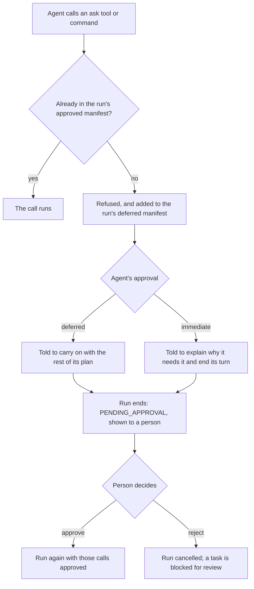
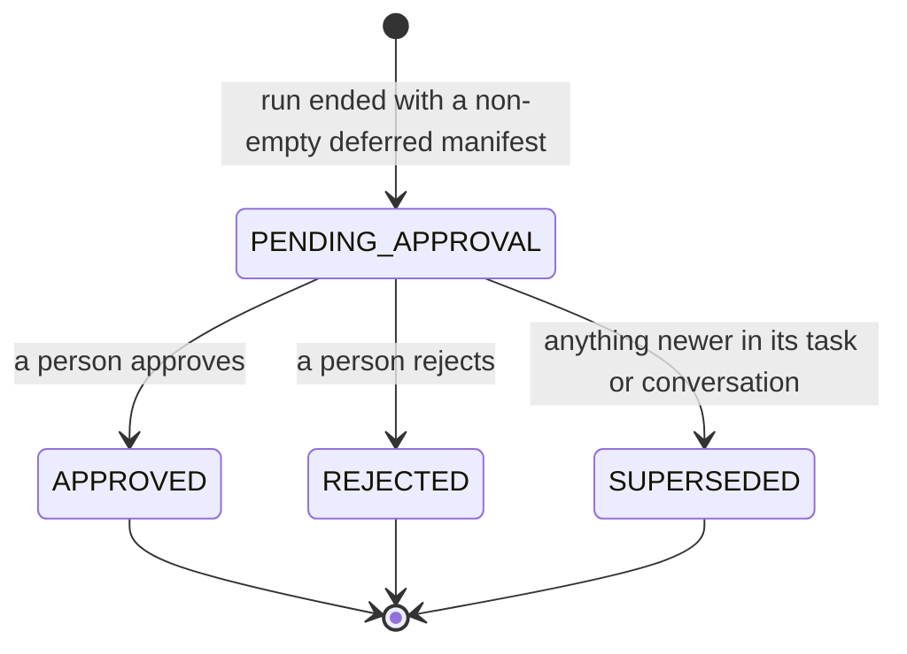

# Tool Manifest

The manifest is how a person approves the tool calls an agent wanted but was not yet allowed to make. It
applies to tools and bash command patterns in the `ask` state ([tool-control.md](./tool-control.md)), in
chat and task runs, and the runs of a conversation's workers. Every such run carries a manifest, so there is always
someone it can be decided by.
For a task, that is the person it is done on behalf of: a task or routine a schedule started has nobody watching
while it runs, but the request waits for a person rather than being refused.

---

## What it is, and is not

**It is** a per-run list of the `ask` tools and bash command prefixes the agent tried to use and was
refused, collected while the run works and decided by a person after the run ends.

**It is not** a way to grant tools the agent cannot have. A `never` tool or command is refused in every
run, approved or not; the manifest only decides `ask` calls, within what the agent's permissions already
allow.

---

## How a run collects it

Every chat and task run starts with an **approved manifest**: the agent's `always` tools, the tools every
agent has, and, for a task, whatever an earlier run of the same task already had approved
(`buildApprovedManifest`, `site/src/agents/runtime/manifestParser.ts`; `taskExecution.ts`). The gate
(`decideToolCall`, `site/src/agents/runtime/toolGate.ts`) checks each `ask` call against it. A call it
does not cover is refused, logged as `tool-deferred` or `bash-not-in-manifest`, and added to the run's
**deferred manifest**: the tool's name and what it was aimed at, or the command's first word.

The agent's **approval** (`Agent.approval`, the strictest of the organisation's and a narrowing's) changes
only what the agent is told:

| Approval | The refused call's text tells the agent to |
|---|---|
| `deferred` | Carry on as if it had access, attempting the remaining steps; nothing stops |
| `immediate` | Explain what it was trying to do and why it needs the tool, then end its turn |
| `bypassed` | Not applicable: a bypassed agent's calls are not checked against its permissions, platform tools included; a platform tool is still bounded by the authority of the person the run is for |

Either way the call does not run, and the decision waits until the run has ended.

A tool the agent reaches through `use_tool` ([tool-search.md](./tool-search.md)) is decided, refused and listed in the
manifest under its own name, as its direct call would be, and approving it approves that tool, not `use_tool`. In a run
nobody can approve, an `ask` tool is not offered at all.

**A refused command is recorded by its first word.** Bash patterns match by prefix, so approving a deferred
`git push origin main` approves `git`: every command starting with `git`, for the rest of that run, unless
a `never` pattern refuses it.

---

## Lifecycle

`AgentRun.manifestStatus` and `pendingManifest` on the site's run row (`site/schema.prisma`). When a run
ends with something deferred, the site sets `PENDING_APPROVAL` and sends one final `run.status` that
carries the manifest, so hq can show it (`site/src/server/runtime/deferredManifestReport.ts`).

A run never waits for approval: it ends with the list of what it was refused.

**Approve** (`approveManifest`, `hq/src/agents/manifestActions.ts`) marks the request `APPROVED` on the site
(`run.approve`) and starts the **next run**, and that run alone is given what was approved:

- **A chat run**: hq sends the conversation a message that is not shown in it, as the person the asking run
  was for, with a fresh capability and context.
- **A task run**: the task is queued again and claimed as usual.

When the site starts a run, it gives it a request only if the newest earlier run of the session (a task has one
session) is that request, approved, and puts a note before the run's message telling the agent what it may use
in this run only (`site/src/server/runtime/nextRunApproval.ts`). The run after it gets nothing: the agent's
levels apply again.

**Reject** (`rejectManifest`): the run becomes `CANCELLED` with `manifestStatus` `REJECTED`. A task is set
`BLOCKED`, "manifest rejected — awaiting human review", with a comment, and is not run again on its own;
a chat is told it was rejected.

**A request nobody answered is replaced** by anything newer in its task or conversation: a new message, Run
again, Dismiss, or a newer run. It becomes `SUPERSEDED`, its notifications are handled, and it leaves Needs you
and the Runs panel; the approval card says it was replaced and offers no buttons. The site replaces a session's
unanswered requests when it starts a run there; Dismiss, and Run again before its run starts, send `run.reject`
with `replaced: true` (`hq/src/agents/manifestRequests.ts`). Approving or denying a replaced request, or one a
newer run has overtaken, is refused with a plain sentence. Nothing else expires a request.

**Who is told**: when a task run ends with something deferred, hq writes the approval comment on the task and
also sends a notification to the person the task is done on behalf of, linking to the request
(`hq/src/agents/approvalNotification.ts`, [ADR-0089](../../adr/adr-0089-every-task-runs-on-behalf-of-a-person.md)).
If that person has lost access to the project, the task is blocked until a project admin reassigns it.

**Who may decide**: for a chat, only the person whose conversation it is, and to approve they must still
be able to start runs in its project. For a task, anyone who works in the task's project — a Member or
Admin of it, not a Viewer. For a task run whose task was deleted, the project's admins.

**A worker in a conversation** asks the same way and the site handles it identically: the run ends asking. What differs is
who is told and where. hq writes an approval request into the conversation, with the worker's last words before the
request as its reason, and the operation waits; the person approves or declines in the conversation's work bar. Approving
calls `run.approve` and continues the worker in a new run of the same session; declining calls `run.reject` and tells the
worker in a new run, which finishes as it decides (`hq/src/conversations/work/workers/owner.ts`). Whoever answers must pass
the checks the asker would, and in a task's thread that may be any member who works in the project. The lead's own tools
at `ask` are not a manifest at all: hq holds the call as an operation until it is answered
([conversation-layer.md](../conversation-layer.md#the-lead-in-hq)).

---

## Where a person sees it

| Run | Where |
|---|---|
| Conversation (flag on) | The work bar's request row, from the conversation's record |
| Chat | `ManifestApprovalBubble`, below the agent's reply in the chat panel (`ui/src/sessions/ManifestApprovalBubble.tsx`); it leaves the screen when a newer run in the conversation reports its status (`agentRunStatus`) |
| Task | A comment on the task (`ui/src/sessions/ManifestApprovalComment.tsx`, through `hq/src/projects/components/ManifestApprovalComment.tsx`) |

The pending state is read back from the run's `manifestStatus` when the page reloads, so the card always
shows the run's real state.

---

## Key files

| File | Role |
|---|---|
| `site/src/agents/runtime/toolGate.ts` | Refuses and records deferred calls; the text each mode sends |
| `site/src/agents/runtime/manifestParser.ts` | `buildApprovedManifest`, `manifestNeedsApproval` |
| `site/src/server/runtime/deferredManifestReport.ts` | Marks a run `PENDING_APPROVAL` and reports it |
| `site/src/server/runtime/dispatchHandler.ts` | `run.approve` and `run.reject` on the site |
| `site/src/server/runtime/nextRunApproval.ts` | What a starting run is given, and replacing unanswered requests |
| `hq/src/agents/manifestRequests.ts` | Replacing a task's request on Dismiss and Run again; the refusal |
| `hq/src/agents/manifestActions.ts` | `approveManifest`, `rejectManifest`, and who may call them |
| `hq/src/agents/manifestQueries.ts` | `getRunManifestStatus`, `getToolCallLog` |
| `site/src/agents/runtime/riskRating.ts` | The risk level recorded with each call |
