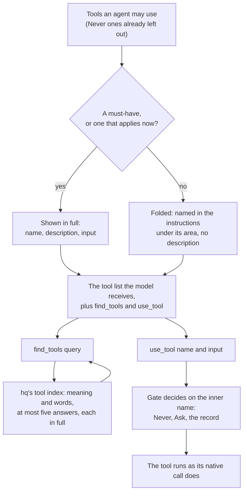

# Tool search

How an agent is offered its tools. An agent is shown a small set of **must-have tools** in full, is told by name the
platform's other tools, and has two tools of its own, `find_tools` and `use_tool`, to look up and call the rest. The
choice and its reasons are [ADR-0193](../../adr/adr-0193-an-agent-is-shown-its-must-have-tools-and-finds-the-rest-by-search.md);
this page is how it works. The gate every call passes is [tool-control.md](./tool-control.md), unchanged.

## What an agent is shown

| | A conversation (hq) | A background run (the site) |
|---|---|---|
| Shown in full | `CONVERSATION_MUST_HAVES` in `core/src/harness/toolSearch.ts`, and while they apply the approval, cancel, keep-listening, live-preview and folded-history tools (`hq/src/conversations/tools/foldedTools.ts`) | `RUN_MUST_HAVES`, the code tools only for code work and the app tools only with the live preview on (`site/src/server/mcp/mcpServer.ts`), and the harness's own file and shell tools, which are never folded |
| Named, not shown | every other tool the turn may use, by name under a plain label for its area (`areaLines`), in the conversation's instructions (`lead/instructions.ts`) | the same lines, after the platform tools' instructions in the MCP server's own instructions |
| Never offered | a tool at Never; the legacy tools in `WITHDRAWN_FROM_AGENTS` | the same, and a tool at Ask in a run nobody can approve |

`find_tools` and `use_tool` are added once anything is folded. The tool list does not change within a conversation,
so the provider's cached prefix stays whole. A tool connected from outside is named only by its connector, so the lines
grow with what Agenthix ships, never with what is connected.

## find_tools

A query is what the agent wants to do, or a tool's name. In a conversation hq answers it in process
(`foldedTools.ts`, `findTools`); in a run the site forwards it to hq on the data path, naming the tools it offers the
run, and hq answers over the control-plane tools the run may use (`hq/src/server/controlplane/findToolsOp.ts`). The
site then answers in its own declarations of the tools found.

The index is `hq/src/tools/search/`. Each tool is one short text: its name in words, its description's first sentence
and its input's names. Each text is embedded once per process with hq's built-in embedding model, kept by a hash of the
text, so an unchanged tool is not embedded again. A search scores each tool by meaning (cosine of the two vectors)
plus words (a query that names a tool, or a word few tools have, ranks it first), keeps those above the bar and
answers at most five (`FOUND_AT_MOST`), each with its full description and its input as a JSON schema. When the model
cannot load, or is slower than five seconds, words alone decide that search, with their own bar, and the model is
tried again on a later one. When nothing passes, the answer is one line saying that every tool the agent may use is named in its
instructions, and that if none of those does it, it says it can't rather than searching again.

Searching grants nothing. The caller gives the index only the tools the agent may use, so a tool at Never is never
found.

## use_tool

`use_tool` takes a tool's `name` and `input`, and the input may come as JSON text. It is the call of the tool it
names: the gate (`gateCallOf` in `site/src/agents/runtime/toolSearchCall.ts`, used by `toolGate.ts` and `mcpCallGate.ts`; for a conversation, `unwrapUseTool`) decides Never and Ask
on the inner name and input, a tool at Ask waits for a person, and the call is recorded and shown under the inner name,
in the harness's own naming. A name the agent may not use, or that does not exist, is refused with a line that says to
search. Input that does not fit the tool is refused with the tool's description and input, so the agent can call it
again without a search. A tool the site serves itself is called by its own name, never through `use_tool`.

## Who sees every tool

Nothing is removed from the platform: every tool stays callable by name. hq's own MCP server, which people connect
their own clients to, still lists every tool in full and has no `find_tools` or `use_tool`; the search is for the
agents Agenthix runs.

## Adding a tool

1. Give its declaration an **area** (`TOOL_AREAS` in `core/src/harness/toolAreas.ts`). It places the tool in the
   instructions' lines. An area is never sent to the model as part of
   the tool.
2. Decide whether it is a **must-have**: add its name to `CONVERSATION_MUST_HAVES` or `RUN_MUST_HAVES` only when most
   asks start from it, or a rule says it must be called before a search could find it. Otherwise it is folded and
   found with no more work.
3. Write its first description sentence for the search: it is what the tool is found by.
4. Prove it with a model check (`hq/src/conversations/__modelchecks__/`, its README): a check that the agent finds and
   calls it by the ask a person would make.
