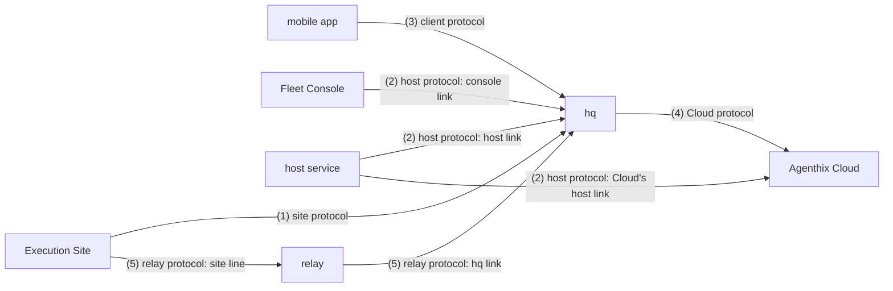

# Versions

Every number the platform carries, what each one promises, and how to move it. Read this before changing anything
another part of the platform receives: a message on a channel, an HTTP route or its answer, a socket event, a stored
format, or a name on a person's machine. The decision behind it is
[ADR-0136](../adr/adr-0136-every-connection-restarts-at-1-0-and-peers-one-major-apart-still-talk.md); how a release
is made is [ADR-0146](../adr/adr-0146-a-release-is-a-proven-build-given-a-name.md).

There are two kinds of number, and they never stand in for each other:

- **The product version**, one for the whole repository, which the release tag names and every image, the core
  package and the container's environment are given at publish (`0.1.0-alpha.1`).
- **A protocol version** for each connection between parts that are installed and upgraded separately
  (`1.0`). Each moves on its own. A phone from an app store and a self-hosted hq are rarely on the same release, so
  what decides whether two parts can talk is the protocol version, never the release.



Each arrow points from the side that dials to the side that listens. hq's own web pages have no number: hq serves
them, so they always match it.

## The product version

**The product stays below 1.0.0 until general availability.** Every `0.x` release is early access, and `1.0.0` is
general availability. The first public release is `0.1.0`; the cuts before it are `0.1.0-alpha.N`, then
`0.1.0-rc.N` (release candidates). Under `0.x` a breaking change moves the minor (`0.2.0`) and a fix the patch; from
`1.0.0`, a breaking change moves the major, as [Semantic Versioning](https://semver.org) says.

**A published version is never published again**, even when it turns out not to work: someone may already have it,
and two builds under one name cannot be told apart. The fix takes the next number, `0.1.0-alpha.3` after
`0.1.0-alpha.2` and `1.0.2` after `1.0.1`. A patch that may be shaky can go out first as a release candidate
(`1.0.1-rc.1`, `rc.2`, …) and be released as `1.0.1` once it is proved; that is optional. Only a tag whose publishing
failed before it finished is tagged again under the same version ([ADR-0146](../adr/adr-0146-a-release-is-a-proven-build-given-a-name.md)):
nothing complete was published.

**The version is a name given at publish, never built in.**

- **The tag `v<version>` is the one place it is written.** Every `package.json` and lock file stays at `0.0.0`, and
  no commit sets a version. The publish workflow checks the tag's form (`.github/workflows/publish-images.yml`).
- **No image carries a version or a commit.** The Dockerfiles take no `VERSION` or `COMMIT` build argument and set no
  version label; each image is built with one label, `content-key` (next section). Two builds of the same content
  therefore never differ by a label.
- **The published index carries it.** At the tag, each image part's two platform images are put under one
  multi-platform index tagged `:<version>`, annotated `org.opencontainers.image.version` and
  `org.opencontainers.image.revision` (the commit), and signed. The tag's check that an image carries its version
  reads that annotation.
- **The core package is given it when it is packed** (`npm pkg set version=<version>`), then checked with
  `npm run check:package` and published. Under `0.x`, removing or changing anything it exports is a minor release;
  from `1.0.0`, a major. The check installs the packed package into an empty project and loads every entry point
  with plain Node.
- **A container is given it by the host service.** The host service writes it into the environment of each compose
  project it starts, beside the image it picks by that version: `APP_VERSION` for hq's server and the site,
  `CONSOLE_VERSION` for the Fleet Console. hq and the Fleet Console read it when they start; with none, they report
  `dev`. A running hq does not know its commit.
- **The host service learns its own version from the reference it was started from**, never from its image
  (`host/src/images/ownVersion.ts`): a host image of the trusted publisher by a published version's tag, with or
  without `@sha256:…`, is that version once the signature for that version checks and the image running is the one
  signed. Any other reference, a local build or a bare digest, and a host service given no Docker socket, are `dev`.
  A switch to a new version starts its successor from `<image>:<to>@<digest>`, so the successor reads the same
  version ([host-management.md](host-management.md#the-host-service)).

A version is therefore always backed by the signature the host service checked for it: the number travels beside the
image rather than inside it. A build made on a machine rather than by the release workflow reports `dev`.

**At most two lines are maintained.** A *line* is the releases of one `major.minor`. Fixes, security fixes included, go
to the newest minor of the current major and the newest minor of the major before it; two majors back gets nothing,
and its users upgrade. Before `1.0.0` only the newest release gets fixes: under `0.x` every minor may break, so there
is no earlier major. This matches the rule that protocol peers one major apart still talk.

## An image's content key

The platform publishes eight **image parts**: `hq-server`, `hq-web`, `relay`, `site-server`, `agent`, `executor` (what a workflow's steps run in, [workflows.md](workflows.md)), `host` and `console`. Each
is built once per content and reused until its code changes, so a patch to one part rebuilds that part alone.

- **`scripts/images/parts.json`** is the one list of the parts. Per part it holds the Dockerfile, the build target and
  the repository paths the image reads (its inputs), beside the **rebuild epoch**, a whole number. The release
  build, `scripts/images/start-test-all.sh` and `scripts/install-test/run.sh` all read it.
- **The content key** is a SHA-256 over the Dockerfile's path and target, the Git object ID of `.dockerignore`, of the
  Dockerfile and of each input path at the commit (a Git object ID changes exactly when a file under it does), the
  Dockerfile's `FROM` references, and the rebuild epoch. `node scripts/images/keys.mjs [<commit>]` prints the eight
  keys. It reads Git only. The same key is the same image.
- **A test holds the inputs to the Dockerfiles:** `scripts/__tests__/image-parts.test.mjs` parses every `COPY` (not
  `COPY --from`) and fails when a source path is not under one of its part's inputs. A key that missed an input
  would reuse a stale image.
- **Every `FROM` names a digest**, so a base image moves only on purpose. Dependabot's `docker` ecosystem
  (`.github/dependabot.yml`) opens the pull request that moves one, and the keys of the parts built on it change.
- **The rebuild epoch** is raised to take security updates into images whose code has not changed, such as the agent
  image's system packages: by hand, or by the monthly *Rebuild epoch* workflow, which opens a pull request.
- **Built images are kept by key.** The release build pushes each image by digest, tags it `build-<key>-<arch>` and
  attests it; before building a part it reuses an image that tag names when the image is attested by the release
  build ([deployment.md](deployment.md#releases-and-the-images-they-publish)). A `build-…` tag is never offered as a
  version: the host service lists only release-version tags. On a dev machine the start test keeps its images as
  `imgtest/<part>:dev` with the key in a label, and builds only the parts whose key differs.

## The protocols

| # | Connection | Constant in `core/src/` | Stated in | Checked |
|---|---|---|---|---|
| 1 | hq ↔ an Execution Site, its control and content channels | `SITE_PROTOCOL_VERSION`, `protocol/connection.ts` | the header `X-Site-Protocol-Version` when the site dials either channel; the `version` field of every frame | hq, on the upgrade (`hq/src/sites/siteUpgrade.ts`) and on every frame (`hq/src/sites/channel/siteChannelServer.ts`); the site reads hq's version from a 426 (`site/src/server/hq/hqAnswers.ts`) |
| 2 | the Fleet Console and a host service ↔ hq's console and host links; a host service ↔ Agenthix Cloud's host link | `HOST_PROTOCOL_VERSION`, `host/relay.ts` | the header `X-Host-Protocol-Version` when a link is dialled; the `version` field of every frame | hq, on the upgrade (`hq/src/fleet/relay/upgrade.ts`) and on every frame (`hq/src/fleet/relay/frames.ts`); the host service on every frame (`host/src/link/frames.ts`); the Fleet Console reads hq's version from a 426 (`console/src/hq/wsLink.ts`) |
| 3 | the mobile app, and any later app, ↔ hq | `CLIENT_PROTOCOL_VERSION`, `client/protocol.ts` | the header `X-Client-Protocol-Version` on every request; `clientProtocolVersion` in the socket.io handshake's `auth` | hq, on every HTTP request and socket handshake (`hq/src/server/clientProtocol.ts`); hq states its own before sign-in, so the app can apply the rule from its side |
| 4 | hq ↔ Agenthix Cloud | `CLOUD_PROTOCOL_VERSION`, `cloud/version.ts` | the header `X-Cloud-Protocol-Version` on every call, in both directions | Cloud, on every call (`checkHqCloudProtocol`); hq, on every answer (`checkCloudAnswerProtocol`, in `hq/src/cloud/cloudClient.ts`) |
| 5 | an Execution Site ↔ its relay, on the site line; a relay ↔ hq, on the hq link | `RELAY_PROTOCOL_VERSION`, `relay/protocol.ts` | the header `X-Relay-Protocol-Version` when a site dials its relay's line and when a relay dials hq; the `version` field of every hq link frame. On the line a site states its site protocol as well, since the streams it serves there are site protocol methods | the relay, on a site's line; hq, on a relay's link |

`1.0` is the baseline every later version counts from. Today the site protocol is at `1.18` (which added `commit` on a place's file in `file.about` and in a file ticket, optional: the file of a workspace with Git as one commit holds it, read from the workspace's repository, with its blob id as its version; an older site ignores it and answers the file on disk), and was at `1.17` before it (which added `linked` to the refusals of `file.about`: the file has more than one hard link, so the site won't show it; an older hq reads any refusal as not found), and was at `1.16` before it (which added the header `X-Run-Waiting-Approval` on a site's data call, optional: the run it acts for has asked for something that waits for a person's approval, so hq refuses a change of that run's own task's state, column or type; an older hq ignores it), and was at `1.15` before it (which added `routineId` on a run's dispatch and on its run row, optional: the routine whose firing started a run that has no task; an older peer ignores it), and was at `1.14` before it (which added `location.shareFile`, a photo or file a person added to a conversation, written into the place's `Shared in conversations/` folder as a new file), and was at `1.13` before it (which added `git.versionChanges`, the files one of `main`'s versions changed against the version before it), and was at `1.12` before it (which added the methods for code work on branches, `branch.*` and `git.*`: a branch's own working copy made, committed in, brought up to date with `main`, brought back to the workspace's repository, renamed, deleted and read; `main`'s versions read, a branch merged into `main` as one version, a version restored, and `main` pushed to and pulled from GitHub; the `branch.back` event; `codeWork` on a run's context, with who the commit the site makes at a run's end names and whether its branch's live preview is open, with its running apps; `branchCopies` on the site's health report, the disk its branches' working copies use; and `reason` on `run.waiting`, `branch` for a run on a branch waiting for its container's other runs to end; live previews, `livePreview.*` and
`site.livePreviews`, with their events, the app stream `app.serve` and duplex streams on the content transport, a branch
sent between two sites as a Git bundle, `bundle.*` and `branch.bringBackBundle`, what a site's live previews use on its
health report, and the live-preview claim on a run's capability; `features` on every request hq sends a site, the
organisation's feature switches, which the site decides each flagged feature from with its own build (adr-0172); and
deprecated the old preview methods,
`preview.start`, `preview.stop` and `preview.connect`), and was at `1.11` before it (which added `location.writeSkill` and `location.removeSkill`, which write one of a place's skill folders whole or remove it, never a workspace's, and `refused` on the run's record of the skills it used, for a skill hq named that the site did not stage), and was at `1.10` before it (which added the `skill` package kind, so installed and personal skills are delivered as packages, each `installedSkills` and `personSkills` entry carrying its `ref`; the `location.scanSkills` method, which lists the skill folders in a place's files and its workspaces; and deprecated the org package's skill source, `org`, since the organisation's skills now come as `installedSkills`), and was at `1.9` before it (which added the skills a run's dispatch names, `installedSkills`, `fileSkills` and `personSkills`, the skill a person picked for a message, a `skill` target among a work step's targets, and the run's record of the skills it used, `skillsUsed`; and deprecated the agent package's skill source, `agent`, since an agent's installed skills now come as `installedSkills`), the relay protocol at `1.2` (which added `commit` on a ticket for a place's file, optional: the file of a workspace with Git at one commit, which the site serves; the relay carries the ticket unread), and at `1.1` before it (which added a live app's address, app tickets, `relay.ask`, `relay.answer` and
`relay.revoke`, and bundle tickets with `relay.bundle` and `relay.bundleReport`), and at `1.0` before it (whose tickets name a place's file, an artefact, a knowledge page, or an upload hq keeps, which hq's relay serves itself), the client protocol at `1.20` (which added `heardWords` on the voice socket event `conversationVoice:interrupt`, optional: how many words of the sentence after `heardThrough` the person heard, so a reply is cut at the last word heard; an interruption is also sent when the person ends voice while a reply plays), and at `1.19` before it (which added the voice socket event `conversationVoice:turnHeld`, sent to the voice holder when the agent judged the person had not finished and nothing will be said for the turn), and at `1.18` before it (which added `adaptiveVoice` on the person's settings, `UserSettingsView`: their own Adaptive voice in a voice conversation), and at `1.17` before it (which added two parts of a board's filter: a sprint filter to the tasks in no sprint, `sprint: { none: true }`, and a type, `typeId`; and a board's socket room named by its project's id, `subscribeToBoard` with a project's id, which every board of the project refreshes on, the built-in ones included), and at `1.16` before it (which added the task model's fields beside the old ones: a task's `typeId`, `columnId`, `state` with Backlog first, `rank` and `executionState`, its `type` and `typeColumn` on the lists, `typeId`, `columnId` and `state` on `createTask` and `getTasks`, `columnId` on `moveTaskToColumn`, a board's `view` and `viewColumns`, and a sprint's `projectId`; the shared task model under `core/src/tasks/`; and deprecated what a board that owned its tasks needed: a task's `boardId`, `column`, `status`, `isEpic`, `routineId`, `roundAt` and `runState`, a listed task's `board`, a board's `columns`, `templateId`, `backlog`, `backlogCount`, `projectTasksBoardId`, `showAlso` and `roundLine`, a column's `autoQueue`, and `moveTaskToBoard`), and at `1.15` before it (which added `savedFromConversation` on a task's comment and on `addTaskComment`'s arguments, a comment saved from the task's conversation, and `modelChoice` on a task, the model its runs use), and at `1.14` before it (which added replies to a task's comments: `parentId` on a comment and on `addTaskComment`'s arguments), and at `1.13` before it (which added `openCount` and `lastActivityAt` to a project's card line, `ProjectCardLine`: its tasks still open, and when anything in it last changed), and at `1.12` before it (which added photos and files in a conversation: `shareConversationFile`, `shared` on a message sent and on `TextBody` with `unseenBy`, the model that was not given its pictures, and `ModelChoice.images`, whether a model takes images), and at `1.11` before it (which added `ModelChoices.recommended`, the model a conversation would talk on unless one is picked, which the model list puts first), and at `1.10` before it (which deprecated `subscribeToDashboard` and `unsubscribeFromDashboard`, which hq now answers with nothing, since no screen shows the dashboard they sent), and at `1.9` before it (which added an optional acknowledgement when a socket joins a conversation's room: `subscribeToConversation` answers once the socket is in it; `mergeCard` on an activity row, an agent's ask to merge its branch into `main`; and the `branch` wait note, `RunWaitNote`), and at `1.8` before it (which added the picked skill kept on the person's message it was picked for, `TextBody.skill`), and at `1.7` before that (which added the skill a person picked with `/` for a message, `PickedSkill`), the
Cloud protocol at `1.1` (which added [the AI contract](cloud-connection.md#the-ai-contract)) and the host protocol at `1.3` (which added `copiesBytes` to a site's runs in `site.loads`: the disk its branch copies use;
`previews.set` and the preview address in the figures; the protections' `private-addresses` and `public-address` rules
and their drops; the machine's processors in its figures; `hq.seenFrom`; the Fleet Console's `sites.livePreviews`,
`sites.livePreviews.set` and `sites.livePreviews.stop`; `features.on` on the console link, the flagged features on for the organisation; and the fleet notices for a site's memory and a live preview
stopped for it; 1.1 added the ports an installation publishes to the operations that install HQ or receive a move; 1.2 added `relay.facts` on the console link, hq's relay as the Fleet Console's page for HQ shows it). A protocol is named after the party hq
or the host service talks to, so each constant is `<PARTY>_PROTOCOL_VERSION` and each header
`X-<Party>-Protocol-Version`; no name carries the product's. hq's one web server receives both the host protocol and
the client protocol, which is why they never share a header.

**Who is calling** goes in the standard `User-Agent` header, as `<party>/<release>`: `mobile/1.2.0` from the mobile
app, `hq/0.1.0-alpha.1` from hq to Cloud. It is logged, and decides nothing: anyone can write it.

**When a peer states no version**, each connection does what its peers need:

| Connection | No version stated |
|---|---|
| Site | Refused, as a version that cannot be read |
| Host | Accepted on the upgrade; every frame still carries its own `version`, and a frame the rule refuses is dropped |
| Client | Accepted: a browser, hq's own pages, or an app from before the client protocol |
| Cloud | Cloud refuses a call from hq without one; hq reads an answer without one as `1.0` |
| Relay | Refused, on the site line and on the hq link, as a version that cannot be read |

## The rule every connection follows

A protocol version is `major.minor`.

- **A minor version adds**: a new message, method, operation, event or optional field. Each side ignores what it does
  not know, so a minor version never breaks anyone.
- **A major version breaks**: something removed, renamed or given a new meaning, or a new required field.

**Two sides talk while their majors are at most one apart.** The newer side speaks the older side's major:

| The peer is | The connection |
|---|---|
| On the same major | Works. Each side uses only what the lower of the two minors has |
| One major behind | Works. The newer side speaks the older major, through code kept for it |
| Two or more majors behind | **Refused**, with a message naming both versions and the side that must upgrade |
| Ahead | The peer decides, by the same rule from its side |

Every connection asks this of one function, `checkProtocolCompatibility` in `core/src/protocol/compatibility.ts`,
and never compares versions itself. It answers `ok` with where the peer stands (`same`, `behind`, `ahead`) and what
this side may speak, or a refusal: `too_far_apart` (with the side to upgrade), `absent` or `malformed`.
`protocolRefusalMessage` and `peerRefusalMessage` turn a refusal into the words a person reads.

At `1.x` there is no earlier major, so a peer one major behind cannot exist yet. The code for a previous major is
written at a connection's first major change, kept apart from the current code, with a test that runs it.

### How a refusal looks

**Site and host protocols.** The upgrade is answered `426 Upgrade Required`, with the listening side's own version
in the protocol's header. The dialling side applies the same rule to that version and says which side must upgrade,
rather than reporting a connection it cannot explain. hq also records a refused site as needing an upgrade.

**Client protocol, over HTTP.** `426`, with hq's version in `X-Client-Protocol-Version`, and this body
(`ClientProtocolRefusal`):

```json
{
  "error": "This app speaks protocol 3.0 and HQ speaks 1.0, too far apart to work together: upgrade HQ.",
  "reason": "too_far_apart",
  "hqVersion": "1.0",
  "clientVersion": "3.0",
  "upgrade": "hq"
}
```

`reason` is `too_far_apart` or `malformed` (a version that is not `major.minor`, which always asks the app to
update); `upgrade` is `hq` or `client`.

**Client protocol, on the socket.** The handshake fails, and socket.io's `connect_error` receives an error whose
`message` is `client_protocol_refused` and whose `data` is the same `ClientProtocolRefusal` (`ClientSocketRefusal`).

**Before sign-in**, hq states its release and its client protocol version in `GET /api/org/public-identity`
(`HqVersions`: `release`, `clientProtocolVersion`), which the mobile app already reads at its address step. An app
ahead of hq reads it and applies the rule from its side.

**Cloud protocol.** Cloud answers a call it refuses with `426`, its own version in `X-Cloud-Protocol-Version`, and
`{ "error": "unsupported_protocol_version" }` (`CloudProtocolRefusal`). A `426`, or an answer two or more majors
apart, stops hq calling Cloud: hq records why, naming the side that must upgrade, and asks nothing more of Cloud
until that can have changed.

## The lifecycle of a piece of a protocol

| Stage | Example: deprecated in 1.4 | What it means | In the code |
|---|---|---|---|
| **Current** | 1.0–1.3 | Part of the current major | Normal |
| **Deprecated** | 1.4 to the last 1.x | Still works for everyone, but scheduled to leave | Marked `@deprecated` (below). Editors strike it through wherever it is used |
| **Previous major** | 2.x | Gone from the current major; still spoken to peers on 1.x | Moved into the connection's code for the previous major, apart from the current code |
| **Retired** | 3.0 on | Two majors back: **stops working** | Deleted. A peer still on 1.x is refused |

So a deprecated thing keeps working for the rest of its own major, and through the whole of the next one for peers
still on it. It fails at the second major after the one it was deprecated in. **Nothing is removed from the current
major unless it was deprecated for at least one minor first**, so a peer has had a release in which to stop using
it.

### The deprecation mark

Every mark says three things: the version it was deprecated in, the version from which it **stops working** (two
majors on, `.0`), and what to use instead. Exactly this form, so the snapshot test can read it:

```ts
/** @deprecated since 1.4; stops working in 3.0. Use `runPage` instead. */
```

Where nothing replaces it: `/** @deprecated since 1.4; stops working in 3.0. Nothing replaces it. */`

The "since" version is the version the mark ships in: deprecating something is itself a change, so the minor moves
with it.

### Writing rules, so most changes are minor

- A new field is optional, or has a default the older side would assume.
- An unknown field, value or message is ignored, never refused, so a closed set of values always has a way to say
  "something this side does not know".
- A field is never renamed and never given a new meaning: a new one is added and the old one deprecated.
- A value is never sent to a peer that has not stated a minor version that understands it. Gate on the version
  `checkProtocolCompatibility` says this side may speak, never on this side's own.

## The shape snapshot

`core/snapshot/` holds one committed file per connection, `site.json`, `host.json`, `client.json`, `cloud.json` and `relay.json`:
every type the connection declares in core, with its fields, their types, whether each is optional, and its
deprecation marks, and the version the shapes were recorded at. Which declarations make up each connection is
`core/src/__tests__/protocolSnapshot/connections.ts`: the site's, host's, Cloud's and relay's are what their entry module
exports, the site's method maps included; the client's is the mobile app's own list, `core/src/client/mobileApp.ts`
(each HTTP route, operation, socket room and event the mobile app relies on), with the version handshake beside it.

`core/src/__tests__/protocolSnapshot.test.ts` compares what the code declares with the committed file, and fails
when the version does not match what changed:

| The difference | The test requires |
|---|---|
| Only additions of optional things: a new type, field, message or value of a closed set | The minor moved |
| A removal, a changed type, a renamed field, or a new required field | The major moved |
| A type renamed with its shape unchanged | Nothing: a type's name never crosses the connection |
| A removal of something that carried no mark in the committed snapshot | Refused: deprecate it first |
| A new or changed deprecation mark | The mark is in the form above, names the version it ships in, and stops working two majors on |
| The major passes a deprecated thing's "since" major | It has left the current major's code, kept only for peers one major behind |
| The major reaches a deprecated thing's "stops working" version | It is gone, and its peers are refused |

The snapshot holds only what core declares, so every message a connection carries is declared there: the site's
channel methods each with their parameters and result, every operation the mobile app uses with an argument and
result built field by field rather than a database row, and no field left `unknown` except one that carries
arbitrary JSON by design, typed as JSON. A test fails while a mobile app operation's shape is undeclared.

### Changing a connection's shape

1. Change the declaration in `core/src/`, following the writing rules above.
2. Run core's tests (`npm test` in `core/`). The snapshot test says what changed and what the version must become.
3. Move the protocol's constant to that version: the minor for an addition, the major for a break.
4. Run `npm run snapshot:update` in `core/`. It records the new shape, and refuses while a rule is still broken.
5. Commit the declaration, the version and the snapshot together.

The cross-app suite (`tests/cross-app/`) runs hq and a site against each other, and hq's stand-in for Cloud
(`hq/src/cloud/__tests__/cloudStandIn.ts`) checks the Cloud protocol's version on every call. The committed snapshot
is also what a part built outside this repository, such as the mobile app, can test itself against.

## Stored data

What one release writes, a later one reads: the databases, sealed backups and agent packages.

- **The databases.** Each app has one initial migration, generated from its schema
  (`hq/migrations/`, `site/migrations/`). **Until the first release candidate, `0.1.0-rc.1`, nothing is carried
  forward**: old data is wiped, never converted, and the initial migration may be regenerated once more before it.
  From `0.1.0-rc.1` every schema change is a new migration that carries a release's data forward. The
  `database-migrations` skill (`.agents/skills/`) has the commands.
- **Formats carry a whole number, starting at 1**: the agent package's contents (`PACKAGE_FORMAT_VERSION`,
  `core/src/protocol/packages.ts`), a Library asset's manifest (`ASSET_MANIFEST_FORMAT`, now 2,
  `core/src/assets/manifest.ts`, which the signed statement also names; a package in the earlier format is refused),
  a sealed backup's header (`format`, `host/src/backups/seal.ts`) and the host service's envelopes
  (`HOST_ENVELOPE_VERSION`, `core/src/host/envelope.ts`). Today each reader accepts exactly its own number and
  refuses any other. One more number counts content rather than a format: the voice settings (`hq/src/conversations/voiceClient/settings.ts`), whose number a voice event log records;
  a log recorded under another number is shown with it, and nothing from it is applied.
- **A later version reads what an earlier one wrote.** When a format changes in a way an older reader could not read,
  its number moves, and the newer reader reads one number back, as a protocol is spoken one major back.
- **A backup records the release it was taken from**, and a restore refuses one taken by a newer release than it
  runs.

## Names on a machine

Every container, volume, network and database an install creates is named `<namespace>-<part>[-<what>]` from the
namespace the host service records at its first start (`agenthix` for a new install), and labels are
`<namespace>.<key>`. The namespace is recorded once, when the host service first starts, and never changes for that install, so renaming the
product would leave an existing install's names as they are. Each part that lives a life of its own is its own
group in Docker, so acting on one never removes another. The full list of names, the groups, and the address ranges
an install's networks take (`10.214.0.0/16` for its own, `10.213.0.0/16` for the agents') are in
[deployment.md](deployment.md#installing).

No product name goes into anything stored or exchanged: headers, fields, the `User-Agent` parties, the variables one
part passes another, and the settings a person writes in `host.env` use neutral words (site, host, client, Cloud,
hq). Where the product's name appears on a machine, it comes from the recorded namespace.

## Where the rule is enforced

| Where | What it holds |
|---|---|
| [ADR-0136](../adr/adr-0136-every-connection-restarts-at-1-0-and-peers-one-major-apart-still-talk.md) | The decision, and the options it was chosen over |
| This document | The rule as it stands, and how to move a version. Edited as the rule changes |
| `core/src/protocol/compatibility.ts` | The one compatibility function every connection asks |
| `core/snapshot/` and its test | Version moves, deprecation marks, and removals at the right major |
| `scripts/images/parts.json` and `scripts/__tests__/image-parts.test.mjs` | The image parts and their inputs, held to what each Dockerfile copies, so a content key cannot miss an input |
| `.github/workflows/publish-images.yml`, `scripts/release/verify-candidate.mjs` | The tag's checks: its form, *Checks* and the release build passed for the commit, each image's attestation and recomputed content key, the index annotation, the signature as a host service checks it |
| [ADR-0146](../adr/adr-0146-a-release-is-a-proven-build-given-a-name.md) and the `releasing` skill | How a release is made: a tag on a proven commit, the version given at publish |
