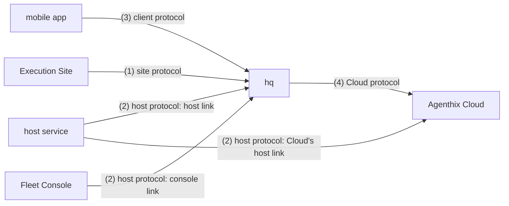

# Versions

Every number the platform carries, what each one promises, and how to move it. Read this before changing anything
another part of the platform receives: a message on a channel, an HTTP route or its answer, a socket event, a stored
format, or a name on a person's machine. The decision behind it is
[ADR-0136](../adr/adr-0136-every-connection-restarts-at-1-0-and-peers-one-major-apart-still-talk.md); how a release
is cut is [ADR-0137](../adr/adr-0137-a-release-is-cut-on-its-own-release-branch.md).

There are two kinds of number, and they never stand in for each other:

- **The product version**, one for the whole repository, which every image, the core package and the release tag
  carry (`0.1.0-alpha.1`).
- **A protocol version** for each connection between parts that are installed and upgraded separately
  (`1.0`). Each moves on its own. A phone from an app store and a self-hosted hq are rarely on the same release, so
  what decides whether two parts can talk is the protocol version, never the release.



Each arrow points from the side that dials to the side that listens. hq's own web pages have no number: hq serves
them, so they always match it.

## The product version

**The product stays below 1.0.0 until general availability.** Every `0.x` release is early access, and `1.0.0` is
general availability. The first public release is `0.1.0`; the cuts before it are `0.1.0-alpha.N`, then
`0.1.0-rc.N` (release candidates). Under `0.x` a breaking change moves the minor (`0.2.0`) and a fix the patch; from
`1.0.0`, a breaking change moves the major, as [Semantic Versioning](https://semver.org) says.

**A published version is never published again**, even when it turns out not to work: someone may already have it,
and two builds under one name cannot be told apart. The fix takes the next number, `0.1.0-alpha.3` after
`0.1.0-alpha.2` and `1.0.2` after `1.0.1`. A patch that may be shaky can go out first as a release candidate
(`1.0.1-rc.1`, `rc.2`, …) and be released as `1.0.1` once it is proved; that is optional. Only a tag whose publishing
failed before it finished is tagged again under the same version (ADR-0137): nothing complete was published.

- **Every `package.json` carries it**, and its lock file with it: the root's and each module's.
  `scripts/check-versions.mjs` fails when any module disagrees with the root, and *Checks* runs it on every change.
  With a version as its argument (`node scripts/check-versions.mjs 0.1.0-alpha.1`), it also checks that the root
  is at that version.
- **It is set only on a release branch**, `release/<version>`, and reaches `main` when that branch merges back
  ([ADR-0137](../adr/adr-0137-a-release-is-cut-on-its-own-release-branch.md)). Between releases `main` carries the
  last release's version, `0.0.0` until the first one. No unit of work changes it.
- **The release workflow checks the tag against it**, rather than putting the tag's version into the build: a tag
  `v0.1.0-alpha.1` on a commit whose modules are not all at `0.1.0-alpha.1` is refused
  (`.github/workflows/publish-images.yml`). So the repository, the images, the core package and the tag always
  agree.
- **The core package**, `@agenthix/core`, is published with the product version. Under `0.x`, removing or changing
  anything it exports is a minor release; from `1.0.0`, a major. `npm run check:package` in `core/` installs the
  packed package into an empty project and loads every entry point with plain Node before it is published.

A build made on a machine rather than by the release workflow reports its version as `dev`.

## The protocols

| # | Connection | Constant in `core/src/` | Stated in | Checked |
|---|---|---|---|---|
| 1 | hq ↔ an Execution Site, its control and content channels | `SITE_PROTOCOL_VERSION`, `protocol/connection.ts` | the header `X-Site-Protocol-Version` when the site dials either channel; the `version` field of every frame | hq, on the upgrade (`hq/src/sites/siteUpgrade.ts`) and on every frame (`hq/src/sites/channel/siteChannelServer.ts`); the site reads hq's version from a 426 (`site/src/server/hq/hqAnswers.ts`) |
| 2 | the Fleet Console and a host service ↔ hq's console and host links; a host service ↔ Agenthix Cloud's host link | `HOST_PROTOCOL_VERSION`, `host/relay.ts` | the header `X-Host-Protocol-Version` when a link is dialled; the `version` field of every frame | hq, on the upgrade (`hq/src/fleet/relay/upgrade.ts`) and on every frame (`hq/src/fleet/relay/frames.ts`); the host service on every frame (`host/src/link/frames.ts`); the Fleet Console reads hq's version from a 426 (`console/src/hq/wsLink.ts`) |
| 3 | the mobile app, and any later app, ↔ hq | `CLIENT_PROTOCOL_VERSION`, `client/protocol.ts` | the header `X-Client-Protocol-Version` on every request; `clientProtocolVersion` in the socket.io handshake's `auth` | hq, on every HTTP request and socket handshake (`hq/src/server/clientProtocol.ts`); hq states its own before sign-in, so the app can apply the rule from its side |
| 4 | hq ↔ Agenthix Cloud | `CLOUD_PROTOCOL_VERSION`, `cloud/version.ts` | the header `X-Cloud-Protocol-Version` on every call, in both directions | Cloud, on every call (`checkHqCloudProtocol`); hq, on every answer (`checkCloudAnswerProtocol`, in `hq/src/cloud/cloudClient.ts`) |

Every protocol is at `1.0`, the baseline every later version counts from. A protocol is named after the party hq
or the host service talks to, so each constant is `<PARTY>_PROTOCOL_VERSION` and each header
`X-<Party>-Protocol-Version`; no name carries the product's. hq's one web server receives both the host protocol and
the client protocol, which is why they never share a header.

**Who is calling** goes in the standard `User-Agent` header, as `<party>/<release>`: `mobile/1.2.0` from the mobile
app, `hq/0.1.0-alpha.1` from hq to Cloud. It is logged, and decides nothing: anyone can write it.

**When a peer states no version**, each connection does what its peers need:

| Connection | No version stated |
|---|---|
| Site | Refused, as a version that cannot be read |
| Host | Accepted on the upgrade; every frame still carries its own `version`, and a frame the rule refuses is dropped |
| Client | Accepted: a browser, hq's own pages, or an app from before the client protocol |
| Cloud | Cloud refuses a call from hq without one; hq reads an answer without one as `1.0` |

## The rule every connection follows

A protocol version is `major.minor`.

- **A minor version adds**: a new message, method, operation, event or optional field. Each side ignores what it does
  not know, so a minor version never breaks anyone.
- **A major version breaks**: something removed, renamed or given a new meaning, or a new required field.

**Two sides talk while their majors are at most one apart.** The newer side speaks the older side's major:

| The peer is | The connection |
|---|---|
| On the same major | Works. Each side uses only what the lower of the two minors has |
| One major behind | Works. The newer side speaks the older major, through code kept for it |
| Two or more majors behind | **Refused**, with a message naming both versions and the side that must upgrade |
| Ahead | The peer decides, by the same rule from its side |

Every connection asks this of one function, `checkProtocolCompatibility` in `core/src/protocol/compatibility.ts`,
and never compares versions itself. It answers `ok` with where the peer stands (`same`, `behind`, `ahead`) and what
this side may speak, or a refusal: `too_far_apart` (with the side to upgrade), `absent` or `malformed`.
`protocolRefusalMessage` and `peerRefusalMessage` turn a refusal into the words a person reads.

At `1.0` there is no earlier major, so a peer one major behind cannot exist yet. The code for a previous major is
written at a connection's first major change, kept apart from the current code, with a test that runs it.

### How a refusal looks

**Site and host protocols.** The upgrade is answered `426 Upgrade Required`, with the listening side's own version
in the protocol's header. The dialling side applies the same rule to that version and says which side must upgrade,
rather than reporting a connection it cannot explain. hq also records a refused site as needing an upgrade.

**Client protocol, over HTTP.** `426`, with hq's version in `X-Client-Protocol-Version`, and this body
(`ClientProtocolRefusal`):

```json
{
  "error": "This app speaks protocol 3.0 and HQ speaks 1.0, too far apart to work together: upgrade HQ.",
  "reason": "too_far_apart",
  "hqVersion": "1.0",
  "clientVersion": "3.0",
  "upgrade": "hq"
}
```

`reason` is `too_far_apart` or `malformed` (a version that is not `major.minor`, which always asks the app to
update); `upgrade` is `hq` or `client`.

**Client protocol, on the socket.** The handshake fails, and socket.io's `connect_error` receives an error whose
`message` is `client_protocol_refused` and whose `data` is the same `ClientProtocolRefusal` (`ClientSocketRefusal`).

**Before sign-in**, hq states its release and its client protocol version in `GET /api/org/public-identity`
(`HqVersions`: `release`, `clientProtocolVersion`), which the mobile app already reads at its address step. An app
ahead of hq reads it and applies the rule from its side.

**Cloud protocol.** Cloud answers a call it refuses with `426`, its own version in `X-Cloud-Protocol-Version`, and
`{ "error": "unsupported_protocol_version" }` (`CloudProtocolRefusal`). A `426`, or an answer two or more majors
apart, stops hq calling Cloud: hq records why, naming the side that must upgrade, and asks nothing more of Cloud
until that can have changed.

## The lifecycle of a piece of a protocol

| Stage | Example: deprecated in 1.4 | What it means | In the code |
|---|---|---|---|
| **Current** | 1.0–1.3 | Part of the current major | Normal |
| **Deprecated** | 1.4 to the last 1.x | Still works for everyone, but scheduled to leave | Marked `@deprecated` (below). Editors strike it through wherever it is used |
| **Previous major** | 2.x | Gone from the current major; still spoken to peers on 1.x | Moved into the connection's code for the previous major, apart from the current code |
| **Retired** | 3.0 on | Two majors back: **stops working** | Deleted. A peer still on 1.x is refused |

So a deprecated thing keeps working for the rest of its own major, and through the whole of the next one for peers
still on it. It fails at the second major after the one it was deprecated in. **Nothing is removed from the current
major unless it was deprecated for at least one minor first**, so a peer has had a release in which to stop using
it.

### The deprecation mark

Every mark says three things: the version it was deprecated in, the version from which it **stops working** (two
majors on, `.0`), and what to use instead. Exactly this form, so the snapshot test can read it:

```ts
/** @deprecated since 1.4; stops working in 3.0. Use `runPage` instead. */
```

Where nothing replaces it: `/** @deprecated since 1.4; stops working in 3.0. Nothing replaces it. */`

The "since" version is the version the mark ships in: deprecating something is itself a change, so the minor moves
with it.

### Writing rules, so most changes are minor

- A new field is optional, or has a default the older side would assume.
- An unknown field, value or message is ignored, never refused, so a closed set of values always has a way to say
  "something this side does not know".
- A field is never renamed and never given a new meaning: a new one is added and the old one deprecated.
- A value is never sent to a peer that has not stated a minor version that understands it. Gate on the version
  `checkProtocolCompatibility` says this side may speak, never on this side's own.

## The shape snapshot

`core/snapshot/` holds one committed file per connection, `site.json`, `host.json`, `client.json` and `cloud.json`:
every type the connection declares in core, with its fields, their types, whether each is optional, and its
deprecation marks, and the version the shapes were recorded at. Which declarations make up each connection is
`core/src/__tests__/protocolSnapshot/connections.ts`: the site's, host's and Cloud's are what their entry module
exports, the site's method maps included; the client's is the mobile app's own list, `core/src/client/mobileApp.ts`
(each HTTP route, operation, socket room and event the mobile app relies on), with the version handshake beside it.

`core/src/__tests__/protocolSnapshot.test.ts` compares what the code declares with the committed file, and fails
when the version does not match what changed:

| The difference | The test requires |
|---|---|
| Only additions of optional things: a new type, field, message or value of a closed set | The minor moved |
| A removal, a changed type, a renamed field, or a new required field | The major moved |
| A type renamed with its shape unchanged | Nothing: a type's name never crosses the connection |
| A removal of something that carried no mark in the committed snapshot | Refused: deprecate it first |
| A new or changed deprecation mark | The mark is in the form above, names the version it ships in, and stops working two majors on |
| The major passes a deprecated thing's "since" major | It has left the current major's code, kept only for peers one major behind |
| The major reaches a deprecated thing's "stops working" version | It is gone, and its peers are refused |

The snapshot holds only what core declares, so every message a connection carries is declared there: the site's
channel methods each with their parameters and result, every operation the mobile app uses with an argument and
result built field by field rather than a database row, and no field left `unknown` except one that carries
arbitrary JSON by design, typed as JSON. A test fails while a mobile app operation's shape is undeclared.

### Changing a connection's shape

1. Change the declaration in `core/src/`, following the writing rules above.
2. Run core's tests (`npm test` in `core/`). The snapshot test says what changed and what the version must become.
3. Move the protocol's constant to that version: the minor for an addition, the major for a break.
4. Run `npm run snapshot:update` in `core/`. It records the new shape, and refuses while a rule is still broken.
5. Commit the declaration, the version and the snapshot together.

The cross-app suite (`tests/cross-app/`) runs hq and a site against each other, and hq's stand-in for Cloud
(`hq/src/cloud/__tests__/cloudStandIn.ts`) checks the Cloud protocol's version on every call. The committed snapshot
is also what a part built outside this repository, such as the mobile app, can test itself against.

## Stored data

What one release writes, a later one reads: the databases, sealed backups and agent packages.

- **The databases.** Each app has one initial migration, generated from its schema
  (`hq/migrations/`, `site/migrations/`). **Until the first release candidate, `0.1.0-rc.1`, nothing is carried
  forward**: old data is wiped, never converted, and the initial migration may be regenerated once more before it.
  From `0.1.0-rc.1` every schema change is a new migration that carries a release's data forward. The
  `database-migrations` skill (`.agents/skills/`) has the commands.
- **Formats carry a whole number, starting at 1**: the agent package's contents (`PACKAGE_FORMAT_VERSION`,
  `core/src/protocol/packages.ts`) and its manifest (`PACKAGE_FORMAT`, `hq/src/library/packages/packageManifest.ts`),
  a sealed backup's header (`format`, `host/src/backups/seal.ts`) and the host service's envelopes
  (`HOST_ENVELOPE_VERSION`, `core/src/host/envelope.ts`). Today each reader accepts exactly its own number and
  refuses any other. Two more numbers count content rather than a format: the board and workforce templates hq seeds
  (`hq/src/library/systemTemplates.ts`), which hq seeds again when the number differs from what its database holds,
  and the voice settings (`hq/src/conversations/voiceClient/settings.ts`), whose number a voice event log records;
  a log recorded under another number is shown with it, and nothing from it is applied.
- **A later version reads what an earlier one wrote.** When a format changes in a way an older reader could not read,
  its number moves, and the newer reader reads one number back, as a protocol is spoken one major back.
- **A backup records the release it was taken from**, and a restore refuses one taken by a newer release than it
  runs.

## Names on a machine

Every container, volume, network and database an install creates is named `<namespace>-<part>[-<what>]` from the
namespace the host service records at its first start (`agenthix` for a new install), and labels are
`<namespace>.<key>`. The namespace is recorded once, when the host service first starts, and never changes for that install, so renaming the
product would leave an existing install's names as they are. Each part that lives a life of its own is its own
group in Docker, so acting on one never removes another. The full list of names, the groups, and the address ranges
an install's networks take (`10.214.0.0/16` for its own, `10.213.0.0/16` for the agents') are in
[deployment.md](deployment.md#installing).

No product name goes into anything stored or exchanged: headers, fields, the `User-Agent` parties, the variables one
part passes another, and the settings a person writes in `host.env` use neutral words (site, host, client, Cloud,
hq). Where the product's name appears on a machine, it comes from the recorded namespace.

## Where the rule is enforced

| Where | What it holds |
|---|---|
| [ADR-0136](../adr/adr-0136-every-connection-restarts-at-1-0-and-peers-one-major-apart-still-talk.md) | The decision, and the options it was chosen over |
| This document | The rule as it stands, and how to move a version. Edited as the rule changes |
| `core/src/protocol/compatibility.ts` | The one compatibility function every connection asks |
| `core/snapshot/` and its test | Version moves, deprecation marks, and removals at the right major |
| `scripts/check-versions.mjs` | One product version across every module |
| [ADR-0137](../adr/adr-0137-a-release-is-cut-on-its-own-release-branch.md) and `AGENTS.md`, *Git* | Where the product version is set: on a release branch |
