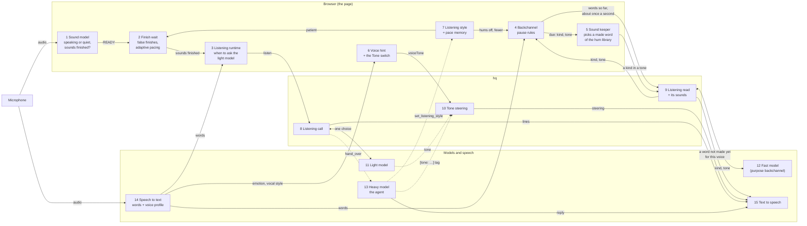
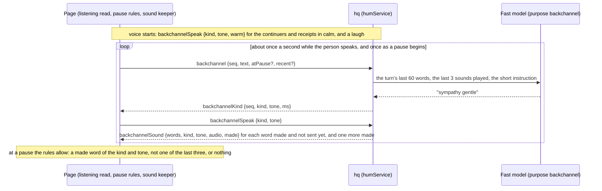

# Adaptive voice listening

How voice works with the flag `voiceListener` on ([feature flags](feature-flags.md); stage *experimental*) and the
person's Adaptive voice on, which it is unless they turned it off. [conversation-layer.md](conversation-layer.md#voice)
has the rest of voice: the holder, the speech services, what a voice client must do. This page is the living reference
for what adaptive voice does today, written from the code; the decisions are
[ADR-0195](../adr/adr-0195-a-light-model-listens-while-the-person-speaks-and-gates-the-conversation-model.md),
[ADR-0196](../adr/adr-0196-adaptive-voice-switches-the-light-model.md) and
[ADR-0179](../adr/adr-0179-a-reading-of-the-words-may-extend-a-turn-but-never-end-one-early.md).

## The shape

Adaptive voice is three services, an optional layer and the foundation they stand on. Each has one job and its own
switch, and turning one off never breaks the ones below it.

| Part | What it is | Its model | Where it is described |
|---|---|---|---|
| **Reasoning** | Writes the answer: the agent itself, called once a turn, and the recap | The heavy model, the conversation's own | [The heavy model and the recap](#the-heavy-model-and-the-recap) |
| **Responsive** | Decides who speaks when, and says something within a second: keep listening, a short line, close the turn, or hand over to Reasoning | The light model | [The light model](#the-light-model), [When a turn ends](#when-a-turn-ends) |
| **Backchannel** | The small sounds of listening while the person talks, of a kind and tone a fast read picks, the words from a library made on demand | The fast model, through the hum service | [The backchannel](#the-backchannel) |
| **Tone** (optional) | Each layer picks the tone it speaks in; calm is no steering; one switch | None of its own | [Tone](#tone) |
| **Foundation** | Hearing (speech to text), the sound model, the floor (who holds it), speaking (text to speech, playback, talking over a reply) | | [The pieces](#the-pieces), [Talking over a reply](#talking-over-a-reply) |

With Responsive off (Adaptive voice off, or no light model reached) the sound model ends the turn and Reasoning answers
every turn. In the product Backchannel and Tone also stop with Adaptive voice off; in the voice playground Backchannel
can run on the sound model alone.

## The pieces

The numbered pieces below are the parts in the diagram. In the text the light model is Responsive, the heavy model
is Reasoning, and the listening read is the fast model's answer to the hum service.

1. **The sound model** (browser, every 32 ms) says whether the person is speaking or quiet, and whether they *sound*
   finished (`READY`).
2. **The finish wait** (`orchestration/scheduler.ts`) is how much quiet a `READY` needs before it counts: stretched by
   false finishes, learned from the person's breaths, lengthened by `patient`.
3. **The listening runtime** (`voiceClient/listener/`) decides only *when* the light model is asked, and drops a line
   that would come too late.
4. **The backchannel** (`voiceClient/backchannel/`) says when a breath gets a sound, by rule.
5. **The sound keeper** (`backchannel/keeper.ts`) asks hq for the hum library's words of each read's kind and tone,
   and at a breath plays one of them made in that tone, never one of the last three played; or nothing.
6. **The voice hint and the Tone switch** (`voiceClient/tone/`): how the person sounds, from the voice profile, and
   whether Tone is on, told to hq as `voiceTone`.
7. **The listening style and pace memory** (`voiceClient/pacing/`) hold what the person asked for and their pace, per
   conversation, in the page's memory only.
8. **The listening call** (`conversations/voice/listening/`) is one small call to the light model.
9. **The hum service** (`conversations/voice/humService/`) asks a fast model which kind and tone of hum fits the words
   so far, and makes each word of the hum library once per agent voice, kept on hq's disk (`store.ts`).
10. **Tone steering** (`conversations/voice/toneSteering.ts`) speaks the light model's lines with some of the tone each
    line names, and the reply with a little of the tone its `[tone: …]` tag names; calm with Tone off.
11. **The light model** reads the person as a listener would and answers with exactly one choice.
12. **The fast model** answers the hum service with two words: a kind and a tone.
13. **The heavy model** is the agent: called only on `hand_over` or the fallback.
14. **Speech to text**: Inworld, asked for the voice profile too and told the person speaks English (`tone.speechLanguage`, `en`; `any` lets it detect the language, for later), or AssemblyAI (no profile).
15. **Text to speech** in the agent's voice, through hq.

| | Sound model | Light model | Hum service | Heavy model |
|---|---|---|---|---|
| Hears | Sound | Meaning | The turn's last 60 words | The whole conversation |
| Runs | Every 32 ms, in the browser | When they sound finished, in a quiet after a "not yet", while the agent works | About once a second while they speak, and as each pause begins | Once a turn, on `hand_over` |
| Decides | Speaking, quiet, sounds finished | Whether they have finished, what to say, whether it needs thinking | Which kind of hum, in which tone | The answer |
| Never | Reads words | Answers a question of substance, gives facts, advice or opinions, promises (but how it listens), acts | Says anything heard | Judges whether the person has finished |

## Feature map

Status: **settled** means its behaviour and first values were measured or held through playtests; **experimental**
means first values from one or two playtests, to be tuned by playing in the voice playground. Every listed number is a
first value and a Tuning control in the playground unless marked *code*.

| Feature | What it does | Where | Settings (default) | In the playground Log | Status |
|---|---|---|---|---|---|
| Light model and its five actions | Answers each listening call with one choice: `keep_listening`, `acknowledge`, `close_turn`, `hand_over` or `invite` | `voice/listener/` (instructions version 18) | `LISTENER_SETTINGS.format` json; `withAnswer` on | LIGHT row per call, tagged with the action, then its `line` | settled |
| Listening style (`style`) | The person asks to be listened to differently; the light model hands it over and the reply sets it with `set_listening_style` | `lead/listeningStyle.ts`, `coordinator/listeningStyle.ts`, `voice/listening/styleTool.ts`, `voiceClient/listener/trigger.ts`, `voiceClient/pacing/style.ts` | `pacing.patientExtraMs` 1.0 s, `pacing.fewerTimes` ×2 | PACE `style` row, set by the reply | experimental |
| Check schedule and limit | hq decides when the light model is asked again; a turn kept open is bounded | `voice/listening/schedule.ts`, `limit.ts` | `schedule` quiet 5, 15, 30 s; working 4 s then every 8 s; `notYetMaxSilenceMs` 60 s | LIGHT checks; SYSTEM `close` at the limit | settled |
| Answer caps and time limits | Words over a cap drop the line whole; a late answer falls back | `voice/listener/settings.ts` | `caps` acknowledge 6, invite 6, close_turn 6, hold 12, answer 15 (cut, never spoken); `soundsFinishedTimeoutMs` 2 s; `callTimeoutMs` 2 s; browser `noAnswerMs` 15 s | LIGHT `no answer`; SYSTEM `hand_over` (fallback) | settled |
| Fallback hold phrases | A stored hold when no usable answer comes in time | `voice/phrases.ts` | about 40 lines, none of the last 8 again (*code*) | SYSTEM `hand_over` and `line` | settled |
| Stale-line dropping | A line about a pause the person has since spoken after, or due while they speak, is dropped and reported skipped | `voiceClient/listener/trigger.ts`, `adapters/linePlayer.ts` | none | LIGHT `line` marked not played, and why | settled |
| False-finish wait | Each false finish this turn makes `READY` need more quiet | `voiceClient/orchestration/scheduler.ts`, `listener/settings.ts` | `finishWaitMs` 0.5 s, `finishWaitStepMs` 0.5 s, `finishWaitMostMs` 2.0 s, `falseFinishMs` 1.0 s | SOUND row says each false finish and the wait in force | experimental |
| Adaptive pacing | Learns the person's breaths per conversation and sets the finish wait and the latest hum start | `voiceClient/pacing/` | `pacing` on; learns after 5, keeps 12; finish 90 % + 0.2 s within 0.5–2.5 s; hums 80 % within 0.8–2.0 s | PACE `pace` row at a turn's end | experimental |
| Backchannel pause rules | When a hum may play: in a short pause, or as a "not yet" keeps the turn open | `voiceClient/backchannel/trigger.ts`, `settings.ts` | `on`; `pauseMs` 0.4 s; `latestPauseMs` 1.2 s; `gainDb` −6 dB | BACKCHANNEL `hum`, or `no hum` (near miss) with the rule that held it | experimental |
| Plain hum spacing | Speech the person must have said since the agent's last sound | `backchannel/settings.ts` | `speechMs` 6 s | `no hum`: "only N s of speech…" | experimental |
| Reaction hums | Sympathy, news, delight and amusement come sooner, are held over plainer answers, are used at one breath only, and never come twice in a row | `backchannel/reaction.ts` | `reactionSpeechMs` 3 s; `reactionGapSpeechMs` 8 s; `reactionHoldMs` 4 s | `hum` says "enough for a reaction" or "held over a plainer answer"; `no hum` says "a reaction played …" or "… was for an earlier breath" | experimental |
| Listening read (hum service) | Picks each sound's kind and tone, never its words, from the turn's words and the last three sounds played | `backchannel/service.ts`, `backchannel/kinds.ts`, `voice/humService/` (instructions version 8), `routing/listener.ts` | `serviceOn`; `serviceIntervalMs` 1 s; stale after 2 s (*code*); last 60 words, last 3 sounds (*code*) | BACKCHANNEL `service`: one folded line a card | experimental |
| Hum library and sound keeper | About ten words a kind, each kind in the tones it takes; each word in a tone made once per agent voice and kept on hq's disk; the common ones warmed as voice starts; at a breath a made word of the kind and tone, never one of the last three played, or nothing | `backchannel/library.ts`, `keeper.ts`, `sounds.ts`, `voice/humService/store.ts`, `sound.ts` | the list (*code*); steering per tone, changeable for the page in "Hear the sounds" | the hum's word, made new or already made, or why nothing played | experimental |
| Voice profile and voice hint | Inworld's speech to text reports an emotion and a vocal style beside the words; their label is offered, in hq's words, to the light model and the listening read | `voiceClient/tone/voiceProfile.ts`, `tone/voiceHint.ts`, `adapters/inworldHearing.ts`, `voice/toneSteering.ts` | with Tone on; `tone.voiceConfidence` 0.6 | VOICE row for each reading that changed; TONE row as the hint changes | experimental |
| Laugh back | A laugh heard lets the next pause laugh back (with Tone on; a read that says amusement laughs either way) | `backchannel/laugh.ts` | `tone.laughConfidence` 0.6 | `hum` marked as a laugh back | experimental |
| Tone | Each layer speaks in the tone it picks: a sound in the listening read's (full), a line in the light model's `tone` (some), the reply in its `[tone: …]` tag's (a little); off, all calm | `lead/toneTag.ts`, `voice/toneSteering.ts`, `adapters/hqBackchannel.ts` (`voiceTone`) | `tone.on` | each LIGHT check and line, and the HEAVY reply, with its tone | experimental |
| Recap | A summary under 100 words, written after each reply, read by the light model | `voice/listener/recap.ts`, `voice/listening/recapCall.ts` | `recapMaxWords` 100 | HEAVY `recap` | settled |
| Voice playground | Tries all of the above: Log, Tuning, Hear the sounds, scripted sets | `voiceClient/playground/`, `voice/playground/` | its own page settings | — | settled (a development page) |

## The light model

### The events

The client protocol (version 1.3, [versioning](versioning.md)) has four events on `CONVERSATION_VOICE_SOCKET`
(`core/src/client/voice.ts`):

| Event | From | What it says |
|---|---|---|
| `listen` | browser | `seq` (rises with every call; a newer one makes older ones stale), the `moment`, the message so far (`text`), `quietMs`, `workingMs` while the reply is worked out, and `keptOpen` on a re-check of a turn kept open |
| `listened` | hq | The answer to `seq`: the `action`, the words to `say` (their audio follows as `line`), `nextCheckSecs`, the optional `style`, and, when a turn ended, `turn` (`closed`, `handedOver` or `fallback`). `off` says no light model listens here |
| `line` | hq | A line to play, 24 kHz PCM16 in parts: the light model's words, or a stored phrase (`stored`) |
| `linePlayed` | browser | A line played to its end, or `skipped`: dropped, never heard |

The moments are `soundsFinished`, `quiet` and `working`; hq also asks `limit` itself. Deprecated since 1.1 and still
answered: the moment `quietAfterWords`, the action `hum`, `turnHeld` and the `trailedOff` flag.

Voice events only hq's own pages send, on `CONVERSATION_VOICE_PAGE_SOCKET` and so carrying no protocol version:
`backchannel` (a question to the listening read, `atPause` on the one asked as a pause begins, `recent` the last three
sounds played), `backchannelKind` (its answer: kind and tone), `backchannelSpeak` (the sound keeper asks for the hum
library's sounds of a kind in a tone, `warm` as voice starts), `backchannelSound` (a sound of the library: its words,
kind, tone, audio and `made`, new or already made for the voice; or `failed`) and `voiceTone` (the Tone switch and
the voice hint's label; until a page sends it, hq takes Tone as off).

### When it is asked

The browser decides only when; the light model decides what.

- **Never while they talk.** A pause in their words asks nothing; the sound of listening is the backchannel's.
- **They sound finished**: a `READY` that has waited out the finish wait (below), once speech to text has caught up,
  sends a `soundsFinished` call with the message. Only this call, and a `keptOpen` re-check, may end the turn.
- **In the quiet, and while the heavy model works**, on hq's schedule (`LISTENER_SETTINGS.schedule`): a turn kept open
  at 5, 15 and 30 s of quiet, then at the 60 s limit; after a hand over at 4 s of waiting, then every 8 s until the
  reply's first sentence. hq sends the wait as `nextCheckSecs`, counted from the quiet when it answers; the browser
  waits from the answer's arrival (held within 1–30 s). The 30 s check tells the light model it is the last.
- **Not while the reply plays**, and a pending check is cancelled when they speak again. In a turn kept open, their next
  quiet is checked again at the quiet hq's first check came at, carrying their new words, and hq starts the 60 s bound
  again from that quiet.

### What it reads

The message so far, what just happened, the recap (`Conversation.voiceRecap`), the last 6 messages word for word, its
own last 5 spoken lines across turns, and what it did this turn (`listening/reads.ts`, `listener/messages.ts`). Nothing
of the agent's instructions, tools, tasks or knowledge.

### What it answers

One JSON object, `{"action": …, "say": …}` (the parser also reads `tool` and `words`, and ignores `next_check`):

| Choice | When | What happens | Cap (words) |
|---|---|---|---|
| `keep_listening` | Still talking or thinking; the default | Nothing plays | — |
| `acknowledge` | A short reply to something they told it; never a bare sound | Plays at once, even over their voice, 6 dB under a reply; also a further hold line while the agent works | 6 |
| `close_turn` | Finished, and the reply needs nothing known, decided or done | Plays; the turn is over; no heavy model call | 6 |
| `hand_over` | Finished, and it needs thinking | The `hold` plays; the message goes to the heavy model | 12 |
| `invite` | A silence that calls for it | Plays at once | 6 |

`hand_over` also carries `asked` and `answer` (the answer it would give, at most 15 words, cut rather than dropped):
hq discards `answer` as it arrives; only the playground and the tests see it. A call that breaks a rule (two choices,
text beside one, an unknown choice, `close_turn` or `hand_over` outside a `soundsFinished` call or `keptOpen` re-check,
a line over its cap, no words) is read as `keep_listening`.

**A line's tone.** `acknowledge`, `invite`, `close_turn` and `hand_over` carry an optional `tone`, one of the six; absent
or anything else is calm. hq speaks the line with some of it (`LINE_STEERING`), calm with Tone off. With Tone on the call
also says how the person sounds, from their voice ("sounds sad"), to weigh with the words.

**The listening style.** When the person asks to be listened to differently, the light model hands it over (a `style`
it still sends is ignored), and the reply calls `set_listening_style` with `hums_off`, `hums_fewer`, `patient`, or
`normal` to undo them (`VOICE_LISTEN_STYLES`). The tool is offered with the flag on every turn offered tools, and acts
only for the person who holds voice. hq sends `listened` with only the style and the latest call's `seq`; the page reads
it as `listen.styleAsked`, which decides nothing about the turn, whatever call is the latest. The browser holds it for
the conversation (`pacing/style.ts`): styles combine, `hums_off` and `hums_fewer` replace each other, `normal` clears
all.

- `hums_off`: no hum at all (each pause a near miss, "you asked for no hums").
- `hums_fewer`: both hum spacings times `fewerTimes` (×2).
- `patient`: `patientExtraMs` (1.0 s) more quiet before `READY` counts, in every turn, under the pause cap; and an
  `acknowledge` or `invite` in their turn, or a hand over's hold, is dropped (`listen.drop`, "you asked to be let
  finish", reported skipped). The hand over still happens; a closing line and lines while the reply is worked out play.
- The reply says that it will, in its own words; in hq a tool round's next step says it.

### Which model

hq resolves the purpose `listener` with its own branch, never the agent's model or a person's own subscription:
Inworld first when the organisation has it, then each provider, from `LISTENER_MODELS` in `routing/listener.ts`, within
the organisation's lists. With none reached voice runs as Adaptive voice off and `listened` says `off`. Costs go in the
usage ledger under `listener`, the recap's with them. One call is in flight at a time; a newer one aborts the older.
An answer to a call that is no longer the latest decides nothing; only its `acknowledge` may still play.

## How its words are played

- hq makes each answer's words into speech on its own path (`listening/lines.ts`), in the agent's ordinary voice,
  with some of the tone the light model gave it, and streams it as `line` parts, so it starts while the rest is made.
  The line player (`voiceClient/adapters/linePlayer.ts`) plays one at a time, when both answer and audio are here.
- **Nothing the light model says is interrupted** once it starts. The echo filter knows each line's words.
- **Stale lines are dropped** (`listener/trigger.ts`). The runtime notes the latest call asked each time the person's
  voice begins, by the order the events came. An answer that comes after they spoke since its call, or while they
  speak, drops its line ("you spoke again"); the line player drops one that comes due while they speak or a reply plays
  ("you were speaking"). The decision stands. The browser sends `linePlayed` `skipped`, so the line is not stored.
- **The reply waits** for a playing line or hum to end. Speaking over the reply is as before: it ducks, then stops on a
  stop word or enough words; "mm-hm" does not stop it. **One decision plays its line once**, however often it arrives.
- The lines do not reset the 2-minute end of a silent voice session.

## When a turn ends

The sound model says when the person sounds finished (0.2 s into a silence the turn model scores the last 8 s; sure at
0.5 s, at the latest the 3 s pause cap). `READY` then waits for the finish wait, if one applies; then the
`soundsFinished` call decides:

| Answer | What happens |
|---|---|
| `close_turn` | Its words play; the turn is over; the heavy model is not called |
| `hand_over` | The hold plays; the message goes to the heavy model |
| `keep_listening`, `acknowledge`, `invite` | Not yet: the turn stays open and is checked on hq's schedule |
| No usable answer in 2 s | The fallback: the message goes to the heavy model and a stored hold phrase plays |

- **"Not yet" is bounded** at 60 s of quiet. At the limit, after an invitation nobody answered, hq asks the light model
  once more (`limit`, whose only choice is `close_turn`; a stored closing line if it fails) and records a closed turn.
  Otherwise the message goes to the heavy model as on the fallback. hq enforces the limit both on a `keptOpen` re-check
  and with its own timer, and tells the browser when the timer ends the turn.
- **Stored hold phrases are only the fallback**: about 40 generic lines in the agent's voice (`voice/phrases.ts`), made
  as voice starts and kept on disk, none of the last 8 repeated.
- **The person goes on after a hand over**, before any reply is heard: their words join the message and it is answered
  again (`voice/continue.ts`).
- **A raised hand** keeps its own path: an invited agent's "go ahead" is handled before the light model.
- **No answer at all** to a `soundsFinished` call for 15 s: the words go as a plain message and the session is plain.

### The finish wait

All in `orchestration/scheduler.ts` with `pacing/pace.ts` `finishWaitNow`, light model only.

- **False finishes.** The person speaking again within `falseFinishMs` (1 s) of a send is a false finish
  (`orchestration.falseFinish`). Each one this turn adds `finishWaitStepMs` (0.5 s) to the quiet `READY` needs, from
  `finishWaitMs` (0.5 s) to `finishWaitMostMs` (2.0 s), never past the pause cap. The count starts afresh once a reply
  is heard or the turn is closed.
- **Adaptive pacing** (`pacing/component.ts`). A *breath* is a pause after which the person went on talking, with no
  sound of the agent's in it but a hum, no longer than the pause cap (a false finish counts). From the most recent 12,
  once there are 5, it sets the finish wait to just past 9 in 10 of them plus 0.2 s (within 0.5–2.5 s) and the latest
  a hum may start to 8 in 10 of them (within 0.8–2.0 s), told to the scheduler and the backchannel as
  `orchestration.pace`. Once learned, `READY` waits for that quiet in every turn, and false finishes step up from it,
  to the larger of 2.0 s and 2.5 s. Off (its Tuning switch), the fixed values hold.
- **`patient`** adds 1.0 s on top of whichever wait is in force.
- A `READY` before that much quiet waits on the clock (`orchestration.finishHeld`; the backchannel may hum meanwhile);
  the person going on cancels it. `orchestration.ready` carries `waitedMs`, `paced` and `patient` for the Log.
- **Memory only.** The pace and the style are held per conversation in a map in the page's memory
  (`pacing/memory.ts`), so voice starting again in the same conversation carries on (`orchestration.paceRestore`);
  nothing is stored, sent to hq, or kept per person. A reload starts afresh.

### Talking over a reply

Barge-in (`orchestration/bargeIn.ts`) ducks the reply the moment the person's voice is heard over it and opens a
confirmation window (`confirmWindowMs`, 1.5 s) for their words, which arrive about a second late. A stop word or enough
words of their own stop it; an acknowledgement alone resumes it. A window that closes in silence with no words yet
resumes it only after a short sound (a cough, a short "mm"): once the person's voice in the window adds up to more than
`wordsVoiceMs` (0.5 s), it waits for the words up to `wordsWaitMs` (1.5 s) more, then resumes. Both are in Tuning.

A `READY` the sound model gives while the reply is ducked is kept by the scheduler, not dropped: once the reply has
stopped and the words that stopped it are shown, it counts as if it came then, through the finish wait above, so the turn
goes the learned wait after the person stopped. Their voice again, or the reply resuming, forgets it.

## The backchannel

The small sounds of listening ("Mm-hm.", "Oh no.") while the person talks, in the browser, outside the turn. Three
parts meet only when the person pauses: **the listening read** (hq's hum service, asking the fast model) says what kind
of sound, in what tone; **the pause rules** say when a sound is due; **the sound keeper** picks the word from the hum
library and has it ready. Every number is in `VOICE_SETTINGS.backchannel`.

### The hum service

- **When asked** (`backchannel/service.ts`): while their voice is on and the words on screen have grown, every
  `serviceIntervalMs` (1 s), and once more as each pause begins (`atPause`, on the words shown then). It asks about the
  whole turn so far (in a turn kept open, the words already sent and the new ones). One question at a time: a second is
  skipped and counted while one is in flight, a pause's question is not asked while one is, and an answer more than
  2 s after its question is dropped. Never later in a silence, over the agent, or with Adaptive voice, the light model,
  the backchannel or its own switch off.
- **In hq** (`voice/humService/`): the purpose `backchannel`, its own branch and short list (`BACKCHANNEL_MODELS`,
  DeepSeek Flash first), costed under it; one call per voice session at a time, a 2 s limit, at most 30 output tokens.
  The instruction (version 8) lists each kind with the tones it takes, reads the words as a live speech-to-text
  transcript, with unreliable punctuation; it says `none` only for a plainly cut-off ending or a question to the agent;
  most of the time `continuer calm`. A pause's call has "They have just paused." after the words, a call made with
  Tone on and a voice hint has "From their voice, they are:" and the hint in hq's words, and every call with sounds
  played "Your recent sounds:" and the words of the last three, to weigh. The answer is one line, `kind tone`, or
  `none`; the parser (`parse.ts`) ignores anything after the tone, so no word the model says is ever spoken, and takes
  the kind's default for a tone it does not take. With Tone off hq answers calm, which every kind but amusement takes.
  An answer that is not the line at all is a failed call. With no model reached it answers `failed: 'off'` and the page
  asks no more.
- **The held answer**: the latest, for the rest of the turn, through a send (a turn kept open is the same turn);
  forgotten with any question in flight when the turn is handed over or closed. A failed or late call leaves the one
  before it standing; with none, or with the read off, a calm continuer stands in. While its first answer is on the
  way, nothing (a near miss). `none` plays nothing and leaves the speech count as it was. A sound plays in the read's own
  tone.
- **Timing classes** (`kinds.ts`): the code maps the nine kinds to three — *listen* (continuer, receipt, agreement,
  thoughtful, realisation), *react* (news, sympathy, delight), *laugh* (amusement); the read keeps nine, since three
  labelled reactions worse.
- **Reaction hums** (`reaction.ts`): the *react* and *laugh* classes answer what just happened. They need only
  `reactionSpeechMs` (3 s) of speech since the agent's last sound, and once answered a reaction stays held for
  `reactionHoldMs` (4 s) or until it comes due: a later plain answer, failure or `none` does not replace it; a later
  reaction does. Except a `none` that came after the pause began, which wins for that pause. A reaction read is used
  at the breath it comes due, played or not, never at a later one; and two reactions never come in a row without a
  *listen* hum, or `reactionGapSpeechMs` (8 s) of speech, between them.

### The pause rules

`backchannel/trigger.ts`. A hum is due:

- **In a pause** of `pauseMs` (0.4 s) to the latest start (`latestPauseMs` 1.2 s, or the learned pace) whose latest sound
  model verdict is `KEEP_LISTENING` or `UNCERTAIN`, or `READY` while the finish wait holds it (`inWait`); or
- **on the next tick after a "not yet" with no line** (`keep_listening`, no line, no turn), whatever the sound model said,
  while they are still quiet. A line dropped because they spoke again is no line, so that "not yet" may hum.

And always: `speechMs` (6 s) of the person's speech, summed, since the agent last made any sound (a reply, a line, a
stored phrase, a hum), or 3 s for a reaction (and 8 s since a reaction that played, for a second in a row), each times
2 under `hums_fewer`; at most one a pause; not when the words
end on a question (`question.ts`); never while the agent holds the floor or any of its audio plays; none once the turn
is handed over (until the reply plays) or closed (until they speak again); none under `hums_off`; only with the flag
and the backchannel's switch on, until hq answers `off`. A pause with no hum says the one rule that held it back
(`backchannel.miss`).

**With the light model off.** In the product the backchannel also needs Adaptive voice on, so Adaptive voice off still
means no listening sounds. The voice playground sets `backchannelAlone`: its backchannel switch alone decides, so it can
be heard with Adaptive voice (there, the light model's switch) off. It then hums on the sound model alone: an `UNCERTAIN`
or `KEEP_LISTENING` pause by the rules above, never `READY` (the turn goes as plain voice), with no "not yet" trigger;
a plain send ends the turn and forgets the hum service's answers about it. The playground's hum service is not tied to
Adaptive voice either.

### The hum library and the sound keeper

The list is `backchannel/library.ts`: about ten words a kind (continuer "Mm-hm.", "Uh-huh.", "Yep."…; sympathy "Oh no.",
"Aw.", "Oof."…), each kind in the tones it can sensibly take (up to four, calm among them, the first its default);
amusement is a laugh only. Never a word of content, an opinion, a question or an invitation. At most 241 sounds an agent
voice (the words times the tones each kind takes), made only as they are needed.

- **Made on demand, kept per voice** (`voice/humService/store.ts`). hq makes a word in a tone the first time it is
  needed for an agent voice, with the tone's full steering (`SOUND_STEERING`, `[soft, sympathetic] Oh no.`; calm none)
  on a speech model that takes a direction, the words alone on any other; a laugh is `[laughing]`, made only where a
  direction is taken. Trimmed of silence, costed like a line, and kept on hq's disk beside the voice previews and the
  stored phrases, named by the speech model and exactly what was sent, for every later conversation in that voice.
- **Warmed as voice starts.** The keeper asks for the continuers and receipts in calm, and a laugh (`warm`): hq sends
  those made for the voice and makes the rest.
- **Asked for as each read comes** (`hum.speak` → `backchannelSpeak {kind, tone}`). hq sends each of the kind's words
  made for the voice that it has not sent this voice session (no speech call), and makes one more, so the set fills. It
  speaks only the library's words, for a kind and a tone the kind takes, never words from the page or a model. A laugh
  heard in the person's voice asks for the laugh too.
- **Play.** When the pause rules say a sound is due (`backchannel.hum`, a kind and tone): a word of that kind on the
  page in that tone, at random, never one of the last three played (a laugh excepted); else nothing
  (`backchannel.unplayed`, why), and the speech it counted toward the spacing counts again. Never a word of another
  kind or tone, never later than its breath, never over the person, never while any of the agent's audio plays.
- The page keeps what hq sent for the voice session only; a new voice session is sent it again from hq's disk.

A sound plays 6 dB under a reply. It starts only while nothing else of the agent's plays; everything else waits for it;
nothing cuts it. It starts, ends and keeps open no turn, is never stored in the conversation or shown, and no model
reads it as something said.

## Tone

One switch, `tone.on` in Tuning, with the light model listening. Each layer picks the tone of its own speech as it
speaks; nothing carries over unless the words do. Off, every layer is spoken calm and nothing about the person's voice is
offered.

- **The voice profile** (`tone/voiceProfile.ts`): with Tone on, Inworld's speech to text is asked for an emotion and a
  vocal style beside the words (top 3, each with a confidence), read as each connection opens. Each reading is
  published as `tone.voice` before its words. AssemblyAI and dictation never ask.
- **The voice hint** (`tone/voiceHint.ts`): a reading's vocal style where hq offers it (laughing, crying, whispering),
  else its emotion (happy, tender, sad, fearful, surprised), at `voiceConfidence` (0.6), as `tone.hint`; calm, neutral,
  anger, disgust and the plain styles give none, so the agent never mirrors anger. A reading taken while the agent's
  audio plays is ignored. The page sends the label and the switch as `voiceTone` (`hqBackchannel.ts`), as the hint
  changes and before a question to either model; hq keeps them on the voice session and puts the label in its own words
  ("sounds sad", "sounds worried") for the light model and the listening read. Until a page says, hq takes Tone as off,
  so the mobile app's voice is calm.
- **The laugh back** (`backchannel/laugh.ts`): with Tone on, the style `laughing` at `laughConfidence` (0.6) or more,
  heard while none of the agent's audio plays, lets the next pause play an amusement hum on the reaction spacing,
  whatever the hum service said, for the longer of the reaction hold and the reaction spacing, or until a hum plays or
  the turn ends. A read that says amusement laughs with Tone off too: the laugh is the backchannel's.
- **What each layer speaks in** (`toneSteering.ts`): a sound in the listening read's tone, its full steering (hq sends
  the read as calm with Tone off); a light model's line in its `tone`, "some" of it (`[warm]`); the reply in the tone of
  its `[tone: …]` tag, "a little" of it (`[a little warm]`). Calm is no direction at all, for sounds too; no steering says
  calm, or a speed word (pace belongs to pacing). Only a model that takes a direction is steered. Words shown and stored are never steered.
- **The reply's tag** (`lead/toneTag.ts`): with Tone on and Adaptive voice on, the voice turn block asks a spoken reply
  to open with `[tone: …]`. The lead's step reader takes it out of the start of each step's text as it streams, split
  across pieces or not, before anything reaches the speech, the chat or the record; a tag naming no tone hq knows is
  taken out and is calm. The reply's tone is its first tag's, read before its first words; no tag is calm.

## The heavy model and the recap

The heavy model is called only on `hand_over` or the fallback, with its instructions, the whole conversation and the
person's words only. With the flag on, its voice instructions say only how to speak: no opening line, no judging the
end of a turn, no `keep_listening` tool (`coordinator/voiceBlock.ts`).

After a reply completes, one small call to the conversation's own model, with none of the agent's instructions or
tools, writes the recap (under 100 words: where the conversation is, what the person wants, anything left open), from
the previous recap and this turn's two messages, while the reply plays. It is stored on the conversation; an
interrupted or withdrawn reply, or a turn closed alone, writes none; a failed call keeps the last. It is not the
compaction summary (`conversations/long/`), which folds older messages in a separate call.

## What is stored

- **Your message**: the person's words. **The agent message**: the light model's lines they heard, in order, joined to
  the heavy model's reply; a `skipped` line is taken out (`listening/unheard.ts`) unless that leaves nothing.
- **A turn the light model closes alone is a real turn** (`listening/lightTurn.ts`): message attached, lines as its
  agent message, cost in the ledger, screens told.
- **The recap**, on the conversation.
- **Never stored**: `answer`, the light model's readings, the hum service's answers, hums, the pace, the style, the
  voice profile, the voice hint and any tone, the reply's tag included (taken out before it is stored). Logs carry the choice and the timings, never the words of `answer`. What the light
  model and the hum service read goes to their vendor, which may differ from the conversation's own.

## With Adaptive voice off, or the flag off

- **Adaptive voice off, or no light model reached: plain voice.** hq answers every `listen` with `keep_listening` and
  `off`; a message such a call carried is admitted anyway. No light model or hum service call; no backchannel, pacing,
  style, voice profile or tone; the sound model ends the turn; nothing is said until the reply. (In the voice playground
  the backchannel's own switch may still hum, as *The backchannel* says.)
- **Flag off: voice as before the flag.** The timed listening family and the standard acknowledgement play; the heavy
  model opens a slow reply itself and may hold a turn (with `voiceBridge`).

When the flag graduates, the timed listening family, the heavy model's hold and opening line, the trailed-off note and
`turnHeld` are removed; the stored hold phrases stay as the fallback.

## The voice playground

`/dev/voice-playground`, a development page that runs the same modules hq does, so what is tried is what ships.

- **The Log**, one card per turn, nine actors, each with its tags and a filter (*Voice and tone* shows VOICE and TONE):

  | Actor | Tags | What it shows |
  |---|---|---|
  | YOU | `said`, `stopped the reply` | each stretch of the person's words |
  | SOUND | `finished` | the sound model's finish: how sure, after how much quiet, each false finish and the wait in force, what set it |
  | LIGHT | the five actions, `no answer`, `line` | each call and its choice, with its line's tone; its line, or why it was not played |
  | HEAVY | `reply`, `recap` | the reply heard, its model and tokens, its tag's tone; the recap |
  | SYSTEM | `hand_over`, `line`, `close`, `notice`, `error` | the fallback, stored phrases, the limit, notices |
  | BACKCHANNEL | `hum`, `no hum`, `service` | each hum with its words, kept or spoken new, how late it played, and why; near misses folded under a count; the hum service's answers folded into one line |
  | PACE | `pace`, `style` | the pace in force at a turn's end (once a breath is heard or a style is set); each style change the reply set |
  | VOICE | `voice` | each voice profile reading that changed (every reading is in the trace) |
  | TONE | `tone` | the voice hint offered to the light model and the listening read, as it changes |

- **Settings › Tuning**: switches for the hand over's `answer`, the light model's reason (playground only) and the
  lines' direction; groups *When it is asked*, *When the sound model's finish counts*, *Word caps*, *Time limits and the
  turn*, *What it reads*, *Lines*; then *Backchannel* (its switch, the pause rules' sliders, the hum service's switch,
  interval and model picker), *Adaptive pacing* (its switch and every number, `patient`'s and `hums_fewer`'s
  included), *Talking over a reply* (`wordsVoiceMs`, `wordsWaitMs`), and *Tone* (its switch, the voice hint's and the laugh's bars,
  the language).
- **Models**: the light model's picker, under Adaptive voice.
- **In the product's Settings**, under Adaptive voice: *Hums* (`voiceHums`) and *Expressive tone* (`voiceExpressiveTone`),
  each on by default and disabled while Adaptive voice is off. The voice call reads them as voice starts into
  `backchannel.on` and `tone.on`; Tone off speaks every layer calm and asks hq for no tag and no voice hint. The
  playground keeps its own Tuning switches.
- **Hear the sounds**: the sounds kept in the current conversation, each with its kind and tone, played on a press;
  voice ending forgets them. A tone's steering can be changed for the page only: sounds made from then on take it.
- **Scripted sets**: the light model set scores scripted moments; the model checks' hum set
  (`conversations/__modelchecks__/voice/`) scores the hum service's speed, kind and tone.

## Where in the code

| You want | Look in (under `hq/src/`) |
|---|---|
| The light model's instructions, parser, rules and settings | `conversations/voice/listener/` |
| The listening call, schedule, limit, lines, recap, a turn closed alone | `conversations/voice/listening/` |
| Which light model or hum service model | `routing/listener.ts` |
| When to ask, stale lines, the line player | `conversations/voiceClient/listener/`, `adapters/linePlayer.ts` |
| The finish wait and false finishes | `conversations/voiceClient/orchestration/scheduler.ts`, `listener/settings.ts` |
| Adaptive pacing, the listening style, their memory | `conversations/voiceClient/pacing/` |
| The backchannel: rules, listening read, kinds, reactions, laugh, sound keeper | `conversations/voiceClient/backchannel/` |
| The hum service in hq | `conversations/voice/humService/` |
| The voice profile, the voice hint and the Tone switch | `conversations/voiceClient/tone/` |
| The page-only events to hq | `conversations/voiceClient/adapters/hqBackchannel.ts`, `conversations/voice/handlers.ts` |
| Steering lines and the reply; the voice hint's words | `conversations/voice/toneSteering.ts` |
| The reply's tone tag; `set_listening_style` | `conversations/lead/toneTag.ts`, `lead/listeningStyle.ts`, `coordinator/listeningStyle.ts` |
| The events | `core/src/client/voice.ts` |
| The playground | `conversations/voiceClient/playground/`, `conversations/voice/playground/` |
