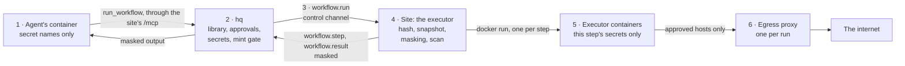
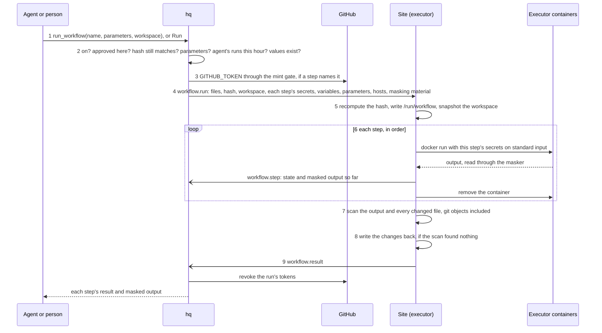
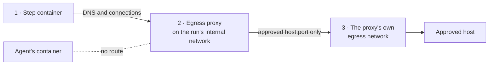

# Workflows and the Executor

How a secret is used without ever entering an agent's container: hq keeps a place's secrets and its library of
**workflows**, a person approves one exact version of a workflow, and the site's **executor** runs that version's steps
in containers of their own, with only the secrets each step names. Git and GitHub go through workflows too, so no
GitHub token reaches an agent ([ADR-0147](../adr/adr-0147-a-secret-is-used-only-by-a-workflow-a-person-approved-run-by-the-platform.md),
[ADR-0148](../adr/adr-0148-an-agent-runs-approved-workflows-and-reads-their-masked-output.md)).

1. **The agent** writes and proposes workflows and runs approved ones with four platform tools; it holds secret names,
   never values.
2. **hq** keeps every workflow, version, approval and run, the place's secrets and variables, and the GitHub App. It
   decides whether a run may start and mints any GitHub token through the mint gate.
3. **The run instruction** crosses the control channel, the only message that carries secret values to a site.
4. **The executor** is code in the site (`site/src/executor/`), not an agent: it has no model and carries out the
   steps exactly as approved.
5. **Executor containers** are started from the executor image, one per step, and removed before the next starts.
6. **The egress proxy** is a step's only way out, when the version names hosts; with none, a step has no network.

The words are defined in [the concept](../concepts/workflows/workflows.md); the design and its reasons are in the
unit's spec, [`docs/work/2026-10-24-workflows/spec.md`](../work/2026-10-24-workflows/spec.md).

---

## Proposing a version

`propose_workflow(path, workspace)` names a `workflow.yaml` in a workspace. hq asks the site that holds it for the
definition and every file it names (`workflow.readFiles`, `site/src/executor/readFiles.ts`, which refuses a symbolic or
hard link), parses it strictly (`core/src/workflows/parse.ts`: an unknown field is refused, not ignored), hashes it with
the executor image's digest, and stores the version (`hq/src/workflows/propose.ts`). The plain checks
(`hq/src/workflows/checks/`, rules with no model) flag risky patterns and alone decide whether the conversation's card
may offer Approve; the reviewer (`review/reviewer.ts`) is one call by hq to the organisation's default model, with no
tools and no values, and only advises. Approval is stored per workflow, place and hash (`approve.ts`), answered through
the conversation's approval card or the workflow's page.

---

## A run, end to end

1. **Asked.** An agent calls `run_workflow`, naming the workspace (an agent's run reaches every workspace of its
   boundary, so it says which), or a person presses Run. A run an agent starts is on behalf of the person its own run
   is for ([ADR-0095](../adr/adr-0095-a-run-is-on-behalf-of-whoever-started-it.md)); viewers cannot start one.
2. **Checked by hq** (`hq/src/workflows/runs.ts`, `runsChecks.ts`): the workflow is on, has a version approved in this
   place whose stored content still hashes as approved, every parameter matches its pattern or list, an agent has not
   reached its runs for the hour (30 by default, `AGENT_WORKFLOW_RUNS_PER_HOUR_DEFAULT`), and every secret and variable
   it names exists. The run is recorded in the same transaction as the count, so two agents cannot both pass the limit.
   For the starter workflows hq also reads GitHub: `push` and `open-pull-request` refuse a protected target branch, and
   `set-github-secrets` sets secrets only on an environment limited to protected branches (`starters/runGuards.ts`).
3. **Minted.** A step that names `GITHUB_TOKEN` gets one made for this run ([the mint gate](#the-mint-gate)).
4. **Sent** to the site that holds the place's storage, as `workflow.run` (`core/src/protocol/workflowRuns.ts`). Secrets
   are decrypted in hq's memory only now (`valuesForRun`, `hq/src/secrets/store.ts`), and each use is recorded.
5. **Checked again by the site** (`site/src/executor/instruction.ts`): it recomputes the version's hash
   (`core/src/workflows/versionHash.ts`) and refuses a mismatch, writes the approved files to the run's own folder
   (`approvedFiles.ts`) and takes the snapshot (`snapshot.ts`). At most four runs go at once on a site; another is
   refused as busy.
6. **Each step** runs in a fresh container (`stepContainer.ts`, `stepRunner.ts`). The first step that fails ends the
   run and the rest are skipped. Stopping a run, or switching its workflow off, stops the step's container and writes
   nothing back.
7. **Scanned** (`masking/scan.ts`): see [masking and the scan](#masking-and-the-changed-file-scan).
8. **Written back** (`writeBack.ts`), as a change set: a path the agent also changed during the run keeps the agent's
   version, and the run's copy is written beside it as `<file>.workflow-<run>` and reported as a conflict.
9. **Reported** as a `workflow.result` event; hq revokes every token minted for the run, and the conversation's card
   for the run moves from the work bar to the thread where it ended.

The site keeps a record of each run (`ExecutorRun`, `ExecutorSnapshot` in `site/schema.prisma`) to answer `workflow.get`
and to clean up after a crash, never the instruction, a secret, a parameter or the masking material. Events can be
lost like any site event; hq recovers a run's state with `workflow.get`.

---

## What a step runs in

### The approved files and the snapshot

The workspace is the agent's, and it can change any file there before and during a run. So nothing a step runs comes
from the live workspace:

- **The approved files** are written from the instruction's bytes to a folder of the run's own, mounted read-only at
  `/run/workflow`. `run: ./deploy/upload.sh` means the version's file.
- **The snapshot** is a copy of the run's workspace taken when the run starts: copy-on-write where the disk allows it
  (a clone on APFS, a reflink on Btrfs or XFS), a byte copy elsewhere. Every step works on it, bound at the agent's own
  path so paths work the same; the agent's container cannot see it.
- **A step that holds a secret sees the snapshot read-only**, and has `/run/out`, the run's scratch folder, to hand
  files on. A step with no secret has the snapshot read-write.
- **Links are never followed** (`safeTree.ts`). Copying, scanning and writing back walk the workspace from open
  directory handles; a symbolic link is copied as a link, and a file with a second name (a hard link) refuses the run.

### An executor container

| Setting | Value |
|---|---|
| Image | `agenthix-executor`, from `site/docker/executor.Dockerfile`, pinned to the digest the version was approved with (`executorImage.ts`) |
| User | uid 1001, as the agent's, so files it writes belong to the agent's user |
| Privileges | `--cap-drop ALL`, `--security-opt no-new-privileges`, `--read-only` root |
| Writable | A `/tmp` tmpfs holding `HOME`, `XDG_CONFIG_HOME` and `GH_CONFIG_DIR`, so no tool reads its config from the workspace |
| Secrets and parameters | A tar archive on the container's standard input, unpacked into two tmpfs folders, `/run/secrets/<NAME>` (this step's secrets only) and `/run/params/<name>`, before the step starts. Never on the machine's disk, a command line or the container's environment |
| Variables | Environment variables, the ones the workflow names; names that change how programs run are refused when a variable is made |
| GitHub | `GITHUB_REPOSITORY` and `GITHUB_REPOSITORY_URL`, set from hq's connection when the workspace has a repository, never from the workspace's `remote.origin.url` |
| Git | Every git a step runs has the workspace's hooks and file-system monitor off (`GIT_CONFIG_PARAMETERS`, `stepContainer.ts`), which outranks every configuration file and a script's own `GIT_CONFIG_COUNT` |
| Docker socket | Never |
| Network | `--network none` without hosts; with hosts, the run's own internal network, whose only other member is its egress proxy, which is also its name server |
| Limits | `WORKFLOW_CONTAINER_LIMITS` (`core/src/protocol/workflowRuns.ts`): 1 GB of memory and no swap, 256 processes, one processor; the step's and the run's time limits |
| Logs | `--log-driver none`: Docker keeps no copy of the output, which is read once, through the masker |

**The executor image** shares its tools stage with the agent image (`agent.Dockerfile`), held identical by a test, so
what an agent can run a step can run. It adds GitHub's `gh` command, pinned by checksum, and `push-bundle`
(`site/docker/executor/push-bundle`); it has no harness, no command launcher and no git credential helper, and its
build fails if any git configuration names one. It is an image part of its own, built, signed and published with the
others ([ADR-0117](../adr/adr-0117-a-host-service-runs-only-signed-published-images.md)); the site's `EXECUTOR_IMAGE`
names it.

**Image upgrades.** The image's digest is part of every version's hash. The site reports its executor image's digest,
release and tools-stage key to hq in its health report (`site/src/server/hq/executorImageReport.ts`); hq keeps an
approval across an upgrade only when the release line and the tools stage are the same, and otherwise marks the new
version *needs approval again*, while the approved one keeps running on its own image (`hq/src/workflows/imageUpgrade.ts`).

### Git with a token

The workspace's `.git` is the agent's, and git config and hooks can name programs. So a step with no secret makes a
`git bundle` from the workspace, and a step with the token reads that bundle as data into a new, empty repository
under `/tmp`, with system and user config off and hooks off, and pushes to the address hq gave (`push-bundle`). The
token reaches git through an askpass program reading `/run/secrets/GITHUB_TOKEN`, so it is on no command line, in no
environment and in no output. `pull` is the same in reverse; `gh` is run with `--repo` from outside the workspace.

---

## The egress proxy

1. A step on a run with hosts is on the run's **internal network**, which has no route anywhere. Its `--dns` is the
   proxy's address, and Docker's resolver forwards its lookups there and nowhere else.
2. **The proxy** (`site/src/executor/egress/`) is one Node process in a container of its own for each run, started
   from the executor image as the same unprivileged, hardened user as the steps, and handed its program on standard
   input. It answers A and AAAA for the approved host names only, with its own address, and `NXDOMAIN` for every
   other name without asking anyone, since a forwarded lookup would carry the name's labels out. A connection to it on
   an approved port is carried on to the approved host it is for, told apart by its TLS server name or HTTP `Host`
   when two share a port; the proxy resolves the name itself and refuses a private, loopback or link-local address
   unless that exact address was approved. It is transparent, so `ssh` and every other tool work without proxy
   settings. It writes nothing a step sent to its output.
3. **The proxy's way out** is a second network of its own. Both are small blocks of the site's agent range,
   `AGENT_NETWORK_RANGE` ([ports.md](ports.md#the-agent-slice)), allocated as agents' networks are, so the host
   service's protections for agents cover them too; they are labelled as workflow networks, so the agents' sweep leaves
   them alone. A port the proxy answers DNS on cannot be an approved host's port.

One proxy per run, rather than one in the site, because a site in development is not a container and cannot join a
Docker network, and a site that joined each run's network would put its own server in reach of the steps.

---

## Masking and the changed-file scan

Before anything leaves the site, every secret value is replaced with `***` (`site/src/executor/masking/`).

- **What is masked:** every secret of the place, not only the run's, and every token minted for the place that hasn't
  expired (`unexpiredMintedValues`, `hq/src/workflows/integrationValues.ts`), so a value one run left behind is still
  masked when a later run prints it.
- **What the site is sent to find them:** for each form of each value — as it is, base64 at its three alignments, hex
  in both cases, URL-encoded, and each line of a file secret — only its length, its HMAC-SHA-256 under a key made for
  the run, and its class; a raw form also carries a short tag of a rolling hash, so the site computes an HMAC only
  where a tag matches. The site never holds more values in plain than the run itself is given. The forms are made in
  one place, `core/src/workflows/maskForms.ts`.
- **Live output** is held back by the length of the longest form, so a value split across chunks is still found.
- **A find** flags the run *printed a secret* and asks the place's administrators to rotate it.

**The scan** runs when the last step ends, over every file the run created or changed in the snapshot and everything in
`/run/out`, by content against the manifest taken at the start, and over the run's new git objects, decompressed
(`gitObjects.ts`). A find fails the run and writes none of its changes back; the person sees which file and which
secret, the agent only that the changes were dropped.

**What comes back.** The agent gets each step's state, time and the last 200 lines of its masked output; a person sees
all of it, live, on the run's page.

---

## The mint gate

Every GitHub installation token hq asks for passes one module (`hq/src/github/mintGate.ts`, and `mintGateConnect.ts`
for a repository being connected, which has no connection to read yet). Nothing else calls GitHub's `access_tokens`
endpoint (`installationTokens.ts`).

1. **The repository comes from the location's own connection**, the site's `RepoAttachment` row found by the place and
   workspace, never from a URL or anything the caller sends.
2. **The connection belongs to the place**, and the place may connect to its GitHub account: the installation is
   allowed and its rule still includes the place, asked at every mint (`connectRule.ts`).
3. **GitHub's ids, never names:** the connection's installation, account and repository ids must all be recorded and
   agree, and the token GitHub returns must reach exactly that one repository, or hq revokes it.
4. **No exception for any agent**, the built-in one included; the gate does not know about agents.
5. **Fresh and narrow:** never cached, with exactly the permissions asked for and `repository_ids` for one repository.
6. **Permissions always named.** GitHub gives a token asked for with none every permission the App holds, so a request
   with an empty or unknown set is refused, never defaulted.

A workflow's token is minted with the GitHub permissions its approved version declares, kept encrypted in
`WorkflowMintedToken` until it expires so masking can find it, and revoked when the run ends, fails or is stopped. hq's
own GitHub work — connecting a repository, reading a branch's protection or the App's facts — mints through the same
gate with the permissions that work needs. The App, its accounts and which places can connect are in
[the git concept](../concepts/git/git-access.md).

---

## A run aimed at a live preview

[ADR-0171](../adr/adr-0171-secrets-reach-a-live-preview-only-through-an-approved-workflow.md). A place's workflows named
`start-live-preview` and `reload-live-preview`, once approved and switched on, can be run by a Member or Admin from a live
preview's strip (`runLivePreviewWorkflow`, `hq/src/livePreviews/workflowSecrets.ts`). They are the person's: an agent's `run_workflow` of either is
refused (`hq/src/workflows/runs.ts`), and its way to start or reload the app is the app tools. hq runs it as any person's run
(`hq/src/workflows/livePreviewRuns.ts`) but names the live preview in the instruction
(`WorkflowRunInstruction.livePreview`, `core/src/protocol/workflowRuns.ts`) and sends it to the live preview's site.

- **The steps run as any run's do**, in executor containers, on the live preview's copy of the branch; the snapshot, scan and
  write-back are unchanged. A run is taken only while the site's own record has that live preview running, on the
  instruction's owner and workspace (`live_preview_unavailable` otherwise).
- **The secrets go to the app's container, once, after the steps passed**, the scan found nothing and the write-back ended: a
  failed step, a leak, a stop or a live preview that stopped meanwhile hands nothing over. They are the union of the secrets
  the steps name, without values minted for the run (`GITHUB_TOKEN`).
- **How they go in.** A fixed script, run as uid 1001, empties `/run/secrets` (a tmpfs of the container's own, `noexec`) and unpacks
  a tar archive read from standard input into mode 0400 files, `/run/secrets/<NAME>`. No value is on a command line, in an
  environment or on the machine's disk, and the exec is one the guard knows. The agent's container never sees them.
- **Masking.** From the hand-off on, the site masks every line an app prints that it sends on (state events, `list_apps`, the
  `install_packages` report), with the run's masking material, so an app printing its database address does not put it in the
  agent's context. The material lives in a closure registered at the hand-off, never in a module the agent's routes import.
- **Nothing restarts the app.** The hand-off changes files; an app that read its values at start needs `stop_app` and `start_app`.
  A pause that removes the container loses the secrets, and *Reload with secrets* hands them over again.
- **The accepted risk** is that the approved workflow runs the app's code, which the agent keeps changing, so code that sends a
  secret elsewhere can only be caught by a person reading the changes.

## Key files

| What | Where |
|---|---|
| A workflow's definition, hash, parameters, hosts, mask forms, the agent's tools | `core/src/workflows/` |
| The run instruction, events and methods | `core/src/protocol/workflowRuns.ts` |
| The library, proposing, the plain checks, the reviewer, approval, the switch, runs | `hq/src/workflows/` (`checks/`, `review/`, `starters/`) |
| Secrets and variables | `hq/src/secrets/` |
| The GitHub App, accounts, the mint gate, protected branches, environments | `hq/src/github/` |
| The executor: instruction, snapshot, steps, write-back | `site/src/executor/` |
| The egress proxy; masking and the scan | `site/src/executor/egress/`; `site/src/executor/masking/` |
| The executor image and `push-bundle` | `site/docker/executor.Dockerfile`, `site/docker/executor/push-bundle` |

## What must not break

- **No secret value in an agent's container**, by any route: an environment variable, a file, a helper, a tool result
  or an MCP answer.
- **What runs is what was approved:** the site rechecks the hash and runs the approved files, never the workspace's.
- **A step gets only the secrets it names**, in a tmpfs, and its container is gone before the next step starts.
- **Nothing returns to an agent unmasked or unscanned**, output and changed files alike.
- **Every installation token passes the mint gate**, names its permissions and reaches one repository.
- **No component starts a GitHub workflow or sets a GitHub secret except through an approved workflow.**

## Decisions behind this

[ADR-0060](../adr/adr-0060-authority-comes-from-the-boundary.md) ·
[ADR-0095](../adr/adr-0095-a-run-is-on-behalf-of-whoever-started-it.md) ·
[ADR-0102](../adr/adr-0102-viewer-is-a-project-role.md) ·
[ADR-0117](../adr/adr-0117-a-host-service-runs-only-signed-published-images.md) ·
[ADR-0147](../adr/adr-0147-a-secret-is-used-only-by-a-workflow-a-person-approved-run-by-the-platform.md) ·
[ADR-0148](../adr/adr-0148-an-agent-runs-approved-workflows-and-reads-their-masked-output.md)
