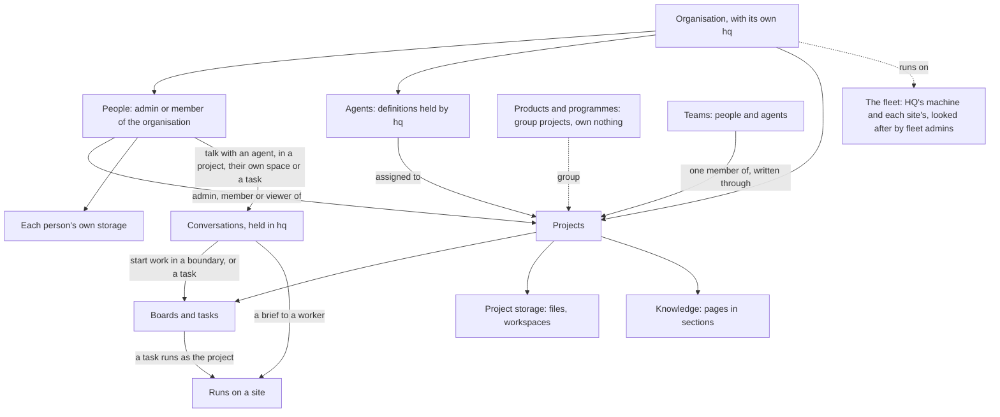

# Concepts

What things are in Agenthix, as a person using it meets them: organisations, people, projects, agents,
tasks, conversations, storage, skills and memory. Each document says what the thing is, how it behaves,
and where in the code it lives.

For **how** the system is built (the two apps, the connection between them, the machines, containers, credentials),
read [the architecture overview](../architecture/README.md) first; it also defines the words used here.

**The ideas that shape everything else:**

- **Only projects and people own things.** Storage and repositories belong to a project or to
  a person; the keys to AI belong to the organisation, held by HQ. An agent owns nothing and carries no authority; a product or programme only groups projects.
- **People are members; agents are assigned.** Membership of a project decides who may start work there.
  Assigning an agent to a project only makes it available there. A team of people and agents joins a project as
  one member, written through to each of them ([teams](projects/teams.md)).
- **An identity has a hero.** An organisation has a name and @handle, a picture and a cover, a vision and a
  mission; a team, an agent and a person each have their own picture and cover too.
- **A run is bounded by its storage and by its person.** A run in a project works within the project; a run
  in a person's own storage works as that person. Either way it may do in hq only what the person it is for
  may do ([ADR-0101](../adr/adr-0101-a-run-is-bounded-by-the-person-it-is-for.md)).
- **A conversation belongs to a home**: a project, using its agents and storage, the person's own space, shown as Your space
  ([places](projects/places.md)), or a task, as the team's thread about it. It is held in hq, where the agent answers at
  once, and longer work is started in the background and reported back
  ([conversations](conversations/conversations.md)). The place's tools sit beside it.
- **A conversation reaches only its own place and the places its person added.** Only the person adds one; the agent
  can only ask. The organisation's knowledge and the platform guide are always in reach
  ([places](projects/places.md#the-places-a-conversation-reaches), [knowledge](knowledge/knowledge.md)).
- **Agents have no schedule of their own.** Work starts on its own only from a boundary's automation, and every
  task is done on behalf of a person.
- **What is built is described as built.** Where a document keeps a design that is not built, it says so
  in a section headed "Not built" or "Design intent, not built".

---

## Words used here

The [architecture overview](../architecture/README.md#words-used-throughout) defines the system's terms.
The ones every concept document leans on:

| Term | Meaning |
|---|---|
| **Storage** | The files a project or a person owns: `files/`, `workspaces/`, `artefacts/`, and for a project `tasks/` and `members/`. Also called a **storage boundary** ([storage and workspaces](workspace/workspace.md)) |
| **Run** | One stretch of an agent's work (the industry's term, as in OpenAI's thread → run → run steps; Claude Code's *query*): from the message, task start or routine that hands the agent work, through everything it does without a person in between, until it hands back. Waiting for approval does not end it ([sessions](agents/sessions.md#a-run)) |
| **Harness** | The vendor's program that actually drives the model: Claude Code or OpenCode |
| **Runner** | Whom a run's container is for: a person, or the project itself for a task in a project. A task in a person's personal project runs as that person |
| **Kernel agent** | `@kernel`, the built-in agent every organisation has; it is waiting on Home when setup finishes |
| **Automation** | A project's (or a person's personal project's) switch, off by default, that lets work start without a person pressing Run: the pulse and the boundary's schedules ([automation](tasks/automation.md)) |
| **Pulse** | The part of automation that starts a boundary's queued tasks, one at a time per agent. hq code, not an agent run |
| **Routine** | A schedule and a task template that keeps its next round ready as a task ([routines](tasks/routines.md)) |
| **Run state** | Whether a run of a task is pending or going now, set by the system; separate from the task's board column ([task](tasks/task.md)) |
| **On behalf of** | The person a task's work is done for. Each run is on behalf of whoever started it, or the task's person when nobody did, and that person answers its approvals |
| **Place** | A project, Your space included. A conversation belongs to one and reaches the places its person added to it ([places](projects/places.md)) |
| **Lead**, **worker** | In a conversation, the lead is the agent as it talks, answering by direct model calls from hq; a worker is the same agent working in one boundary, as a harness session on that boundary's site ([conversations](conversations/conversations.md#the-lead-workers-and-helpers)) |
| **Operation** | One piece of work a conversation commissioned: a brief to a worker, a task, or a call that outlived its turn. The work bar lists the live ones |
| **Memory item** | A short record of what an agent learned, held in hq in one of three scopes and recalled by meaning ([memory](memory/memory.md)) |
| **Knowledge**, **page**, **section** | What a place shares for everyone and every agent working there: pages (Markdown files with front matter) in sections (folders), searched by words and changed through one gate. Four **levels**: the platform guide (`platform:`), the organisation (`org:`), a project, and Your space (`personal:`) ([knowledge](knowledge/knowledge.md)) |
| **Your space** | A person's default personal project. Any other personal project is a place of its own, like any project ([places](projects/places.md)) |
| **Programme** | A group of projects; `Program` in the code |
| **Asset** | A Library item: a skill, or an agent, board or team template. A signed or unsigned package with an identity (`publisher/name`), pinned to one version for the whole organisation ([the Library](library/library.md)) |
| **Skill**, **has** | A folder of instructions an agent follows for one kind of task. An agent *has* a skill, from the Library, a project's files or a person's own space; never "given" ([skills](skills/skills.md)) |
| **Draft**, **publish**, **proposal** | An edit is a draft no agent sees; publishing makes the next version. Agents draft and propose; people publish ([drafts and proposals](skills/drafts-and-proposals.md)) |
| **Library maintainer** | An organisation role, named by administrators, that looks after every Library asset ([the Library](library/library.md#who-may-do-what)) |
| **Workflow** | A named, versioned script in a place's library that a person approves word for word; the only thing that uses a secret ([workflows](workflows/workflows.md)) |
| **Executor** | The site carrying out an approved workflow's steps, each in a container of its own. Not an agent, and has no model |
| **Secret**, **variable** | A place's named values for its workflows: a secret is never shown and goes only to the steps that name it; a variable is a plain setting anyone in the place can read ([secrets and variables](workflows/secrets-and-variables.md)) |
| **Relay** | A fleet member that carries file bytes between browsers and sites and decides nothing. HQ's relay is always there. Not the *model relay* on a site ([the fleet](fleet/fleet.md#relays)) |
| **Ticket** | HQ's signed permission, five minutes long, for one person to preview or download one file ([opening a file](file-sharing/opening-files.md)) |
| **Renderer**, **frame** | A renderer draws one or more kinds of file; the frame is what Agenthix draws around it: title, facts, Download and every state ([opening a file](file-sharing/opening-files.md#what-a-renderer-can-do)) |
| **Reference**, **chip**, **embed** | A path written from a place's root (`files/reports/q3.pdf`, `tasks/MOP-1`) that names a file, folder, task or attachment; the small piece it is drawn as in a message; and a file drawn inside a page ([references, chips and embeds](file-sharing/references-and-chips.md)) |
| **GitHub account** | A GitHub organisation or person's account where the organisation's GitHub App is installed, and which places may connect to it ([git access](git/git-access.md)) |

## Who may do what

Whether someone may work is decided per project ([ADR-0102](../adr/adr-0102-viewer-is-a-project-role.md)): no
organisation role grants or withholds work in a project.

| Role | Where it is set | What it allows |
|---|---|---|
| Organisation `ADMIN` | `UserSettings.role` | What is organisation-wide: people, agents, providers, model choices and billing profiles, Execution Sites, products and programmes, projects, settings, the GitHub App and which places may use each GitHub account, and the platform tools that change the organisation |
| Organisation `MEMBER` (the default) | `UserSettings.role` | Nothing organisation-wide; what they may do in a project is their role there |
| Project `ADMIN` | `ProjectMember.role` | Everything a Member does, and administer that project: its people, agents, permissions, repositories, secrets and variables, and approving its workflows |
| Project `MEMBER` | `ProjectMember.role` | Work in the project: talk to its agents, start, stop and change work, run its approved workflows, comment and approve |
| Project `VIEWER` | `ProjectMember.role` | Read the project — everything a Member reads — and change nothing in it |
| Fleet admin | `User.fleetAdmin` | Sign in to the Fleet Console and look after the machines and sites: adding a site, maintenance, backups, moves. In HQ, see a site's figures, versions and logs. Apart from the organisation roles, and given only by a fleet admin or on HQ's machine ([the fleet](fleet/fleet.md)) |

A team added to a project gives each of its people the team's project role there, unless they have a higher one
of their own or through another team ([teams](projects/teams.md)).

Joining an open project makes you its Member ([ADR-0099](../adr/adr-0099-an-open-project-is-open-to-join.md)); a
project that wants newcomers read-only is private, with people added as Viewers. A run is bounded by the person it
is for ([ADR-0101](../adr/adr-0101-a-run-is-bounded-by-the-person-it-is-for.md)), so nothing changes a project on a
Viewer's behalf. A person's own Chat is theirs to do everything in.

**Where settings live.** Each setting has one owner. **Settings** is only the signed-in person's own — profile,
appearance, conversations (waiting or interrupting, the primary agent), their own Claude subscription and which models
may run for them, memory, their phone and connections, and signing in. **Manage organisation**, the
[admin area](organisation/admin-area.md), is the organisation, for its admins: its people, agents, and the whole of
AI — [providers](providers/providers.md), [models and lists](models/models.md), [billing profiles and usage](billing/billing.md)
— beside GitHub: registering the App, its accounts and which places may use each, the sites new projects can use, automation, run limits, archiving, tool
risk rules, what the sign-in page shows, and Infrastructure: what everything runs on — HQ itself, every Execution Site,
storage, a link to the GitHub App, and diagnostics. The machines themselves are looked after in the
**Fleet Console**, by fleet admins ([the fleet](fleet/fleet.md)).

**Who sees a file.** A file in a project's storage is visible to every member of the project, Viewers
included (anyone in the organisation may join an open project, but until they do they read none of its files),
and to every agent run in that project, which mounts the whole of it. A file in a person's own storage is visible to that person and to their own runs there, and to nobody
else, administrators included. Nothing narrower exists inside a storage: to keep something from agents or
from other people, keep it in your own storage or in a project they are not part of
([storage and workspaces](workspace/workspace.md#who-can-see-what)).

---

## Where to start

| If you want to understand | Read |
|---|---|
| Projects, and what groups them | [projects/](projects/README.md): [project](projects/project.md), [product](projects/product.md), [programme](projects/program.md) |
| What the Organisation page shows, and to whom | [Organisation](organisation/organisation.md) |
| What an organisation admin manages, and where | [The admin area](organisation/admin-area.md) |
| Who the organisation reaches AI through, and who may change it | [Providers](providers/providers.md) |
| Which model answers, works, listens or speaks, and which may run | [Models](models/models.md), [lists](models/lists.md) |
| What AI use cost, and whose it is | [Billing and the ledger](billing/billing.md) |
| How a new HQ is set up | [Setup](setup/setup-flow.md) |
| Teams, and a team as one member of a project | [Teams](projects/teams.md) |
| Where files live and who sees them | [Storage and workspaces](workspace/workspace.md), [file sharing](file-sharing/file-sharing.md) |
| How a person opens an agent's file, and how relays and tickets carry it | [Opening a file](file-sharing/opening-files.md) |
| How a file, folder, task or attachment is named in a message, and drawn there | [References, chips and embeds](file-sharing/references-and-chips.md) |
| Repositories, GitHub accounts and which places can connect | [Git access](git/git-access.md) |
| Using secrets: workflows, approval, the executor | [Workflows](workflows/workflows.md), [secrets and variables](workflows/secrets-and-variables.md) |
| Tasks and boards | [Task](tasks/task.md), [board](tasks/board.md), [sub-tasks and delegation](tasks/subtask.md) |
| Work that starts without a person pressing Run | [Automation](tasks/automation.md), [routines](tasks/routines.md), [one task per agent per project](agents/task-execution-concurrency.md) |
| A person's own tasks | [Personal projects](projects/personal-projects.md) |
| Reaching hq from a person's own tools | [Connections](auth/connections.md) |
| Conversations: the lead, workers, a turn, the work bar | [Conversations](conversations/conversations.md), [long conversations](conversations/long-conversations.md), [voice](conversations/voice.md) |
| Where conversations belong, and which places one reaches | [Places](projects/places.md) |
| Harness sessions on a site (a task's, a worker's) and how a run happens | [Sessions](agents/sessions.md), [how a run happens](agents/agent-execution-flow.md) |
| What needs a person, and how they are told | [Notifications](notifications/notifications.md) |
| The machines it runs on, and who looks after them | [The fleet](fleet/fleet.md) |
| What an agent learned, and how it is recalled | [Memory](memory/memory.md), [the prompt](agents/prompt_builder.md) |
| What a place shares: pages in sections, the platform guide, the gate, who may change what | [Knowledge](knowledge/knowledge.md) |
| What an agent can do, and approvals | [Skills](skills/skills.md), [tool control and approvals](agents/hitl-and-tool-control.md) |
| How a skill is looked after: drafts, publishing, proposals, a project's own skills | [Drafts and proposals](skills/drafts-and-proposals.md), [skills in files](skills/skills-in-files.md) |
| Which harness runs work | [Runtimes and models](agents/agent-runtime-model.md) |
| Ready-made agents, boards, teams and skills, and how they are installed, versioned and trusted | [the Library](library/library.md), [installing](library/installing.md) |

## The folders

| Folder | Holds |
|---|---|
| [`agents/`](agents/) | Agents' data model, harness sessions and runs, the prompt, runtimes, security, tool approval |
| [`auth/`](auth/) | Invitations: how a person joins an organisation; connections: a person's own tools reaching hq ([connections](auth/connections.md)) |
| [`conversations/`](conversations/README.md) | Conversations held in hq: the lead and its workers, turns, operations and approvals, long conversations, voice |
| [`billing/`](billing/billing.md) | Billing profiles, the ledger of every call's cost and the usage report |
| [`budget/`](budget/README.md) | Token counting and cost display; a budget design that is not built |
| [`file-sharing/`](file-sharing/file-sharing.md) | How files and artefacts are served back to people: [what is kept and who may read it](file-sharing/file-sharing.md), [opening a file](file-sharing/opening-files.md) through tickets and relays, and [references, chips and embeds](file-sharing/references-and-chips.md) |
| [`fleet/`](fleet/fleet.md) | The fleet: HQ, its sites and relay and the machines they run on, the host service, the Fleet Console, and the organisation, fleet and machine admins |
| [`git/`](git/git-access.md) | Repository attachments, the GitHub App and its accounts, which places can connect, pushing and pulling through workflows |
| [`library/`](library/library.md) | The asset layer: skills and agent, board and team templates, each one a package with an identity, a pinned version, a history and a maintainer; [installing](library/installing.md) from anywhere; [library skills](library/skills.md) |
| [`knowledge/`](knowledge/README.md) | What a place shares for agents and people: pages in sections, four levels, the tools, the gate with versions, who may change what |
| [`memory/`](memory/README.md) | What an agent learned, memory recalled by meaning in three scopes, how it differs from knowledge, and where each part is held |
| [`notifications/`](notifications/notifications.md) | What hq tells a person, what needs them, and how a request clears itself |
| [`models/`](models/models.md) | Which model answers, works, listens and speaks, and the lists that say which may run |
| [`organisation/`](organisation/organisation.md) | The Organisation page, and [the admin area](organisation/admin-area.md) |
| [`providers/`](providers/providers.md) | The services the organisation reaches AI through, and who writes them |
| [`projects/`](projects/README.md) | Projects, products and programmes; places, where conversations belong ([places](projects/places.md)); each person's personal project ([personal projects](projects/personal-projects.md)) |
| [`onboarding/`](onboarding/onboarding-flow.md) | Onboarding: every invited person joins the organisation |
| [`setup/`](setup/setup-flow.md) | Setup: the first admin sets up a fresh HQ, once: the organisation, then models and voice, now or later |
| [`skills/`](skills/skills.md) | Skills: where they live and which wins, [skills in files](skills/skills-in-files.md), [drafts, publishing and proposals](skills/drafts-and-proposals.md), how a turn receives them ([staging](skills/skills-merge.md)), [writing one](skills/authoring-skills.md) |
| [`tasks/`](tasks/task.md) | Tasks, boards, delegation, [automation](tasks/automation.md) and [routines](tasks/routines.md) |
| [`workforce/`](workforce/workforce-templates.md) | Workforce templates as a person meets them: why they exist, applying one, the bundled teams. The package is [library/workforce-templates.md](library/workforce-templates.md) |
| [`workflows/`](workflows/workflows.md) | Workflows, their versions and approval, the executor; [secrets and variables](workflows/secrets-and-variables.md) |
| [`workspace/`](workspace/workspace.md) | Storage and workspaces, commit authorship (not built) |

The decisions behind these are in [`../adr/`](../adr/README.md); each document links the ones that shaped
it.
