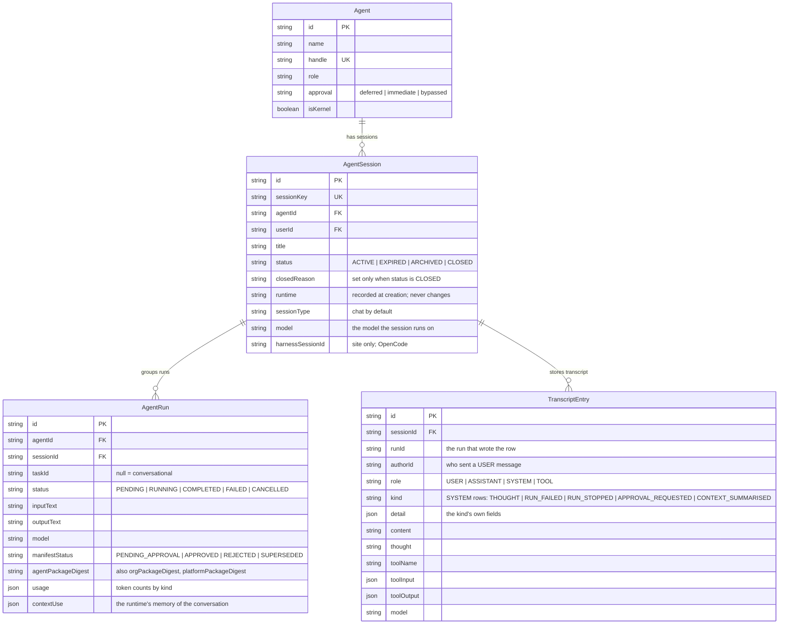

# Agent Data Model

The database tables that back agent execution: `Agent` and the creation fields of `AgentSession` in hq, and `AgentSession`'s runtime fields, `AgentRun` and `TranscriptEntry` on the Execution Site.

---

## Schema Diagram

---

## Entities

### Agent

The agent's one current definition, held by hq and edited in place (ADR-0072) — there is no version number and nothing to publish. The record owns the settings that govern how a run executes — which tools and approval — and no other place keeps a copy of them. What the agent reads — its instructions — is its package content, delivered to a site by its content fingerprint (digest); each run records the digest of the content it loaded. A run uses the definition as it was when it started; an edit applies from the next run, and never fails or changes a run already under way. Content is stored immutably by its digest, and content no package points at is removed a day after it was released. Its skills are not part of that content: the agent *has* installed skills from the Library, each pinned at one version for the organisation ([skills](../skills/skills.md)). Persists across sessions.

Key fields:
- `modelChoices` — the agent's own models and voice, in `AgentModelChoices`: its default model (which its conversations start on and their work runs on), speech to text, and text to speech with its voice, each a model via a provider, none until an admin chooses one. A choice it does not hold follows the organisation's ([models](../models/models.md)). The agent has no runtime of its own: the model chosen for a piece of work decides the harness ([agent-runtime-model.md](./agent-runtime-model.md)).
- `allowedTools`, `allowedBashPatterns`, `approval` — the organisation's permissions: a state per tool, bash patterns, and when a person is asked ([hitl-and-tool-control.md](./hitl-and-tool-control.md)).
- `isKernel`. Every agent has a voice, chosen with its other model choices ([voice](../conversations/voice.md#the-speech-models-and-the-voice)).

A boundary's narrowing (the same permission shapes as the agent's own — tools, bash patterns, approval; never a model, since which models may run is a [list](../models/lists.md)) lives in `AgentOverride`, not on the agent (`hq/schema.prisma`, [ADR-0072](../../adr/adr-0072-an-agent-is-defined-once-in-hq-and-overridden-per-boundary.md)). A project's are read by every member of the project and changed by its admins; a person's are theirs alone (`hq/src/agents/overrides/overrideOperations.ts`).

Every agent is the organisation's, and every member may see what it is doing in the projects they can see, with how many of those it is in (`hq/src/agents/agentPlaceQueries.ts`); "in my projects" means the projects the person is listed on, so an open project they are not listed on does not count. A person's own parts of an agent — their conversations with it, its runs on their behalf, their narrowing of it and their usage — are theirs alone. Its usage for a period is summed on each site (`run.usage`) and shown as the person's (the runs on their behalf), a project's (every run in it, to its members) and the organisation's (every run); one run counts in each, and organisation admins also see the organisation's by project — the projects they can see by name, every private project they are not on summed into one unnamed line, and people's own spaces into another (`hq/src/agents/agentUsageQueries.ts`). Runs carry tokens and the model only, so cost and energy are estimates from the tokens.

An agent has no schedule of its own: nothing on the record wakes it. Work reaches it as a task, started by a person (Run, or its Start in the Workroom), by a Run at… time, or by another agent's `run_task`; a routine's schedule starts the agent on its instructions ([execution flow](./agent-execution-flow.md), [how work starts](../tasks/automation.md), [routines](../tasks/routines.md); [ADR-0175](../../adr/adr-0175-work-starts-only-by-an-explicit-act.md)).

### An agent in a project, and its place

An agent belongs to the organisation and is **in** a project when it is assigned there (`ProjectAgent`): directly, or
only through a team the project has (`direct` is false then, and it is changed through the team ([ADR-0103](../../adr/adr-0103-a-team-joins-a-project-as-one-member.md))). In a project the agent works
in the project's storage, and the project's admins may narrow its permissions for runs there, and which models may run in the project is the project's [list](../models/lists.md)
(`AgentOverride`, boundary type project). Three screens show an agent (`hq/src/agents/pages/`):

| Screen | Address | What it holds |
|---|---|---|
| Agents | `/agents` | A card for every agent: what it is doing now, how many of the person's visible projects it is in |
| An agent's place | `/agents/:handle` | Tabs: Overview, Conversations, then At work (Now, Projects, Runs, Usage) and About it, for the person alone (their instructions, their Memory, their settings: their permissions in their own space). An organisation admin also sees *Manage* |
| Manage organisation › Agents | `/admin/agents/:handle` | For organisation admins: its Instructions (with the prompt preview), Skills, Settings and Permissions, its own models and voice and its list of allowed models, the projects it is in, its usage, export, stop and delete |

### AgentSession

A harness session between a user and an agent, on a site: a task's session, a standing worker of a [conversation](../conversations/conversations.md), or a chat from before the conversations, hidden and closed. Groups all runs that belong to one continuous session. The conversation itself is a `Conversation` row in hq with its messages, turns and operations (`hq/schema.prisma`); a worker's session points back to it. The session ID doubles as the Claude Agent SDK session ID — no separate field needed.

Key fields:
- `model` — the model the session runs on, as the runtime names it, recorded when the session is created.
- `sessionType` — `"chat"` by default, or `"task"` for a task's session. `taskId` is set (and unique) on a task's session.
- `conversationId`, `workerGeneration` — set on a standing worker: the conversation it serves, and which fresh start of its slot (conversation, boundary, person, and the workspace the lead's brief named, if any) it is. A worker in a code workspace works on its conversation's own branch there. `conversationId` is null on a chat and on a task's session.
- `primaryOwnerType`, `primaryOwnerId`, `primaryWorkspaceId` — the storage location the run works in ([storage-and-placement.md](../../architecture/storage-and-placement.md)).
- `totalInputTokens`, `totalOutputTokens`, `totalCacheReadTokens`, `totalCacheWriteTokens` — running token totals, incremented per run.
- `harnessSessionId` — on the site's copy only: the harness's own id for the conversation, where the harness chooses it (OpenCode). Null for Claude.
- `status` — `ACTIVE`, `EXPIRED`, `ARCHIVED` or `CLOSED`, where `CLOSED` means the conversation cannot continue; `closedReason` says why — its harness state is gone (`HARNESS_STATE_MISSING`), the person left the project or the organisation, or the project was deleted. Set by the site, which owns session status, and replicated to hq (person-scoped execution spec §4, [ADR-0076](../../adr/adr-0076-a-conversation-whose-harness-state-is-gone-is-closed.md)).
- `closedReason` — set only when `status` is `CLOSED`: `HARNESS_STATE_MISSING`, `LEFT_PROJECT`, `LEFT_ORGANISATION` or `PROJECT_DELETED`.
- `runtime` — the runtime the session was created on, which the model chosen for its first run decided (`"claude-sdk"` or `"opencode"`). Recorded once and never changed: a conversation keeps the runtime it started with even if the models chosen for the agent are changed afterwards ([ADR-0078](../../adr/adr-0078-a-conversation-keeps-the-runtime-it-started-with.md)).

### AgentRun

A single execution unit — one prompt in, one response out. Every message the user sends creates a new `AgentRun` within the session.

Key fields:
- `taskId` — `null` for conversational runs (user-initiated). Set for task runs.
- `parentRunId` / `rootRunId` — unused and always null. They were for runs started by another run, which were removed with sub-agent runs ([ADR-0020](../../adr/adr-0020-task-delegation-over-spawn-agent.md)); nothing sets them.
- `status` — lifecycle: `PENDING → RUNNING → COMPLETED | FAILED | CANCELLED`.
- `model` — which model handled this run.
- `manifestStatus`, `pendingManifest`, `approvedManifest`, `manifestApprovedAt`, `manifestDecidedById`, `manifestDecidedAt` — the tool approval state: `PENDING_APPROVAL`, `APPROVED`, `REJECTED`, or `SUPERSEDED` when something newer in the task or conversation replaced an unanswered request ([tool-manifest.md](../../architecture/tools/tool-manifest.md), [human approval](./hitl-and-tool-control.md#an-approval-is-for-the-next-run-only)).
- `contextUse` — how full the runtime's own copy of the conversation was when the run ended ([sessions](./sessions.md#the-agents-memory)).
- `agentPackageDigest`, `orgPackageDigest`, `platformPackageDigest` — the content fingerprint each package had when the run loaded it.
- `usage` (input, output and total tokens, with the cache kinds), `error`, `startedAt`, `endedAt`, `auditSummary` — outcome of the run. A run the site stopped at a time or turn limit ends `CANCELLED` with `error` naming the limit ([execution flow](./agent-execution-flow.md#who-started-a-run-and-the-limits-it-gets)).

Who started a run is not a column on the run: hq records it on the task (`Task.runStartedBy`) and puts it in the run's signed capability, which the site reads.

Tool calls of a run are `ToolCallLog` rows on the site (`toolName`, `toolInput`, `toolUseId`, a risk level).

### TranscriptEntry

The conversation's whole record, which the UI reads. One row per user turn (naming its sender, `authorId`), one `TOOL` row per tool call (carrying the harness's `toolUseId` for the call, which pairs it with its `ToolCallLog` row), one assistant row carrying the reply, its thought as a whole, thinking duration, usage and model, and `SYSTEM` rows for what used to exist only on screen or on the run, each with a `kind`: a stretch of thinking, a failed or stopped run, an approval asked, the runtime summarising its memory ([sessions](./sessions.md#what-the-transcript-records)). Every row names the run that wrote it (`runId`).

The harness maintains its own session state inside the run's container's harness home (bound at `/home/appuser` in the container; Claude keeps its files in `.claude/` within it) — private to the one runner that container belongs to. `TranscriptEntry` is a parallel copy for display purposes only, not for session reconstruction.

Key fields:
- `role` — `USER`, `ASSISTANT`, `SYSTEM` or `TOOL` (`MessageRole`).
- `thought`, `toolName`, `toolInput`, `toolOutput` — filled on assistant and `TOOL` rows.
- `kind`, `detail` — on a `SYSTEM` row, what it records and that kind's own fields (`core/src/protocol/transcript.ts`).

## Where in the code

| What | Where |
|---|---|
| `Agent`, `AgentOverride`, hq's `AgentSession` | `hq/schema.prisma` |
| The site's `AgentSession`, `AgentRun`, `TranscriptEntry`, `ToolCallLog` | `site/schema.prisma` |
| hq's reads of runs and transcripts | `hq/src/sessions/siteRuntimeStore.ts` |
