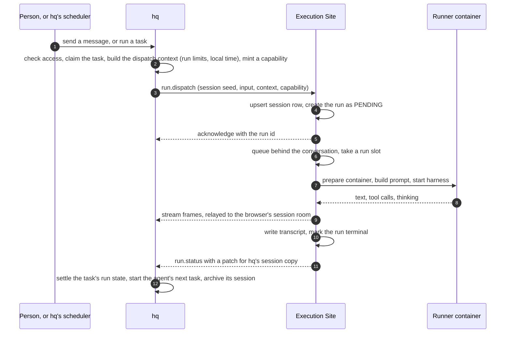

# Agent Execution Flow

How a chat message, a worker's brief or a task run becomes an agent run. hq decides and dispatches; an Execution Site runs; status comes back as events.

A reply in a [conversation](../conversations/conversations.md) held in hq is not a run: it is a direct model call made by hq, and nothing here applies to it. What a conversation starts as work, a brief to a worker or a task, is a run, and goes the way this page describes.

A **run** is one turn of an agent: one input in, one reply out. A **dispatch** is hq handing a run to a site over the [control channel](../../architecture/control-channel.md). The **harness** is the agent program inside the container (the Claude Agent SDK, or OpenCode); see [agent runtimes](../../architecture/sites/agent-runtimes.md). hq never runs an agent's harness and never touches a site's disk.

## What hq does

hq pre-resolves everything the run needs, so the site holds no agent table: the agent's configuration, the package content (instructions, org file), the one model credential the run may use, the pinned memory items the run may read, and the risk rules. It also mints a signed **capability** that says what the run may do, and sends it with the dispatch. The site that receives it is the one holding the storage the run works in ([ADR-0056](../../adr/adr-0056-a-run-is-placed-on-the-site-holding-its-storage.md)). Dispatch and status crossing the channel is [ADR-0050](../../adr/adr-0050-dispatch-and-status-cross-the-control-channel.md).

| Entry | hq code | What hq adds |
|---|---|---|
| Chat message, or a worker's brief | `triggerAgentRun` then `dispatchChatRun` (a brief: the worker's queue, `hq/src/conversations/work/workers/queue.ts`) | Refuses a closed conversation, and a person no longer entitled to the session's project. If the person's busy-conversation setting is interrupt, stops the running turn first. |
| Task run | `TaskRunner.runTask` then `dispatchTaskRun` | Owns the task state machine, below. |

**A task run** can be started by a person, a schedule or an agent, and each records who started it as `startedBy` on the task, which travels in the run's signed capability ([task concurrency](./task-execution-concurrency.md), [how work starts](../tasks/automation.md)). Work starts only by an explicit act ([ADR-0175](../../adr/adr-0175-work-starts-only-by-an-explicit-act.md)); no column, switch or limit starts a task:

| Started by | What starts it | `startedBy` |
|---|---|---|
| A person | **Run** or **Run again** on a task, an agent's **Start** or **Start all agents** in the project's Workroom; the same through a person's own connection with *start work* turned on | `person` |
| A schedule | A person's **Run at…** time falling due, run by the one scheduler at the top of the minute (`hq/src/automation/scheduledStart.ts`) | `schedule` |
| An agent | `run_task`, or `create_task` asked to start, in a run a person started | `agent` |

A routine's run is not a task run: on its schedule the scheduler starts one chat run of the routine's agent with its instructions, no task, as `schedule`; **Run now** starts one as `person` ([routines](../tasks/routines.md)). Approving a deferred tool request runs the task again with the `startedBy` it already had. Chat messages and a conversation's briefs to a worker are always `person`. The scheduler is hq code and makes no model call; an agent has no timer of its own ([ADR-0088](../../adr/adr-0088-one-scheduler-in-hq-starts-every-automated-start.md)). (`pulse` is still a value a site reads, as a run no person started; hq no longer sends it.)

**Task execution state.** hq claims a task atomically: under a database lock on the (agent, project) pair, a started task steps to Running and is dispatched. An agent runs one task at a time per project, in the project's rank order: if it already has one running, the task stays Waiting and says it is waiting for the agent's running task; it goes next when that run ends. `dispatchTaskRun` finds or creates the task's single session, builds the task context (its type, its column and the type's columns), and sends the run's limits and `startedBy` with the dispatch; the site enforces the limits. If the site is unreachable the task returns to Waiting, held until the site reconnects. When the run ends, its final status event settles the task's execution state (Finished, Not started, Failed or Needs you), starts the agent's next task, and archives the task's session when the run finished or failed ([task concurrency](./task-execution-concurrency.md)). The execution state belongs to the system alone: nothing an agent does to its task changes it, and a run ending never moves the task.

**Every run is bounded by the person it is for.** A run is on behalf of whoever started it (a person's message, Run, Run again, an agent's Start), else the task's person for a run nobody started. Every platform tool it calls is checked in hq against that person's current role, as the browser would check them ([ADR-0101](../../adr/adr-0101-a-run-is-bounded-by-the-person-it-is-for.md)), and the model credential is chosen for them: in a project, the project's own model access first, then the person's own Claude login, then their own API key, then the organisation's; in a person's own space, theirs and then the organisation's. A person's own login goes only to a run in their own harness home, so a task's run in a project uses their key and never their login ([ADR-0105](../../adr/adr-0105-a-run-uses-the-login-of-the-person-it-is-for.md), [runtimes and models](./agent-runtime-model.md)). With none usable the run fails with a sentence saying what to add. A task's session is shared, so several people may start runs in it, each on their own behalf ([sessions](./sessions.md#a-tasks-session-is-shared)).

**Every task run is on behalf of a person.** The task records the person, and the dispatch is refused, and the task blocked, if that person no longer has access to the project ([ADR-0089](../../adr/adr-0089-every-task-runs-on-behalf-of-a-person.md)). A task in a person's personal project runs in that person's own storage, as that person ([personal projects](../projects/personal-projects.md)). When the run defers a tool request, that person is notified and the request is on the task ([approvals](./hitl-and-tool-control.md)).

## Who started a run, and the limits it gets

`startedBy` changes three things, because a run a person is present for is held to less than one nobody is watching.

| | `person` | `schedule`, `agent` |
|---|---|---|
| Time limit | Yes | Yes |
| Turn limit | No | Yes |
| `run_task`, and setting a start time or a routine | Available (the schedule tools also need the project's *agents may set start times when asked* setting) | Refused |
| Depth of a task the run starts | 0 | One deeper than the task the run was for |

The **time limit** stops a run after that many minutes of working; the **turn limit** stops it after that many round trips with the model. The org sets both (defaults 60 minutes and 100 turns); a project may only tighten them. hq sends the effective values in the dispatch and the site enforces them (`site/src/agents/runtime/runLimitWatch.ts`), so a limit holds when hq restarts. A run stopped by a limit ends cancelled with a reason that names the limit, and its task is set to Needs you with that reason, not retried. A task a person starts is at depth 0; an agent's start is one deeper than its run's task ([ADR-0091](../../adr/adr-0091-work-agents-cause-is-bounded-by-its-depth.md)).

## What the site does

`handleRunDispatch` upserts the session row from hq's seed (idempotent), then calls `runChat` or `runTask` by the dispatch's kind. Each creates the `AgentRun` row as PENDING, starts `agentEngine.run` in the background and returns the run id at once. A chat run first writes the person's message to the transcript, and names an untitled session from it.

`AgentEngine` (`site/src/agents/runtime/AgentEngine.ts`) then:

1. **Orders.** Turns of one conversation run one after another, because a harness transcript has one writer. Other conversations and tasks in the same boundary run at the same time, up to a site-wide cap ([ADR-0075](../../adr/adr-0075-work-in-a-boundary-runs-in-parallel-only-a-conversation-is-ordered.md)). Waiting in a conversation's queue does not hold a slot. A run the site holds because every run slot is taken sends a `run.waiting` event, and its task says it is waiting for a free run slot; the time limit starts only once it has one. The cap is `AGENT_MAX_CONCURRENT_RUNS` on the site (5 by default), shared by every project and person on it.
2. **Launches** (`runLaunch.ts`). Verifies the capability before any side effect, picks the runtime, prepares the container keyed on its storage boundary and runner ([ADR-0074](../../adr/adr-0074-a-container-is-keyed-on-its-boundary-and-its-runner.md)), builds the prompt ([prompt builder](./prompt_builder.md)) and checks the conversation can be resumed.
3. **Streams.** Harness events become stream frames to hq, which re-emits them to the browser.
4. **Ends.** Writes the transcript and token totals, marks the run COMPLETED, FAILED or CANCELLED, and sends the terminal status event. A run always reaches a terminal state. Cancelling aborts the harness turn only; it leaves the conversation's other processes alone.

Container and process mechanism is in [container runtime](../../architecture/container-runtime.md).

## Resuming a conversation

A chat and a task each keep one harness session across runs, so the agent remembers earlier turns. The harness session is filed under the conversation's own id (OpenCode names its own and the site records it).

Before resuming, the launch asks the runtime whether the session's state still exists. There is no silent fresh start: if it is gone, the site closes the conversation with reason `HARNESS_STATE_MISSING`, fails the run with a message the person can read, and replicates the status to hq. hq then shows the history, a notice, no message box and a button to start a new conversation with the same agent ([ADR-0076](../../adr/adr-0076-a-conversation-whose-harness-state-is-gone-is-closed.md)). More in [sessions](./sessions.md).

## Where in the code

| Concern | Path |
|---|---|
| Dispatch, context, run limits | `hq/src/agents/dispatchService.ts`, `runContext.ts` |
| Task claim, serialisation, hold and drain | `hq/src/agents/TaskRunner.ts`, `taskStatusListener.ts`, `taskSessionArchive.ts` |
| Start, Stop, Run at… and the one scheduler | `hq/src/projects/agentStart.ts`, `hq/src/automation/` (`scheduledStart.ts`, `scheduler.ts`, `routineFiring.ts`) |
| Run limits | `hq/src/agents/runLimits/`, `site/src/agents/runtime/runLimitWatch.ts` |
| Receiving a dispatch | `site/src/server/runtime/dispatchHandler.ts`, `chatExecution.ts`, `taskExecution.ts` |
| Ordering and the run pipeline | `site/src/agents/runtime/AgentEngine.ts`, `runLaunch.ts`, `runQueueKey.ts` |
| Resume check | `site/src/agents/runtime/sessionExistenceCheck.ts` |

## Decisions behind this

[ADR-0032](../../adr/adr-0032-agent-execution-flow-convergence.md) (one entry point for all run kinds), [ADR-0050](../../adr/adr-0050-dispatch-and-status-cross-the-control-channel.md), [ADR-0056](../../adr/adr-0056-a-run-is-placed-on-the-site-holding-its-storage.md), [ADR-0074](../../adr/adr-0074-a-container-is-keyed-on-its-boundary-and-its-runner.md), [ADR-0075](../../adr/adr-0075-work-in-a-boundary-runs-in-parallel-only-a-conversation-is-ordered.md), [ADR-0076](../../adr/adr-0076-a-conversation-whose-harness-state-is-gone-is-closed.md), [ADR-0175](../../adr/adr-0175-work-starts-only-by-an-explicit-act.md), [ADR-0088](../../adr/adr-0088-one-scheduler-in-hq-starts-every-automated-start.md), [ADR-0089](../../adr/adr-0089-every-task-runs-on-behalf-of-a-person.md), [ADR-0091](../../adr/adr-0091-work-agents-cause-is-bounded-by-its-depth.md).
