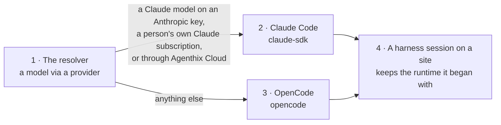

# Runtimes and Models

Which harness runs a piece of work, and which models it can use. Nobody chooses a harness: the model chosen for the work
decides it. How a model is chosen is [models](../models/models.md); how each harness is started, driven and kept warm on
the Execution Site is [agent-runtimes.md](../../architecture/sites/agent-runtimes.md); the path of a run is
[container-runtime.md](../../architecture/container-runtime.md).



For the database schema, see [Agent Data Model](./agent-data-model.md).

---

## Overview

Each run works in one storage boundary (a person's or a project's storage — the agent has no workspace of its own) and is backed by a runtime — the component responsible for taking a prompt, doing work, and producing a result. The Site supports multiple runtimes behind a common interface.

---

## Runtime Options

| Runtime | Backed by | Providers | Tools | When to use |
|---|---|---|---|---|
| `claude-sdk` | Claude Code, through the Claude Agent SDK (`@anthropic-ai/claude-agent-sdk`) | Anthropic on an API key, a person's own Claude subscription, Claude models through Agenthix Cloud | Claude Code's built-ins ([claude-tools.md](../../architecture/tools/claude-tools.md)) | Claude models, and the only path to a Claude subscription |
| `opencode` | OpenCode (`opencode serve`) | OpenRouter, OpenAI, Google, an OpenAI-compatible endpoint, other models through Agenthix Cloud — on an API key | OpenCode's, some replaced by Agenthix's own ([opencode-tools.md](../../architecture/tools/opencode-tools.md)) | Any model that is not served to Claude Code |

An agent has no runtime setting. For each piece of work the [resolver](../models/models.md#how-a-model-is-chosen-for-a-call)
chooses a model via a provider, and the runtime follows it: **Claude Code** for a Claude model on an Anthropic key, for a
person's own Claude subscription, and a Claude model through Agenthix Cloud (whose gateway speaks Anthropic's API); **OpenCode** for any
other model or provider. Neither harness is Agenthix's own
([ADR-0073](../../adr/adr-0073-claude-keeps-its-own-runtime-opencode-replaces-nativeruntime.md)); how
each is driven and kept warm is [agent-runtimes.md](../../architecture/sites/agent-runtimes.md).

---

## The Interface

Both runtimes implement a single thin interface:

```typescript
interface AgentRuntime {
  run(context: RunContext): AsyncIterable<RunEvent>
  sessionExists(query: SessionExistenceQuery): Promise<boolean>
  conversationIdle(conversation: ConversationRef): Promise<void>
  endConversation(conversation: ConversationRef): Promise<void>
}
```

The interface captures only what the caller needs: run a turn and consume its events, ask whether the
harness still holds a conversation, and tell the runtime when a conversation goes idle or ends, so it can
let go of the harness it keeps warm. How each runtime operates internally — tool loops, session management, model selection — is its own concern.

Shared infrastructure (transcript persistence, WebSocket event emission, error handling) sits above the interface and is runtime-agnostic.

Each runtime also answers one more question before a conversation resumes: does the harness still hold this session's state? For Claude this checks whether the session's file is in the runner's harness home; OpenCode asks its server `GET /session/:id`. The engine acts on the answer the same way whichever runtime gave it — a missing session closes the conversation rather than starting a fresh one silently under the same id ([ADR-0076](../../adr/adr-0076-a-conversation-whose-harness-state-is-gone-is-closed.md)).

---

## Claude Agent SDK Runtime

The Claude Agent SDK is the Claude Code CLI exposed as a Node.js library. It provides a fully-formed agent loop with built-in tools and session management, eliminating the need to implement those concerns manually.

**Authentication:** the provider the resolver chose, handed to the site as a **provider descriptor** with the run's
dispatch ([model resolution](../../architecture/model-resolution.md)). HQ holds every key; the site keeps none. For a
provider the organisation holds by API key, the key travels for this run only and stays on the site, which adds it to each
model request through its model relay ([model-relay.md](../../architecture/sites/model-relay.md)). A person's own Claude
subscription is the one exception: it is written into the container's harness home, only for a run in that person's own
place (their space or a personal project) that runs as them, and is not relayed ([ADR-0105](../../adr/adr-0105-a-run-uses-the-login-of-the-person-it-is-for.md)).
The organisation holds no subscription, and no project or agent has a credential of its own; a run with no provider that
may serve it fails with the resolver's reason. With container isolation on, the SDK process is started inside the container
keyed to the run's boundary and runner. Every run starts with the claude.ai connectors of a subscription's own account turned
off (`ENABLE_CLAUDEAI_MCP_SERVERS=false`), so a project's runs never reach one person's Drive, mail or other connected accounts
through it ([ADR-0080](../../adr/adr-0080-a-run-never-carries-a-persons-own-connected-accounts.md)).

**Working directory:** the SDK's `cwd` is the run's primary location in its storage boundary — a container path such as `/projects/<project id>/files`, `/projects/<project id>/tasks/<task id>` or `/users/<person id>/files`. The agent has no working directory of its own, so switching runtimes changes nothing about where files live.

---

## Workspaces

Runtime choice does not affect where a run works. A run reaches exactly one owner's storage — a person's or a project's, its storage boundary — and the agent has no directory of its own. A container is keyed on that boundary and on who is running in it: a person, or the project itself for a task in a project; a task in a person's personal project runs as that person ([ADR-0074](../../adr/adr-0074-a-container-is-keyed-on-its-boundary-and-its-runner.md)). Two people working in one project do not share a container — each has their own, alongside the project's own container for its tasks — though all of them mount the same project folder.

See [Agent Security Model](./agent-security-model.md) for the current isolation rules.

Every run is limited in time, and a run no person started is also limited in turns. The site enforces both on either harness (`site/src/agents/runtime/runLimitWatch.ts`); the values are the org's, which a project may only tighten ([execution flow](./agent-execution-flow.md#who-started-a-run-and-the-limits-it-gets)).

---

## A conversation's talking model is not a runtime

Everything on this page is about a harness session: a task's or a worker's. A conversation's replies are direct model calls
made by HQ, with no harness, so the **talking model** is chosen differently: the person's pick in the model picker, else
the agent's own default model, else the organisation's, among the models the lists allow, and it can change at any time
([conversations](../conversations/conversations.md#which-model-and-who-pays)). The worker it starts takes the model the
person's instruction names, else the model the conversation talks on, else the agent's own default model, else the
organisation's, on this page's rules; one the place's lists rule out falls to the next allowed, and the run says so.

## Model selection

A harness session is given **one model for each run**, decided when the run is dispatched:

1. **A new session** takes the model the resolver chose for the work (an instruction's, the conversation's, the agent's own
   default model, the organisation's), and records it, with the runtime, on the session (`AgentSession.model`, `runtime`).
2. **A session that carries on** keeps its runtime: a conversation never moves between runtimes
   ([ADR-0078](../../adr/adr-0078-a-conversation-keeps-the-runtime-it-started-with.md)). HQ looks for a provider that
   serves the session's model on that same runtime, and carries on with it; if none works, the run fails with a reason that
   names the model and where an organisation admin adds a provider.

Each run reads its model from the run context. An edit to the organisation's or an agent's models applies from the next
new session; it never changes a run under way.

### OpenCodeRuntime

Uses the resolved model from `RunContext.model`, named with its provider first, as OpenCode addresses
models — which is also how hq knows which provider's credential to resolve:

| Provider | ID format | Example |
|---|---|---|
| OpenRouter | `openrouter/<model>` | `openrouter/qwen/qwen3.8-27b:free` |
| OpenAI | `openai/<model>` | `openai/<model>` |
| Google | `google/<model>` | `google/<model>` |
| Anthropic | `anthropic/<model>` | `anthropic/claude-sonnet-5` |
| OpenAI-compatible endpoint | `openai_compatible/<model>` | a model name typed in the choice |


### ClaudeSDKRuntime

Uses the resolved model from `RunContext.model`, passed to the SDK as `model` and changed between turns
with `setModel()`. Claude uses bare Anthropic model ids (no provider prefix), such as `claude-sonnet-5`,
`claude-opus-4-6` or `claude-haiku-4-5`; a trailing date suffix is stripped. The run records the model the CLI reports for the turn, which may differ from
the one requested — the CLI renames retired ids.

### Where the lists come from

Both runtimes' model lists, and every model's price, are generated into `core`
(`core/src/models/openCodeModels.generated.ts`, by `core/scripts/generate-model-list.mjs`) from the
catalogue of the OpenCode version pinned in the agent image, and regenerated whenever OpenCode is
upgraded: OpenCode's list is the catalogue's models for the providers Agenthix offers; Claude's is its
`anthropic` entries under their bare ids, with a dated id dropped where its undated alias exists. Each
model has a cost rank from its price, which setup uses to recommend defaults, and a price band shown in the pickers: free, `$` (up to $8 per million tokens, input plus output), `$$`
(up to $25) and `$$$` (above). The same generated price table prices runs' token usage in hq and the UI
(`core/src/models/pricing.ts`).

---

## Runtime and Model in the UI

No screen shows or sets a runtime for an agent. A model is shown as *model · via provider*, with its price band, wherever it
is chosen: the model picker (a search box over what may run, a provider that is not working greyed out), the Models page,
an agent's own models, and a task's model. Changing the model mid-conversation takes effect on the next reply; for a harness
session it applies to the next new session, since a session keeps the runtime it began with.
