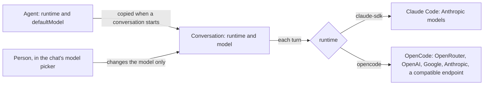

# Runtimes and Models

Which harness runs an agent, which models it can use, and how a conversation's model and runtime are
chosen. How each harness is started, driven and kept warm on the Execution Site is
[agent-runtimes.md](../../architecture/sites/agent-runtimes.md); the path of a run is
[container-runtime.md](../../architecture/container-runtime.md).



For the database schema, see [Agent Data Model](./agent-data-model.md).

---

## Overview

Each run works in one storage boundary (a person's or a project's storage — the agent has no workspace of its own) and is backed by a runtime — the component responsible for taking a prompt, doing work, and producing a result. The Site supports multiple runtimes behind a common interface.

---

## Runtime Options

| Runtime | Backed by | Providers | Tools | When to use |
|---|---|---|---|---|
| `claude-sdk` (default) | Claude Code, through the Claude Agent SDK (`@anthropic-ai/claude-agent-sdk`) | Anthropic, on an API key or a Claude subscription | Claude Code's built-ins ([claude-tools.md](../../architecture/tools/claude-tools.md)) | Claude models, and the only path to a Claude subscription |
| `opencode` | OpenCode (`opencode serve`) | OpenRouter, OpenAI, Google, Anthropic, an OpenAI-compatible endpoint — on an API key | OpenCode's, some replaced by Agenthix's own ([opencode-tools.md](../../architecture/tools/opencode-tools.md)) | Any model that is not Claude on a subscription |

Agents choose a runtime with the `runtime` field in their configuration, set in the Settings section of the
agent's page under Organisation › Agents. The default is `claude-sdk`. Neither harness is Agenthix's own
([ADR-0073](../../adr/adr-0073-claude-keeps-its-own-runtime-opencode-replaces-nativeruntime.md)); how
each is driven and kept warm is [agent-runtimes.md](../../architecture/sites/agent-runtimes.md).

---

## The Interface

Both runtimes implement a single thin interface:

```typescript
interface AgentRuntime {
  run(context: RunContext): AsyncIterable<RunEvent>
  sessionExists(query: SessionExistenceQuery): Promise<boolean>
  conversationIdle(conversation: ConversationRef): Promise<void>
  endConversation(conversation: ConversationRef): Promise<void>
}
```

The interface captures only what the caller needs: run a turn and consume its events, ask whether the
harness still holds a conversation, and tell the runtime when a conversation goes idle or ends, so it can
let go of the harness it keeps warm. How each runtime operates internally — tool loops, session management, model selection — is its own concern.

Shared infrastructure (transcript persistence, WebSocket event emission, error handling) sits above the interface and is runtime-agnostic.

Each runtime also answers one more question before a conversation resumes: does the harness still hold this session's state? For Claude this checks whether the session's file is in the runner's harness home; OpenCode asks its server `GET /session/:id`. The engine acts on the answer the same way whichever runtime gave it — a missing session closes the conversation rather than starting a fresh one silently under the same id ([ADR-0076](../../adr/adr-0076-a-conversation-whose-harness-state-is-gone-is-closed.md)).

---

## Claude Agent SDK Runtime

The Claude Agent SDK is the Claude Code CLI exposed as a Node.js library. It provides a fully-formed agent loop with built-in tools and session management, eliminating the need to implement those concerns manually.

**Authentication:** the one model credential hq decided this run may use — an API key or a subscription login — delivered in the run's dispatch context. hq tries, in order, the run's project's own (in a project), then the person the run is on behalf of — their own login, then their own key — then the organisation's ([ADR-0105](../../adr/adr-0105-a-run-uses-the-login-of-the-person-it-is-for.md)). A person's own login goes only to a run in their own harness home, so a task's run in a project, which runs as the project, uses their key and never their login. An organisation's or a project's subscription is used only while the organisation has one person; in a development build only (`NODE_ENV` development or test), `HQ_DEV_SHARED_SUBSCRIPTION=true` lifts that rule so one developer can test task runs on one login. A subscription login is written into the container's harness home; an API key stays on the site, which adds it to each model request through its model relay ([model-relay.md](../../architecture/sites/model-relay.md)). There is no per-agent or environment-wide credential; a boundary with none configured fails the run. With container isolation on, the SDK process is started inside the container keyed to the run's boundary and runner. Every run starts with the claude.ai connectors of a subscription's own account turned off (`ENABLE_CLAUDEAI_MCP_SERVERS=false`), so a project's runs never reach one person's Drive, mail or other connected accounts through it ([ADR-0080](../../adr/adr-0080-a-run-never-carries-a-persons-own-connected-accounts.md)).

**Working directory:** the SDK's `cwd` is the run's primary location in its storage boundary — a container path such as `/projects/<project id>/files`, `/projects/<project id>/tasks/<task id>` or `/users/<person id>/files`. The agent has no working directory of its own, so switching runtimes changes nothing about where files live.

---

## Workspaces

Runtime choice does not affect where a run works. A run reaches exactly one owner's storage — a person's or a project's, its storage boundary — and the agent has no directory of its own. A container is keyed on that boundary and on who is running in it: a person, or the project itself for a task in a project; a task in a person's personal project runs as that person ([ADR-0074](../../adr/adr-0074-a-container-is-keyed-on-its-boundary-and-its-runner.md)). Two people working in one project do not share a container — each has their own, alongside the project's own container for its tasks — though all of them mount the same project folder.

See [Agent Security Model](./agent-security-model.md) for the current isolation rules.

Every run is limited in time, and a run no person started is also limited in turns. The site enforces both on either harness (`site/src/agents/runtime/runLimitWatch.ts`); the values are the org's, which a project may only tighten ([execution flow](./agent-execution-flow.md#who-started-a-run-and-the-limits-it-gets)).

---

## A conversation's talking model is not a runtime

Everything on this page is about a harness session: a task's or a worker's. A conversation's replies are direct model calls made by hq, with no harness, so the **talking model** is chosen differently: from the model policy and the person's own picker, among the models their access reaches, and it can change at any time ([conversations](../conversations/conversations.md#which-model-and-who-pays)). The worker it starts uses the policy's light or heavy model for each brief, on this page's rules.

## Model Selection

### How it works

Model selection is a two-step process:

1. **Session creation** — `AgentSession.model` is initialised from the agent's default model (`Agent.defaultModel`). The agent is just the reference point; once the session exists, it owns the model choice.
2. **During the session** — the user can change the model via the selector in the chat UI. This updates `AgentSession.model`. The agent's model list is not touched.

Each run reads the active model from `AgentSession.model`. The agent's `defaultModel` is only the starting point; the run reads `AgentSession.model`, falling back to `Agent.defaultModel`.

```
Agent.defaultModel ──(session created)──▶  AgentSession.model  ──(each run)──▶  RunContext.model
                                              ▲
                                         user changes model mid-session
```

### OpenCodeRuntime

Uses the resolved model from `RunContext.model`, named with its provider first, as OpenCode addresses
models — which is also how hq knows which provider's credential to resolve:

| Provider | ID format | Example |
|---|---|---|
| OpenRouter | `openrouter/<model>` | `openrouter/qwen/qwen3.8-27b:free` |
| OpenAI | `openai/<model>` | `openai/<model>` |
| Google | `google/<model>` | `google/<model>` |
| Anthropic | `anthropic/<model>` | `anthropic/claude-sonnet-5` |
| OpenAI-compatible endpoint | `openai_compatible/<model>` | a model name typed by the person |

The default is `anthropic/claude-sonnet-5`.

### ClaudeSDKRuntime

Uses the resolved model from `RunContext.model`, passed to the SDK as `model` and changed between turns
with `setModel()`. Claude uses bare Anthropic model ids (no provider prefix), such as `claude-sonnet-5`,
`claude-opus-4-6` or `claude-haiku-4-5`; a trailing date suffix is stripped. The default is
`claude-sonnet-5`. The run records the model the CLI reports for the turn, which may differ from
the one requested — the CLI renames retired ids.

### Where the lists come from

Both runtimes' model lists, and every model's price, are generated into `core`
(`core/src/models/openCodeModels.generated.ts`, by `core/scripts/generate-model-list.mjs`) from the
catalogue of the OpenCode version pinned in the agent image, and regenerated whenever OpenCode is
upgraded: OpenCode's list is the catalogue's models for the providers Agenthix offers; Claude's is its
`anthropic` entries under their bare ids, with a dated id dropped where its undated alias exists. Each
model has a cost rank from its price, which the "equal or cheaper" rule for model overrides compares,
and a price band shown in the pickers: free, `$` (up to $8 per million tokens, input plus output), `$$`
(up to $25) and `$$$` (above). The same generated price table prices runs' token usage in hq and the UI
(`core/src/models/pricing.ts`). The defaults per runtime are `DEFAULT_MODELS` in
`core/src/models/modelList.ts`.

---

## Runtime and Model in the UI

A runtime is chosen when an agent is created (the New Agent dialog) and can be changed in its
Settings section; pages show it by name, *Claude* or *OpenCode* (`runtimeLabel`). Changing it keeps the
agent's model if the new runtime offers it, and otherwise takes that runtime's default. The model picker
offers the models of the chosen runtime, each with its price band (`ui/src/agents/ModelSelect.tsx`,
`modelGroups.ts`): Claude's list in catalogue order; OpenCode's grouped by provider, free models first
and then by price within a group, with a text filter above it and a typed name for an OpenAI-compatible
endpoint.

In a chat, the model picker offers the models of the runtime the conversation started on — its session's
recorded runtime, else the agent's (`ui/src/sessions/conversationRuntime.ts`) — so a conversation is never
offered the other runtime's models after its agent is switched.

Changing the model mid-session takes effect on the next run. The runtime cannot be changed mid-session — and changing it on the agent applies only to conversations created afterwards. A session records the runtime it was created with, on the site and in hq's copy, and every run of that session keeps using it even after the agent's own runtime setting changes; no conversation moves between runtimes ([ADR-0078](../../adr/adr-0078-a-conversation-keeps-the-runtime-it-started-with.md)).
