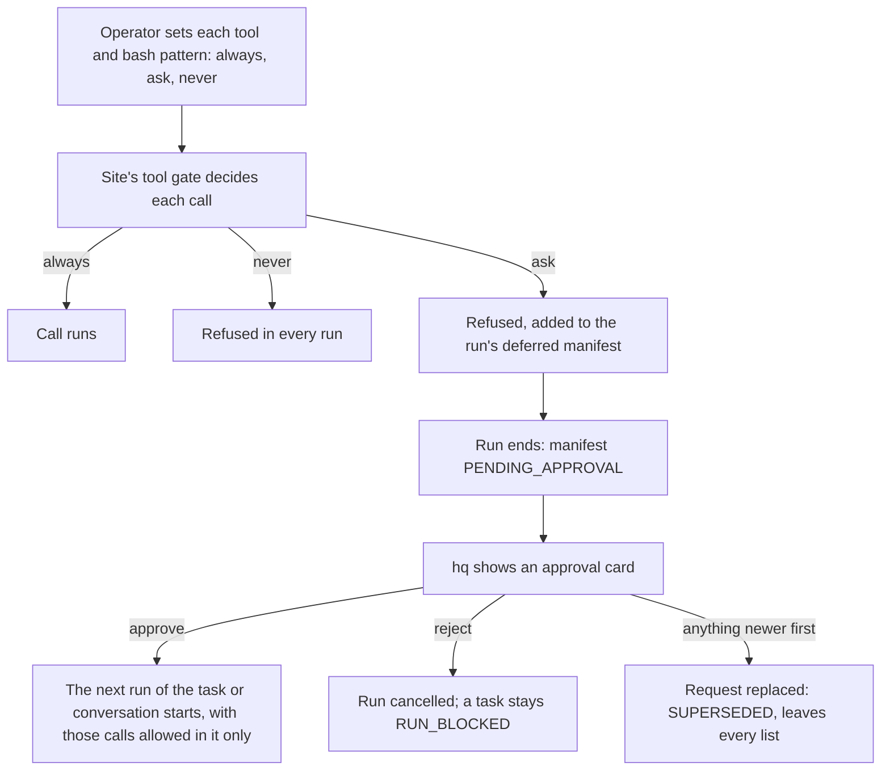

# Human Approval and Per-Agent Tool Control

An agent is useful only if it can act, and dangerous if it can act without limit. Two controls sit between
those: **what an agent may ever do**, set per tool by an operator, and **how a call that needs a person's
say-so is handled**. This document is the product-level view and the place the task and run states are
tied together; the mechanism is in the architecture documents.



Read these first; this document does not repeat them:

- [tool-control.md](../../architecture/tools/tool-control.md): the three states, the single gate, what each
  harness shows the model, the harness path rule and the command sandbox.
- [tool-manifest.md](../../architecture/tools/tool-manifest.md): the manifest, approval
  (`bypassed`, `deferred`, `immediate`) and what each tells the agent, the approve and reject paths, who
  may decide, and where a person sees the card.
- [mcp/tools.md](../../architecture/mcp/tools.md): the platform tools an agent can be given.

---

## Two settings, two questions

| Setting | Question it answers | Where it lives |
|---|---|---|
| Tool and bash pattern states | What may this agent ever use? | `Agent.allowedTools`, `Agent.allowedBashPatterns` (`hq/schema.prisma`); edited in the Permissions section of the agent's page under Manage organisation › Agents (`hq/src/agents/pages/manage/PermissionsSection.tsx`, the view in `ui/src/agents/permissions/AgentPermissionsView.tsx`) |
| Approval | When an `ask` call comes up, is a person asked at the end, at once, or not at all? | `Agent.approval`: `deferred` (the default: the run carries on and lists every Ask for the end), `immediate` (the run stops at the first Ask and asks at once) or `bypassed` (every tool runs, platform tools and tools set to Never included, and no one is asked) |

A preset fills in only the tools and bash patterns; it never sets approval, so bypassing is chosen on
approval alone. A preset that offers `bash` sets it to Ask.

**A command matching no pattern follows "Any other command"** — the `bash` tool's own state. Always runs it,
Ask asks (at the end or at once, as approval says), Never refuses it and every other command. A pattern that
matches a command decides for it, whatever `bash` is: with `bash` at Ask and `git` at Always, `git status`
runs and `make` is asked about.

**Bypassed switches off the agent's own permissions for every tool**, platform tools included: no list the
organisation saved applies, and its run's capability names no tool Never but the ones a workspace's allowed
list leaves out. **Permissions are what an agent may attempt, not authority.** Every platform tool is bounded
by the person the run is for ([ADR-0101](../../adr/adr-0101-a-run-is-bounded-by-the-person-it-is-for.md)): hq checks each call against that person's
current organisation role for what is organisation-wide and their role in the project for the rest, as the
browser does when they act themselves, so a chat by a project's Viewer cannot delete a task through its agent,
bypassed or not ([ADR-0102](../../adr/adr-0102-viewer-is-a-project-role.md)). A run in
a project is refused every tool that acts on the whole organisation, and a run on behalf of no one is refused
everything that needs a person (`hq/src/server/controlplane/authorize.ts`).

A `null` tool list means the runtime's defaults. A built-in tool an explicit list leaves out is not
offered; a platform tool it leaves out is asked about. Names in the stored
permissions are the platform's canonical names (`read_file`, `bash`, a platform tool's own name); each
harness translates them, as [tool-control.md](../../architecture/tools/tool-control.md#tool-name-mapping)
shows. An agent exported as a zip carries them in its `agent.json` (`hq/src/agents/agentZipService.ts`).

### Three levels, the strictest winning

The organisation sets each agent's permissions (its admins). A project may narrow them for runs in it (its
admins), and a person for their own Chat, with an `AgentOverride` that holds the same shapes — a state per
tool, bash patterns and approval — never widening them
([ADR-0072](../../adr/adr-0072-an-agent-is-defined-once-in-hq-and-overridden-per-boundary.md)). A run in a
project takes the project's narrowing, and a run in a person's own storage (their Chat, or a task in their
personal project) takes theirs: never a person's in a project, never a project's in Chat.

When a run's permissions are minted (`hq/src/agents/permissions/effectivePermissions.ts`), for each tool,
each bash pattern and approval the strictest level wins: Always < Ask < Never, and
bypassed < deferred < immediate. A narrowing cannot grant a built-in tool the organisation's list leaves out,
and the platform tools every agent always has stay fixed. A bash command takes the strictest state any level
gives it, each level reading its own patterns as the gate does — the first that matches decides — and a
command none of a level's patterns matches takes that level's Any other command. So a pattern only a narrower
level names starts from the organisation's Any other command. When the organisation bypasses approval and a
narrowing sets deferred or immediate, the organisation's tools count as every tool Always (its saved list is
not used) and the narrowing applies on top. A workspace's allowed list still applies after all of this. The
dispatched agent row carries the same effective approval, tools and patterns, so the tools a run starts
approved come from what its boundary allows.

The **kernel agent** (`@kernel`) is the built-in system agent every organisation has, which runs its first
setup. Its tool permissions are editable; its handle is reserved and it cannot be deleted
(`hq/src/agents/kernelGuards.ts`). Its approval starts Deferred, like any new agent's, and may be changed.
Its organisation-setup tool is set again at every hq boot (`hq/src/server/setup.ts`), so removing it does not last.

---

## How a task moves while it waits for approval

hq owns the task's state; the site owns the run. The hand-off between them is one `run.status` frame.

```mermaid
sequenceDiagram
    participant S as Execution Site
    participant L as hq: taskStatusListener
    participant P as Person
    participant A as hq: manifestActions

    S->>S: run ends with a non-empty deferred manifest
    S->>L: run.status carrying manifestPending, and a manifestPendingApproval stream frame
    L->>L: task becomes RUN_BLOCKED, "Awaiting tool approval", a comment is added
    L->>P: notification to the person the task is done on behalf of
    P->>A: approveManifest or rejectManifest
    A->>S: run.approve, then hq queues the task again; or run.reject
```

- **The site** (`site/src/server/runtime/deferredManifestReport.ts`) sets the run's `manifestStatus` to
  `PENDING_APPROVAL` and sends the run's single terminal `run.status`, with the manifest attached. The run's
  own `status` is whatever it truly ended as, usually `COMPLETED`.
- **hq's status listener** (`hq/src/agents/taskStatusListener.ts`) sets the task's run state to `RUN_BLOCKED`
  ("Needs you") with the reason "Awaiting tool approval", adds a task comment holding the approval card, and
  **notifies the person the task is done on behalf of** (`hq/src/agents/approvalNotification.ts`): a
  notification in hq that links to the request on the task. It does this once; a repeated frame is ignored.
  The agent's next task in the project then starts, since this run has ended
  ([task concurrency](./task-execution-concurrency.md)).
- **Approving** (`approveManifest`, `hq/src/agents/manifestActions.ts`) marks the request `APPROVED` on the
  site (`run.approve`) and starts the next run. For a task, the task is set `RUN_QUEUED` ("manifest approved —
  re-queued") and `TaskRunner.runTask` claims it again, with the `startedBy` the task already had: a person's
  approval does not make a run a person started, so a run the pulse started is re-run as a pulse run, with its
  turn limit. For a conversation, hq sends it a message that is not shown in the conversation ("Please
  continue."), as the person the asking run was for. Either way, that run alone is given what was approved:
  see below.
- **Denying** (`rejectManifest`): the run becomes `CANCELLED` with `manifestStatus` `REJECTED`. A task
  stays `RUN_BLOCKED` ("manifest rejected — awaiting human review") with a comment, and is not run again on
  its own. A conversation, like an approved one, starts its next run with a message that is not shown,
  telling the agent what was denied and the person's reason, so it answers without it.

**The answer is the request's own state**, never a message of the person's: the site records who answered
(`manifestDecidedById`), when (`manifestDecidedAt`, set too when a request is replaced) and, for a denial, the
reason (the run's error). Where the run asked, the conversation's transcript has an `APPROVAL_REQUESTED` row,
which is read with the request and its answer ([sessions](./sessions.md#what-the-transcript-records)); hq words
each item as what it will do ("Fetch a web page", or the command itself) and names who answered. An answer given
from the conversation and one given from Notifications write the same state.

### An approval is for the next run only

A run never waits for approval. What needs it is refused and listed, and the run ends with the list. Approving
starts the **next run** of the task or the conversation, and that run alone is given what was approved, with a
note before its message telling the agent what it may now use and that it may do so in this run only. After
it, the agent's levels apply again: nothing is carried further.

The site decides this when it starts a run (`site/src/server/runtime/nextRunApproval.ts`): a run is given a
request only when the newest earlier run of its session is that request, approved. A task has one session, so
its runs and the messages into its session are one sequence.

**A request nobody answered is replaced** by anything newer in its task or conversation: a new message, Run
again, Dismiss, or a newer run. Its `manifestStatus` becomes `SUPERSEDED`, its notifications are handled, and it
leaves Needs you, the Runs panel and the approval card. The site replaces a session's unanswered requests itself
when it starts a run there; Dismiss, and Run again before its run starts, ask it with `run.reject` and
`replaced: true` (`hq/src/agents/manifestRequests.ts`). A message into a task's session also releases a task
that was blocked only for that approval. Approving or denying a replaced request, or one a newer run has
overtaken, is refused with a plain sentence, so an old card never starts a run over a newer one.

A run that asked for approval and also reached its time or turn limit keeps both reasons on its task:
"Awaiting tool approval — Run limit reached: …".

**Who is asked.** Every task run is done on behalf of a person ([ADR-0089](../../adr/adr-0089-every-task-runs-on-behalf-of-a-person.md)),
and that person gets the notification, so a request raised by a run no one is watching still reaches someone
answerable for it. Anyone who could decide a request before still can: a Member or Admin of the task's
project; its Viewers cannot. If that person loses access to the project, the task is blocked until a project admin
assigns someone else; it is never routed to another person on its own.

The rest of the run states are in [task-execution-concurrency.md](./task-execution-concurrency.md).

### Run status and manifest status

These are separate fields on the site's `AgentRun` row (`site/schema.prisma`). `status` is the run's own
lifecycle; `manifestStatus` is the approval.

| `manifestStatus` | Meaning |
|---|---|
| none | No call was deferred, or the run's approval is bypassed |
| `PENDING_APPROVAL` | The run ended with calls awaiting a person |
| `APPROVED` | A person approved them |
| `REJECTED` | A person rejected them; the run is `CANCELLED` |
| `SUPERSEDED` | Nobody answered before something newer in the task or conversation replaced the request |

A run waiting for approval is not shown as active: the activity panels treat a run as active only when its
`manifestStatus` is not `PENDING_APPROVAL` (`hq/src/shared/components/RunsPanel/`).

---

## Risk rating and the audit log

Every tool call the gate decides is rated, and the rating is stored on the `ToolCallLog` row and shown in
the run's tool calls on the Runs screen (`hq/src/runs/components/ToolCalls.tsx`). Levels, lowest to highest: `SAFE`, `LOW`, `MEDIUM`,
`HIGH`, `FLAGGED`. The rating is a record, not a gate: it never refuses a call by itself.

Built-in rules match a bash command by substring, highest risk first, for example `rm -rf` and `sudo`
(`FLAGGED`), `git push` (`HIGH`), `git commit` and `npm install` (`MEDIUM`), `git status` (`SAFE`); the file
tools have fixed levels. An admin can add rules under Manage organisation › Settings › Tool risk rules (`updateRiskRules`,
`hq/src/settings/actions.ts`); they are checked first and the first match wins. The list is in
`site/src/agents/runtime/riskRating.ts`.

---

## What a person sees

| Run | Surface | Where |
|---|---|---|
| Chat | An approval card (`ApprovalCard`, Approve and Deny) where the run asked, folded to one line once answered | Its `APPROVAL_REQUESTED` transcript row, read with the request's state (`approvalCard` on the conversation read, `hq/src/sessions/conversationRecord.ts`); delivered live by the `manifestPendingApproval` socket event |
| Conversation: a worker's request, or a tool the lead has at *ask* | A row in the **work bar** with what would run, the work it belongs to and why, and **Approve** and **Decline** (with a note); the request takes no turn, and the answer is the person's message. Whoever answers must pass the checks the asker would, and is named on the card | The `APPROVAL_REQUEST` and `APPROVAL_ANSWER` messages of the conversation's record and its operation, answered with `answerConversationApproval` ([conversations](../conversations/conversations.md#approvals)) |
| Task | A notification to the person the task is done on behalf of, the request in the task's own view (`TaskWaiting`), and a comment on the task | `ManifestApprovalComment`, from the `__MANIFEST_APPROVAL__:` comment hq wrote; its state is read from `getRunManifestStatus`, so it shows the real state after a reload |

After a decision the card shows approved or rejected. Only the newest run's request is offered:
`getSessionPendingManifest` and the Runs panel read the newest run of a session, and a task's request is shown
as waiting only while its task is blocked. `manifestRejected` is the socket event that clears a
chat's bubble (`hq/src/server/socket.ts`).

---

## Where in the code

| File | Role |
|---|---|
| `site/src/agents/runtime/toolGate.ts` | The decision, and what each mode tells the agent |
| `site/src/agents/runtime/manifestParser.ts` | `buildApprovedManifest`, `manifestNeedsApproval` |
| `site/src/server/runtime/deferredManifestReport.ts` | Marks the run pending and reports it |
| `site/src/server/runtime/dispatchHandler.ts` | `run.approve` and `run.reject` on the site |
| `site/src/server/runtime/nextRunApproval.ts` | What a starting run is given, and replacing unanswered requests |
| `hq/src/agents/manifestRequests.ts` | Replacing a task's request on Dismiss and Run again, and the refusal |
| `hq/src/agents/taskStatusListener.ts`, `approvalNotification.ts` | Sets the task `RUN_BLOCKED`, writes the approval comment and notifies the person |
| `hq/src/agents/manifestActions.ts` | `approveManifest`, `rejectManifest`, who may decide |
| `hq/src/agents/manifestQueries.ts` | `getRunManifestStatus`, `getSessionPendingManifest`, `getToolCallLog` |
| `site/src/agents/runtime/riskRating.ts` | `computeRiskLevel` |
| `ui/src/sessions/ApprovalCard.tsx`, `ManifestApprovalBubble.tsx`, `ManifestApprovalComment.tsx` | The approval cards |

## What must not break

- **Nothing the gate refuses may run.** Refusals fail closed, and `never` binds every run, approved or not.
- **One terminal frame per run.** A deferred run's only `run.status` is the one that carries the manifest;
  a second frame would finalize the task before it is blocked.
- **The task is blocked by hq, from the frame.** Not by the site, and not by a limit or an agent: the run state is the system's alone.
- **An approval reaches one run.** Only the run an approval starts is given it; no later run, and no run after an
  unanswered request, inherits an older approval.

## Decisions behind this

[ADR-0072](../../adr/adr-0072-an-agent-is-defined-once-in-hq-and-overridden-per-boundary.md) ·
[ADR-0050](../../adr/adr-0050-dispatch-and-status-cross-the-control-channel.md) ·
[ADR-0081](../../adr/adr-0081-a-harness-runs-the-way-its-vendor-intends.md)
