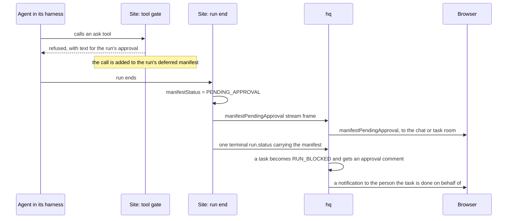
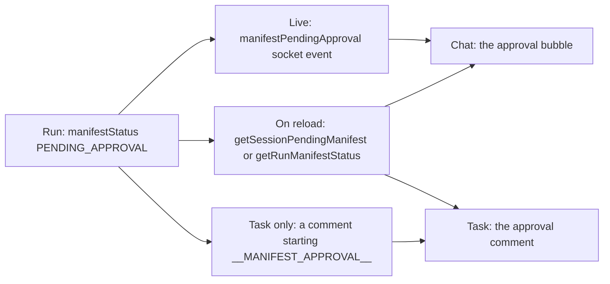
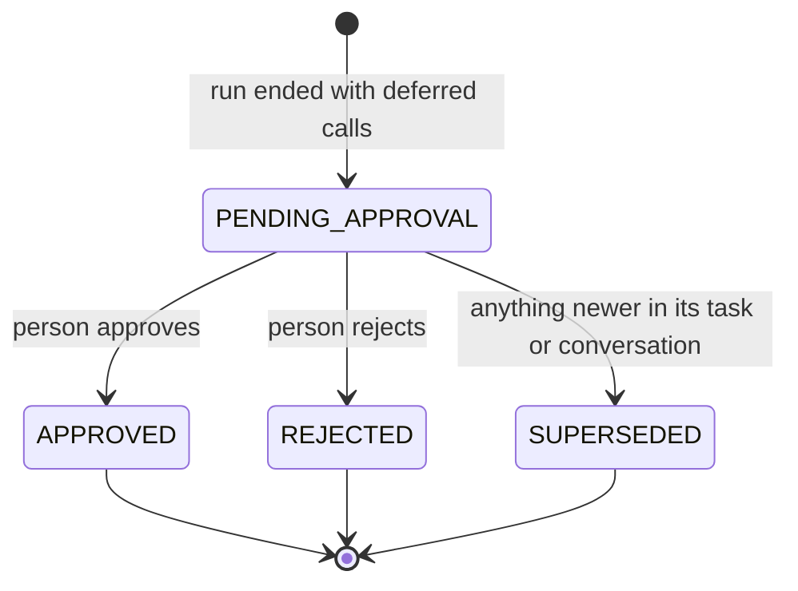

# Approval Flows: What the User Sees

The flows of a tool approval, from a refused call to a person's decision, with the cards that carry it.
The model is in [tool-control.md](../../architecture/tools/tool-control.md) and
[tool-manifest.md](../../architecture/tools/tool-manifest.md); the states and who writes them are in
[hitl-and-tool-control.md](./hitl-and-tool-control.md). This document covers the rendering layer: how the
approval card reaches the person, for a chat and for a task, and what its states mean.



The agent is never told an approval system exists: it sees an ordinary refusal from a tool. In `deferred`
mode the text tells it to carry on with its plan; in `immediate` mode, to explain why it needs the tool and end
its turn ([tool-manifest.md](../../architecture/tools/tool-manifest.md#how-a-run-collects-it)).

---

## What the person sees

The agent's reply and the approval request are separate: the agent's text is the run's transcript, and the
approval card is its own element below it.

**A conversation held in hq** shows a request differently: a worker's request, which the site raises as described here, and the lead's own tools at *ask* become a request in the conversation's work bar, answered there ([approvals in a conversation](../conversations/conversations.md#approvals)). What follows describes a run in a session.

**A session**, opened on its own (a task's session), shows the card where the run asked, in the session's own record: the run's `APPROVAL_REQUESTED`
line, drawn by `ApprovalCard`. While the request waits it lists, in plain words, what each item will do and why,
with **Approve** and **Deny** (a denial may give a reason; "Denied by the person" if none). Once answered it folds to one
line, "Approved by you" or "Denied by <name>" with the time, and opens to the same card; a request that was
replaced reads "Not answered — replaced by a newer message". A person who may only read sees what it asks and no
buttons. A request that has arrived live but is not yet in the record is shown by the same card.

```
┌──────────────────────────────────────────────┐
│  [AV]  AgentName is waiting for an approval  │
│                                              │
│  Write a file — to create the output file    │
│                                              │
│  [ Approve ]  [ Deny ]                       │
└──────────────────────────────────────────────┘
```

**A task** has its agent's text in the session transcript. What waits is shown in the task's own view (`TaskWaiting`,
using `ManifestApprovalBubble`) with Approve and Reject, and as a comment on the task (`ManifestApprovalComment`);
once decided each shows "Approved" or "Rejected" in place of the buttons. Rejecting asks for an optional reason,
"Rejected by user" if none is given.

The cards are in `ui/src/sessions/` (`ApprovalCard.tsx`, `ManifestApprovalBubble.tsx`, `ManifestApprovalComment.tsx`);
hq wraps the task's in `hq/src/projects/components/TaskWaiting.tsx` and `ManifestApprovalComment.tsx`.

---

## How the card is delivered



| Path | Delivered by | Restored on reload by |
|---|---|---|
| Chat | The `APPROVAL_REQUESTED` line of the conversation's record, with the request and its answer read off the run (`hq/src/sessions/conversationRecord.ts`); live, the `manifestPendingApproval` socket event, sent to the session room as the site's stream frame is relayed (`hq/src/sites/channel/siteEventHandler.ts`) | The conversation read itself; `getSessionPendingManifest` finds a run still `PENDING_APPROVAL` on the site |
| Task | A comment written by hq's status listener (`hq/src/agents/taskStatusListener.ts`), and a notification to the person the task is done on behalf of (`approvalNotification.ts`), whose button opens the task; the same socket event reaches the task room | The comment is persisted in hq's database; its buttons or its decided state come from `getRunManifestStatus` |

The `manifestRejected` socket event (`hq/src/server/socket.ts`) clears a chat's bubble when a manifest is
rejected, and a rejected task gets a second comment starting `__MANIFEST_REJECTED__`.

---

## Approval card states

The card asks the site for the run's `manifestStatus` whenever it mounts, so it shows the true state after
navigating away and back.



| `manifestStatus` | Card shows | What follows |
|---|---|---|
| `PENDING_APPROVAL` | Approve and Reject buttons | Nothing until a person decides, or anything newer in the task or conversation replaces it |
| `APPROVED` | An "Approved" badge | The next run of the task or conversation starts, and it alone is given the approval |
| `REJECTED` | A "Rejected" badge | The run is `CANCELLED`; a task stays `RUN_BLOCKED` for review |
| `SUPERSEDED` | "Replaced — something newer happened in this task", with no buttons; a chat's bubble leaves when a newer run reports its status | Nothing: the newer message or run went on without it |

---

## Where in the code

| File | Role |
|---|---|
| `ui/src/sessions/ApprovalCard.tsx`, `ManifestApprovalBubble.tsx`, `ManifestApprovalComment.tsx` | The chat card, and the task's two |
| `ui/src/sessions/PanelChatView.tsx`, `ConversationItems.tsx` | Listens for the socket events and shows the chat card |
| `hq/src/agents/manifestQueries.ts` | `getSessionPendingManifest`, `getRunManifestStatus` |
| `hq/src/agents/manifestActions.ts` | `approveManifest`, `rejectManifest` |
| `hq/src/agents/taskStatusListener.ts` | The task comment, the `RUN_BLOCKED` transition and the notification |
| `site/src/server/runtime/deferredManifestReport.ts` | Marks the run pending and sends the frames |
