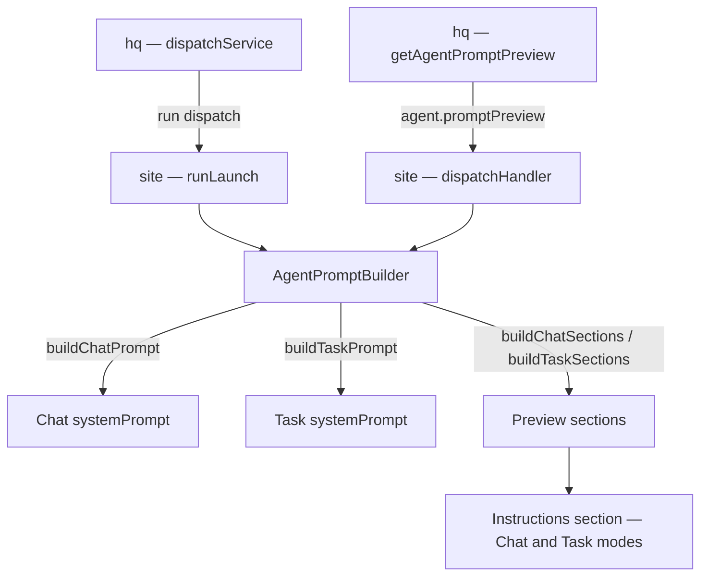

# Prompt Builder

How system prompts are assembled, where prompt content comes from, and how the UI surfaces structured sections for editing.

**Source:** [`site/src/agents/AgentPromptBuilder.ts`](../../../site/src/agents/AgentPromptBuilder.ts)
**Types:** [`site/src/shared/promptSections.ts`](../../../site/src/shared/promptSections.ts)
**Block text:** [`site/src/agents/promptSectionText.ts`](../../../site/src/agents/promptSectionText.ts)
**Preview lists:** [`site/src/agents/promptSectionLists.ts`](../../../site/src/agents/promptSectionLists.ts)
**Related:** [agent-execution-flow.md](./agent-execution-flow.md) — how a run reaches the builder

The builder lives on the Execution Site. hq dispatches a run and hq asks for a preview; neither assembles a prompt itself. It builds the prompt of a **harness run**: a task run, a chat, or a worker's brief in a conversation. The lead of a [conversation](../conversations/conversations.md), which answers by direct model calls in hq, has no prompt built here: its context is assembled by hq ([long conversations](../conversations/long-conversations.md)).

---

## Principle

All prompt assembly is owned by `AgentPromptBuilder`. Nothing prompt-related should be defined elsewhere. Callers pass only their own context — the builder handles section assembly internally.

The builder takes two things: the agent's configuration as hq sent it at dispatch, and the run's resolved package content (the `AgentPromptBuilder` constructor). The package content is the agent's `instructions.md` and the org's `ORG.md`, plus a storage boundary's own instructions override appended after the package's, and the place's `AGENTS.md` (`site/src/agents/promptContent.ts`). The builder reads no identity file from disk.

Each run mode returns `{ systemPrompt, userMessage }`, with an optional `sections` array (`PromptResult`). Sections are joined into the prompt with `'\n\n---\n\n'` (`joinSections`). The builder reads one file itself: the person's agenda (chat runs).

**A place's instructions.** `AGENTS.md` at the top of a project's or a person's own files is that place's instructions for every agent working there, and every run in the place — chat or task — carries it, under *Instructions for this place* (`site/src/agents/placeInstructions.ts`). Agents may change it when someone asks them to. It is read only as a regular file directly in a real `files/` folder: a link at the file, or a `files/` folder replaced by a link, leaves it out, as does a file over 128 KiB.

---

## Architecture



A run's prompt is built by `runLaunch`, which picks the mode from the dispatch context it was given (`assembleRunLaunch`). A preview is built by the `agent.promptPreview` handler (`handleAgentPromptPreview`), which hq calls over the control channel (`hq/src/agents/queries.ts`).

---

## What each run mode contains

| Mode | System prompt, in order | User message |
|---|---|---|
| Chat (a chat, or a worker's brief) | identity, instructions, memory, local time, agenda, the place's `AGENTS.md`, the conversation's own context if any, filesystem | empty: the person's message, or the brief, is the run's input |
| Task | identity, instructions, memory, local time, no-agenda notice, org, the place's `AGENTS.md`, board, task, new comments if any, execution rules, filesystem | `Execute your assigned task.` |

The filesystem section is present only when the run has mounts. The local time section is present only when the run has a person with a timezone (below). Skills are not part of the prompt; the runtime stages them separately.

---

## Structured sections

| Method | Used by |
|---|---|
| `buildChatSections()` | The prompt preview in an agent's Instructions section — Chat mode (preview only) |
| `buildTaskSections()` | The prompt preview in an agent's Instructions section — Task mode (preview only) |

**How closely the preview matches a real run.** Chat and task previews are built from separate preview-only lists (`chatPreviewSections`, `taskPreviewSections` in `site/src/agents/promptSectionLists.ts`), because a real chat or task prompt needs a live run's agenda, memory, mounts, local time and task detail, none of which a preview has. The preview stands in for those with explanatory placeholders (and leaves out the local time section) and flattens its own sections with the same join (`site/src/server/runtime/dispatchHandler.ts`).

### Section keys

Defined in `site/src/shared/promptSections.ts` as `PROMPT_SECTION_KEY`:

| Key | Present in | Editable |
|---|---|---|
| `identity` | all modes | no — platform managed |
| `org` | task | no — platform managed |
| `instructions` | all modes | yes → `instructions.md` |
| `memory` | all modes | no — platform managed |
| `agenda` | all modes | no — platform managed |
| `execution` | task | no — platform managed |
| `project` | all modes — the place's `AGENTS.md`, labelled *Place instructions* | no — runtime injected |
| `board` | task | no — runtime injected |
| `task_detail` | task | no — runtime injected |

The one editable key saves the agent's package file in place, mapped by `EDITABLE_SECTION_FILES` (`site/src/shared/promptSections.ts`). An agent's identity is one editable section — `instructions` — carried as package content. The local time section is added to a real run's prompt only and has no key, because it is not shown in the preview.

The `editable` flag on each `PromptSection` is the authoritative source on the client — the UI reads `section.editable` directly.

---

## Builder API

```typescript
new AgentPromptBuilder(agent, content)   // agent config from dispatch + resolved PromptContent

  // Run-mode prompts
  .buildChatPrompt(context: {
    sessionContext?: string | null
    agenda?: { hostPath: string; visiblePath: string } | null
    containerMounts?: ContainerMounts
    person?: { timezone: string } | null
    pinnedMemoryPath?: string | null
  }): Promise<PromptResult>

  .buildTaskPrompt(context: {
    projectId: string
    boardName: string
    columns: string
    taskId: string
    title: string
    description: string
    roadmapPath: string
    containerMounts?: ContainerMounts
    person?: { timezone: string } | null
    pinnedMemoryPath?: string | null
    newComments?: TaskCommentForRun[]
  }): Promise<PromptResult>

  // Section builders (used by the prompt preview)
  .buildChatSections(): Promise<PromptSection[]>
  .buildTaskSections(): Promise<PromptSection[]>
```

`PromptResult` shape:
```typescript
{ systemPrompt: string; userMessage: string; sections?: PromptSection[] }
```

`ContainerMounts` (`site/src/agents/AgentPromptBuilder.ts`) is what the container prep resolved: every mounted location's container path, and the run's working directory. It becomes the `## Filesystem` section, so an agent is told where its directories are.

**There is no `userHandle` in the chat context.** It was removed when the agenda stopped being keyed by a handle: the agenda belongs to a person within a storage location, and the folder holding it is keyed by the immutable user id like every other storage path. The wire type carries `sessionContext` only, and says so (`core/src/protocol/runtimeData.ts`). Voice adds nothing to a harness prompt: it is a mode of the lead's conversation, so the voice note a chat run used to carry is gone.

---

## Block builders

Module-level functions in `site/src/agents/promptSectionText.ts` that build individual section content strings. Used by the run prompts and by the preview section lists alike.

| Function | Line | Returns |
|---|---|---|
| `buildAgentIdentityContent(agent)` | `:17` | Identity block, from the agent config hq dispatched |
| `buildMemoryContent(pinnedMemoryPath)` | `:65` | The memory section: how to recall, and the pinned file if the run has one |
| `buildOrgSection(org)` | `:113` | The org's `ORG.md` as a section, or null |
| `buildAgendaSection(agendaPath, contents)` | `:129` | The person's agenda, at the path the run itself sees |
| `buildNoAgendaSection()` | `:162` | The agenda section for a run that has none |
| `buildBoardSection(boardName, columns)` | `:176` | Board block: the board's name and its columns, with a note that a task in none is in the board's Backlog |
| `buildTaskSection(taskId, title, description)` | `:180` | Task block |
| `buildNewCommentsSection(comments)` | `:189` | The comments written on the task since this agent's last run on it, marked new (a task's session is shared, see [sessions](./sessions.md#a-tasks-session-is-shared)) |
| `buildTaskExecutionSection(roadmapPath)` | `:199` | Task execution rules |
| `buildLocalTimeSection(timezone, now)` | `:223` | The person's timezone and the current local date and time |

---

## Agenda

The agenda is one section: the person's own file, followed by the guidance about it (`site/src/agents/AgentPromptBuilder.ts`).

**Only a chat run has one.** It is resolved from the run's storage location and the invoking person's user id by `resolveRunAgenda` (`site/src/agents/runtime/locationResolver.ts`), and only when the session is a chat with a user on it (`site/src/agents/runtime/runLaunch.ts`). A task run acts for the project (or, in a personal project, for its person) and is not a conversation with anyone, so it gets `buildNoAgendaSection()`.

The resolver returns two paths: the host path the builder reads the file from, and the path the run itself sees inside its mounts. The prompt prints the second, so the path an agent is told about is always one it can reach.

---

## Memory

No memory arrives whole in a prompt. `buildMemoryContent` (`site/src/agents/promptSectionText.ts`) renders one section that says what the agent knows is kept in hq, tells it to call `recall` before asking again, `remember` when it learns something and `forget` when an item stops being true, and, when the run has pinned items, names the read-only file they are in (`pinnedMemoryPath`, written at run start from what hq sent in the dispatch context). The same section ends with a few lines on knowledge: that `search_knowledge` finds how things are done here and how Agenthix works, in one search across the conversation's places, that the most specific page wins, and that what the agent learns on its own belongs in memory. None of knowledge itself is in the prompt ([knowledge](../knowledge/knowledge.md)). A run nobody commissioned has no pinned file for a person ([memory](../memory/memory.md)).

---

## Local time

A run on behalf of a person whose timezone is known gets a `## Local time` section after the memory section. It states the person's timezone and the current date and time on their clock, taken from the site's clock when the prompt is built, and tells the agent to read "today", "tomorrow" and times of day on that clock, and to give any time it sets without an offset so that it is read in the person's timezone unless they name another (`buildLocalTimeSection`, `site/src/agents/promptSectionText.ts`).

hq sends the timezone in the dispatch context as `person.timezone` (`hq/src/agents/runContext.ts`): a chat's is the person in the conversation, a task run's is the person the task is done on behalf of. A person's timezone is stored in their settings, taken from the browser until the person chooses one in their Settings. A run with no person, or whose person has none, gets no section, and the agent's scheduling tools then read times in UTC with a note saying so ([routines](../tasks/routines.md)).

---

## Prompt preview

`getAgentPromptPreview` on hq resolves the agent and its packages and asks a site to assemble the preview, returning the sections alongside the flattened prompt (`hq/src/agents/queries.ts`). Building a preview reads no run and touches no storage, so any site that could run the agent produces the identical prompt and the local one answers. An unreachable site surfaces as an explicit failure rather than an empty preview.

Task-mode sections that are runtime-injected (`project`, `board`, `task_detail`) are shown as read-only placeholders with explanatory content (`site/src/agents/promptSectionLists.ts`).
