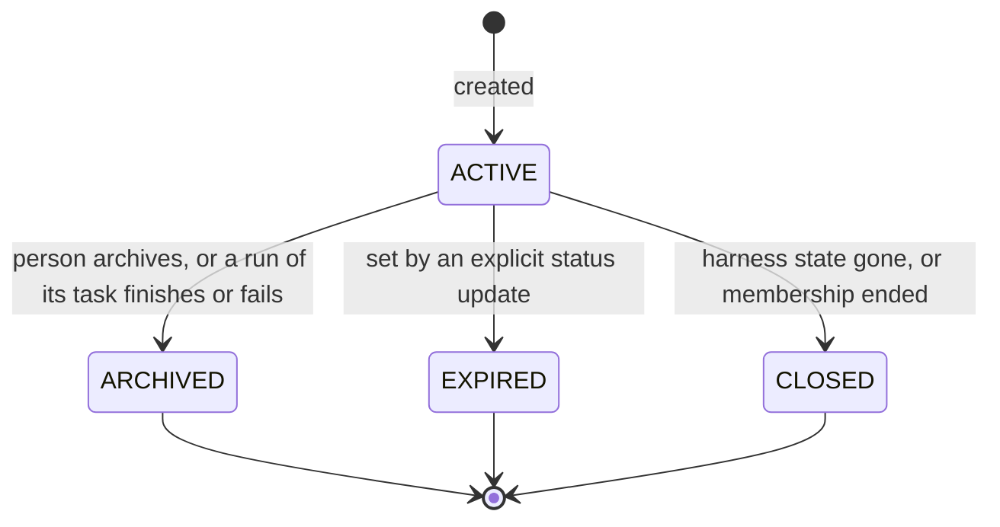

# Sessions

A **session** is a harness session held on a site: an ordered transcript of messages and the runs that produced them, in the code an `AgentSession`. There are three kinds. A **task's session** is the agent's working record of a task. A **standing worker** is the session in which a [conversation](../conversations/conversations.md) does its background work in one boundary. A **chat** — a session with no task and no conversation, in which a harness answered every message — is from before the conversations held in hq: none starts and none is listed or opened; nothing carries one forward.

A conversation is not a session. It is a record held in hq whose replies are direct model calls, with workers and tasks doing its longer work; everything in this document about a transcript, a run and the agent's memory then describes those workers and tasks, and what a person reads in the conversation comes from hq.

`CLOSED` is permanent: nothing reopens a conversation, and hq refuses to set a closed session back to `ACTIVE`. `EXPIRED` exists in the schema and can be set through hq's `updateSession` action, but nothing in the platform sets it on a timer. Releasing an idle conversation's processes is a different thing and does not change the status (see Idle release).

## A run

A **run** is one stretch of an agent's work. The term is the industry's, from OpenAI's Assistants API, where a
*thread* holds a conversation, a *run* applies the assistant to it until it replies, and *run steps* are its tool
calls. Claude Code calls the same span a *query* on a session, made of the model's *turns*, so a turn there is
smaller than a run; OpenCode's `opencode run` sends one message the same way. What is Agenthix's own is the exact
boundary:

- **It starts** when something hands the agent work: a person's message in a conversation, a task starting, or a
  routine firing.
- **It covers** everything the agent does from then on, without a person in between: its thinking, every tool call,
  any sub-agents it starts, until it hands back with its reply.
- **It ends** completed (the agent replied), failed (an error, or the run's time or turn limit), or stopped (someone
  pressed Stop, or a new message interrupted it).
- **It never waits for approval.** What needs approval is refused and listed, and the run ends with the list.
  Approving starts the next run, which alone may use what was approved
  ([human approval](./hitl-and-tool-control.md#an-approval-is-for-the-next-run-only)).
- **The next message starts the next run.** A conversation is a sequence of runs. The agent's context is not the
  run: the harness keeps the whole conversation and resumes it on every run.

A run is an `AgentRun` row on the site, with its own tool calls (`ToolCallLog`). Every line of the transcript
names the run that wrote it (`TranscriptEntry.runId`; a person's message names the run it started), so a reply
links to its run. A tool call's `TOOL` line and its `ToolCallLog` row both carry the harness's own id for the call
(`toolUseId`), so a call finds its own output. A `TOOL` line written before that was recorded has no id, and its
call shows "Output not recorded".

### What the transcript records

The transcript is the conversation's whole record (`core/src/protocol/transcript.ts`), so a reload loses nothing.
Each tool line and each stretch of the agent's thinking is written at the time it happened, and what used to exist
only on screen or on the run is a `SYSTEM` line of its own, a `kind`:

| `kind` | Where it stands | What it carries |
|---|---|---|
| `THOUGHT` | Among the run's tool calls, where the agent thought it | The thought |
| `RUN_FAILED` | Where the reply would be, after what the run did | The reason in plain words (`plainFailureReason`); the raw error stays on the run |
| `RUN_STOPPED` | After anything the run wrote | Why it stopped (a person, a new message, a limit) and who |
| `APPROVAL_REQUESTED` | Where the run ended asking | Read with the request and its answer, which are the run's ([human approval](./hitl-and-tool-control.md)) |
| `CONTEXT_SUMMARISED` | Where the runtime summarised its memory | Automatic or asked for, by whom, and the summary |

A conversation is read run by run (`orderTranscript`): a message sent while a reply was being written stands after
that reply, and reads as waiting while its run has not started. The work line above a reply — each step as one
plain line in order, and the folded line that names them — is built from these lines by `workLine`
(`core/src/protocol/workLine.ts`), never from raw tool names. hq adds who answered an approval or asked for a
summary, and the conversation's facts: replies, failed replies, the failure **Try again** would answer, and the
agent's memory (`hq/src/sessions/conversationRecord.ts`).

**Try again** sends the person's last message again in a fresh, hidden run, told the last attempt failed. It is
offered only while the latest reply is a failure, and refused while the agent works.

### The agent's memory

The agent works from its runtime's own copy of the conversation, which the runtime may summarise without the
transcript changing. After each run the site reads how full that copy is — tokens now, where the runtime summarises
on its own, the model's window (`core/src/protocol/contextUse.ts`) — and keeps it on the run and the session; hq
reads it with the conversation. Claude reports it through `getContextUsage()` and summarises with a
`compact_boundary` and its `PostCompact` hook's summary; OpenCode through each step's tokens against the model's
limits, and a summary message and `session.compacted`. **Summarise now** sends the hidden `/compact`, which the
Claude runtime passes to Claude Code and the OpenCode runtime turns into its session's `summarize` call; it is
refused while the agent works. A runtime summarising leaves a `CONTEXT_SUMMARISED` line. A conversation whose
runtime state is gone is still closed ([ADR-0076](../../adr/adr-0076-a-conversation-whose-harness-state-is-gone-is-closed.md)),
with the reason as its failure line.

### The Runs screen

A person's runs are listed on the **Runs screen**, which the Runs panel's **Show all ›** opens: their own, as the
panel's filters say, newest first, 25 at a time, narrowed by when, place, agent, how a run ended and a search. One run
is open beside the list at its own address (`/runs/<run>`, carrying its conversation's or task's session so one site is
asked for it). It shows what the run was for and where, its agent, who started it and for whom, its runtime and model,
its usage, its site, when and how long, how it ended and the request it made, and its tool calls with their risk
labels, each opening to its input and output. Each page of the list is one request to each site, for the runs of all
the person's conversations and tasks together (`run.listPage` with `sessionIds`); who may see a run is decided by hq
from its session, as for a transcript, and a run someone may not see reads as one that is not available.

## Kinds of session

| Kind | `sessionType` | `taskId` | Who it belongs to |
|---|---|---|---|
| Chat, from before (hidden and closed) | `chat` | none | The person it was created for, and nobody else. It belonged to one place |
| Standing worker | `chat`, with `conversationId` set | none | The person it works for, in one boundary, for one conversation; never listed as a conversation. A fresh session replaces it past the context mark (`workerGeneration`) |
| Task session | `task`, whoever started the run: a person, the pulse, a schedule, or an agent with `run_task` | set, unique | The task's project: shared with its members on equal footing (below). For a task in a person's personal project, that person alone |

A task has exactly one session, created on its first run and reused for every later run, so the agent keeps its context; its **conversation** is a separate thing, the team's thread about the task, held in hq ([conversations](../conversations/conversations.md#a-tasks-conversation)). The task's session is what a run of the task, from the thread or anywhere, works in ([ADR-0030](../../adr/adr-0030-task-scoped-agent-sessions.md)). It is archived when a run of it finishes or fails; a run that is stopped or blocked leaves it open for the run that follows. A standing worker works in one boundary, and a task's session in its task's project. The row records the **primary location** the session works in, which decides which site runs it, and it is never moved. See [places](../projects/places.md) and [execution flow](./agent-execution-flow.md).

## Two rows, one writer per field

The session exists in hq's database and in the site's (`model AgentSession` in `hq/schema.prisma` and `site/schema.prisma`). hq keeps its copy so it can answer ownership and privacy questions without calling the site; the site needs its own because it owns the runtime data: transcript entries, runs and tool-call logs live only there.

| Fields | Written by | How the other side learns |
|---|---|---|
| `id`, `sessionKey`, `agentId`, `userId`, `sessionType`, `taskId`, `model`, `metadata`, primary location, `runtime`, `createdAt` | hq, once | Sent as a session seed on every dispatch; the site's upsert never overwrites an existing row (`site/src/server/runtime/sessionRows.ts`) |
| `title` (when untitled), `status`, `closedReason`, token totals | the site | Replicated in the session patch on each run's status event; hq copies only these fields (`hq/src/sites/channel/siteEventHandler.ts`) |
| `title` (renamed), `status` (archived) by a person | hq action, site first | hq calls the site, then updates its own copy from the acknowledgement |
| `harnessSessionId` | the site, site only | Not replicated; hq never needs it |
| `status` to `CLOSED` when a membership ends, with no run to carry it | the site | A `session.patch` event; hq accepts only that close, only from the site that owns the session (`hq/src/sites/channel/sessionPatchEvent.ts`) |

**Closed reasons** (`core/src/protocol/sessionState.ts`): `HARNESS_STATE_MISSING` (the harness no longer holds the conversation's state), `LEFT_PROJECT`, `LEFT_ORGANISATION` and `PROJECT_DELETED` (the person lost access, and the site deleted the home that held the state). The history stays in every case. hq shows it with a notice and a button to start a new conversation with the same agent ([ADR-0076](../../adr/adr-0076-a-conversation-whose-harness-state-is-gone-is-closed.md)); a send into a closed session fails with the reason (`hq/src/sessions/closedSession.ts`).

## The runtime is fixed at creation

A session records the agent's `runtime` (`claude-sdk` or `opencode`) when it is created and never changes it, because one harness cannot read another's saved state. Changing the agent's runtime later affects new conversations only ([ADR-0078](../../adr/adr-0078-a-conversation-keeps-the-runtime-it-started-with.md)).

## Privacy

A chat's content, meaning its title, messages, runs, tool calls and live stream, is readable only by its owner, with no exception for administrators ([ADR-0041](../../adr/adr-0041-chat-session-privacy.md)). Within a storage boundary, its members can see that a chat is running, which agent it is with, who started it, where and since when, but not what it says ([ADR-0077](../../adr/adr-0077-within-a-boundary-a-running-chat-is-visible-its-content-is-not.md)). A conversation held in hq is read by the same rule, decided from its home (`hq/src/conversations/readingRule.ts`); a standing worker's content is its person's too. The rule is enforced in hq only, in `hq/src/sessions/sessionEntitlement.ts`: task sessions follow project membership (a personal project's follow its one person), and chats follow the person. Acting on an existing session (sending, starting a run) also re-checks that the person is still a member of its project, so losing access stops a live chat.

## A task's session is shared

A task's session belongs to the task's project, not to one person, and the people on the project work in it on
equal footing ([ADR-0095](../../adr/adr-0095-a-run-is-on-behalf-of-whoever-started-it.md)):

- **Who may act.** Every member who may see the project reads it. Anyone who works in the project — its Members
  and Admins — can send a message into it, interrupt or stop its run, start one, and approve or deny its tool
  requests; the project's Viewers only watch. A message sent while nothing is running starts a run at once.
- **Whose behalf a run is on.** A run a person starts — Run, Run again, Run all, or a message into the session —
  is on that person's behalf: their access to the project is checked before it starts, its tool requests notify
  them, and a task its agent creates is on their behalf. hq records the person on the task's claim
  (`Task.runOnBehalfOfUserId`), sends them in the dispatch, and signs them into the run's capability, which
  carries them through renewal. A run nobody started — a column, a start time, a routine, the pulse — is on
  behalf of the task's person ([task](../tasks/task.md#on-behalf-of)). A run whose starter has left the project
  fails instead of starting.
- **Who sent each message.** Every person's message records its sender (`TranscriptEntry.authorId` on the
  site), and hq shows it with their name: "You" for the reader's own, "Someone" for a person no longer in the
  organisation.
- **Who stopped a run.** Stop, Stop all and an interrupting message send the person's name with the cancel; the
  run's error reads "Stopped by <name>" or "Interrupted by <name>", and its `RUN_STOPPED` line names them.
- **What the agent is told.** Each run of the task is given the comments written since its agent last ran on
  the task, marked new in its prompt; `get_task_details` returns the rest.

This is what the session is for: the agent's working record, every message, command and result, with each run
as a divider. Discussion meant to be kept, or for others, belongs in the task's comments.

## Sending into a busy conversation

A session runs one turn at a time. (A conversation held in hq queues messages the same way, with the same setting; see [conversations](../conversations/conversations.md#a-turn).) Each person has a setting, `UserSettings.busyConversationMode` in `hq/schema.prisma`: `WAIT` (default) queues the new message behind the running turn; `INTERRUPT` cancels the running turn first, recording it as "Interrupted by <name>" ("Interrupted by a new message" on an older site), then dispatches (`hq/src/sessions/busyConversationInterrupt.ts`). The setting is that of the person sending, not the session's owner.

A waiting message is a run that has not started, so it survives a reload and reads as waiting. **Send now** stops
the running turn for it, as Interrupt would. **Cancel** withdraws it before it starts: the site cancels its run and
takes the message out of the transcript (`run.cancel` with `withdrawn`); only its sender may, and once it has
started it can only be stopped (`hq/src/sessions/conversationActions.ts`).

## Idle release

Nothing is reset when a turn ends. After a conversation has had no turn for a machine-set time (`AGENT_SESSION_IDLE_MINUTES`, default 30), the site releases what it held: processes the agent started, the warm harness, staging files. The conversation stays resumable; its next turn starts without them. Closing or deleting a conversation releases it at once ([ADR-0083](../../adr/adr-0083-a-process-belongs-to-the-conversation-that-started-it.md)). The timer is in site memory, so a site restart forgets it.

## Where in the code

| Concern | Path |
|---|---|
| hq's row, create, rename, archive | `hq/schema.prisma`, `hq/src/sessions/actions.ts` |
| Task session archive | `hq/src/agents/taskSessionArchive.ts` |
| Site's row, seed, close | `site/src/server/runtime/sessionRows.ts` |
| Close on membership end | `site/src/server/runtime/membershipEnding.ts` |
| Resume check and close | `site/src/agents/runtime/sessionExistenceCheck.ts` |
| Idle release | `site/src/agents/runtime/conversationLifecycle.ts` |
| Access rules | `hq/src/sessions/sessionEntitlement.ts` |
| A standing worker, a fresh start | `hq/src/conversations/work/workers/standingWorker.ts`, `freshStart.ts` |
| Whose behalf a run is on | `hq/src/agents/taskSlotClaim.ts`, `dispatchService.ts`, `hq/src/server/controlplane/runOnBehalfOf.ts` |
| Who sent a message, who stopped a run | `site/src/server/runtime/chatExecution.ts`, `hq/src/sessions/transcriptAuthors.ts`, `site/src/agents/runtime/turnStop.ts` |
| A run's lines in the transcript, its ending | `site/src/agents/runtime/runPersistence.ts`, `runFailure.ts`, `site/src/server/runtime/transcriptRows.ts` |
| The conversation read; Try again, Send now, Cancel, Summarise now | `hq/src/sessions/conversationRead.ts`, `conversationRecord.ts`, `conversationActions.ts` |
| The agent's memory from each runtime | `site/src/agents/runtime/claude/claudeMemory.ts`, `site/src/agents/runtime/opencode/openCodeContext.ts`, `openCodeTranslate.ts` |
| The comments a run is given | `hq/src/agents/taskCommentsForRun.ts`, `site/src/server/runtime/taskComments.ts` |

## Decisions behind this

[ADR-0030](../../adr/adr-0030-task-scoped-agent-sessions.md), [ADR-0041](../../adr/adr-0041-chat-session-privacy.md), [ADR-0076](../../adr/adr-0076-a-conversation-whose-harness-state-is-gone-is-closed.md), [ADR-0077](../../adr/adr-0077-within-a-boundary-a-running-chat-is-visible-its-content-is-not.md), [ADR-0078](../../adr/adr-0078-a-conversation-keeps-the-runtime-it-started-with.md), [ADR-0083](../../adr/adr-0083-a-process-belongs-to-the-conversation-that-started-it.md), [ADR-0095](../../adr/adr-0095-a-run-is-on-behalf-of-whoever-started-it.md), [ADR-0096](../../adr/adr-0096-a-conversation-belongs-to-a-place.md).
