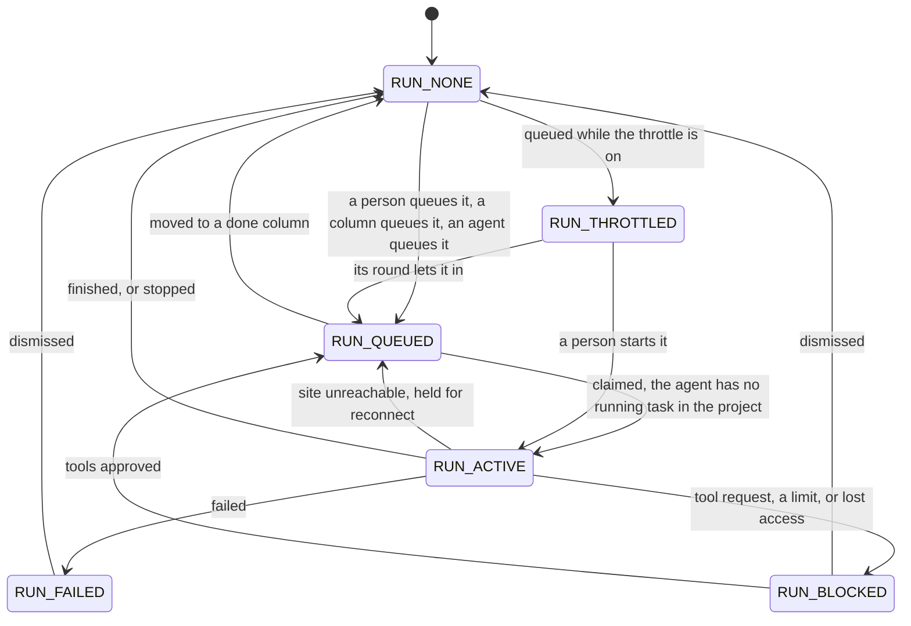
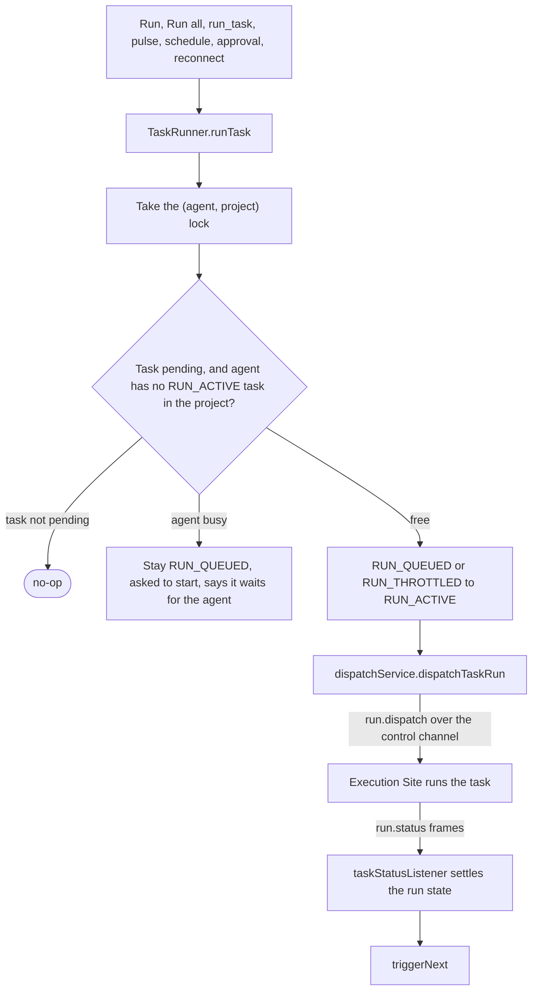
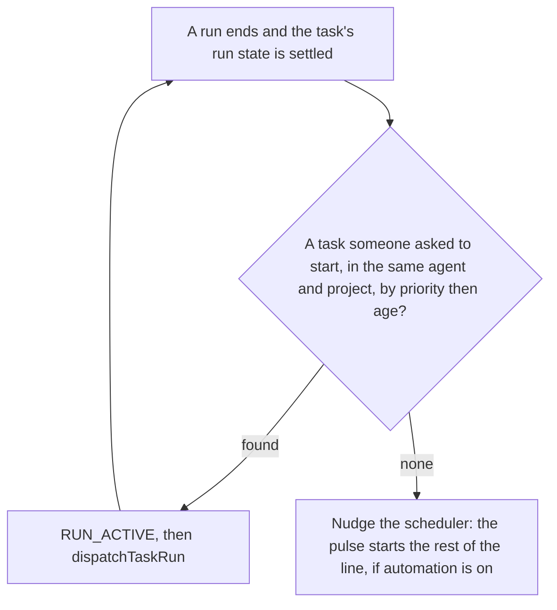

# Task Execution Concurrency

How the system keeps tasks for the same agent and project running one at a time, and what state a task is in while it waits, runs, or needs a person.

For the full agent execution flow, see [agent-execution-flow.md](./agent-execution-flow.md). For what starts a task on its own, see [automation](../tasks/automation.md).

---

## The Rule

**One `RUN_ACTIVE` task per agent per project at a time.** The database enforces it.

An agent can work on tasks from multiple projects concurrently — each project is its own storage boundary, served by its own container for its own runs plus one container per active member. But within a single project, tasks assigned to the same agent run one after another: the next task does not start until the current one's run ends. This is a rule about how task work is handed out, not about containers: the site itself runs a project's chats, tasks and subagents in parallel, ordering only the turns of one conversation ([ADR-0075](../../adr/adr-0075-work-in-a-boundary-runs-in-parallel-only-a-conversation-is-ordered.md)).

**Enforced atomically.** Every claim of a pair runs in one transaction that first takes a Postgres advisory lock keyed on the (agent, project) pair, then checks whether the agent already holds a `RUN_ACTIVE` task there, then writes (`hq/src/agents/taskSlotClaim.ts`). Claims of the same pair queue on the same lock across connections and across hq processes, so two pulses, or a pulse and a person pressing Run, cannot both see the slot free; the loser stays queued. The write is also conditional on the task's run state, so a task a person stopped meanwhile is never pulled back to running.

**The agent's line.** An agent's queued tasks in a project form one line. Tasks someone asked to start (a person's Run, a start time that fell due, `run_task`) go first; the rest follow, highest priority first, then longest queued first. When the agent's run ends, the first task in the line starts at once. A task whose start time or round time has not yet come is not in the line ([tasks](../tasks/task.md)).

---

## A task's state and its run state

A task carries two states, owned by different parties. The task's own state is where the work stands: its board column (`column`) and the `status` that column maps to, set by the agent or a person. The **run state** (`Task.runState`, enum `TaskRunState` in `hq/schema.prisma`) says whether a run of the task is pending or going now, and **only the system sets it**. Agents have no tool for it. A task can have many runs over its life; each run's own outcome is on that run, not in the run state.

| Run state | UI label | Meaning |
|---|---|---|
| `RUN_NONE` | none shown | No run pending. Where a run that finishes, or is stopped, leaves the task |
| `RUN_QUEUED` | Queued | In its agent's line; it starts when the agent is free, or, with automation off, when a person starts it |
| `RUN_THROTTLED` | Throttled | Only with the boundary's throttle on: queued, but outside this round's batch; it waits for the next round |
| `RUN_ACTIVE` | Running | A run is going, including one its site has accepted and holds until a run slot is free, which the task says |
| `RUN_BLOCKED` | Needs you | A person must act: approve a tool request, look at a run stopped at its limit, or reassign a task whose person lost access |
| `RUN_FAILED` | Run failed | The last run failed; a person looks at why |

`runStateReason` says why: what a queued or throttled task waits for (its place in its agent's line, the agent's running task, the next round, automation being off, a held site), the error of a failed run, or what a person must do. A task that sits queued never looks like a fault.

Rules that follow:

- **Moving a task between columns never changes its run state**, with two exceptions the system applies: moving it into a column that queues automatically queues a run if none is pending, failed or blocked; and moving it into a done column withdraws a run that is queued or throttled, but never one already running.
- **When a run ends, the system settles the run state** (`hq/src/agents/taskStatusListener.ts`): `RUN_NONE` if it finished or was stopped, `RUN_FAILED` if it failed, `RUN_BLOCKED` if it ended on a time or turn limit or on a deferred tool request. It then starts the agent's next task in the project, whatever the agent did to the task during the run. A task left waiting only because the agent was busy needs nothing from a person.
- **A person clears a failed or blocked run** by running the task again or dismissing it back to `RUN_NONE`. A task blocked because the person it is done for lost access is released only by a project admin choosing someone else.
- **A run stopped by a limit is blocked with the limit as its reason**, not retried: running it again would only reach the limit again.

How a task's column, state and board relate is in [task.md](../tasks/task.md). How this rule stacks with the site's own limits (one turn at a time per conversation, a fixed number of runs at once, `AGENT_MAX_CONCURRENT_RUNS`) is in [container-runtime.md](../../architecture/container-runtime.md#order-and-concurrency).

---

## Dispatch Flow

A task is started through `TaskRunner` (`hq/src/agents/TaskRunner.ts`), which owns the concurrency logic and executes nothing itself: it hands the run to the Execution Site over the control channel and returns once the site acknowledges. The callers are:

| Caller | `startedBy` |
|---|---|
| Run on a task, Run all on a board or a project (`hq/src/projects/actions.ts`) | `person` |
| `run_task` in a run a person started (`hq/src/server/controlplane/taskOps.ts`) | `agent` |
| The pulse of a boundary with automation on, taking the first task in an agent's line (`hq/src/automation/pulse.ts`) | `pulse` |
| A person's start time falling due, from the one scheduler | `schedule` |
| Approving a task's tools, and the drain of tasks held for a site's reconnect | the task's stored value |

`startedBy` decides which run limits apply and what the run may start itself; see [who started a run](./agent-execution-flow.md#who-started-a-run-and-the-limits-it-gets).

`dispatchTaskRun` (`hq/src/agents/dispatchService.ts`) builds the run's context and capability, including its limits and who started it, and sends `run.dispatch` to the site that holds the project's storage. Three failures are not plain errors:

- The site is unreachable: the task returns to `RUN_QUEUED` with a held-for-reconnect reason, and its line waits for the reconnect.
- The person the task is done on behalf of no longer has access to the project: the task becomes `RUN_BLOCKED` with a reason that says so.
- Any other dispatch error: the task becomes `RUN_FAILED` with the error, and the next task starts.

The mechanism is in [control-channel.md](../../architecture/control-channel.md).

The atomic claim is the primary guardrail. It only succeeds on a task that is pending, so any other state is a no-op. This prevents the same task being dispatched twice, the pulse picking up a task a person has already started with Run all, and a click on Run for a task already running.

---

## Trigger-Next (Completion Chain)

When a run ends, `triggerNext` steps up the agent's next task in the same project. It is called from the status listener after every run end — finished, failed, stopped, blocked by a limit or a tool request — and after a failed dispatch. It is not called when a dispatch is held for an unreachable site: the line waits for the reconnect.

`triggerNext` starts the next task someone asked to start, with the starter it was asked by. The rest of the line is the pulse's, so it nudges the scheduler, which starts it at once if the boundary has automation on and records the start. With automation off, queued tasks the agent has not been asked to start stay queued until a person starts them.

Tasks from other projects for the same agent are unaffected — they run on their own independent chain.

---

## Restart Behaviour

hq does not reset tasks at boot. A task left `RUN_ACTIVE` across a restart is reconciled when its site reconnects (`hq/src/agents/reconcileService.ts`): hq reads the site's newest run for the task. A run still pending or running is left alone; a terminal run is replayed as its status event; a `RUN_ACTIVE` task with no run at all is marked `RUN_FAILED`. A dispatch that could not reach a site returns its task to `RUN_QUEUED` with the reason "site unreachable — held for reconnect", and reconnecting drains those tasks through the normal claim. Everything the scheduler needs (when each pulse and start time is next due, when each boundary's last round finished) is stored, so a restart neither loses nor repeats it. The site's own boot marks runs it was executing as failed ("Server restarted — run was orphaned").

---

## References

- [task.md](../tasks/task.md) — a task's column and state, and how it is queued and run
- [automation.md](../tasks/automation.md) — the pulse, the throttle, depth and the queue limit
- [agent-execution-flow.md](./agent-execution-flow.md) — the run itself, on the site
