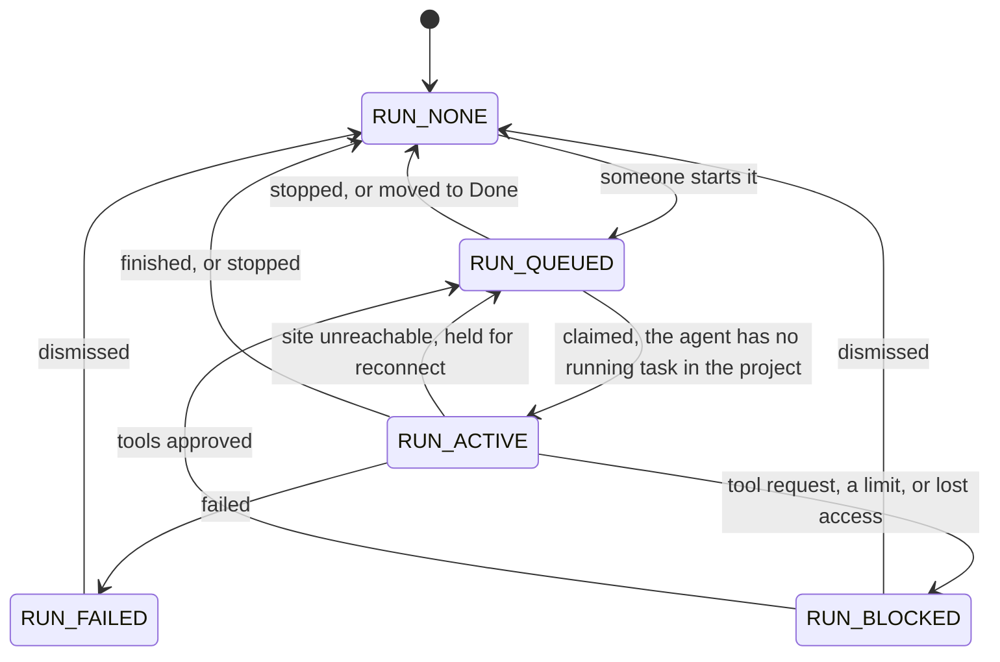
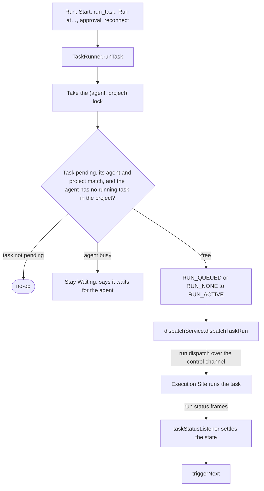
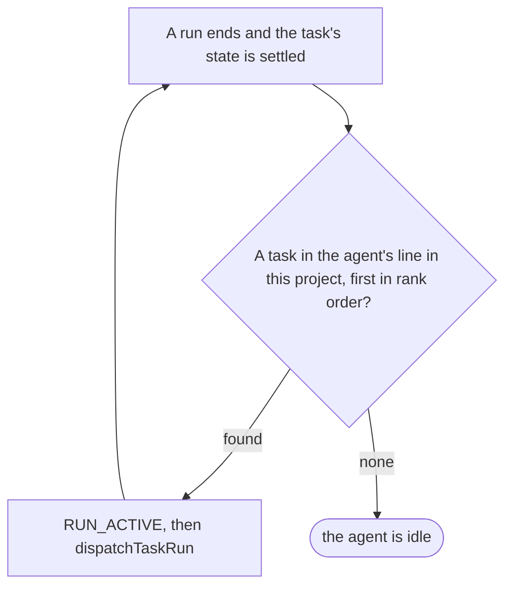

# Task Execution Concurrency

How the system keeps tasks for the same agent and project running one at a time, and what a task shows while it waits, runs, or needs a person.

For the full agent execution flow, see [agent-execution-flow.md](./agent-execution-flow.md). For what starts a task, see [how work starts](../tasks/automation.md).

---

## The Rule

**One running task per agent per project at a time.** The database enforces it.

An agent can work on tasks from multiple projects concurrently — each project is its own storage boundary, served by its own container for its own runs plus one container per active member. But within a single project, tasks assigned to the same agent run one after another: the next task does not start until the current one's run ends. This is a rule about how task work is handed out, not about containers: the site itself runs a project's chats, tasks and subagents in parallel, ordering only the turns of one conversation ([ADR-0075](../../adr/adr-0075-work-in-a-boundary-runs-in-parallel-only-a-conversation-is-ordered.md)).

**Enforced atomically.** Every claim of a pair runs in one transaction that first takes a Postgres advisory lock keyed on the (agent, project) pair, then checks whether the agent already holds a running task there, then writes (`hq/src/agents/taskSlotClaim.ts`). Claims of the same pair queue on the same lock across connections and across hq processes, so two Starts, or a Start and a person pressing Run, cannot both see the slot free; the loser stays Waiting. The write is also conditional on the task's run state, a task a person stopped meanwhile is never pulled back to running, and it requires the task's agent and project to be the pair being claimed.

**The agent's line.** A task someone has started for an agent in a project, and that has not yet run, is in the agent's **line**. The line is taken in the **project's rank order** (`hq/src/agents/agentLineOrder.ts`: rank ascending, unranked last, then number), whatever started each task. When the agent's run ends, the first task in the line starts at once. A task whose Run at… time has not yet come is not in the line. A task reassigned to another agent before it starts goes to that agent's line.

---

## A task's execution state

A task carries its **task state** (Backlog · To do · In progress · Done, set by people and agents moving it) and, separately, its **execution state**, which says what an agent is doing with it now and which **only the system sets**. Agents have no tool for it. A task can have many runs over its life; each run's own outcome is on that run ([task.md](../tasks/task.md)).

hq records the claim and settle cycle as a **run state** on the task (`Task.runState`, enum `TaskRunState` in `hq/schema.prisma`) and writes the execution state in the same write, so lists filter on a stored value (`hq/src/projects/executionState.ts`).

| Run state | Execution state | Meaning |
|---|---|---|
| `RUN_NONE` | Not started, or Finished | No run pending. **Finished** only when the task's run ended on its own; every other way back (a Stop, a withdrawal from the line, a dismissed failure, a released hold) is Not started |
| `RUN_QUEUED` | Waiting | In its agent's line; it starts when the agent is free |
| `RUN_ACTIVE` | Running | A run is going, including one its site has accepted and holds until a run slot is free, which the task says |
| `RUN_BLOCKED` | Needs you | A person must act: approve a tool request, look at a run stopped at its limit, or reassign a task whose person lost access |
| `RUN_FAILED` | Failed | The last run failed; a person looks at why |

`runStateReason` says why: what a Waiting task waits for (its place in its agent's line, the agent's running task, a held site), the error of a failed run, or what a person must do. A task that waits never looks like a fault.

Rules that follow:

- **Moving a task between columns never starts a run and never changes the execution state**, with one exception: moving it into Done takes it out of its agent's line (the work is decided), but never ends a run already going.
- **When a run ends, the system settles the execution state** (`hq/src/agents/taskStatusListener.ts`): Not started or Finished if it ended or was stopped, Failed if it failed, Needs you if it ended on a time or turn limit or on a deferred tool request. It then starts the agent's next task in the project, whatever the agent did to the task during the run. A task left waiting only because the agent was busy needs nothing from a person.
- **A failed run does not hold the line**: the failure waits under Needs you and the agent takes its next task.
- **A person clears a Failed or Needs you task** by running it again or dismissing it to Not started. A task held because the person it is done for lost access is released only by a project admin choosing someone else.
- **A run stopped by a limit is Needs you with the limit as its reason**, not retried: running it again would only reach the limit again.

How a task's column, state and board relate is in [task.md](../tasks/task.md). How this rule stacks with the site's own limits (one turn at a time per conversation, a fixed number of runs at once, `AGENT_MAX_CONCURRENT_RUNS`) is in [container-runtime.md](../../architecture/container-runtime.md#order-and-concurrency).

---

## Dispatch Flow

A task is started through `TaskRunner` (`hq/src/agents/TaskRunner.ts`), which owns the concurrency logic and executes nothing itself: it hands the run to the Execution Site over the control channel and returns once the site acknowledges. The callers are:

| Caller | `startedBy` |
|---|---|
| Run or Run again on a task, an agent's Start, Start all agents (`hq/src/projects/actions.ts`, `agentStart.ts`) | `person` |
| `run_task`, or `create_task` asked to start, in a run a person started (`hq/src/server/controlplane/startByTool.ts`) | `agent` |
| A person's Run at… time falling due, from the one scheduler | `schedule` |
| Approving a task's tools, and the drain of tasks held for a site's reconnect | the task's stored value |

`startedBy` decides which run limits apply and what the run may start itself; see [who started a run](./agent-execution-flow.md#who-started-a-run-and-the-limits-it-gets). A task that is Waiting with no recorded starter is never claimed.

`dispatchTaskRun` (`hq/src/agents/dispatchService.ts`) builds the run's context and capability, including its limits and who started it, and sends `run.dispatch` to the site that holds the project's storage. Three failures are not plain errors:

- The site is unreachable: the task returns to Waiting with a held-for-reconnect reason, and its line waits for the reconnect.
- The person the task is done on behalf of no longer has access to the project: the task becomes Needs you with a reason that says so.
- Any other dispatch error: the task becomes Failed with the error, and the next task starts.

A Stop that lands while a dispatch is on its way cancels the run the dispatch just started. The mechanism is in [control-channel.md](../../architecture/control-channel.md).

The atomic claim is the primary guardrail. It only succeeds on a pending task, so any other state is a no-op. This prevents the same task being dispatched twice, an agent's Start taking a task a person has already started, and a click on Run for a task already running.

---

## Trigger-Next (Completion Chain)

When a run ends, `triggerNext` steps up the agent's next task in the same project. It is called from the status listener after every run end — finished, failed, stopped, stopped by a limit or a tool request — and after a failed dispatch. It is not called when a dispatch is held for an unreachable site: the line waits for the reconnect.

Tasks from other projects for the same agent are unaffected — they run on their own independent chain.

---

## Restart Behaviour

hq does not reset tasks at boot. A task left running across a restart is reconciled when its site reconnects (`hq/src/agents/reconcileService.ts`): hq reads the site's newest run for the task. A run still pending or running is left alone; a terminal run is replayed as its status event; a running task with no run at all is marked Failed. A dispatch that could not reach a site returns its task to Waiting with the reason "site unreachable — held for reconnect", and reconnecting drains those tasks through the normal claim. Everything the scheduler needs (when each routine and Run at… time is next due) is stored, so a restart neither loses nor repeats it. The site's own boot marks runs it was executing as failed ("Server restarted — run was orphaned").

---

## References

- [task.md](../tasks/task.md) — a task's column, state and execution state
- [automation.md](../tasks/automation.md) — how work starts, the line, Stop, depth
- [agent-execution-flow.md](./agent-execution-flow.md) — the run itself, on the site
