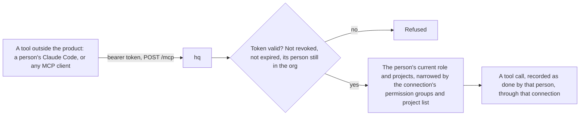

# A person's own connections to hq

hq serves an MCP endpoint at `/mcp`, so a tool outside the product can read and change work in hq. Every
caller is **a person's own connection**
([ADR-0090](../../adr/adr-0090-a-connection-to-hq-is-a-persons-own.md)). There is no org-wide key: the one
an admin used to create belonged to no person, so work it created was on behalf of nobody
([ADR-0089](../../adr/adr-0089-every-task-runs-on-behalf-of-a-person.md)). A leftover org-wide key from an
earlier install is ignored. Agents never use this endpoint; they reach their site's own MCP server.

## What a connection is

- **It acts as its person, never as more.** It reaches only the projects that person can reach, with that
  person's role, under the same rules their own chat run is held to. Role and project access are read on
  every call, so a change of role, a revocation or an expiry takes effect on the next call. An admin
  connected this way still acts with an admin's reach, as themselves. A connection never outlives its
  person: removing the person removes it.
- **A person may have several**, each named for what uses it (one per tool, or one per project), up to 25
  active at once.
- **Each is created, listed, renewed and revoked by its person** in **Settings › Devices and connections › Connections**. No one else,
  an admin included, sees or changes another person's connections.

## Permissions

Each connection has four permission groups, each on or off. They only narrow what the person may do
(`hq/src/shared/connections.ts`, `hq/src/server/controlplane/connectionGroups.ts`):

| Group | Default | What it allows |
|---|---|---|
| **Read** | On | Look at the organisation, agents, teams, projects, boards, tasks and comments, the queue and active runs, products, the git configuration, and workforce templates |
| **Change tasks** | Off | Create, edit, archive and delete tasks; add comments and attach files. Creating a task never starts it, even asked to start: starting is *Start work*, whichever tool asks |
| **Start work** | Off | Run a task now (`run_task`, or `create_task` asked to start), set a task's start time, create and change routines |
| **Manage** | Off | Create boards, projects, teams, agents, products and workforce proposals, and change the organisation, each only where the person's role already allows it |

A call outside the connection's groups is refused with a message that names the group to turn on. A tool
meant only for an agent's own run is refused to every connection. A run started through a connection counts
as started by a person, which is why *Start work* is off until the person turns it on.

## Projects

A connection reaches all of its person's projects, or only a list the person chooses. The list can name only
projects the person is a member of. A project deleted later stays in the list, so the connection never
widens.

## Expiry and revoking

- A connection lasts 7, 30, 90, 180 or 365 days from creation, 90 by default. The person can **renew** it,
  which counts the same period from now.
- The list shows each connection's name, permissions, projects, last use (recorded at most every five
  minutes) and expiry.
- **Revoking** takes effect at once. A revoked connection cannot be renewed; create a new one.
- The token starts with `ahx_conn_` and is shown **once**, when the connection is created. Only its hash is
  stored, so hq cannot show it again.

## Attribution

Everything a connection creates or changes is recorded as done by its person, through that connection. A task
it creates is done on behalf of that person; tasks it starts, start times it sets, routines it sets up and
comments it writes carry the connection too, so any change can be traced to the tool that made it.

Signing in to a connection through the browser (OAuth), which some MCP clients expect, is not built; it would
issue the same kind of connection.

## Where in the code

| What | Where |
|---|---|
| Create, list, renew, revoke | `hq/src/connections/operations.ts` |
| Checking a token and reading its grant | `hq/src/connections/connectionAuth.ts`, `connectionToken.ts` |
| The endpoint | `hq/src/server/mcp/handler.ts` |
| Which tool needs which group | `hq/src/server/controlplane/connectionGroups.ts` |
| The settings page | `hq/src/connections/pages/ConnectionsPage.tsx` |
| Schema | `hq/schema.prisma`: `PersonConnection` |

## Decisions behind this

[ADR-0090](../../adr/adr-0090-a-connection-to-hq-is-a-persons-own.md) (a connection is a person's own),
[ADR-0089](../../adr/adr-0089-every-task-runs-on-behalf-of-a-person.md) (every task runs on behalf of a
person).
