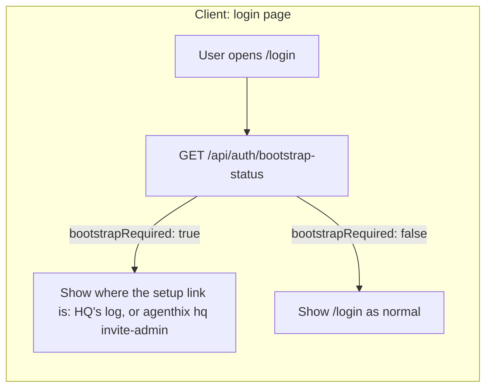
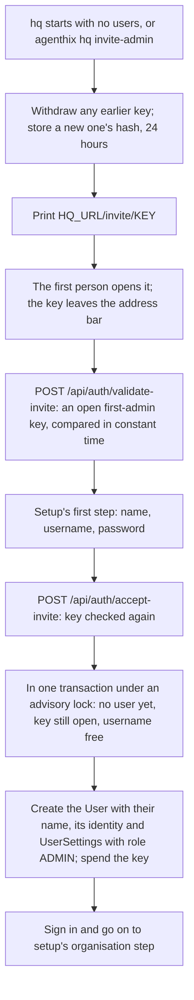
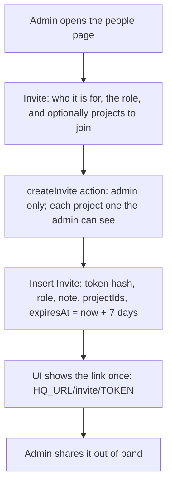
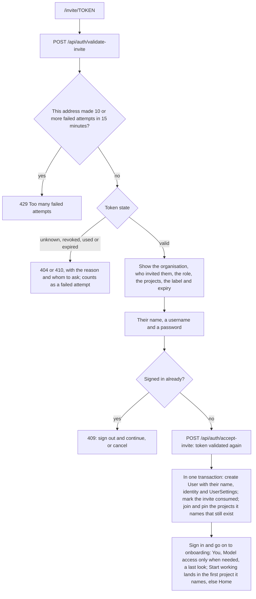
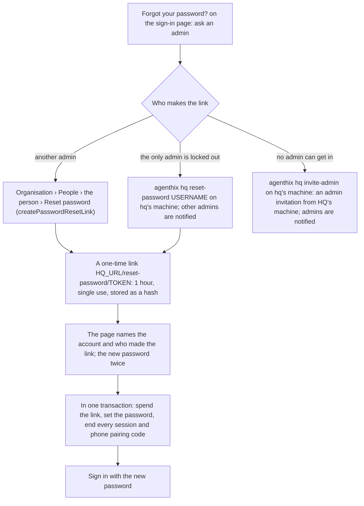
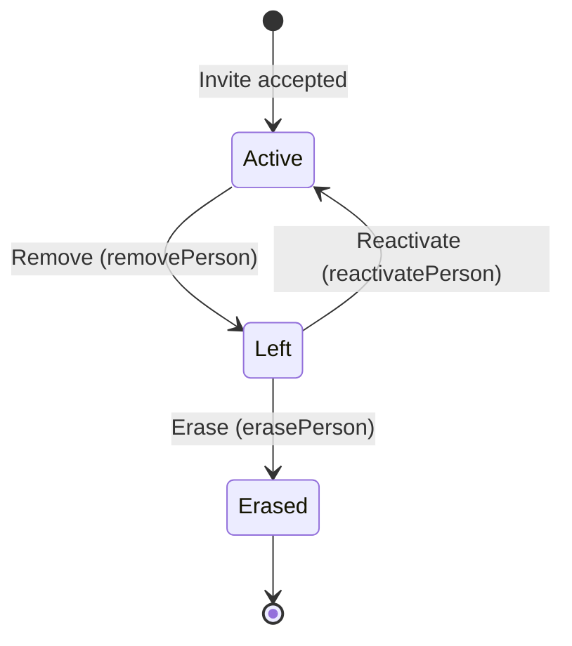
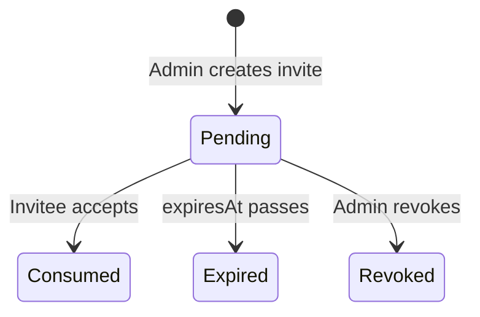

# Auth

How users are authenticated and onboarded to an hq instance.

---

## Why this exists

An hq instance is the org's own control plane. Only trusted people should have access. The auth layer controls who gets in and what role they hold — without relying on shared secrets or manual credential handover.

---

## How it works

**Invite only, password only.** The first person on a fresh hq comes in by a **one-time first-admin link**
hq makes while it has no users; nothing waits in the configuration. After that every account comes from a
single-use invitation link an admin makes, which records who invited them. hq refuses Wasp's own sign-up
route (`onBeforeSignup`, `hq/src/auth/refuseSignup.ts`), so there is no other way in. hq keeps no email
address and sends no email: every link is copied and sent by the person who made it, and every link is built
from hq's configured address (`HQ_URL`), never from the sender's browser (`hq/src/auth/hqLinks.ts`).

`agenthix install` makes every secret the two apps need, writes the same pairing secret into HQ's and its site's settings, starts both and the Fleet Console, and prints the first-admin link (`host/src/install/`). The account made from that link holds the organisation admin role and the fleet admin role too, the only account made holding it ([the fleet](../fleet/fleet.md); `hq/src/auth/inviteAccept.ts`).

**Every way back in is an admin acting in the app, or someone who can run commands on hq's machine** — the
same proof of control a site's `agenthix-site` command relies on. On a machine Agenthix Cloud runs, Cloud is that
machine's admin and may ask for the same links (a first-admin link, a password reset, an admin invitation); each is
an ordinary link, built and spent the same way, and announced to hq's admins
([ADR-0133](../../adr/adr-0133-cloud-may-ask-for-admin-links-on-a-machine-it-runs.md)).

> **Implementation status:** every flow below is built. hq's only auth method is username and password
> (`hq/main.wasp.ts` `auth.methods`), and there is no passkey. A person may also **link an Agenthix account** in
> Settings › Sign-in, once the organisation's hq is connected to Agenthix Cloud, and then sign in with it; that gives
> the same hq session a password does, never makes an account, and leaves the password working
> ([cloud-connection.md](../../architecture/cloud-connection.md#signing-in-with-an-agenthix-account)).

---

### Flow 1 — Bootstrap mode detection

The login page asks hq whether any `User` rows exist (`GET /api/auth/bootstrap-status`, which counts users) to decide what to show the visitor. That count is the only source of truth; the server also records it in `SiteConfig.bootstrapRequired` at boot, but nothing reads that flag to decide anything.



---

### Flow 2 — The first admin (a one-time link)

Start: the link hq prints in its log at a start with no users — "No admin yet. Open this link to set up
Agenthix (valid 24 hours)" — or the one `agenthix hq invite-admin` prints on hq's machine.



The key is an `Invite` of kind `FIRST_ADMIN`, 32 random bytes of which only the SHA-256 is stored, and it is
compared against that hash in constant time (`openFirstAdminKey`, `hq/src/auth/firstAdmin.ts`). Making a new
one withdraws the last, so only the newest link works. Once any user exists it answers 410 "Acme Corp's HQ is
already set up"; past its 24 hours, 410 with how to get a new one. The advisory lock stops two simultaneous
requests from each creating an admin (`acceptFirstAdmin`, `hq/src/auth/inviteAccept.ts`).

**Setup runs once per hq, for that admin only:** You · Your organisation · Model access, optional · Review. It
is done when they press **Finish** on Review (`completeSetup`; `Org.setupCompletedAt`, `hq/src/setup/setupState.ts`),
as [setup-flow.md](../setup/setup-flow.md) describes. An admin
invited later accepts an invitation like anyone else and is never sent through setup.

---

### Flow 3 — Admin invites a user

Start: Organisation › People (`/org/people`), **Invite**



**The link is shown once, at creation**, built from hq's configured address; when that address opens only on
hq's own machine, `createInvite` says so (`addressWorksOnlyHere`) so the admin is told before sending it. hq
stores only a hash of the token, so it cannot show the link again. A lost link means revoking the invite and issuing a new one. The token is 32 random bytes
(`generateInviteToken`, `hq/src/auth/inviteToken.ts`). The username is not chosen at invite time: the
invitee picks it when accepting.

**Who it is for.** The note is the admin's description of who the invitation is for, and the list of
invitations shows it. **Projects.** An invitation may name projects the person joins as a Member on
accepting — any the inviting admin can see: an open one, or a private one they are in. Another admin
reading the list sees a project they cannot see counted, never named (`invitationViews`,
`hq/src/auth/invitationViews.ts`).

---

### Flow 4 — User accepts invite

Start: `/invite/<token>`. The page is the same for every link: the first admin's opens setup's first step (Flow 2); anyone else's opens onboarding's Join. There is no `/accept-invite` page and nothing forwards from it.



Accepting is refused while the request carries a session (409, `reason: 'signed_in'`): the page asks the person to sign out and
continue, never switching sessions silently. An unknown code says only that it does not work; a real one that
no longer works names who to ask. Only a refusal of the code itself (404 or 410) counts toward the limit, so a person filling in the form
does not use up the budget. The count is per address and kept in the database (`RateLimit`, so it survives
a restart). Passwords must be at least 8 characters. A username is checked for being taken only after the
code is known to be good, so a spent code reveals no usernames. An expired invite is a dead end: the page
shows the error and the admin issues a new invite.

---

### Flow 5 — Changing a password, and getting back in

A person changes their own password under **Settings › Sign-in** (`POST /api/auth/change-password`,
`hq/src/auth/changePassword.ts`): their current password, then the new one twice. The current one is checked
with Wasp's own `verifyPassword`, and five wrong ones in 15 minutes stop further attempts for that person until
the window ends (the `RateLimit` table, keyed by the person). The new one meets the sign-up rule
(`hq/src/auth/passwordRules.ts`, at least 8 characters) and is hashed with Wasp's `hashPassword` into the
username identity, as sign-up does. In the same transaction every other session of theirs ends — other
browsers and paired phones, which are Wasp sessions too — with every unspent phone pairing code; the session
the change was made from stays. Connections for outside tools are tokens of their own and are not ended.

hq stores no email address, so **recovery goes through someone who can vouch for the person**:



- **An admin's link** (`createPasswordResetLink`, `hq/src/auth/passwordReset.ts`) is for someone else — one's
  own password is changed in Settings › Sign-in — and never for someone who has left. It is shown once; no one
  learns the new password. Making a new one ends the last.
- **On hq's machine**, `agenthix hq reset-password <username>` makes the same link, recorded as made on hq's
  machine, and every other admin gets a notification (`password_reset_from_hq_machine`).
  `agenthix hq invite-admin` makes the first-admin link while hq has no users, and once it has some, an admin
  invitation recorded as from hq's machine (`createdBy` null), shown in Organisation › People as "Invited
  from HQ's machine" and announced to the admins (`admin_invited_from_hq_machine`). Both reach the running hq
  through its control socket (`hq/src/auth/machine/`), a Unix socket in a folder only hq's own user can open.
- **The reset page** reads the link (`POST /api/auth/password-reset/read`) and sets the password
  (`POST /api/auth/password-reset`), refused while signed in. A refused link counts against the caller's
  address as a refused invitation code does.

### Signing in

Wasp's own login route checks the password. In front of it, `signInLimit` (`hq/src/auth/signInLimit.ts`)
counts every wrong password (a 401) per address; after 10 in 15 minutes that address waits 15 minutes. A
wrong password never says whether the username or the password was wrong. Someone not signed in who opens a
page is sent there once they sign in (`hq/src/shared/hooks/useReturnAfterSignIn.ts`), else Home.

Before sign-in, the sign-in page reads the organisation (`GET /api/org/public-identity`): its name, handle,
vision, picture and cover, as much as an admin chose — the whole cover, the name only, or nothing
(`Org.signInShows`, `setSignInShows`, `hq/src/org/publicIdentity.ts`). An invitation, a reset link and setup
read the whole identity, since whoever holds one of those links is being let in.

---

### Flow 6 — Someone leaves

Leaving is three separate acts, each an organisation admin's
([ADR-0100](../../adr/adr-0100-leaving-deactivates-erasing-is-separate.md)):



- **Remove** (`removePerson`, `hq/src/settings/leaving.ts`) deactivates and deletes nothing. It sets
  `User.deactivatedAt`; ends every signed-in session, pairing token and connection; ends their membership of
  every project but their own and every team; and tells every site that is not revoked, which ends their conversations, runs
  and harness logins there and keeps the transcripts. For each project the admin can see where tasks are done
  on their behalf, the admin chooses where those open tasks go — another member, or left waiting — with no
  default; everywhere else they wait. A run in progress finishes first. From then on sign-in is refused
  (`onBeforeLogin`, `hq/src/auth/refuseLogin.ts`), and every access check, picker and count leaves them out.
  It is refused while they are the only admin of a project, naming the projects, and for the admin's own account.
- **Reactivate** (`reactivatePerson`) clears `deactivatedAt`: the same account, with its history. Projects
  are added again by hand; connections are made again.
- **Erase** (`erasePerson`, `hq/src/settings/erasePerson.ts`), only after Remove and confirmed by typing
  their name or handle, deletes their own data: their conversations and those conversations' runs on each
  site, their own project and files, what agents remember of them, their connections, model logins, name,
  picture, settings and sign-in identity. Their data is found by what they own — a conversation is its
  person's — never by a column that names them only for bookkeeping, so a project's task runs filed under
  them stay. Tasks, comments and task runs stay with their projects, and the person reads as "Former
  member". It cannot be undone, and nothing erases automatically. A site that cannot be reached refuses the erase before anything in hq changes, and it can be run again.

Wherever a person is named, hq reads one helper (`peopleByIds`, `hq/src/server/identity/people.ts`): their
display name, else their login name; their login name as the @handle; their picture; and whether they are
here, have left or have been erased.

---

## Data model

### `Invite`

```prisma
model Invite {
  id         String     @id @default(uuid())
  tokenHash  String     @unique   // SHA-256 of the token; the token is shown once
  kind       InviteKind @default(INVITATION)   // or FIRST_ADMIN, the first-admin link
  role       Role       @default(MEMBER)   // the organisation role: ADMIN or MEMBER
  note       String?              // who it is for, shown in the list
  projectIds String[]   @default([])  // projects joined as a Member, and pinned, on accepting
  createdBy  String?              // null when made on hq's machine
  expiresAt  DateTime?
  consumedAt DateTime?
  consumedBy String?
  revokedAt  DateTime?
  createdAt  DateTime   @default(now())
}
```

The first-admin link is never listed among invitations.

### `PasswordReset`

```prisma
model PasswordReset {
  id          String    @id @default(uuid())
  tokenHash   String    @unique   // SHA-256 of the token; the link is shown once
  userId      String
  createdById String?             // the admin who made it; null when made on hq's machine
  expiresAt   DateTime            // an hour after it was made
  usedAt      DateTime?
  createdAt   DateTime  @default(now())
}
```

### Invite states

Admins see the invitations waiting, and the earlier ones — used, expired or revoked — with who each is for, who sent it, its role and its projects (`getOrgPeople`, `hq/src/settings/orgPeopleQueries.ts`; `listInvites` is the older list), and revoke one that has not been used (`revokeInvite`). Every invite an admin makes has a 7-day expiry; one made on hq's machine, 24 hours.



### `SiteConfig.bootstrapRequired`

A record of the user count at boot (`hq/src/server/setup.ts`). Nothing reads it to decide anything: bootstrap state is whether any `User` row exists.

---

## Execution Sites and identity

An Execution Site has no users of its own. Browsers only ever talk to hq, and a site verifies the tokens hq issues, pinning its own site id as the audience (ADR-0042).

---

## Files

| File | Responsibility |
|---|---|
| `hq/schema.prisma` | `Invite`, `PasswordReset`, `RateLimit`, `UserSettings.role`; `setupCompletedAt` and `signInShows` on `Org`; `bootstrapRequired` on `SiteConfig` |
| `hq/main.wasp.ts` | `auth:` (username and password, `onBeforeSignup`, `onBeforeLogin`) |
| `hq/src/auth/auth.wasp.ts` | routes `/login`, `/invite/:token?` and `/reset-password/:token?`, the APIs `/api/auth/bootstrap-status`, `/api/auth/validate-invite`, `/api/auth/accept-invite`, `/api/auth/password-reset/read`, `/api/auth/password-reset`, `/api/auth/change-password`, and the operations `createInvite`, `revokeInvite`, `createPasswordResetLink`, `listInvites` |
| `hq/src/settings/settings.wasp.ts` | the operations `removePerson`, `reactivatePerson`, `erasePerson`, `getOrgPeople`, `getOrgPerson` |
| `hq/src/auth/inviteService.ts` | Reading an invitation, why one is refused, rate limiting |
| `hq/src/auth/inviteAccept.ts` | Accepting an invitation or the first-admin link |
| `hq/src/auth/inviteToken.ts` | Generating and hashing a token |
| `hq/src/auth/firstAdmin.ts` | The first-admin link: making it, matching it in constant time |
| `hq/src/auth/passwordReset.ts`, `passwordResetApi.ts` | Reset links: making, reading and spending one |
| `hq/src/auth/machine/` | The commands run on hq's machine, and the control socket that carries them |
| `hq/src/auth/signInLimit.ts` | Wrong passwords limited per address |
| `hq/src/auth/hqLinks.ts` | Links built from hq's configured address |
| `hq/src/org/publicIdentity.ts` | The organisation before sign-in |
| `hq/src/setup/setupState.ts` | Setup once per hq, for its first admin |
| `hq/src/auth/refuseSignup.ts` | Refuses Wasp's own sign-up route |
| `hq/src/auth/refuseLogin.ts` | Refuses sign-in to someone who has left |
| `hq/src/auth/invitationViews.ts` | Invitations as the people page lists them |
| `hq/src/settings/leaving.ts`, `erasePerson.ts` | Remove, Reactivate and Erase |
| `hq/src/auth/api.ts` | The invitation API handlers |
| `hq/src/auth/changePassword.ts`, `passwordRules.ts` | A person's own password change; the rule a new password meets |
| `hq/src/auth/actions.ts`, `queries.ts` | `createInvite`, `revokeInvite`, `listInvites` |
| `hq/src/auth/pages/InvitePage.tsx` | The page every invitation link opens: reads the link, makes the account, signs in, and goes on to setup or onboarding |
| `hq/src/auth/inviteGlimpse.ts` | The people and projects an invitation page shows beside Join |
| `hq/src/onboarding/` | Onboarding for every invited person: Join, You, Model access, a last look ([onboarding](../onboarding/onboarding-flow.md)) |
| `hq/src/auth/pages/LoginPage.tsx` | Says where the setup link is while hq has no users |
| `hq/src/auth/pages/ResetPasswordPage.tsx` | The reset link's page |
| `host/` | `agenthix install`, `hq invite-admin`, `hq reset-password`, `status` |
| `hq/src/org/pages/people/` | Organisation › People: people, invitations, one person, leaving |
