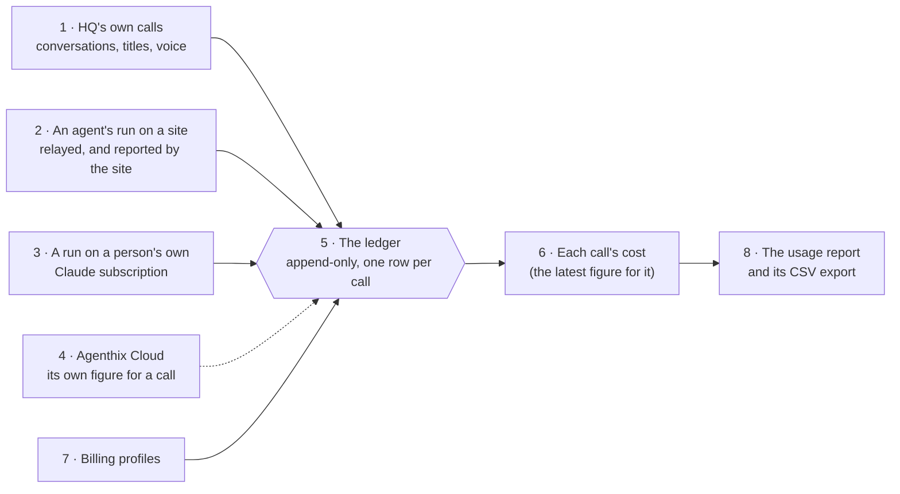

# Billing and the ledger

Every model, speech-to-text and text-to-speech call an organisation makes is written down once, costed to a **billing
profile**, so an organisation admin can say what its AI use cost and who it belongs to. The record is the **ledger**.

## Billing profiles

A **billing profile** is what a place's AI cost belongs to, inside one organisation: *Fernhill*, *Client X*. (It is not
a *billing account*, which is the hosted service's word for whoever pays.) Organisation admins make, rename and archive
them on **Manage organisation › Billing profiles**.

- **There is always exactly one default**, made at [setup](../setup/setup-flow.md) from the organisation's name. An admin
  can make another the default; the default cannot be archived.
- **A shared project has one profile**, picked by whoever creates it (the default when they do not pick) and changed
  afterwards by organisation admins only, from the project's next call; each change is recorded with who made it.
  Everyone who sees the project reads its profile in its settings, once the organisation has more than one.
- **Everything else is the default's**: a person's own place (their space and every personal project), and HQ's own
  calls that belong to no place, such as the voice sample phrase.
- **Archived, never deleted**, so old cost keeps its name and an id is never reused. A profile that projects still use is
  archived only when the admin names where those projects go, which moves them first.

## What a call is costed on

Each row carries a **basis**, which says where its cost comes from. The usage report keeps each basis and each currency
a separate total and never adds them together.

| Basis | Means |
|---|---|
| **Actual** | Agenthix Cloud's own figure for the call, which matches Cloud's bill |
| **Estimated** | The organisation's own keys: the call's usage times HQ's price list. The provider's bill may differ |
| **Awaiting Agenthix Cloud** | A call through Cloud whose actual cost has not been reported yet |
| **Included in subscriptions** | A run on a person's own Claude subscription: it costs nothing per call |
| **Unpriced** | A model with no known price, or a call that reported no usage. Counted, with no cost |

Two sources are **estimates at list price** whatever the basis says about the provider: speech to text (per hour of
audio) and text to speech (per million characters sent) are priced from HQ's list, since neither vendor reports a price
per call. HQ measures text to speech itself; it cannot meter listening, because the browser streams to the speech service
directly, so HQ issues each listening token with a sealed ticket and counts the audio the client hands back when the
session ends, never more than the time since the token was issued. Prices are never entered by hand.

Agenthix Cloud is the one provider whose costs are measured by whoever bills them. Reading its figures back into the
ledger waits on the hosted service's metering, behind a flag (`usageBilling`) that is on in development and off in
production ([cloud connection](../../architecture/cloud-connection.md#the-ai-contract)). With it off, a call through
Cloud is written from Cloud's catalogue as an estimate; with it on, as awaiting Cloud until its actual figure comes.

## The ledger's rules

1. **Money is whole millionths of a currency unit**, with its ISO currency, never a floating-point number.
2. **Append-only.** A row is never changed or deleted. Cloud's actual figure, or a fix, is a new row that points at its
   call; a call's cost is its latest row that has an amount.
3. **One call id per call**, made on the organisation's side (by HQ for its own calls, by the site's relay for an agent's)
   and shared with Cloud. A retry reuses it, and a report that arrives twice counts once.
4. **Each row names its price** (HQ's list at a version, Cloud's catalogue at a version, or Cloud's reported figure).
5. **A billing profile is archived, never deleted**, and a row keeps its profile, project, agent, person and provider as
   plain ids and names, so deleting any of them never deletes cost. An erased person's rows read *Former member*.
6. **Rows are stored in UTC; a month is cut in the organisation's time zone**, set at setup and changeable beside the
   report.
7. **A refusal for money** (Cloud's spending limit for a profile or the organisation) is its own kind of problem with its
   own message, not a provider failing.

## The usage report

**Manage organisation › Usage** shows a month at a time, in the organisation's time zone: the cost by billing profile,
or within a profile by project, agent or person, with the calls and tokens behind each, and an export of the month's calls
as a CSV, a page at a time. Only organisation admins see it. A project, agent or person that has since gone reads *Deleted
project*, *Deleted agent* or *Former member*.

The per-agent usage on an agent's page and the *spend this month* figure on the Organisation page are separate
figures: tokens summed on each site and priced at list ([budget](../budget/README.md)). The ledger is the record of cost.

## Where in the code

| What | Where |
|---|---|
| The rules, the bases, the money maths | `core/src/billing/ledger.ts`, `profiles.ts` |
| Writing a row; pricing it | `hq/src/billing/writer.ts`, `pricing.ts`; the store `store.ts` |
| What a call is costed to | `hq/src/billing/costing.ts`; the profile of a place `hq/src/routing/snapshot.ts` (`billingProfileOf`) |
| Where rows come from | `hq/src/billing/sources/` (`hqCalls.ts`, `relay.ts`, `runs.ts`, `voice.ts`) |
| Billing profiles | `hq/src/billing/profiles.ts`, `defaultProfile.ts`, `pages/BillingProfilesPage.tsx` |
| The report, months, export | `hq/src/billing/report.ts`, `months.ts`, `exportApi.ts`, `pages/UsagePage.tsx` |
| A call's cost, one view | `hq/src/billing/callCostView.sql` (`UsageCallCost`) |
| Schema | `hq/schema.prisma`: `UsageEntry`, `BillingProfile`, `ProjectBillingChange`, `RunCosting`, `RelayUsageReport` |
