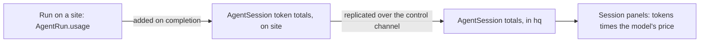

# Budget

There is no budget system in the code. Nothing allocates, limits or blocks spending: no table holds a budget, no check refuses a run for cost, and no code path handles money an agent spends outside its model calls. What exists is **token counting**, **estimated cost display**, and the **ledger**, which records what every call cost and who it belongs to ([billing and the ledger](../billing/billing.md)). The ledger records cost; it never limits it. The rest of this page is a design that has not been built.

## What exists today

### Token counting

- Each run records its usage as JSON on `AgentRun.usage` in **site's** database (`site/schema.prisma`; shape `TokenUsage` in `core/src/protocol/runtimeData.ts`: input, output, total, and cache read and write tokens).
- When a run completes, `site/src/agents/runtime/runCompletion.ts` adds the run's usage to the running totals on `AgentSession` (`totalInputTokens`, `totalOutputTokens`, `totalCacheReadTokens`, `totalCacheWriteTokens`). The site sends the new totals to hq as a session update, and `hq/src/sites/channel/siteEventHandler.ts` writes them into hq's copy of the session (`hq/schema.prisma`). Totals change only through the site, as for every runtime field of a session.
- hq reads runs and their usage back across the control channel (`hq/src/sessions/siteRuntimeStore.ts`); see [control-channel.md](../../architecture/control-channel.md).

### Cost display (an estimate, never enforced)

- **Per-model prices.** `core/src/models/pricing.ts` exports `MODEL_PRICING`: input, output, cache read and cache write price per million tokens, built from the pinned model catalogue (`core/src/models/openCodeModels.generated.ts`) for both runtimes. A model missing from it has no price.
- **Session panels.** `calculateCost` and `formatCost` (`hq/src/shared/utils/aiMetrics.ts`, and a copy in `ui/src/agents/aiMetrics.ts`) multiply a session's token totals by that model's price. An unpriced model shows a dash. The same module estimates energy and carbon from token counts. Shown in the session components in `ui/src/sessions/` (for example `PanelActivitySession.tsx`).
- **Usage on an agent's place, and Today's numbers.** These price tokens per model, never at the flat rate. An agent's usage for a period (yours, the organisation's, a project's, and by project for admins; `hq/src/agents/agentUsageQueries.ts`, `usageTotals.ts`) sums each site's `run.usage` and prices it at each model's list price. *Today's numbers*, at the top of the Organisation page for admins (`hq/src/dashboard/todayNumbers.ts`; the old `/org/dashboard` address only redirects there), shows spend this month the same way. Tokens of a model with no price are counted apart (`unpricedTokens`), never as free.

No screen shows a flat-rate cost. Before the dashboard page was removed, it showed total and per-agent tokens multiplied by one flat rate regardless of model; replaced by the per-model figures above. The snapshot that computed it (`hq/src/server/dashboard/snapshot.ts`) is still sent over the socket, but no client receives it.

### What to be careful of

- Every cost figure on this page is an estimate at list price, not a bill. Do not build limits on it.
- Token totals live on a session, not on a project, person or period. The per-month and per-project rollup is the ledger's usage report ([billing](../billing/billing.md#the-usage-report)), which reads its own record of calls and not these totals.
- Rate limiting (`hq/src/server/rateLimit.ts`) is about request volume, not spend.

## Design intent, not built

Everything below describes a plan. None of it is in the schema or the code.

**Two spending slices.**

| Slice | What it measures | Needs |
|-------|------------------|-------|
| Workforce spending | The cost of running agents: model tokens and compute | Token counting (exists) plus price tables (exist) |
| Business spending | Real money an agent spends for the org, such as a domain, an API subscription or cloud resources | A spend request, a human approval step, and a payment method |

Business spending was designed to be approval-gated: an agent proposes a spend with a vendor, amount and reason; a person approves or rejects it before anything is paid; the agent never holds payment credentials. Payment would go through a person doing the purchase, or a card issued per project with a limit equal to its business allocation. Trusted agents could be given a small auto-approve threshold. Every spend would be recorded against an agent, session and task.

**A hierarchy.** Organisation, then project, then project member (an agent's membership of one project), each carved from its parent: a child allocation could never exceed what its parent has left. The same agent would have a separate allocation per project. Each level has an allocated amount, a spent amount and the remainder.

**Enforcement levels.** Hard cap (no new work once the limit is reached; tasks wait for a person to raise the limit or the period to reset), soft cap (a warning, work continues) or uncapped (spending still tracked).

**Periods.** Lifetime (never resets), monthly (resets on the first of the month) or per sprint. A hierarchy path would have to use consistent periods, except a per-sprint project under a monthly organisation. Unspent balance would not roll over by default.

**Principles carried over from the old design.** Detailed spend data stays on the site and hq holds summaries and limits, consistent with [ADR-0042](../../adr/adr-0042-hq-is-the-orgs-own.md) and the site holding the runtime data. Every spend has a traceable record. Tokens are counted even when no limit is set.

If this is built, it would add models to `hq/schema.prisma` for limits, an enforcement check in the dispatch path (`hq/src/agents/dispatchService.ts`, where hq decides whether a task may start), and a new tool for spend requests.

## Where in the code

| Concern | Path |
|---------|------|
| Usage shape | `core/src/protocol/runtimeData.ts` (`TokenUsage`) |
| Per-run usage, session totals | `site/schema.prisma`, `site/src/agents/runtime/runCompletion.ts` |
| Totals replicated to hq | `hq/src/sites/channel/siteEventHandler.ts`, `hq/schema.prisma` |
| Prices | `core/src/models/pricing.ts` |
| Cost formatting | `hq/src/shared/utils/aiMetrics.ts`, `ui/src/agents/aiMetrics.ts` |
| Usage and spend by period | `hq/src/agents/agentUsageQueries.ts`, `hq/src/agents/usageTotals.ts`, `hq/src/dashboard/todayNumbers.ts` |
| What each call cost, by billing profile | `hq/src/billing/` ([billing](../billing/billing.md)) |

## Decisions behind this

- [ADR-0042](../../adr/adr-0042-hq-is-the-orgs-own.md): the org's own hq is the source of truth for org data.
