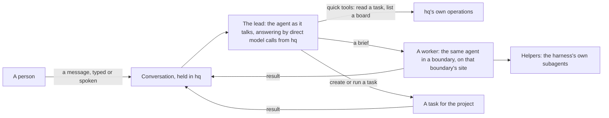
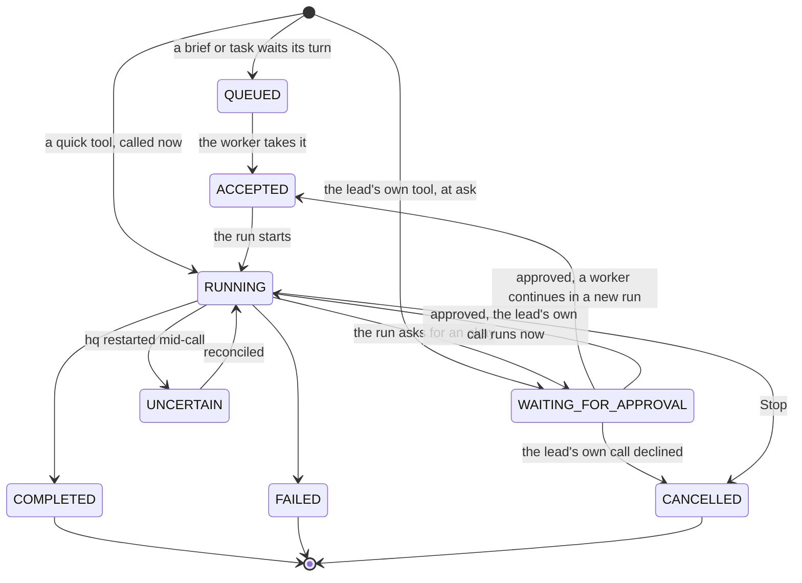

# Conversations

A **conversation** is a person talking with an agent, held in hq. The agent answers at the speed of conversation
while it starts longer work in the background and tells the person when that work is done.

## The lead, workers and helpers

| | What it is | Where it runs |
|---|---|---|
| **Lead** | The agent as it talks in a conversation: its words, its choices, which place gets work | In hq, by direct calls to a model, with no harness and no container |
| **Worker** | The same agent working in one boundary: a harness session (Claude Code or OpenCode) with that boundary's authority | On the site that holds the boundary |
| **Helper** | A subagent a worker starts through its harness, in a context of its own | Inside the worker's run |

The agent keeps one identity. The lead speaks of its background work as its own, in the first person: *I'm checking
the README now*, never *I passed it to a worker*. What is Agenthix's own is only the split between talking and
working; fanning work out inside a boundary is the harness's. A conversation that only talks never starts a worker.

A worker is **standing**: one per conversation, per boundary it has worked in, per person it works for. It is made the
first time the conversation sends work to that boundary and reused for every later brief there. It is an
`AgentSession` row marked with its conversation, listed nowhere as a conversation of its own. Briefs to one
worker run one at a time; a second waits as *queued*. A worker whose context has passed 70% of its model's window is
replaced by a fresh session between briefs, never during one ([long conversations](long-conversations.md#workers)).

## Where a conversation lives

A conversation has one **home**, fixed when it starts, which decides who reads it, who speaks in it and which billing profile its cost belongs to:

| Home | Read and spoken in by | Cost belongs to | Listed in |
|---|---|---|---|
| **A person's own space** (Chat) | The person who opened it, alone | The organisation's default billing profile | Chat |
| **A project** | The person who opened it, alone (a Viewer of the project who opened one reads it but cannot speak) | The project's billing profile | The project's conversations |
| **A task** | The team: anyone who can see the task reads it; anyone who works in the project speaks | The project's billing profile | The task's page, and a mark on the task's card on the board |

A personal or project conversation is private to the person who opened it, administrators included
([ADR-0041](../../adr/adr-0041-chat-session-privacy.md)); hq decides it from the home before reading anything. It keeps
its agent for its life; talking to another agent is a new conversation. Which agent a new one starts with is the
person's **primary agent** (**Kernel** to begin with, changed in Settings); a picker offers the others the home allows.
One starts from the message box of Chat, a project or Home; from one of Home's first suggestions, with the built-in
agent in the person's own space; or from an agent's page, with that agent in the person's own space. *New
conversation* on an agent's card or on the Agents screen opens the box of the place the person is in (Chat
elsewhere) with that agent picked.

A person has one conversation open at a time, and it is shown in the **dock**, docked on the right of every page, not on the page of its place: moving about hq never closes or changes it, and a new one begins as a draft in the dock, with the list of places to choose from ([places](../projects/places.md#the-docked-conversation)). Where it is shown does not change the place it belongs to.

The home is where the lead reads directly (the place's tasks, board and knowledge), with that place's authority. **Work
may be commissioned in any boundary the person and the agent share**, and each piece of work is authorised on its own
for its own boundary: the person must be a member, the agent assigned there, the tool allowed there. Nothing is
unioned, and a refusal is said in words ("you're not a member of Finance").

### A task's conversation

A task has at most one conversation, created when someone first writes on its page. Its lead is **the task's agent,
whoever that is now**: reassign the task and the thread goes on with the new agent, with a quiet line, and the agent
recalls under its own memory scopes. An unassigned task has no lead, so its thread is read-only until one is assigned.
Work started from the thread is always a run of the task, with the person's ask as its brief. Every run of the task
(the pulse's, a schedule's, one from the board) leaves a card in the thread and a report, so the thread is the task's
running story. Comments stay the board's channel. It archives with its task, closes when the task is deleted, and only
a project administrator deletes or archives it by hand. Each message shows its author once more than one person has spoken; a turn acts as
the author of the message it answers, and two people asking get two turns.

## A turn

The lead speaks in **turns**. A turn is a short loop of steps: one model call; if the model asks for tools they run at
once and the results go back for the next step; until the model answers in words. At most **one turn owns a
conversation at a time**, across hq's processes: a lock on the conversation, with a lease the running turn renews.

- **Messages queue durably.** A message sent while a reply is being written is stored and waits, shown as waiting with
  **Send now** and **Cancel**. By the sender's setting (`UserSettings.busyConversationMode`) it waits (**Wait**, the
  default) or stops the running reply first (**Interrupt**). Consecutive messages by one author go into one turn; a
  change of author is a new turn. A restart loses none.
- **Each turn is told the date and time** in the person's time zone (UTC when they have none), so "tomorrow at 9"
  means something.
- **The record keeps what the lead looked at.** A reply that looked something up carries its steps. On screen they are
  the **thinking pill** beside the agent's name: *Thinking · 6 s* with a pulsing dot while it works, *Thought for 6 s*
  after, with *started N* or *set N* if the reply started work or set a task for a time. Select it to see each step as
  one line with its time.
- **A reply that runs long moves to the background.** After 4 steps that looked something up, hq itself starts the rest
  as work in the conversation's place, the brief being the person's message and what has been found so far, and ends
  the reply with one fixed line: *That's taking longer than I expected — I'm working on it in the background, and
  I'll tell you as soon as I have it.* No model call writes it. Where work cannot be started there, the next call is
  words only. A turn takes at most 8 steps, and its last is always words.
- **A reply that starts work ends there.** The work's card answers; the model is not called again. The agent always
  says in the same step what it has started, and if it does not, hq writes a fixed line.
- **Stop** cancels the running turn; what it had written stays, marked as stopped.
- **A failed turn** keeps what it had streamed and says why in plain words. If hq restarts mid-reply, the turn is
  failed with that reason and the person's message waits for another.

## Tools and the two kinds of work

Every Agenthix tool is defined once, in hq, behind one permission check. A worker reaches them through its site's
endpoint; the lead calls them in process, with a capability minted for the turn that carries the author of the message
being answered and that person's tool permissions. A tool set to *ask* is not called: the lead asks for it, with a
reason, and the call waits for an answer.

| Kind | Examples | How it goes |
|---|---|---|
| **Quick tools** — no model in them | Read a task, list a board, read a file in a workspace, a connected service's tools | Called directly. The turn waits up to **4 seconds**; past that the same call is **detached**: it carries on, its result arrives later as a card, and the lead says once that it is taking a moment. Nothing is cancelled or run twice. A result over **16,000 characters** is cut, and the lead is told to brief a worker for the rest |
| **Work** — a model is in it or behind it | `start_work` (a brief to a boundary), `run_task`, `create_task` | Background at once: an **operation** is created, and the result comes back as a completion |

The lead's own tools are `start_work`, `create_task`, `run_task`, `cancel_operation`, `answer_approval`, `ledger`,
`recall`, `remember`, `forget`, `expand` and `messages`, besides hq's task, board and project tools. A worker gets
the platform tools too, and `set_result`, with which a run states what it achieved.

`create_task` is three asks: *now* (queued for its agent), *later* (the backlog, nothing runs) and *at a time*. A task
set for a time is done in the turn that sets it: its card shows the time, and nothing comes back to the conversation
about it.

## Operations, results and the work bar

An **operation** is one piece of work the conversation commissioned: a brief to a worker, a task, or a detached call.
One set of states serves every kind: *waiting for approval*, *accepted*, *queued*, *running*, *uncertain* (hq's own
outside call was cut by a restart, and is being reconciled), then *completed*, *failed*, *cancelled* or *detached*
(severed from a deleted conversation; a task operation only).

- **The work bar** is the last thing in the thread, above the message box: one line, *4 working · 2 need you*, which
  opens to a list with requests for the person's okay first. A row shows what the work is and where, how it goes, one
  line per live helper written as a path (*Shop · Profile the image pipeline · Measure resize times*), and **Stop**.
  It opens by itself when a request arrives and is absent when nothing is live. There is no count in the header and no
  sheet.
- **A completion is a card** in the thread (*title · the one-line result · View results*), which opens the run's work,
  fetched from its site then. A completion's card heads the agent's reply to it.
- **A result belongs to a run.** A run states its result with `set_result`; hq keeps it (`RunResult`), and a task's
  latest is on the task. A run that ends without stating one says so, and the card shows its last words instead.
- **Every completion gets one reply**, a *report turn* that speaks and starts no work, whether or not the person is
  there; completions that arrive together share it, and the notification carries its first line. Only a sequence the
  person already authorised ("investigate, then create the task") continues with work, as a *continuation turn*
  acting as that person, if its checks still pass. A conversation closed meanwhile takes no turn, and the person is
  told the result's one line.
- **Stop** is on every row of the work bar for anyone who may speak; the lead has `cancel_operation` for when the person says
  so. A stopped worker's partial output stays on its run.

### Approvals

A tool at *ask* never pauses a turn. The lead's own tool: an operation waits for approval, with a card saying what it
does, why, who asks and in which boundary (the work bar row shows what would run, the work and the reason). A worker's harness: the run ends asking, as a run that asks does today, and
the answer continues it in a new run of the same session. Either way the request is a row in the work bar with
**Approve** and **Decline** (a note is optional). A request takes no turn of its own: the agent says nothing when one
arrives. The answer is a message, and the lead replies to it only when no result will follow; when one will, its one
reply covers the answer.

**Whoever answers must pass the same checks as the asker**: a member of the operation's boundary, the tool not *never*
for them. The answerer is named on the card. In voice a spoken yes counts only after the lead has read the action back
([voice](voice.md#approval-by-voice)). A request nobody answers stays waiting; nothing times it out.

## Which model, and who pays

Turns are direct model calls through one adapter, made by HQ with a key from the organisation's
[providers](../providers/providers.md): nobody brings a key to a conversation. The organisation's providers pay, and each
call is costed to the billing profile of the conversation's home ([billing](../billing/billing.md)). A person's own
Claude subscription stays a credential of work on a site (their space and their personal projects) and never pays for a
turn. Paying with a person's ChatGPT plan is designed but not built: it waits on a client id from the vendor.

The **talking model** is fixed when the first turn is answered, from the agent's own conversation model, else the
organisation's ([models](../models/models.md)). The person changes it at any time from the **model picker** in the message
box's plus menu, which lists the models that may run here: the organisation's, the agent's, the project's and the
person's [lists](../models/lists.md) all narrow it. A switch writes a quiet line and costs one reply that reads the
conversation again. A task's thread has no picker: it talks on its agent's default model. A conversation is never
switched silently: if its provider stops working or its model stops being allowed, it says what is missing, offers the
same model via another provider or the default, and waits for the person to accept. Titles and summaries use the
conversation's own model; the lead names a worker's model only when the person's instruction does, else the worker model
of the agent and the organisation applies.

## Memory

The lead reads memory by meaning, not as a whole: before each turn hq looks for items that match the message and either
includes them or hints at them; the lead can `recall`, `remember` and `forget`. Workers get the person's pinned items as
a file and can recall the rest. [Memory](../memory/memory.md) has the scopes, the ranking and knowledge excerpts.

## Closing, archiving, deleting

| | What it means |
|---|---|
| **Closed** | Final: the person left the project or organisation, or the project (or a task's thread's task) was deleted. The history stays; the message box gives way to *start a new conversation with this agent*. Closing declines its workers' waiting requests; a task's request stays on the task |
| **Archived** | Hidden, not closed. A conversation idle for the organisation's number of days (90 by default) is archived unless it is kept out of archiving, has work or a reply going on, or is a task's thread. It returns when reopened, or when a completion or request arrives |
| **Deleted** | By the person who opened it (a project administrator for a task's thread), after a confirm that names what goes and offers **Archive** beside **Delete**. Its worker operations are stopped and its workers' sessions ended on their sites (a site that cannot be reached refuses the delete); its task operations are detached and the tasks stay |
| **From before** | A chat held on a site before the conversations held in hq is not carried over: no list shows it, its session address goes to Chat, and anything sent into it is refused. Its row is left as it is |

Conversations are found again from the conversation's menu: **Summarise now**, **Keep out of archiving** and **Show its
runs**, which opens the Runs screen on the conversation.

## What the thread shows

Prose first; everything else is one quiet line or a one-line card that opens. A message is a bubble with **Copy** under
the agent's reply. The rest: the thinking pill; **action lines** for something a tool changed, with **Show in Tasks** and
the like opening the tool with the item marked (a memory opens **Settings › Memory**); task cards; completion cards;
failure cards with the reason; the summarised marker ([long conversations](long-conversations.md)); quiet lines for a
voice start and end, a model switch and a lead taking over; and a **shown part** (a diagram, table or code the agent
wants seen) as a card in voice and inline otherwise.

## Where in the code

| Concern | Path |
|---|---|
| The record, rows, reading rule | `hq/src/conversations/store/`, `readingRule.ts`, `hq/schema.prisma` (`Conversation`, `ConversationMessage`) |
| The coordinator: turns, lock, queue, mailbox | `hq/src/conversations/coordinator/` |
| Workers, tasks and tool calls as operations | `hq/src/conversations/work/` |
| A task's thread | `hq/src/conversations/taskThread/` |
| The model a conversation talks on and the picker | `hq/src/conversations/access/`, `modelChoice.ts`; the rule `hq/src/routing/` ([models](../models/models.md)) |
| Screens | `hq/src/conversations/components/`, `pages/`, `hooks/` |
| Archive, deleting, closing | `hq/src/conversations/archive/`, `work/deleting.ts`, `closing.ts` |

How the parts fit together as a system: [the conversation layer](../../architecture/conversation-layer.md).

## Decisions behind this

[ADR-0041](../../adr/adr-0041-chat-session-privacy.md),
[ADR-0075](../../adr/adr-0075-work-in-a-boundary-runs-in-parallel-only-a-conversation-is-ordered.md),
[ADR-0082](../../adr/adr-0082-a-conversation-acts-with-its-current-turns-authority.md),
[ADR-0096](../../adr/adr-0096-a-conversation-belongs-to-a-place.md),
[ADR-0101](../../adr/adr-0101-a-run-is-bounded-by-the-person-it-is-for.md).
