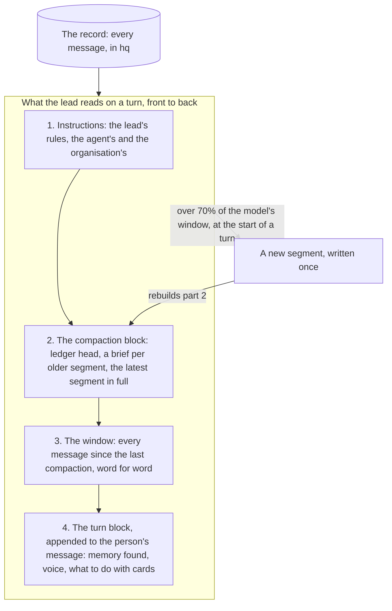

# Long conversations

A conversation can run for months. The **record** keeps every message; what the lead reads on a turn is **assembled**
from it, and when that grows too large the older part is folded into a **segment** that is written once and can be
opened again.

**Why the order.** Model providers cache the front of a request. The parts are ordered by how often they change, so
the front stays the same from one call to the next and only the end grows. Nothing in the first three parts changes
within a turn; a turn's tool loop is many calls on one front. The adapter adds each provider's own hints: up to four
cache breakpoints for Anthropic (after the instructions, after the compaction block, at the last message before this
turn's input, and at the request's last message), a cache key per conversation where a provider routes by one, and
nothing where caching is automatic.

## The ledger

The **ledger** is what must survive any compaction: decisions taken, approvals given, work under way with its brief and
state, obligations the lead accepted ("create the task once the fix lands"), and what the person asked to keep. hq
writes it from events (work starting and ending, an approval answered) and the lead writes it with its `ledger` tool.
It is stored on the conversation, each entry sealed like a message, and bounded: at most 300 entries, the oldest
closed ones let go first, and about 1,500 tokens of it shown, with closed work cut to one line. It is not sent on
every turn: between compactions the window already holds everything it records. It is the head of the compaction
block.

## Compaction in segments

When the context the last turn sent passes **70%** of the model's window, hq compacts at the start of the next turn,
before its first model call, never in the middle of one. It folds everything older than the last **30%** into one
**segment** with one call to the talking model.

A segment holds its **span** (first and last message, with times), a **brief** of about fifty tokens, a **full
summary** of up to about 3,000 tokens (decisions with their reasons, names, numbers, open threads) and the ledger as
it then stood. It is written once from the verbatim messages and never summarised again, so detail does not decay
with each pass. A *summarised* message goes into the record with the span, the brief and what the ledger kept. If the
summariser fails, the turn goes on without it.

**Summarise now**, in the conversation's menu, compacts at once in the same way. It returns immediately: the thread
shows *Summarising…* until the marker appears. It is refused while a reply is being written, and when there is not
enough to fold.

A model's window comes from its name (200,000 tokens for Claude models, 400,000 for GPT-5, 128,000 for DeepSeek and so
on); a model not known gets 32,000, so a long conversation on it compacts early rather than failing.

## Reading the past

The lead reads the past at three levels, each one call apart:

| Level | Where | How |
|---|---|---|
| Brief | In context, in the compaction block | — |
| Full summary | The record | `expand`, for one, several or all segments, in span order |
| The exact words | The record | `messages`, for a segment, a page at a time |

An expansion is **appended as a tool result**, behind the cached front, never swapped into the block, so it costs only
its own size. What does not fit the room left is named. The lead's instructions say when to zoom: when the person
refers to something a brief covers, when a decision's reason is needed, when a name or number is uncertain. When a
conversation drifts to a new subject the lead may offer a new one (`offer_new_conversation`), once and never pressed.

## On screen

A **summarised marker** stands in the thread where the older messages were: the span and the brief. Opening it shows
the full summary, then the messages it covers, the same three levels the lead has.

## Workers

A worker's harness compacts its own session as its vendor intends; the conversation shows how full it is. A standing
worker whose context has passed the same 70% mark is replaced by a fresh session **between briefs**, never during one:
briefs stand alone and results live in the operations, so little is lost. A task's session resumes across runs as it
always did.

## Where in the code

| Concern | Path |
|---|---|
| Assembling the context | `hq/src/conversations/coordinator/context.ts`, `long/block.ts` |
| The ledger | `hq/src/conversations/long/ledger.ts`, `ledgerHead.ts`, `ledgerTool.ts` |
| Compaction, segments, Summarise now | `hq/src/conversations/long/compactor.ts`, `segments.ts`, `summariser.ts`, `segmentOperations.ts` |
| `expand`, `messages` | `hq/src/conversations/long/zoom/` |
| Marks and budgets | `hq/src/shared/conversations/long.ts`, `long/windows.ts` |
| Caching hints | `hq/src/conversations/model/caching.ts`, `openRouterCaching.ts` |
| A worker started fresh | `hq/src/conversations/work/workers/freshStart.ts` |

See [conversations](conversations.md) for the rest of the conversation layer.
