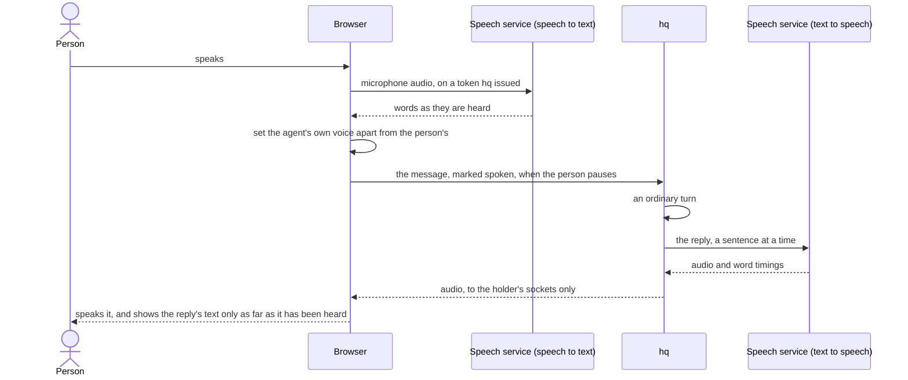

# Voice

Voice is a **mode of the conversation**, not a screen of its own. The thread stays on screen, the words stream into it,
and a spoken turn is an ordinary turn: it is admitted, queued, answered and recorded like a typed one, so it can start
work and hear results.



## The speech models and the voice

Voice is not optional: every organisation has a working speech-to-text and a working text-to-speech
[provider](../providers/providers.md) from [setup](../setup/setup-flow.md) on, and every agent has a voice. What is
chosen is narrow on purpose.

| | What it is | Chosen by |
|---|---|---|
| **Speaking** | Always **Inworld TTS 2**, the one speech model voice supports, because voice steers its emotion to keep a reply continuous | Nobody; only the voice is chosen |
| **The voice** | One of the voices in Inworld's own list for the organisation's text-to-speech provider, each with a play button that speaks a short sample phrase in it. The default is Alistair | The organisation (its default), and an agent (its own) |
| **Listening** | One of AssemblyAI's three live models: **Universal-3 Pro** (32 languages, the most accurate and the default), **Universal-Streaming** (English only) or **Universal-Streaming Multilingual** (6 languages), each shown with its price | The organisation (its default), and an agent (its own) |

The voice and the listening model are set with the other [model choices](../models/models.md): the organisation's on
**Manage organisation › Models**, an agent's own on its page in the admin area. A voice is chosen by ear in a dialog
that filters the list (by language, gender and the like) and plays each sample. The sample phrase is written by the
organisation's default model and costed to the organisation. A voice left as the organisation's follows it.

The voice button in the message box is greyed, with the reason on selecting it, when the person may not speak in the
conversation, the agent no longer exists, **voice is down** (no speech-to-text or text-to-speech provider works, said as
an outage and not as a setting, with an organisation admin told), no model serves the conversation, or someone else holds
voice in it. Anyone who may speak in the conversation may start voice.

**One person holds voice at a time**, recorded on the conversation. Voice starts and ends write a quiet line into the
thread (*Voice · 10:58*, *Voice ended · 4 min*) that every client reads from the record. In a task's thread, another
person's typed message is answered in text for all to read, never spoken.

## A spoken turn

- **Speech to text runs in the browser**, straight to the organisation's speech service, on a short-lived token hq
  issues. What is heard streams into the person's own message and is sent when they pause, on the service's own end of
  turn. The message is marked *spoken*, which the lead reads and the screen does not show.
- **Sent once, whole.** A turn the service ends mid-sentence is held, shown as still being said, and continued by the next
  words; it is sent when the person stays quiet. Words already sent are not sent twice, and a single stray word heard
  just after a message is not sent on its own. The browser takes a fresh connection to the speech service for each
  message, because one that streams for long falls further behind, and sends nothing in bursts.
- **The agent's own voice is kept out.** With laptop speakers the microphone hears the agent. Word by word, the
  browser sets apart words of the sentence being spoken (or the one just before it), and other words heard over
  the audio when fewer than two come in a row, and keeps from the first word that is neither. Echo cancellation in the
  browser does most of this; this does the rest. It is not perfect.
- **Text to speech runs in hq**, from the lead's stream, a sentence at a time with word timings, in the agent's voice.
  Audio goes only to the holder's sockets and is never stored.
- **The reply fills in step with the voice**: its bubble shows text only as far as it has been spoken, never ahead,
  nothing highlighted.
- **Interrupting.** The person speaking over the reply stops the audio at once and cancels the turn; the record keeps the
  sentences that were heard, marked *interrupted*, and the voice session stays up.
- **Two minutes of silence** on both sides ends voice, warned fifteen seconds before. If speech to text stops, voice ends
  with a line saying why and the conversation carries on typed; if text to speech fails mid-reply, the reply finishes as
  text with one line why.

## The message box

One pill: a plus (holding the model), the text, a microphone and one button on the right: voice when the box is empty,
Send with text, Stop while a reply is being written. The **microphone** is **dictation**: what is heard goes into the box
as text as it is spoken, each stretch rewritten in place when the service formats it, for the person to read, fix and
send. Nothing is sent by itself. In voice, **Mute** and **End** stand beside the pill and step aside while the person
types; a typed message in voice is answered aloud to the holder. A ring on the pill and a glow behind the thread show who
is talking.

## How the lead speaks in voice

The turn block says the person is listening, and the lead's instructions give a register: short turns, one point then
handing back, plain prose with no headings, lists, tables, code or markup, numbers and names in words, a result in one
sentence with the detail offered.

**Shown parts** carry what must be seen. The lead wraps a diagram, table, code or long list in a fenced block with a
title, a one-sentence spoken line, and the body:

```
:::shown The three steps
> I've put a diagram in the thread that shows the three steps; tap it to open.
…the body, in ordinary markup…
:::
```

Voice speaks the line and skips the body. On screen it is a card; opening it shows the body beside the thread (in a sheet
on a phone) without stopping the voice. Outside voice the same block is shown inline. If the lead writes markup in voice
anyway, voice strips what cannot be read.

## Work and approvals in voice

A background result takes its report turn after the current turn, and its speech starts after the current sentence,
never over it. A request for an okay is shown in the work bar and does not take a turn.

### Approval by voice

A spoken yes counts only after the lead has read the action back in one sentence (*Approving:
deploy to staging. Yes?*) and the person said yes to that; the answer is recorded as spoken, with what was said. A
read-back stands for ten minutes.

## Leaving the conversation

Going to another page keeps voice on: a slim bar at the top of every page shows the agent, who is talking and the work
under way, with Mute and End, and returns to the thread when selected. Closing the tab ends voice; a running turn
finishes as text.

## Not reliable on every setup

Voice is unreliable on laptop speakers: the agent can still hear itself, or lose the person's words. It is a known bug.
Headphones avoid it.

## Where in the code

| Concern | Path |
|---|---|
| Taking and ending voice, the holder, silence | `hq/src/conversations/voice/service.ts`, `holder.ts`, `registry.ts` |
| A reply spoken sentence by sentence; interruption | `hq/src/conversations/voice/session.ts`, `speechUnits.ts`, `speech.ts` |
| Approval by read-back | `hq/src/conversations/voice/readBack.ts` |
| The browser's voice session, echo, utterances, fresh sockets, reveal | `hq/src/conversations/voiceClient/` |
| Dictation | `hq/src/conversations/hooks/useDictation.ts`, `dictationText.ts` |
| Shown parts | `hq/src/shared/conversations/shownParts.ts` |
| The speech models, the voice list and sample, the provider's key for a call | `hq/src/voice/` (`voiceModels.ts`, `speechAccess.ts`, `voiceSettingsQueries.ts`, `voicePreviewAction.ts`) |
| Choosing the voice and the listening model | `hq/src/models-settings/components/VoiceRow.tsx`, `ListeningRow.tsx` |
| Costing a spoken or heard call | `hq/src/billing/sources/voice.ts` ([billing](../billing/billing.md)) |
