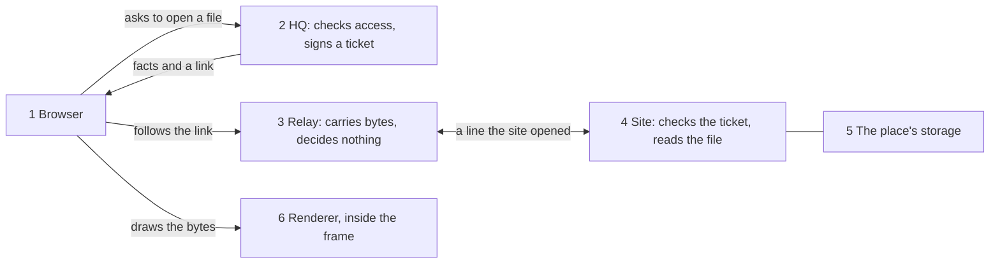

# Opening a file

How a person sees a file an agent made, without the file passing through hq. For what each kind of storage keeps and
who may read it, see [file-sharing.md](file-sharing.md); for how a file is named in a message, see
[references-and-chips.md](references-and-chips.md).

**hq decides, relays carry, sites hold.** hq checks that the person may read the file and signs a short-lived permission
for that one file. A relay carries the bytes from the site to the browser. The site checks the permission and serves only
what it names. No file byte passes through hq's server, and a site listens on nothing: it dials out to its relay.

1. The **browser** is the person's. It is given a link and nothing else.
2. **hq** checks access before it asks any site anything, finds the site that holds the file, asks it only *about* the file
   (its size, when it changed, whether it looks like text), chooses the file's kind, signs a ticket and records that it did.
3. The **relay** answers on the *files address*, a web address of its own, so a file opened there can never act as the person
   in hq.
4. The **site** verifies the ticket with hq's public key and reads the file from inside the place's storage.
5. The **place's storage** is where the file is. Symbolic links are never followed out of it.
6. The **renderer** draws the bytes. It is given the file's facts and bytes and nothing else.

## Terms

| Term | What it is |
|---|---|
| **Ticket** | hq's signed permission for one file at one version, for one purpose (to preview it or to download it), for one person. It lasts five minutes and travels in the link. Only hq can make one: sites check it with hq's public key, and a relay cannot make one ([ADR-0153](../../adr/adr-0153-relays-carry-every-file-byte-and-hq-only-signs-tickets.md)) |
| **Relay** | A member of the [fleet](../fleet/fleet.md) that carries bytes between browsers and the sites assigned to it and decides nothing. Not the *model relay*, the site's endpoint that forwards model requests. hq's own relay is always there |
| **Files address** | The name a relay answers on, such as `files.example.com`: another origin from the one people use for hq. See [deployment](../../architecture/deployment.md) |
| **Kind** | What a file is drawn as: Markdown, text, code, JSON, table (CSV), image, PDF, or none. Chosen in one place, from the file's name and from whether its first bytes look like text |
| **Renderer** | What draws one or more kinds. A renderer is added by adding an entry to one list, never by changing the frame ([ADR-0155](../../adr/adr-0155-a-file-is-drawn-only-by-a-renderer-behind-one-boundary.md)) |
| **The frame** | What Agenthix draws around a renderer: one header (back, title, Download, Full screen, the ⋯ menu), the facts line, and every state a file can be in |
| **File viewer** | Where a file opens when it is selected where it is mentioned: over the whole area between the menu and the chat, which stays beside it |
| **Opened, embedded** | A file shown on its own, filling its area, or shown inside a page or a message, bounded and without controls |

## What a ticket guards

A ticket names one file at the version it had when the ticket was made. If the file changes after that, the site refuses
the ticket and the frame says the file changed, offering to show the new version. A ticket's link works for its five
minutes so that a PDF viewer can read the file a part at a time. A copied link stops working when the ticket expires, and
hq records every ticket it signs, so it is known who opened what. Losing access to a place does not recall a ticket that
was already signed: it ends within minutes.

## A file's stable link

A file's **stable link** is its address in hq: the place, the tool and the path, such as
`/projects/ALPHA?tool=files&file=reports/q3.pdf`. It never names a site, a relay or a ticket, so it keeps working when a
site moves, and a person who may not see the place gets the place's ordinary "not found", never the file's name. A
ticket is made only when the link is opened. Where a file's link is:

| The file is in | Its link has |
|---|---|
| A project's or a person's Files | `tool=files&file=<path>` |
| An artefact | `tool=artefacts&artefact=<name>` |
| A workspace | `tool=workspaces&workspace=<id>&wfile=<path>` |
| A task's own folder or one of its attachments | `task=<key>&file=<path>`, or `task=<key>&attachment=<id>` |

## What a renderer can do

A renderer is given the file's facts and a way to read its bytes, and reports back one of three things: it is ready, it
showed only part of the file, or it failed (unreadable, too large, changed, unavailable). It never draws its own error:
the frame turns the report into words and offers Download. Text-like kinds are drawn in the page, as text and never as
markup. A PDF is drawn by a viewer page on the files address, where there is no hq session.

| Kind | Read at most |
|---|---|
| Text, Markdown, code | 1 MB; code is highlighted to 512 KB |
| JSON | 5 MB as a tree; beyond, the first 1 MB as the whole records in it, each folded to one line |
| Table (CSV) | 10,000 rows, 5 MB; a table shown in part is not sortable |
| Image | 20 MB |
| PDF | 50 MB, read by range |

A file shown only in part says so, with the part and the whole, and offers Download. A file with nothing in it says it is
empty. A download has no cap. A file with no renderer, such as a ZIP, still downloads. Where hq has no files address, a PDF cannot
be previewed, because nothing may be drawn inline on hq's own address; it can still be downloaded.

## The file viewer

A file opened where it is mentioned (a chip in a conversation, a task's attachment, working file or description, a link in
a page) opens in one **file viewer**, not in a place of its own for each: over the whole area between the menu and the
chat, with the page underneath unchanged. The conversation stays beside it, at a medium width too, where it otherwise
slides over the page; minimising it gives the file the full width, and the choice holds from file to file. Below a
medium width, a phone, the viewer is the whole screen. Its header is the frame's, the same everywhere: back, named for where
the person came from, then Download, Full screen and the ⋯ menu. The address holds the open file, so the browser's Back
closes the viewer and a copied address opens the same file again. The Files tool and a workspace's files are the file's
home for browsing instead: opening a file there folds the tree away and puts the same header on it. A workspace's git
changes keep their diff view, and what an agent shows beside a voice conversation stays in the conversation's panel.

## A workspace's file at a version

A workspace with Git is read at one commit: a branch's latest, `main`'s, or one of `main`'s older versions. A file there is
opened as any file is, with the commit named in its reference; the site reads it from the workspace's repository, and a
ticket for it names that one version of the file. So the same previews, frame, states and Download apply, and a past
version cannot read as changed. A site too old to read a file at a commit says it must be upgraded.

## A file that cannot be opened for safety

A file with more than one hard link is the same file as one somewhere else on the machine, so a site cannot be sure it is
inside the place. It is listed but never opened or downloaded, and the frame says why and offers **Ask the agent**, which
puts a request to save the file again as an ordinary copy in the conversation's message box.

## Who may open what

- **A file in a place** (Files, a workspace, a task's folder, an artefact): anyone who may read the place. A person's own
  space is theirs alone; a project's files are for its members and viewers. hq checks this before it asks the site.
- **A task's attachment**: a member of the task's project.
- **A picture** of an agent, person or team: anyone signed in. The organisation's picture and cover are also shown, without
  signing in, while an admin has chosen to show the whole cover on the sign-in page.

When someone may not open a file, or it is not there, the answer does not say which.

## When a relay is not answering

hq has no second way to carry bytes. When a relay is not answering, opening a file says so, naming the site and the
relay ("hq-box · HQ's relay"), and offers Try again; Download is unavailable too. Everything else in hq keeps working,
including browsing a folder, because a listing is not file bytes. hq's relay runs on hq's machine, so when it is down that
machine is not well.
