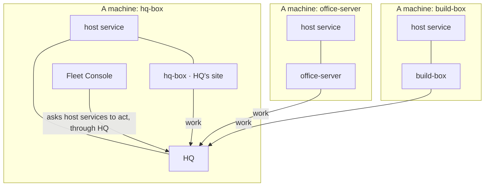

# The fleet

The **fleet** is the machines an organisation's Agenthix runs on, and what runs on each: its HQ, its Execution Sites,
and the host service on every machine. People who use Agenthix meet only HQ and, through it, where their work runs;
the people who look after the machines meet the fleet through the **Fleet Console**. How it is built is
[host-management.md](../../architecture/host-management.md); installing it is
[deployment.md](../../architecture/deployment.md).

## What is in it

| Thing | What it is |
|---|---|
| **HQ** | The organisation's own instance: its people, projects, agents and data ([ADR-0042](../../adr/adr-0042-hq-is-the-orgs-own.md)). One per organisation, on one machine |
| **Site** | An Execution Site: where agents run and the projects' files are kept. HQ's machine always carries one, *HQ's site*; every other site is on a machine of its own |
| **Machine** | A computer or virtual machine running a host service. It carries at most one HQ and at most one site ([ADR-0108](../../adr/adr-0108-a-machine-carries-at-most-one-hq-and-one-site.md)). A second organisation is a second machine |
| **Host service** | The one service on each machine that installs, upgrades, backs up, restores, moves and erases what runs there, holds the machine's capacity, and keeps agents off the machine itself. Nothing else has authority over the machine ([ADR-0107](../../adr/adr-0107-the-host-service-alone-holds-a-machines-authority.md)) |
| **Fleet Console** | The fleet admins' screens for the whole fleet. It runs beside HQ by default, opens only on its own machine (bar remote access on a machine Agenthix Cloud runs), has no accounts and no authority of its own: it asks host services to act, and HQ passes each request on without being able to read it ([ADR-0109](../../adr/adr-0109-the-host-manager-is-a-site-that-signs-its-commands.md)) |

**A site is named after its machine** — *office-server* — in the Fleet Console, in HQ and on the machine. When a site
moves to another machine, or is restored onto one, it takes that machine's name. HQ's own site is shown with a tag,
*hq-box · HQ's site*. A name is a label only: machines are told apart and trusted by their fingerprints.

## Who looks after what

Three kinds of administrator, each granted and checked on its own; one person may be all three.

| Role | Who | Looks after | Never |
|---|---|---|---|
| **Organisation admin** | An HQ account with the organisation `ADMIN` role ([who may do what](../README.md#who-may-do-what)) | People, projects, agents, settings. Sees each site's state in HQ, read-only, with its cause and who acts | Adds, removes or changes a machine or a site |
| **Fleet admin** | An HQ account holding the fleet admin role ([ADR-0110](../../adr/adr-0110-fleet-admin-is-a-role-on-hq-accounts.md)) | The machines and sites, in the Fleet Console: adding a site, maintenance, backups, moves. In HQ, also sees a site's figures, versions and logs | The organisation's people, projects or work, by this role alone |
| **Machine admin** | Whoever can use Docker on a machine. Not an account in Agenthix | That one machine, through its command line, `agenthix …` | Anything on another machine |

- **The first account**, made when Agenthix is installed, holds both the organisation admin and fleet admin roles.
- **The fleet admin role is given only by a fleet admin** (in the Fleet Console, under *Fleet admins*) **or by a machine
  admin of HQ's machine** (`agenthix hq fleet-admin <user>`), which is also how it comes back when nobody holds it. An
  organisation admin cannot give it. Every grant and removal is announced to every fleet admin and organisation admin.
- **When a site goes down**, organisation admins see in HQ that it is down and why, and fleet admins are told what to
  do. Members see only what affects their work: a notice of planned maintenance on their projects, or a run that says
  it is waiting.

## What a fleet admin does

In the Fleet Console (`console-web/`): **Dashboard**, the whole fleet at a glance; **HQ** and a page for each site;
**Maintenance**, to plan an upgrade, a change of capacity, a move or a suspend, now or at a set time; **Backups**;
**Activity**, the record of what fleet admins did; **Fleet admins**; and **Help**, the guide's running pages built
in.

- **Adding a site.** *Add a site* gives a one-time code; on the new machine, its machine admin runs
  `agenthix console connect <hq address> <code>`; the two compare the machine's fingerprint, and the fleet admin
  confirms. The site starts and takes part at once.
- **Maintenance.** Each change is done now, or scheduled. From the moment it is scheduled, HQ tells the members whose
  work it affects; a few minutes before, it starts no new runs there and pauses those going; afterwards they carry on.
  An upgrade takes a backup first and is put back if what it upgraded does not come up healthy.
- **Backups.** Every machine backs itself up each night, sealed. A copy can also go to a folder of the organisation's
  choosing — chosen only on the machine itself, unless Agenthix Cloud runs the machine and sets it — and any backup can
  be exported, sealed to a key shown once.
- **Restoring a lost site.** *Add a site › Restore from a backup…* brings a site whose machine is lost back on a new
  machine, as itself; the old machine is refused if it ever comes back.
- **Moving.** A site moves to a new machine, and HQ to a new machine or a new address, keeping everything; the sites
  and machines follow HQ by themselves.
- **A machine that stops answering.** When HQ has not heard from a machine for 10 minutes, fleet admins are asked to
  look, unless the machine was stopped on purpose or its fleet admins chose not to be told about it.

## Agenthix Cloud

**Agenthix Cloud** is the hosted service from the makers of Agenthix. The fleet works the same without it, and two
separate things connect to it. A **machine Cloud runs** has Cloud as its controller instead of a Fleet Console: Cloud
sets its backup location, front door certificate and maintenance window, can pause HQ and its site so the machine can be
resized, makes the sign-in links a new HQ there needs, and, while it has remote access on, lets a fleet admin open the
Fleet Console from chosen addresses with an authenticator code ([host-management.md](../../architecture/host-management.md#agenthix-clouds-controller)).
Such a machine's sites show as Cloud's in HQ, and their figures are shown to no one. Separately, an organisation's **HQ**
can connect to Cloud, from the Fleet Console's own machine, so that people can sign in to HQ with an Agenthix account
they have linked, and Cloud can email them before planned downtime ([cloud-connection.md](../../architecture/cloud-connection.md)).
Nothing Cloud does replaces a password or makes an account.

## Where to read more

| You want | Read |
|---|---|
| How each part works and is checked | [host-management.md](../../architecture/host-management.md) |
| Every credential the fleet uses | [identity-and-trust.md](../../architecture/identity-and-trust.md#machines-and-the-fleet) |
| How sites connect to HQ | [control-channel.md](../../architecture/control-channel.md#how-a-site-takes-part) |
| Installing, the network, a front door | [deployment.md](../../architecture/deployment.md) |
| Doing it, step by step | the user guide's *Running Agenthix* pages, `docs/guide/running-agenthix/` |
