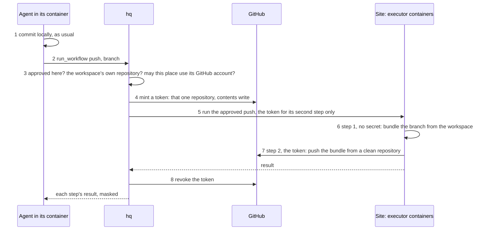

# Git Access

How a git repository is connected to storage, which GitHub accounts a place can use, and how an agent pushes and pulls
without its container ever holding a token.

**A repository belongs to a storage location, and a token is only ever minted for that location's own repository.**
There is no per-agent key, no key per project, and nothing an agent can call that hands it a token. A product owns no
repository ([ADR-0061](../../adr/adr-0061-a-product-and-a-programme-group-work-and-own-nothing.md)).

---

## The pieces

- **A repository attachment** links a GitHub repository to one location in a storage: a workspace, or an owner's
  `files/` folder. It is a `RepoAttachment` row on the site that holds the storage (`site/schema.prisma`), recording
  GitHub's ids for the installation, the account and the repository; the checkout is the folder itself. A location
  has at most one repository. See [Storage and Workspaces](../workspace/workspace.md).
- **The organisation's GitHub App.** One App per HQ, registered from hq, whose private key only hq holds, encrypted.
  Its permissions are a ceiling the organisation sets on GitHub; each token gets only part of it.
- **GitHub accounts.** A GitHub organisation, or a person's GitHub account, where the App is installed (GitHub calls it
  an *installation*): the organisation's own, and others', such as a client's. hq stores them as `GitHubInstallation`
  rows, each with its rule for which places may connect.
- **The mint gate.** The one check every token passes: the repository comes from the location's own attachment, the
  place must still be allowed to use that account, accounts and repositories are matched by GitHub's ids, and the token
  reaches that one repository with only the permissions named
  ([the mint gate](../../architecture/workflows.md#the-mint-gate)).

## Several GitHub accounts, and which places can connect

| | Step | Who, and where |
|---|---|---|
| 1 | Register the App, once | An organisation administrator, on *Manage organisation › Settings › GitHub*; hq sends GitHub an App manifest and GitHub creates the App |
| 2 | Install the App on a GitHub account, on all repositories or some | An owner of that account, on GitHub, from the App's page or an **install link** hq makes, with a note ready to send to a client |
| 3 | Allow it, and say which places can connect | An organisation administrator, on the same page |
| 4 | Set the project's default account | A project administrator, in the project's GitHub section |
| 5 | Connect a workspace's repository | A project administrator, in the workspace; for a person's own storage, that person |

- **A new installation waits.** The App can be installed by anyone, so a new account shows as *wants to connect* and is
  not used until an administrator allows it. After GitHub sends the person back, hq looks for the new installation for
  up to a minute, so nobody has to refresh.
- **Which places can connect**, set per account: every shared project, or chosen projects; and, separately, chosen
  people. A person's own storage and their personal projects are never part of *every project*: they can connect to an
  account only when an administrator has chosen that person, so a member cannot link someone else's repository into
  their own work and approve workflows there.
- **The rule is checked at every mint**, not only when a repository is connected, so narrowing it takes effect at once.
- **A client stays in control.** They change what the App reaches, or remove it, in their own GitHub settings, and
  access stops there and then. They need no Agenthix account.

## Connecting a repository

From a workspace, from Files' *Back up to GitHub*, or when making a workspace: one flow, with the same checks
(`hq/src/storage/actions.ts`, `repoAttachmentService.ts`, `hq/src/github/connect/`).

| Mode | The folder is | What happens |
|---|---|---|
| A new repository | The source of truth | A private repository is created on the chosen account and the folder pushed up. Offered only where the installation reaches all repositories, since a repository the App creates is not part of a selection; the screen says how an owner of that account can change it |
| An existing repository | Either | Pulled into an empty location; pushed into an empty repository, or one that shares the folder's history; refused plainly otherwise, never overwritten. A folder with history of its own keeps its branches, and only its `main` is pushed |

- **The account** starts at the project's default and can be changed to any other the project may connect to.
- **Checked before anything is created:** that the account can take a new repository and that the name is free. If a
  later step fails anyway, hq deletes the repository it just created, or names it if it cannot.
- **The starter workflows are proposed** as soon as it is connected.
- **Disconnecting** removes the attachment and keeps the folder and its files.

Connecting runs git on the site that holds the storage, never in hq and never in an agent's container, with a token
from the mint gate passed to git for that one call and never written to `.git/config`
(`site/src/server/storage/repoWorkMethods.ts`, `site/src/storage/repoOps.ts`; contract in `core/src/protocol/repoWork.ts`).

## Working with the repository

The agent commits in its workspace as usual. Everything that talks to GitHub is a [workflow](../workflows/workflows.md):

| Workflow | Does | Its token may |
|---|---|---|
| `push` | Bundles a branch with no secret, then pushes the bundle from a clean repository. Never forces, never to a protected branch | Write contents |
| `pull` | Fetches into a clean repository with the token, then fast-forwards the workspace from the bundle with no secret | Read contents |
| `open-pull-request` | `gh pr create` for a branch, with a title and body. Never from a protected branch | Write pull requests, read contents |
| `set-github-secrets` | Sets the named secrets as environment secrets on a GitHub environment limited to protected branches | Write environments |

A plain `git push` in the agent's container fails with a message naming the `push` workflow. The repository's address
always comes from hq, never from the workspace's `remote.origin.url`, and git with a token never runs in the agent's
own repository, whose config and hooks the agent controls. A workflow can also start a GitHub workflow
(`gh workflow run`), with its own declared permission; hq has no other way to start one.

## Commit authorship

Connecting a repository commits under one generic identity (`site/src/storage/repoOps.ts`). The agent's own commits use
whatever git identity the container is configured with. A convention that would name the acting agent and person on
each commit is specified in [GitHub commit authorship](../workspace/github-commit-authorship.md) and is **not built**.

## What must not break

- No GitHub token is ever in an agent's container, its workspace or a site's database.
- Every token passes the mint gate, names its permissions, reaches one repository and, for a workflow, is revoked when
  the run ends.
- hq decides which places may use which account, at every mint; the site never decides that for itself.

## Where in the code

| What | Where |
|---|---|
| Connect, disconnect, who may | `hq/src/storage/actions.ts`, `repoAttachmentService.ts`; `hq/src/github/connect/`, `connectChecks.ts` |
| The App, its registration and accounts | `hq/src/github/githubApp.ts`, `githubAppRegistrationAction.ts`, `accountOps.ts`, `pages/GitHubInstallationsPage.tsx` |
| Which places may connect | `hq/src/github/connectRule.ts` |
| The mint gate | `hq/src/github/mintGate.ts`, `mintGateConnect.ts` |
| Protected branches, environments | `hq/src/github/protectedBranches.ts`, `githubEnvironment.ts` |
| The starter workflows | `hq/src/workflows/starters/`, `site/docker/executor/push-bundle` |
| Running git to connect | `site/src/server/storage/repoWorkMethods.ts`, `site/src/storage/repoOps.ts` |

## Decisions behind this

[ADR-0039](../../adr/adr-0039-files-and-workspaces.md) (repository as an attachment over a location) ·
[ADR-0060](../../adr/adr-0060-authority-comes-from-the-boundary.md) ·
[ADR-0061](../../adr/adr-0061-a-product-and-a-programme-group-work-and-own-nothing.md) ·
[ADR-0147](../../adr/adr-0147-a-secret-is-used-only-by-a-workflow-a-person-approved-run-by-the-platform.md)
