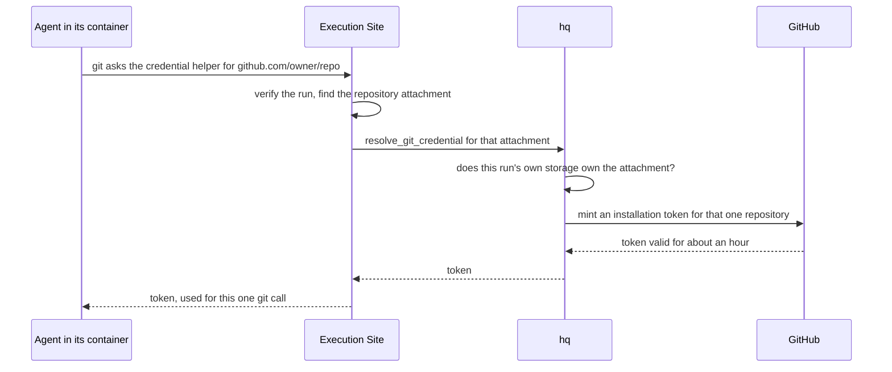

# Git Access

How a git repository is connected to storage, and how an agent gets to push and pull without ever holding
a long-lived secret.

**A repository belongs to a storage, and a run may use it only if its own storage owns it.** There is no
per-agent key, no key per project, and no tool an agent calls to request access. A product owns no
repository ([ADR-0061](../../adr/adr-0061-a-product-and-a-programme-group-work-and-own-nothing.md)).

---

## The pieces

- **A repository attachment** links a GitHub repository to one location in a storage: a workspace, or an
  owner's `files/` folder. It is a `RepoAttachment` row on the site that holds the storage (`site/schema.prisma`);
  the checkout is the folder itself. A workspace has at most one repository, and so does an owner's
  `files/`. See [Storage and Workspaces](../workspace/workspace.md).
- **The organisation's GitHub App.** One GitHub App per organisation, registered from hq, whose private
  key only hq holds, encrypted. It is what gives hq the right to create repositories and to mint tokens.
  hq stores the App and the accounts it is installed on as `GitHubApp` and `GitHubInstallation`
  (`hq/schema.prisma`).
- **Short-lived tokens.** hq mints an installation token scoped to one repository for each use, valid for
  about an hour (`hq/src/github/githubApp.ts`). The token is never written to `.git/config`.

## Setting it up

1. **An administrator registers the GitHub App** under Organisation › Infrastructure › GitHub App
   (`/org/infrastructure/github-app`, `hq/src/github/pages/GitHubAppPage.tsx`) — one App per HQ, tied to
   its address. hq sends GitHub an App Manifest, GitHub creates the App and hands its keys back
   (`hq/src/github/githubAppRegistrationAction.ts`, `githubAppApi.ts`); disconnect there removes it. The
   administrator then installs it on the organisation's accounts under Organisation › Settings › GitHub
   (`/org/settings/github`, `hq/src/github/pages/GitHubInstallationsPage.tsx`), where Refresh re-reads where
   it is installed.
2. **Someone connects a repository to a location.** Who: a **project's administrator** for a project's
   storage, and the **person themselves** for their own (`hq/src/storage/actions.ts`,
   `assertMayAdministerAttachment`). A project member who is not an administrator can use the storage but
   cannot attach or detach its repository. A project's page for this is `/projects/:key/github`. There are
   three ways in (`hq/src/storage/repoAttachmentService.ts`):

| Mode | The folder is | What happens |
|---|---|---|
| Create a new repository | The source of truth | A new private repository is created and the folder is pushed up. Needs the App installed on an organisation; a personal account cannot create one. |
| Adopt an existing repository | The source of truth | The folder is pushed up to a repository that already exists. |
| Link an existing repository | Empty, waiting | The repository is pulled down into the empty folder. |

   Disconnecting removes the attachment and keeps the folder and its files.

All git commands run on the site that holds the storage, never in hq: hq checks the person may do it and
mints the token, and the site runs git with the token for that one call
(`site/src/server/storage/repoWorkMethods.ts`, `site/src/storage/repoOps.ts`; contract in
`core/src/protocol/repoWork.ts`).

## Agents pushing and pulling

Inside the agent's container, git is configured with a credential helper
(`site/docker/agenthix-git-credential`) that answers only for `github.com`. It calls the site's
`POST /api/v1/git/credential` (`site/src/server/git/gitCredentialApi.ts`), which asks hq; the check on
hq's side is `hq/src/storage/gitGrantService.ts`:

- A run in a **project** may use the repositories attached to that project.
- A run in a person's **own storage** may use the repositories attached to that person's storage.
- A run with no storage to act in is refused.
- A task in a person's **personal project** runs as that person in their own storage, so it may use the repositories attached to that person's storage, and no one else's ([personal projects](../projects/personal-projects.md)).
- Being assigned to a project grants nothing; only the storage the run is working in counts
  ([ADR-0060](../../adr/adr-0060-authority-comes-from-the-boundary.md)).

The mechanism, including how the platform token is checked, is in
[Identity and Trust](../../architecture/identity-and-trust.md#git).

## Commit authorship

Connecting a repository commits under one generic identity (`site/src/storage/repoOps.ts`). The agent's
own commits use whatever git identity the container is configured with. A convention that would name the
acting agent and person on each commit is specified in
[GitHub commit authorship](../workspace/github-commit-authorship.md) and is **not built**.

## What must not break

- A token is minted per use, for one repository, and is never stored on a site or in a container's files.
- hq decides whether a run may use an attachment; the site never decides that for itself.
- A failure after a new repository is created on GitHub can leave an empty repository behind that nothing
  removes; the code says so in `repoAttachmentService.ts`.

## Where in the code

| What | Where |
|---|---|
| Connect, disconnect, who may | `hq/src/storage/actions.ts`, `repoAttachmentService.ts`, `github.ts` |
| The GitHub App and token minting | `hq/src/github/` |
| Registering the App; installing it | `hq/src/github/pages/GitHubAppPage.tsx`; `GitHubInstallationsPage.tsx` |
| Which run may use which attachment | `hq/src/storage/gitGrantService.ts` |
| Running git | `site/src/server/storage/repoWorkMethods.ts`, `site/src/storage/repoOps.ts` |
| The credential helper and its endpoint | `site/docker/agenthix-git-credential`, `site/src/server/git/gitCredentialApi.ts` |

## Decisions behind this

[ADR-0039](../../adr/adr-0039-files-and-workspaces.md) (repository as an attachment over a location) ·
[ADR-0060](../../adr/adr-0060-authority-comes-from-the-boundary.md) ·
[ADR-0061](../../adr/adr-0061-a-product-and-a-programme-group-work-and-own-nothing.md)
